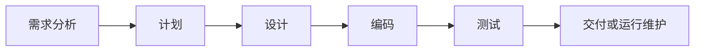
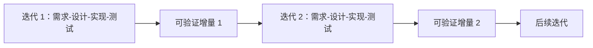
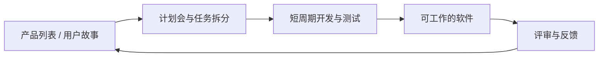

> 描述：本节整理软件生命周期的三个时期和八个阶段，对比瀑布、螺旋、迭代、增量与敏捷模型，完整转写课件过程图和敏捷看板，并总结经典 SW-CMM 的五个成熟度等级。

## 2.1 软件生命周期

### 2.1.1 三个时期

| 时期 | 主要回答的问题 | 对应活动 |
| --- | --- | --- |
| 软件定义时期 | 做什么，是否值得做 | 问题定义、可行性研究、需求分析 |
| 软件开发时期 | 怎样实现 | 概要设计、详细设计、编程、测试 |
| 软件维护时期 | 如何持续运行和演化 | 运行维护 |

### 2.1.2 八个阶段

1. **问题定义**：明确问题、目标、范围和边界。
2. **可行性研究**：分析技术、经济、操作、法律和进度可行性。
3. **需求分析**：确定系统必须提供的功能和质量属性。
4. **概要设计**：形成总体架构、模块划分、数据和接口方案。
5. **详细设计**：细化模块内部算法、数据结构和接口细节。
6. **编程**：把设计转换为可执行程序。
7. **测试**：验证和确认软件，发现与修复缺陷。
8. **运行维护**：部署、监控、纠错、适应、完善和预防性维护。

生命周期描述软件从提出到退役的阶段；过程模型则规定这些活动怎样组织、先后如何、是否迭代以及怎样交付。

## 2.2 瀑布模型

### 2.2.1 核心结构

瀑布模型是最早的软件过程模型之一，按相对固定的顺序推进：



主要特点：

+ 每一主要阶段通常执行一次，整体呈线性顺序。
+ 前一阶段的输出文档是后一阶段的重要输入。
+ 每阶段都要产生规定的文档、基线或交付物。
+ 阶段结束前进行评审，形成项目检查点。

> **WARNING**
> 课件采用“瀑布模型缺少运行维护”的简化图。不同教材的传统瀑布模型常把运行与维护也列为最后阶段，因此“是否包含维护”不是区分瀑布模型与生命周期的本质标准；本质是阶段顺序、文档驱动和较弱的迭代反馈。

### 2.2.2 优点

+ 阶段和里程碑清晰，便于计划、分工、评审与合同管理。
+ 强调早期需求调查和总体计划。
+ 每阶段有文档，便于追踪、审计和交接。
+ 强调在交付前进行系统测试。

### 2.2.3 缺点

+ 可运行结果较晚出现，风险可能到后期才暴露。
+ 需求需要在早期相对稳定，但实际需求常复杂多变。
+ 反馈路径长，开发经验和用户意见难以及时作用于当前版本。
+ 后期发现需求或架构错误时，返工代价很高。

### 2.2.4 适用场景

适用于需求明确、变更少、技术成熟、合规文档要求高且阶段边界清晰的项目。

## 2.3 螺旋模型

### 2.3.1 核心思想

螺旋模型是风险驱动的演进模型，把原型、迭代和系统化开发结合起来。每转一圈形成更完整的版本，并显式分析风险。

每圈通常包括四类活动：

1. **制定计划**：确定本轮目标、候选方案和约束。
2. **风险分析**：评价方案，识别并消除关键风险，必要时构造原型。
3. **实施工程**：开发、验证本轮产品，包含需求确认、设计、编码、单元测试、集成和验收等活动。
4. **客户评估与下轮计划**：评审提交结果，决定是否继续和下一轮范围。

课件螺旋图中：

+ 半径向外表示项目逐步推进和累计成本增加。
+ 每圈经过目标/约束、风险分析、实施、评审四个象限。
+ 原型 1、2、3 到可运行原型逐步降低需求和技术风险。
+ 需求计划、生命周期计划、开发计划在不同轮次持续细化。

### 2.3.2 优点与风险

+ 适合大型、高风险、需求或技术不确定的项目。
+ 通过原型和多轮用户评价应对需求变化。
+ 风险在每轮都被识别和处理，不必等到测试阶段。
+ 测试随迭代持续进行，回归测试很重要。

缺点是管理复杂、成本较高，并高度依赖风险识别与评估能力；小型低风险项目使用可能得不偿失。

## 2.4 迭代模型

一次迭代要相对完整地经过主要工作流，至少包含需求、分析设计、实现和测试，可看作一个时间较短的小型开发周期。



特点：

+ 每轮根据反馈修正需求、设计和实现。
+ 每轮产生一个可运行、可测试的产品增量，功能逐渐完善。
+ 早期即可暴露需求、架构和集成风险。

> **NOTE**
> “每次迭代都产生可发布产品”通常指达到潜在可发布或可演示状态，不代表每轮都必须对外正式发布。

## 2.5 增量模型

### 2.5.1 核心结构

增量模型把系统按功能分为多个增量构件，逐个创建、测试和交付，直到完整系统形成。

```text
增量 1：分析 -> 设计 -> 编码 -> 测试 -> 核心产品
增量 2：  分析 -> 设计 -> 编码 -> 测试 -> 新增功能
增量 3：    分析 -> 设计 -> 编码 -> 测试 -> 新增功能
增量 4：      分析 -> 设计 -> 编码 -> 测试 -> 完整系统
```

它综合线性过程流与并行过程流：每个增量内部可以采用类似瀑布的线性序列，不同增量在时间上可交错推进。

### 2.5.2 优点

+ 初期不必一次投入全部人力和成本。
+ 先交付核心产品，用户更早获得价值并提供反馈。
+ 高风险或高优先级能力可以有计划地先实施。
+ 需求变化可安排到后续增量。

### 2.5.3 缺点与适用条件

+ 系统需要开放、稳定且可扩展的总体架构。
+ 增量边界划分不当会造成接口混乱、重复开发和集成困难。
+ 只追求局部交付而忽视整体设计，可能降低设计质量和开发效率。

适合能够按业务价值拆分、需要早期交付、需求会逐步变化的系统。

### 2.5.4 迭代与增量的区别

+ **迭代**强调反复修改和深化同一产品，逐轮提高正确性与质量。
+ **增量**强调逐块增加新功能，产品范围逐轮扩大。
+ 实际项目常同时采用：每个增量内部又通过多次迭代完善。

## 2.6 敏捷模型

### 2.6.1 核心思想

敏捷开发以用户需求演化为核心，把复杂过程分为短周期，通过频繁交流、反馈、测试和调整持续交付可工作的软件。

课件以极限编程（XP）说明敏捷，其四个基础价值是：

+ 交流。
+ 简单。
+ 反馈。
+ 勇气。

### 2.6.2 敏捷宣言四项价值

+ **个体和互动**高于流程和工具。
+ **可工作的软件**高于详尽的文档。
+ **客户合作**高于合同谈判。
+ **响应变化**高于遵循计划。

“高于”不表示右侧没有价值，而表示冲突时更重视左侧。

### 2.6.3 课件敏捷流程图转写

1. 产品负责人维护产品功能列表或用户故事列表。
2. 团队召开计划会，把高优先级故事拆成迭代任务。
3. 计划板用于拆分任务、估计工时、排优先级和规划迭代。
4. 任务板记录花费、缺陷和发布记录；每日站会同步进展与阻碍。
5. 周期内持续开发、测试和发布，产生可工作的软件。
6. 发布板跟踪问题与周报生成，相关方进行回顾评审并形成报告。
7. 反馈进入下一轮产品列表和计划。



敏捷并非不做设计、文档和计划，而是让它们保持足够、及时并能服务交付。

## 2.7 过程模型对比

| 模型 | 组织方式 | 最适合 | 核心风险 |
| --- | --- | --- | --- |
| 瀑布 | 阶段顺序、文档驱动 | 需求稳定、技术成熟 | 反馈晚、变更成本高 |
| 螺旋 | 风险驱动、多轮演进 | 大型、高风险、不确定项目 | 管理复杂，依赖风险专家 |
| 迭代 | 同一产品反复完善 | 需要持续验证和学习 | 范围控制与回归测试压力 |
| 增量 | 功能分块逐步交付 | 可按价值拆分、需早交付 | 架构和增量边界不当 |
| 敏捷 | 短周期、协作、持续反馈 | 需求变化快、客户可持续参与 | 缺少纪律时易演变为无计划开发 |

不存在对所有项目都最优的过程模型。选择应依据需求稳定性、风险、规模、合规、技术成熟度、交付节奏和用户参与程度。

## 2.8 软件过程与 CMM

### 2.8.1 CMM 核心思想

CMM 全称 Capability Maturity Model for Software，即软件能力成熟度模型。经典 SW-CMM 把软件开发视为可定义、管理、度量和持续改进的过程，帮助组织从依赖个人的混乱状态走向稳定成熟。

> **NOTE**
> 课件按经典 SW-CMM 五级体系考查。后来更常见的是 CMMI，等级命名和模型范围有所调整；答题时应先按题目指定版本作答。

### 2.8.2 五个成熟度等级

| 等级 | 名称 | 核心状态 | 课件要点 |
| ---: | --- | --- | --- |
| 1 | 初始级 Initial | 过程不可预测，依赖个人 | 制度缺乏，计划常被放弃，紧急时直接编码和测试，成效不稳定 |
| 2 | 可重复级 Repeatable | 基本项目管理制度化 | 成本、进度、需求和基线受控，可借鉴类似项目经验 |
| 3 | 已定义级 Defined | 组织过程文档化、标准化 | 技术与管理活动采用统一标准，建立培训和同行评审制度 |
| 4 | 已管理级 Managed | 过程和质量定量管理 | 建立过程数据库，收集统计数据，度量、预测并控制过程和产品质量 |
| 5 | 优化级 Optimizing | 持续过程改进 | 缺陷预防，引入新技术，分析过程有效性并持续提升效率与质量 |

### 2.8.3 各级关键区别

#### 初始级

+ 缺少稳定过程和健全管理制度。
+ 成功主要依赖少数个人的能力与经验。
+ 计划不能有效执行，危机中容易放弃既定过程。

#### 可重复级

+ 建立基本项目管理制度，费用和时间可被跟踪。
+ 需求和软件产品建立基线并受配置控制。
+ 相似项目可以复用成功的管理经验。

#### 已定义级

+ 技术过程与管理过程均文档化、标准化。
+ 组织有统一过程、培训体系和专家评审制度。
+ 项目可在组织标准基础上裁剪并稳定实施。

#### 已管理级

+ 为质量与过程性能制定定量目标。
+ 建立过程数据库，利用统计数据理解、预测和控制波动。
+ 生产效率和产品质量可度量。

#### 优化级

+ 依据统计证据持续改进过程。
+ 强调缺陷预防和根因分析。
+ 受控地采用新技术、新工具和新方法。

### 2.8.4 记忆主线

```text
靠个人 -> 能重复 -> 有标准 -> 可度量 -> 持续优化
初始级 -> 可重复级 -> 已定义级 -> 已管理级 -> 优化级
```

成熟度升级是组织过程能力的提升，不保证某个项目绝对成功，也不等于文档越多越成熟。

## 相关知识

+ **科目导航**：[复试常考科目导航](/en/notes/cs408-53cbe59d76f3/)
+ **阅读顺序**：[上一篇：软件工程概述](/en/notes/cs408-620376646216/) · [下一篇：软件需求工程](/en/notes/cs408-c7b75c1ae846/)

## 本节复盘

+ 软件生命周期分定义、开发、维护三个时期，共包含问题定义到运行维护八个阶段。
+ 瀑布模型适合稳定需求；螺旋模型风险驱动；迭代反复完善；增量逐块交付；敏捷强调短周期协作和反馈。
+ 迭代与增量不是同义词，实际项目常将二者结合。
+ 敏捷重视可工作的软件与响应变化，但仍需要适量设计、文档、计划和工程纪律。
+ 经典 CMM 五级主线是：依赖个人、过程可重复、组织已定义、定量管理、持续优化。
