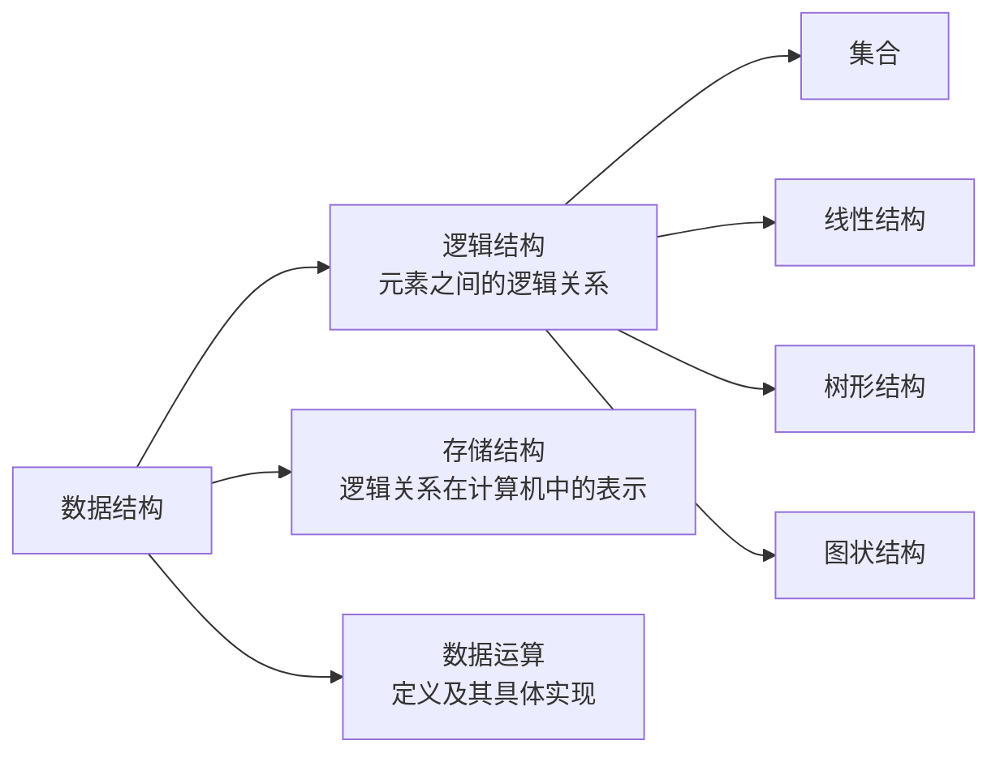

## 1.1 数据结构的存储结构
**核心问题**
+ 数据结构不仅要考虑“数据元素是什么”，还要考虑“元素之间是什么关系”。
+ 存储结构要解决的问题是：如何把逻辑关系放到计算机的存储空间中。
+ 同一种逻辑结构，可以采用不同的存储结构；不同存储结构会影响查找、插入、删除和空间利用率。

### 1.1.1 顺序存储
##### **定义**：#顺序存储
> 描述：
> 把逻辑上相邻的元素，存储在物理位置也相邻的存储单元中，元素之间的关系由存储单元的相邻关系体现。

**解释**
+ 逻辑相邻：从数据关系上看，两个元素前后相邻。
+ 物理相邻：在内存地址上连续存放。
+ 典型结构：数组、顺序表。

**特点**
+ 优点：
	+ 在元素定长、地址可由下标计算的顺序表/数组中，可以按下标随机存取；
	+ 每个元素只保存数据本身，不需要额外保存指针，所以单个元素占用空间较少。
+ 缺点：
	+ 必须使用相邻的一整块存储单元；
	+ 当连续空间不足时，可能出现外部碎片问题；
	+ 插入、删除时可能需要移动大量元素。

**例子**
+ 数组 `a[0], a[1], a[2]` 在内存中连续存放。
+ 若以 $a_1$ 为第一个元素、首地址为 `base`，每个元素占 $L$ 个存储单元，则第 $i$ 个元素地址为：
$$
LOC(a_i)=base+(i-1)\times L
$$
+ 若采用从 0 开始的数组下标，则 `a[i]` 的地址才是 $base+i\times L$。

### 1.1.2 链式存储
##### **定义**：#链式存储
> 描述：
> 不要求逻辑上相邻的元素在物理位置上相邻，而是借助指针表示元素之间的逻辑关系。

**解释**
+ 链式存储的核心不是“放在一起”，而是“通过指针找到下一个”。
+ 每个结点通常包含：
	+ 数据域：保存数据元素；
	+ 指针域：保存相关结点的地址。
+ 典型结构：单链表、双链表、循环链表。

**特点**
+ 优点：
	+ 不要求连续存储空间；
	+ 不要求整表占用一块连续空间，能利用离散的可用存储块；
	+ 已定位到操作位置时，插入、删除主要修改相关指针，不必像顺序表那样整体移动后续元素；结点分配/释放和查找位置仍有成本。
+ 缺点：
	+ 每个元素需要额外保存指针；
	+ 不能直接随机存取；
	+ 查找第 $i$ 个结点通常要从头结点开始顺序查找。

**注意**
+ PDF 中写到“只能实现顺序存储”，这里更准确的理解是：链式存储通常只能**顺序访问**，不能像数组那样按下标随机访问。

### 1.1.3 索引存储
##### **定义**：#索引存储
> 描述：
> 在存储数据元素信息的同时，额外建立索引表，用索引项辅助定位数据元素。

**解释**
+ 索引表类似一本书的目录。
+ 数据本体可以放在原位置，索引表负责记录关键字与地址之间的对应关系。
+ 索引项的一般形式：
$$
(\text{关键字},\text{地址})
$$

**特点**
+ 优点：
	+ 检索速度快；
	+ 适合查找频繁的数据集合。
+ 缺点：
	+ 索引表会额外占用存储空间；
	+ 增加、删除数据时，索引表也要同步修改，因此会花费更多时间。

**理解**
+ 顺序存储靠“物理位置”找元素；
+ 链式存储靠“指针”找元素；
+ 索引存储靠“目录”找元素。

### 1.1.4 散列存储
##### **定义**：#散列存储
> 描述：
> 根据元素的关键字直接计算出该元素的存储地址，又称哈希存储。

**解释**
+ 散列存储的核心过程：
$$
\text{关键字}\xrightarrow{\text{散列函数}}\text{存储地址}
$$
+ 典型结构：哈希表。

**特点**
+ 优点：
	+ 查找、插入和删除结点的操作通常很快；
	+ 理想情况下，平均时间复杂度可以接近 $O(1)$。
+ 缺点：
	+ 如果散列函数设计不好，可能出现冲突；
	+ 解决冲突会增加时间开销或空间开销。

**补充**
+ 冲突：不同关键字通过散列函数计算后，得到同一个存储地址。
+ 常见冲突处理方法：
	+ 开放定址法；
	+ 链地址法；
	+ 再散列法。

## 1.2 四种存储结构对比
**对比表**
| 存储结构 | 核心方式 | 查找特点 | 插入删除 | 空间开销 | 典型例子 |
| --- | --- | --- | --- | --- | --- |
| 顺序存储 | 物理相邻表示逻辑相邻 | 定长元素且地址可计算时支持按下标随机存取 | 可能移动大量元素 | 较小 | 数组、顺序表 |
| 链式存储 | 指针表示逻辑关系 | 通常顺序访问 | 定位后修改指针较方便 | 指针占额外空间 | 链表 |
| 索引存储 | 建立索引表 | 检索较快 | 需要维护索引 | 索引表占空间 | 数据库索引 |
| 散列存储 | 关键字映射到地址 | 平均很快 | 平均很快 | 取决于冲突处理 | 哈希表 |

**记忆方法**
+ 顺序存储：位置。
+ 链式存储：指针。
+ 索引存储：目录。
+ 散列存储：函数。

## 1.3 面试题：循环一定比递归效率高吗
### 题型：#循环递归比较
#### 第一部分：解题方法
+ 这类题不能直接回答“循环一定更高”。
+ 更稳的表达方式：
	+ 1. 先说明二者很多情况下可以互换；
	+ 2. 再比较递归和循环的优缺点；
	+ 3. 最后说明具体问题具体分析。

#### 第二部分：典型回答
+ 循环和递归在很多场景下可以互相转换，因此不能决定性地说循环效率一定比递归高。
+ 递归的优点：
	+ 代码简洁清晰；
	+ 逻辑更接近数学定义；
	+ 容易检查正确性；
	+ 适合树、图、分治、回溯等天然递归结构。
+ 递归的缺点：
	+ 每次调用都要保存现场；
	+ 调用次数过多时会增加栈空间开销；
	+ 递归层数太深可能导致栈溢出；
	+ 函数调用本身也会带来一定时间开销。
+ 循环的优点：
	+ 结构简单；
	+ 不需要额外的递归调用栈；
	+ 对线性重复操作，通常速度更稳定。
+ 循环的缺点：
	+ 并不能自然解决全部问题；
	+ 对某些递归结构，强行写成循环会使代码更复杂。

#### 第三部分：知识点复盘
+ 如果问题本身具有递归定义，用递归表达更自然。
+ 如果问题只是简单重复，用循环更直接。
+ 判断效率时，不能只看“递归/循环”这个形式，还要看：
	+ 数据规模；
	+ 调用深度；
	+ 是否有重复计算；
	+ 是否能尾递归优化；
	+ 是否需要额外数据结构模拟递归。

## 1.4 面试题：数组中找出和为固定值的所有数对
### 题型：#TwoSum
#### 第一部分：解题方法
+ 问题描述：给定一个数组和一个固定值 `target`，找出所有满足和为 `target` 的数对。
+ 典型思路有三种：
	+ 暴力枚举；
	+ 排序后双指针；
	+ 哈希表。

#### 第二部分：典型例题
**方法 1：暴力枚举**
+ 两层循环枚举所有数对。
+ 时间复杂度：
$$
O(n^2)
$$
+ 空间复杂度：
$$
O(1)
$$
+ 优点：简单直接。
+ 缺点：数据量大时效率低。

**方法 2：排序 + 双指针**
+ 先对数组排序。
+ 左指针指向最小值，右指针指向最大值。
+ 若两数之和小于 `target`，左指针右移。
+ 若两数之和大于 `target`，右指针左移。
+ 若两数之和等于 `target`，记录答案。
+ 时间复杂度：
$$
O(n\log n)
$$
+ 如果题目要求原下标，需要在排序前保存元素原始位置。

**方法 3：哈希表**
+ 遍历每个元素 $x$。
+ 查找 `target - x` 是否已经出现。
+ 如果出现，则找到一组数对。
+ 如果没出现，把 $x$ 放入哈希表。
+ 平均时间复杂度：
$$
O(n)
$$
+ 空间复杂度：
$$
O(n)
$$

#### 第三部分：知识点复盘
+ 如果数组无序且追求时间效率，优先考虑哈希表。
+ 如果数组有序，优先考虑双指针。
+ 如果需要输出所有数对，要处理重复元素和重复答案。

## 1.5 什么是数据结构
##### **定义**：#数据结构
> 描述：
> 数据结构是指数据元素以及数据元素之间的关系，可以看作相互之间存在某种特定关系的数据元素集合。

**解释**
+ 数据结构不是单纯的数据堆放，而是“带结构的数据元素集合”。
+ 结构强调的是元素之间的关系。
+ 选择合适的数据结构，可以提高：
	+ 运行效率；
	+ 存储效率；
	+ 程序可维护性。

**补充**
+ 数据结构通常包含三个层次：
	+ 逻辑结构；
	+ 存储结构；
	+ 数据运算。
+ 逻辑结构回答：数据之间是什么关系。
+ 存储结构回答：数据在计算机中怎么存。
+ 数据运算回答：对这些数据可以进行什么操作。

## 教材补充：数据结构的基本概念体系

> **NOTE** · 补充范围
> 本节不是原 PDF 的逐字转写，而是为完整表达教材的概念体系补入，并以 2027 年 408 大纲作最低覆盖核验。后续各章默认使用这些概念。

### 数据、数据元素、数据项与数据对象

| 概念 | 准确定义 | 例子 |
| --- | --- | --- |
| 数据 | 能被计算机识别、存储和处理的符号集合 | 数值、字符、图像编码、学生记录 |
| 数据元素 | 数据的基本单位，程序通常把它作为一个整体处理 | 一条学生记录、图中的一个顶点 |
| 数据项 | 构成数据元素的、具有独立含义的最小单位；“最小”与当前问题的划分粒度有关 | 学生记录中的学号、姓名 |
| 数据对象 | 性质相同的数据元素的集合，是数据的一个子集 | 某班全部学生记录 |

+ 一个数据元素可以由多个数据项组成；“元素”和“项”不能无条件互换。
+ 数据结构研究的不只是元素本身，还研究元素之间的关系以及作用在这些元素上的运算。

### 数据结构的三要素

1. **逻辑结构**独立于具体存储位置，按关系可分为：
   + 集合：元素除“同属一个集合”外没有其他特定关系；
   + 线性结构：除首尾外，每个元素各有唯一直接前驱和唯一直接后继；
   + 树形结构：一对多的层次关系；
   + 图状结构：多对多关系。
2. **存储结构（物理结构）**是逻辑结构在计算机中的映像，常见为顺序、链式、索引和散列存储。
3. **数据运算**包括创建、销毁、查找、插入、删除、修改、遍历、排序等。运算的逻辑定义可以相同，但在不同存储结构上的实现和复杂度可能不同。

逻辑结构与存储结构不是一一对应关系。例如，线性表既可用连续地址的顺序表实现，也可用结点地址离散的链表实现；图也可以用邻接矩阵或邻接表实现。

### 数据类型与抽象数据类型

##### **定义**：#数据类型
> 数据类型是一个值的集合以及定义在该集合上的一组操作的总称。

+ 原子类型的值不可再分，如给定语言语境下的整数、字符；结构类型的值由若干成分按某种结构组成，如数组、结构体。
+ 数据类型通常还受具体语言的表示范围约束，例如 C 语言中不同整数类型的位宽与取值范围由实现和标准共同规定。

##### **定义**：#抽象数据类型 #ADT
> 抽象数据类型（Abstract Data Type，ADT）从逻辑上说明数据对象、数据关系和允许的基本操作，不规定这些操作必须采用哪一种存储结构或代码实现。

可把 ADT 概括为三元组：

$$
ADT=(D,S,P)
$$

其中 $D$ 是数据对象，$S$ 是 $D$ 上的关系集合，$P$ 是基本操作集合。例如“栈”规定后进先出以及入栈、出栈、读栈顶等操作，但既可用顺序栈实现，也可用链栈实现。

### 易错边界

+ “线性表有序”在数据结构定义中表示元素存在前驱、后继次序，**不等于**关键字按数值递增或递减；若关键字有大小顺序，应明确写“递增有序表”等。
+ 顺序存储强调物理地址连续；逻辑上相邻不必物理相邻，链式存储就是典型反例。
+ ADT 描述“是什么、能做什么”，具体数据结构实现回答“怎样存、怎样做”。同一个 ADT 可以有多种实现。
+ 算法是对特定问题求解步骤的有限描述；数据结构是算法操作的数据组织基础，两者相关但不是同一概念。

## 1.6 C 语言、数据结构、算法和程序的关系
**核心关系**
+ 数据结构解决“数据如何组织”。
+ 算法解决“问题如何求解”。
+ 程序是数据结构和算法在计算机中的具体实现。

**常用助记表达**
$$
\text{数据结构}+\text{算法}=\text{程序}
$$

**解释**
+ 这是一句强调“数据组织方式与处理步骤共同决定程序”的助记表达，不是严格的数学恒等式；完整程序还包含输入输出、控制逻辑、错误处理等组成部分。
+ 算法不一定要求能直接在计算机上运行；
+ 程序必须能够在计算机中运行；
+ C 语言只是描述数据结构和算法的一种工具。
+ 描述数据结构和算法不局限于 C 语言，也可以使用：
	+ C++；
	+ Java；
	+ Python；
	+ 伪代码；
	+ 自然语言。

## 1.7 程序和软件的区别
### 题型：#程序软件辨析
#### 第一部分：解题方法
+ 抓住两句话：
	+ 程序是实现功能的指令集合；
	+ 软件是由程序、数据和文档组成的完整系统。

#### 第二部分：典型回答
+ 软件是相对于硬件而言的，是一系列按照特定顺序组织的计算机数据和指令的集合。
+ 程序是软件的组成部分之一，是实现软件功能的主要动力。
+ 程序是软件的必要元素，但软件不等于程序。

**关系式**
$$
\text{软件}=\text{程序}+\text{数据}+\text{文档}
$$

+ 其中，程序负责实现功能，数据是程序处理或依赖的内容，文档用于说明需求、设计、使用与维护。
+ “数据结构＋算法＝程序”可用于理解程序的核心，但不能据此省略软件中的数据，也不能把两条助记式机械相加。

#### 第三部分：知识点复盘
+ 程序偏向“能执行的代码或指令”。
+ 软件偏向“完整产品或系统”。
+ 在工程项目中，数据和文档都是软件的重要组成部分。

## 相关知识

+ **科目导航**：[数据结构导航](/en/notes/cs408-5620bc526d96/)
+ **阅读顺序**：[下一篇：算法和算法评价](/en/notes/cs408-01ad73094eab/)
+ **关联专题**：[重点算法汇总](/en/notes/cs408-424a656729a9/)

## 1.8 本节复盘
**必须掌握**
+ 四种存储结构：
	+ 顺序存储；
	+ 链式存储；
	+ 索引存储；
	+ 散列存储。
+ 四种存储结构的优缺点和适用场景。
+ 数据结构、算法、程序、软件之间的关系。

**易错点**
+ 链式存储不是“只能实现顺序存储”，而是通常只能顺序访问。
+ 索引存储和散列存储都能提高查找效率，但原理不同：
	+ 索引靠目录；
	+ 散列靠函数。
+ 程序是软件的一部分，软件不等于程序。

**面试表达**
+ 遇到“是否一定”类问题，不要绝对化。
+ 更稳的表达方式：
	+ 先给结论；
	+ 再说条件；
	+ 再比较优缺点；
	+ 最后给适用场景。
