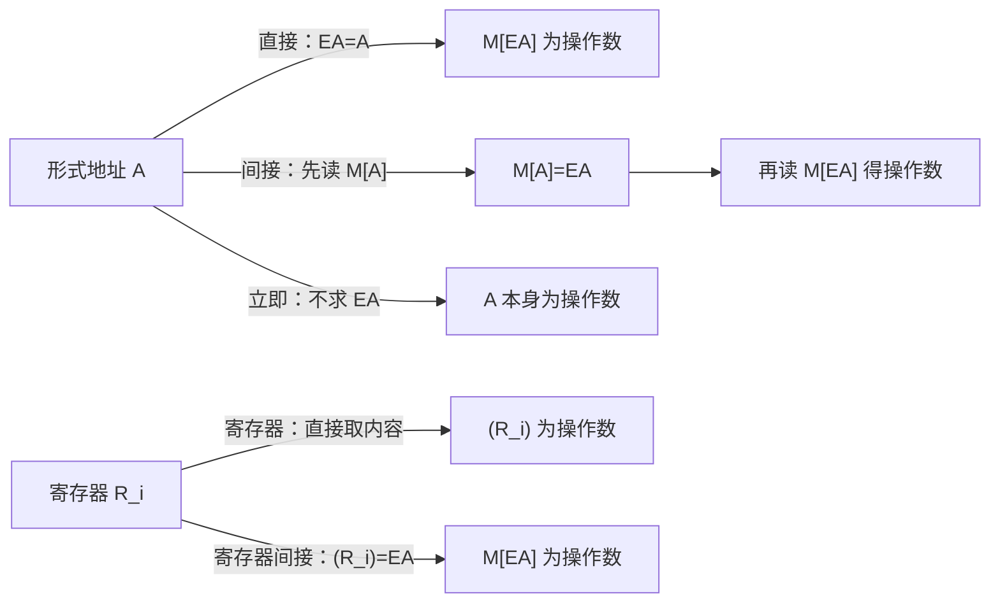

> 描述：寻址就是确定“下一条指令在哪”和“本指令操作数在哪”。题目中的 `A` 是形式地址，`EA` 是有效地址；括号 `(X)` 表示取寄存器或内存 X 的内容，必须和地址 X 本身区分。

## 4.1 指令寻址与数据寻址

### 4.1.1 指令寻址

指令寻址确定下一条待执行指令地址，PC 保存该地址。

| 情况 | PC 更新 |
| --- | --- |
| 顺序执行、按字编址且一条指令占一字 | $PC\leftarrow PC+1$ |
| 字节编址，指令占 2 B | $PC\leftarrow PC+2$ |
| 变长指令 | 译码器根据操作码以及可能的前缀、寻址字段、位移和立即数字段确定实际长度 $n$，再 $PC\leftarrow PC+n$ |
| 转移/跳转 | 按转移指令规定的目标地址更新 PC |

+ PC 在指令边界处指向**下一条将取的指令地址**。计算本节的 PC 相对目标时，先按指令实际长度求顺序下一条指令地址，再加位移；处理器内部何时更新 PC 取决于实现，不能固定理解为“译码后才加”。

### 4.1.2 数据寻址与访存次数

数据寻址确定本条指令地址码所指操作数的真实位置。下表的“执行阶段访存”不含取指、不含写回结果，题目若要求总访存次数需再加取指和可能的写回。

| 方式 | 有效地址/操作数 | 执行阶段访存 | 关键点 |
| --- | --- | ---: | --- |
| 立即 | 操作数就是 $A$ | 0 | `#` 常表示立即数 |
| 直接 | $EA=A$，操作数为 $(EA)$ | 1 | 地址字段直接给内存地址 |
| 一次间接 | $EA=(A)$ | 2 | $A$ 指向“有效地址所在单元” |
| 寄存器 | 操作数在寄存器 $R_i$ | 0 | 指令写寄存器编号 |
| 寄存器间接 | $EA=(R_i)$ | 1 | 寄存器保存内存地址 |
| 隐含 | 地址由指令语义隐含 | 依指令 | 例如 ACC、SP 等 |

## 4.2 基本数据寻址方式

### 4.2.1 直接、间接、寄存器、立即与隐含

#### 源 PDF 的地址字段位宽例题（2020 年）

单地址、定长 16 位指令共有 48 条操作指令，支持直接、间接、立即、相对四种寻址方式，且操作码和寻址方式位数固定。操作码至少占 $\lceil\log_2 48\rceil=6$ 位，寻址方式占 $\log_2 4=2$ 位，因此形式地址最多剩 $16-6-2=8$ 位。在**直接寻址且该字段按无符号主存地址解释**时，可寻址范围是 $0\sim 2^8-1$，即 $0\sim255$；不能把相对寻址的有符号位移范围套到直接寻址上。这个计算按题设字段独立、等长编码进行；若 ISA 对不同指令采用扩展操作码或不同格式，应重新按实际格式分配位数。

##### **定义**：#直接寻址

$EA=A$。指令取指 1 次、执行取操作数再访存 1 次，因此不计写回时总访存 2 次。优点是简单、执行阶段只访存一次；缺点是形式地址位数限制范围，且操作数地址不易修改。

##### **定义**：#间接寻址

$EA=(A)$。先访问 $A$ 所指单元获得 EA，再访问 EA 获得操作数；一次间接不计写回总访存 3 次。优点是 EA 位宽可大于形式地址、范围更大，且便于子程序返回等；缺点是多次访存。多次间接需通过间址字的标志判断是否继续。

原页的二次间接图可逐级读作：先从 $M[A]$ 取得带“继续间接”标志的地址 $A_1$，再从 $M[A_1]$ 取得带“结束间接”标志的 $EA$，最后读 $M[EA]$ 才是操作数。按这张图的取址流程，不计取指与写回时需访问主存 3 次；连同一次取指则为 4 次。标志位属于题设的间址字格式，不能把它当成普通地址位。

##### **定义**：#寄存器寻址与寄存器间接寻址

+ 寄存器寻址：指令给出寄存器号，操作数就是寄存器内容 $(R_i)$，不需要形成主存有效地址 EA；执行阶段不访问主存，指令短且快，代价是寄存器数量有限。
+ 寄存器间接：$R_i$ 保存操作数所在主存地址，$EA=(R_i)$；执行阶段须访问该内存单元一次，适合指针。

##### **定义**：#立即寻址与隐含寻址

+ 立即寻址中 $A$ 就是操作数本身，通常以 `#` 表示。执行阶段零访存、最快，但 $A$ 位数限制立即数范围；若为 $n$ 位补码，范围为 $[-2^{n-1},2^{n-1}-1]$。
+ 隐含寻址不显式写操作数地址，由指令默认使用的 ACC、SP 等给出。优点是缩短指令，缺点是需要相应隐含硬件/寄存器。

## 4.3 偏移寻址：相对、基址、变址

三者结构相似，均为“某寄存器内容 + 形式地址”：

| 方式 | 公式 | 谁可变 | 典型用途 |
| --- | --- | --- | --- |
| 基址寻址 | $EA=(BR)+A$ | 程序期间 BR 通常不变，$A$ 为偏移 | 程序重定位、多道程序 |
| 变址寻址 | $EA=(IX)+A$ | $A$ 常作数组首地址，IX 由用户不断改变 | 数组、循环 |
| 相对寻址 | $EA=(PC)+A$ | PC 随执行改变，$A$ 为相对下一条指令的补码位移 | 分支、转移、代码段内浮动 |

三种偏移方式的加法本身不访问主存；若指令随后要读取内存操作数 $(EA)$，执行阶段再访存 1 次。相对转移只把 EA 作为转移目标时，不应额外算作一次数据访存。

### 4.3.1 基址寻址

基址寄存器 BR 面向操作系统/管理程序；其内容通常由 OS 装入，程序执行过程中保持为基地址。优点：程序可整体装到不同内存位置而无需修改内部地址，适合多道程序；且 BR 与偏移共同扩展范围。通用寄存器也可承担 BR，但基地址管理语义仍由系统负责。

### 4.3.2 变址寻址

变址寄存器 IX 面向用户，IX 是随循环/下标变化的偏移，形式地址 $A$ 常为数组首地址。不断改 IX 即可生成数组任一元素地址；IX 位数足够时可覆盖整个寻址空间，特别适合循环程序。

### 4.3.3 相对寻址

相对寻址用下一条指令的 PC 加补码位移 $A$。目标随程序整体移动而同样移动，且与当前指令距离固定，因此适合条件转移和位置相对的代码。

### 题型：#复合寻址

+ 一定按题目顺序逐层代入。先基址再变址只是先形成“基址 + 形式地址”这一中间和，再加变址量，最终为 $EA=(BR)+(IX)+A$；这里没有间接寻址，也不应因分组括号多算一次访存。
+ 先变址再间接：先得中间地址 $(IX)+D$，再取该单元内容：$EA=((IX)+D)$；最终操作数为 $(EA)=(((IX)+D))$。
+ 数括号时只把“取内容”算一次：$A$、$(A)$、$((A))$ 分别是三个不同层次，不能省略。

#### 源 PDF 数值例题复算

1. 变址寄存器 $(IX)=1000H$，形式地址 $A=2000H$，且 $(1000H)=2000H$、$(2000H)=3000H$、$(3000H)=4000H$。变址寻址先求

   $$EA=(IX)+A=1000H+2000H=3000H$$

   题目问的是操作数而非有效地址，所以还要访问一次主存：操作数 $(EA)=(3000H)=4000H$。其余给出的内存内容是干扰项。
2. 指令字段为 `OP | M | I | D`，要求“先变址、后间接”时，先形成中间地址 $(I)+D$，再取该主存单元内容，故 $EA=((I)+D)$；若继续问操作数，则为 $(EA)=(((I)+D))$。
3. 机器字长 16 位、按字节编址，一条相对转移指令占 2 B，指令首地址为 `2000H`、位移为 `06H`。取指完成后 $PC=2002H$，再按相对寻址计算：

   $$EA=(PC)+06H=2002H+06H=2008H$$

   不能用指令首地址 `2000H` 直接加位移。

## 4.4 堆栈寻址

堆栈是按后进先出（LIFO）管理的特定存储区，SP（堆栈指针）给出栈顶地址，故操作数地址通常隐含。

| 类型 | 存放位置 | 特点 |
| --- | --- | --- |
| 硬堆栈 | 专用寄存器组 | 速度快、容量小 |
| 软堆栈 | 主存划出的栈区 | 容量大、通用，函数调用常用 |

以栈向小地址生长为例：入栈先 $SP\leftarrow SP-1$，再 $Y\to M_{SP}$；出栈先 $M_{SP}\to ACC$，再 $SP\leftarrow SP+1$。栈增长方向与操作顺序必须以题设为准。

## 相关知识

+ **科目导航**：[计算机组成原理导航](/en/notes/cs408-2406c8c61473/)
+ **阅读顺序**：[上一篇：指令系统的基本概念](/en/notes/cs408-e93053729cfd/) · [下一篇：指令格式](/en/notes/cs408-35c58c723ece/)

## 4.5 本节复盘

+ 指令寻址更新 PC，数据寻址求 EA；变长指令必须由完整的指令编码格式识别长度，不能无条件说只看操作码。`A` 是形式地址，`EA` 才是真实地址。
+ 直接 $EA=A$，间接 $EA=(A)$，寄存器间接 $EA=(R_i)$；立即数无需执行阶段访存，寄存器寻址也无需主存访问。
+ 基址面向 OS、BR 通常不变，适合程序浮动；变址面向用户、IX 可变，适合数组循环；相对寻址以 PC 为基准，常用于转移。
+ 复合寻址逐步代入并数清括号；堆栈寻址隐含 SP，软/硬堆栈分别在主存/寄存器实现。
+ 做访存次数题时先写明是否计入取指和写回，避免同一寻址方式因统计口径不同而得出看似矛盾的答案。
