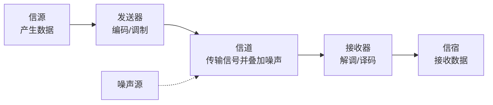

> 描述：物理层只负责在介质上传 0/1 比特，不理解帧、地址和协议语义。它通过统一接口规范屏蔽双绞线、光纤、无线等介质差异；中继器和集线器也仅在这一层对信号做再生/转发。

## 2.1 物理层实现的功能

物理层在各种传输媒体上发送和接收比特 `0`、`1`，向上面的数据链路层提供**透明传输比特流**服务。

+ “透明”不是指数据永远不出错，而是指数据链路层不需要知道下层究竟用哪一种物理媒体、信号编码和通信手段；它只把物理层交付的内容当作连续比特流使用。
+ 物理层不解释帧首部、MAC 地址、IP 地址或应用数据，不承担帧级差错校验、路由和端到端流量控制；具体 PHY 实现仍可能包含线路编码、纠错码等信号处理机制，不能据此说物理层绝不处理任何差错。
+ 同一逻辑比特可在铜缆上表现为电压变化、在光纤上表现为光脉冲、在无线中表现为电磁波状态；介质差异被物理层接口与传输规范隔离。

```text
数据链路层：把比特流组织成帧、处理相邻节点链路问题
      ↑ 透明比特流服务
物理层：将 0/1 映射为可在介质中传输的信号并恢复比特
      ↓
双绞线 / 光纤 / 无线等传输媒体
```

### 2.1.1 通信系统的基本对象与速率

> **INFO** · 教材补充



| 概念 | 准确定义与边界 |
| --- | --- |
| 数据 | 要传送的信息内容，可为数字数据或模拟数据 |
| 信号 | 数据在传输系统中的电气、光学或电磁表现，可为数字信号或模拟信号 |
| 信源/信宿 | 分别产生数据和最终接收数据的实体 |
| 信道 | 信号传输的通路；按方向可讨论发送信道和接收信道，按频谱特性可讨论低通/带通信道 |
| 码元 | 固定时长内代表一个离散信号状态的基本信号单元 |
| 码元速率 | 每秒传送的码元数，单位 Baud；若每码元有 $M$ 种可区分状态，理想携带 $\log_2M$ bit |
| 比特率 | 每秒传送的二进制位数，单位 bit/s；在理想映射下 $R_b=R_B\log_2M$ |
| 频率带宽 | 信号占用或信道允许通过的频率范围，单位 Hz；与网络性能指标中以 bit/s 表示的“数字链路带宽”不是同一个量 |

**基带传输**把数字数据直接变换为数字基带信号送入低通信道；**带通传输**先用数据调制载波，形成适合带通信道的模拟信号。编码、调制和码元换算详见 [编码与调制](/en/notes/cs408-e503e71568f6/)。

## 2.2 物理层接口的四类特性

物理层规定设备与传输媒体/接口之间可正确互连与工作的条件，常分为机械、电气、功能、过程四类。

| 特性 | 规定内容 | 常见判断关键词 |
| --- | --- | --- |
| 机械特性 | 接头形状、尺寸、引脚数及排列、固定/锁定装置 | 插头外形、针脚数量、接口扣具 |
| 电气特性 | 信号电压范围、阻抗匹配、传输速率、距离限制等 | 电平、阻抗、速率、最大距离 |
| 功能特性 | 接口电缆每一条信号线的作用 | 哪根是发送、接收、控制、地线等 |
| 过程特性 | 信号线上传输比特流的一组操作过程及信号时序关系 | 建立、发送、确认、撤销的先后时序 |

> 易错：引脚“排列”属于机械特性；某根线“做什么”属于功能特性；各信号“何时出现/撤销”属于过程特性；电压范围和阻抗匹配属于电气特性。

## 2.3 物理层设备

### 2.3.1 中继器 Repeater

数字信号沿传输介质传播会受衰减、噪声和失真影响。**中继器**接收已衰减/失真的数字信号，对其判决、整形、再生后再发送，延长可通信距离或连接网段。

+ 核心原理是**信号再生**，不是把原来已衰减的波形简单调大。
+ 中继器只能直接连接物理层兼容的网段，例如速率、线路编码和接口时序一致；教材常进一步表述为所连接网段使用相同的数据链路层协议。
+ 因为只处理物理信号，它不会根据 MAC/IP 地址进行过滤、选择转发或路由。

> 严格说，中继器并不读取或判断数据链路层协议；“链路层协议相同”是两段合并后能作为同一网络正常工作的条件，不是中继器具备协议转换能力。它既不能在不同速率/编码间转换，也不能把一种帧格式改成另一种。

### 2.3.2 集线器 Hub

集线器本质上是**多端口中继器**。它从一个端口收到信号后进行再生/放大，再转发到其他端口，属于物理层设备。

+ 集线器不学习 MAC 地址，也不只把数据发给目标端口；多个端口共享同一冲突域的教材模型是其典型特征。
+ 交换机虽然也有多个端口，但它根据帧 MAC 地址学习/转发，属于数据链路层；不能把集线器误认为交换机。

### 2.3.3 放大器、中继器与集线器对比

| 设备 | 信号类型与原理 | 端口/层次 |
| --- | --- | --- |
| 放大器 | 放大**模拟信号**的幅度，原波形的噪声/失真也可能一并放大 | 模拟通信场景 |
| 中继器 | 对**数字信号**判决、整形、再生，消除累积衰减/失真 | 通常双端口，物理层 |
| 集线器 | 多端口数字信号再生转发 | 多端口中继器，物理层 |

### 题型：#接口特性与设备层次

#### 第一部分：解题方法

1. 题干问“比特如何在介质上传送”“信号电平/接口插头”，定位物理层。
2. 出现“整形、再生、延长传输距离、两段相同协议网段”判断中继器。
3. 出现“多端口中继器、收到即转发到多端口”判断集线器；出现“MAC 地址学习和选择性转发”则是交换机而非集线器。

#### 第二部分：易错点

+ 物理层的透明传输强调对上层透明，并不保证物理链路无误码；可靠传帧由数据链路层等进一步机制完成。
+ 中继器虽常被口语称“放大”，但考试应写“再生数字信号”；模拟放大器与它的原理不同。
+ 中继器不能连接任意异构网段；题目特别给出速率、线路编码或链路层协议不同时，要警惕不能靠中继器完成转换。

## 相关知识

+ **科目导航**：[计算机网络导航](/en/notes/cs408-b78f75dd8c69/)
+ **阅读顺序**：[上一篇：体系结构与参考模型](/en/notes/cs408-9af3b667a6a2/) · [下一篇：传输媒体](/en/notes/cs408-769850dc79d7/)

## 2.4 本节复盘

+ 物理层在媒体上透明传输原始比特流，屏蔽具体介质和信号实现，不处理帧、地址、路由。
+ 机械特性看外形/引脚，电气特性看电平/阻抗/距离，功能特性看每根线用途，过程特性看操作时序。
+ 中继器对数字信号整形再生，连接相同速率/链路层协议网段；集线器是多端口中继器。
+ 放大器简单放大模拟波形，中继器再生数字比特；集线器和交换机的分界是后者会按 MAC 地址学习转发。
