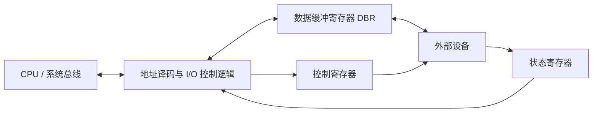

> 描述：I/O 接口（控制器）是主机和外设之间的协调层；端口是接口内部能被 CPU 直接访问的寄存器。理解“接口、端口、指令”三个不同层级后，统一/独立编址和 I/O 过程就不会混淆。

## 6.1 I/O 接口（I/O 控制器）

**I/O 接口**又称 I/O Controller、设备控制器，负责协调主机与外部设备间的信息传输。它一端连接系统总线/CPU，另一端连接具体设备；它不是外设本体。

主机与设备之间存在速度、信号形式、控制逻辑差异，I/O 接口的主要作用如下：

| 功能 | 实现与意义 |
| --- | --- |
| 数据缓冲 | 用数据缓冲寄存器 DBR 暂存数据，匹配主机和外设不同速度 |
| 状态/错误监测 | 用状态寄存器保存就绪、忙、完成、错误等信息，供 CPU 查询 |
| 控制与定时 | 接收控制总线来的命令/时钟信号，控制设备动作时序 |
| 数据格式转换 | 串—并、并—串等转换，适配双方数据组织 |
| 通信协调 | 建立 `主机 <-> I/O 接口 <-> I/O 设备` 的可靠传递链路 |



### 6.1.1 I/O 接口的常见分类

| 分类依据 | 类型 | 含义与边界 |
| --- | --- | --- |
| 外设侧的数据传送方式 | 并行接口 | 一个字节或一个字的多个数据位同时传送 |
| 外设侧的数据传送方式 | 串行接口 | 数据位按时间顺序逐位传送 |
| 主机控制设备的方式 | 程序查询接口 | CPU 反复读取状态并亲自传送数据 |
| 主机控制设备的方式 | 中断接口 | 设备就绪后请求中断，CPU 在 ISR 中服务 |
| 主机控制设备的方式 | DMA 接口 | DMA 控制器取得总线控制权，成批在设备与主存间传送 |
| 功能可配置性 | 可编程接口 | 工作方式、速率或格式等可由控制字配置 |
| 功能可配置性 | 不可编程接口 | 功能和时序主要由固定逻辑决定 |

这里的串行/并行主要描述**外设与接口一侧**的传输。主机系统总线一侧通常按字节或字并行传送，接口可在两侧之间完成串—并转换；不能因为外设侧使用串行线，就断言 CPU 内部也逐位处理。

### 6.1.2 接口与设备的辨析

+ 打印机适配器、网络控制器、可编程中断控制器等“适配器/控制器”通常属于 I/O 接口。
+ 磁盘驱动器本身负责驱动磁盘稳定旋转，是外部存储设备硬件的一部分，不是 I/O 接口。
+ “设备控制器”不等同于“CPU 的控制器”：前者服务于某类 I/O 设备，后者负责解释和控制指令执行。

## 6.2 I/O 指令与通道指令

### 6.2.1 I/O 指令

主机常用 I/O 指令同接口交换信息。一条 I/O 指令通常包括：

| 字段 | 作用 |
| --- | --- |
| 操作码 | 标识这是 I/O 指令 |
| 命令码 | 规定要做什么，例如启动、读、写、复位；随设备特性而变化，需驱动程序配合 |
| 设备码 | 指出操作哪一个设备/接口 |

### 6.2.2 通道指令

通道是具有专门 I/O 管理功能的处理器。**通道指令**是通道能识别和执行的指令；预先编写成通道程序并放在主存。

在含通道的机器中：`CPU 执行 I/O 指令向通道发命令 -> 通道执行一串通道指令 -> 管理设备传输`。通道因此可代替 CPU 完成细粒度 I/O 控制，减少 CPU 对慢速设备的直接参与。

## 6.3 I/O 端口：接口内可直接访问的寄存器

**I/O 端口**是 I/O 接口中可被 CPU 直接访问的寄存器；若干端口加上相应控制逻辑才组成一个 I/O 接口。

| 端口 | CPU 常见访问 | 保存内容 |
| --- | --- | --- |
| 数据端口 | 读、写 | 输入/输出数据，通常对应数据缓冲寄存器 |
| 控制端口 | 写 | 命令字、控制信息 |
| 状态端口 | 读 | 就绪、忙、错误、完成等状态字 |

+ 状态端口与控制端口可以共用同一个**端口地址**：CPU 读该地址时得到状态，写该地址时送入控制字。硬件内部既可能复用一个寄存器，也可能连接到不同的读/写锁存器，不能仅凭地址相同断言物理存储一定相同。
+ 端口不是外部插孔，也不是整个控制器；在组成原理语境中它首先是 CPU 可寻址的接口寄存器。

## 6.4 I/O 端口的编址方式

### 6.4.1 统一编址（存储器映射 I/O）

统一编址用**不同的地址码**区分主存单元与 I/O 端口，把端口映射进同一地址空间。

+ 对端口的访问可使用普通访存类指令和寻址方式。
+ 内存与 I/O 的地址范围不可重叠，因它们要靠地址本身区分。
+ 优点是无需专用 I/O 指令、可利用较丰富的访存寻址方式，编程灵活。
+ 缺点是会占用部分主存地址空间；端口地址若与完整存储器地址同宽，地址译码电路和指令地址字段也可能较长。

### 6.4.2 独立编址（I/O 映射 I/O）

独立编址用**不同的指令**区分主存和 I/O，端口位于独立 I/O 地址空间。

+ 只能用专门 I/O 指令访问端口，例如 `IN`、`OUT`。
+ 因为由指令类型区分，同一个数值可以同时是某主存地址和某 I/O 端口地址。
+ 优点是主存地址空间不被 I/O 端口占用，端口地址通常可较短，译码和区分明确。
+ 缺点是可用的 I/O 指令与寻址形式较少，程序设计灵活性较低，并需设置专用指令及相应的 I/O 读写控制逻辑。

| 对比点 | 统一编址 | 独立编址 |
| --- | --- | --- |
| 区分依据 | 地址码/地址空间 | 指令类型 |
| 访问指令 | 普通访存指令即可 | 专用 I/O 指令 |
| 地址是否可同值 | 不可在同一地址空间冲突 | 可以与主存地址同值 |
| 常见名称 | 存储器映射 I/O | I/O 映射 I/O |

## 6.5 接口、端口与指令的关系

```text
CPU 的通用寄存器
        │  访存指令（统一编址）或专用 I/O 指令（独立编址）
        ▼
I/O 端口（数据/状态/控制寄存器）
        │  端口 + 控制逻辑
        ▼
I/O 接口（控制器）
        │
        ▼
外部设备
```

+ I/O 接口接收主机控制信号并控制主机和设备之间的信息交换。
+ I/O 端口是接口的一部分，分别保存数据、状态、控制信息。
+ 专用 I/O 指令的数据传输通常发生在**CPU 的通用寄存器**与**I/O 端口**之间；统一编址时则可用普通访存指令访问端口。两种情况都不是 CPU 直接与设备的机械/电气部件交换数据。

## 6.6 I/O 的基本工作过程

查询、中断与 DMA 都需要 CPU 配置命令并获知状态，但数据搬运路径不同，可概括为：

1. **发命令**：CPU 将命令字写入 I/O 控制寄存器；设备相关命令通常由驱动程序组织。
2. **读状态**：CPU 从状态寄存器读状态字，判断设备/控制器是否就绪、忙、完成或出错。
3. **传送数据**：查询/中断方式通常由 CPU 指令在接口数据端口与 CPU/主存之间逐次搬运；DMA 方式由 DMA 控制器取得总线后在设备接口与主存之间直接传送，CPU 不逐次读写数据端口。

实际顺序依设备与 I/O 方式而定：例如读设备可反复确认就绪后读数据；写设备通常先写数据/命令再等待完成。状态与数据分离使速度不匹配的主机和外设能正确协作。

### 题型：#接口、端口与编址辨析

#### 第一部分：解题方法

1. 问“能被 CPU 直接访问的寄存器”时答 **I/O 端口**；问“协调主机和外设”时答 **I/O 接口/控制器**。
2. 出现普通 `load/store` 访问端口、内存和端口用地址区分时，判断为**统一编址**；出现 `IN/OUT` 等专用指令时，判断为**独立编址**。
3. 读状态、写控制、读写数据分别对应状态、控制、数据端口；状态与控制可共用端口地址，是否共用同一物理寄存器取决于实现。

#### 第二部分：易错点

+ “网络控制器”通常是 I/O 接口，“网卡所连网络”不是端口；“端口地址”也不等于网络 TCP/UDP 端口号。
+ 独立编址下端口地址可与主存地址数值相同，因为 CPU 已由指令类别知道目标空间。
+ CPU 发 I/O 指令的直接数据对象通常是端口；控制器再与设备进行实际握手、格式适配和缓冲。

## 相关知识

+ **科目导航**：[计算机组成原理导航](/en/notes/cs408-2406c8c61473/)
+ **阅读顺序**：[上一篇：外部设备](/en/notes/cs408-c2d3a38a7b30/) · [下一篇：I/O 方式](/en/notes/cs408-914a13597252/)
+ **关联专题**：[设备驱动与设备独立性](/en/notes/cs408-69c0d725657f/)

## 6.7 本节复盘

+ I/O 接口/控制器负责缓冲、状态/错误监测、控制定时、格式转换与通信协调；它不同于具体外设。
+ I/O 接口可按外设侧串/并行、查询/中断/DMA 控制方式以及可编程性分类；串/并行接口还能负责两侧格式转换。
+ 数据、控制、状态端口是接口中 CPU 可直接访问的寄存器，状态和控制可以共用端口地址，但不必共用同一物理锁存器。
+ I/O 指令含操作码、命令码、设备码；通道以主存中的通道程序代替 CPU 执行一系列设备管理动作。
+ 统一编址用地址区分并可用访存指令；独立编址用专用 I/O 指令区分，端口地址可与主存地址同值。
+ 基本交互为发命令、读状态、读/写数据；程序查询与中断方式通常经 CPU 通用寄存器和 I/O 端口传送数据，DMA 则由控制器在设备接口与主存之间搬运。
