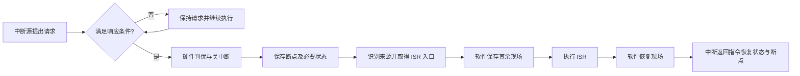

> 描述：中断让 CPU 暂停现行程序去处理异常或请求，随后从正确的断点恢复。最关键的分界是：硬件做检测、响应、保护断点和转入口；操作系统软件保存现场、处理事件、恢复现场。多重中断还要区分“谁先被响应”和“谁能打断谁”。

## 6.1 中断的基本概念与作用

**程序中断**是 CPU 执行当前程序时发生异常或特殊请求，CPU 暂停当前程序，转去处理；处理程序完成后通过专用中断返回机制恢复状态与断点，再继续原程序。CPU 会在规定的检查点检测异常/中断请求，不能把“提出请求”与“已经响应”混为一谈。

中断系统的作用：

+ 实现 CPU 与 I/O 设备并行工作，避免 CPU 对慢设备持续轮询。
+ 处理硬件故障、软件错误和异常。
+ 支持人机交互、用户干预、多道程序与分时系统。
+ 实现应用程序与操作系统（管态程序）之间的切换；软件触发的此类切换常称软中断/自陷。
+ 支持多处理器之间的信息交流与任务切换。

中断、异常和系统调用都会把控制权转交给内核，但三者不能等同：**外部中断**由设备等外部事件异步触发，**内部异常**与当前指令同步发生，**系统调用**则是用户程序通过专用指令主动请求内核服务。进入处理程序时，硬件按体系结构规则保存返回位置和必要的处理器状态并转入内核入口，其余软件现场再由入口代码保存。

## 6.2 中断的分类与响应时机

### 6.2.1 可屏蔽与不可屏蔽中断

| 类型 | 含义 | 与开/关中断的关系 |
| --- | --- | --- |
| 不可屏蔽中断 NMI | 用于掉电等紧急事件 | 不受普通可屏蔽中断允许位/屏蔽字控制，优先级通常高于可屏蔽中断；仍在体系结构规定的检查点进入 |
| 可屏蔽中断 | 一般外部中断请求 | 要求 CPU 处于开中断状态，且请求未被当前屏蔽字屏蔽 |

### 6.2.2 内部中断与外部中断

| 类型 | 别称/来源 | 检测时机 | 例子 |
| --- | --- | --- | --- |
| 内部中断 | 异常，与当前指令有关 | 当前指令执行过程中由 CPU 内部逻辑检测 | 非法操作码、缺页/越权、除零、算术溢出（若 ISA 规定产生异常）、陷阱 |
| 外部中断 | 狭义中断，与当前指令无直接关系 | 通常在一条指令执行结束后、取下一条前查询 | I/O 完成、时钟、外部设备请求 |

+ 译码时可发现非法指令，取指/访存时可发现缺页和保护错，整数除法执行时可发现除数为 0。
+ 外部中断通常由 CPU 在指令结束边界采样中断请求引脚或向 I/O 接口发中断查询；处理器不能在任意一条指令的中间随意响应外部中断。
+ 对可响应的外部中断，常见条件为：有请求、CPU 开中断、当前指令已完成且无更紧迫任务。内核态也能检测和响应中断。

每一中断源可有一个中断请求标记触发器 `INTR`；`INTR=1` 表示该源有请求。多个标记可集中构成中断请求寄存器，也可分散在各中断源处。

## 6.3 从请求到响应：优先级的两层含义

中断处理应按三个阶段理解：**请求**、**能否进入**、**从谁开始**。

1. 中断源发出请求，`INTR` 被置位。
2. **中断处理优先级**通过当前屏蔽字决定一个请求能否在当前服务程序中进入；它回答“能不能进/能否打断当前处理”。
3. 当多个未屏蔽请求同时可响应时，**中断响应优先级**（中断判优）选择一个首先响应；它回答“谁先进入”。

| 概念 | 实现依据 | 问题 |
| --- | --- | --- |
| 中断响应优先级 | 硬件排队器/判优线路，或软件查询程序 | 多个待响应源中谁先响应 |
| 中断处理优先级 | 中断屏蔽字/屏蔽寄存器 | 当前服务程序允许哪些请求嵌套进入 |

+ 两种优先级不必相同。例如 2、4 同时请求，可先由响应优先级选择 2；但 2 的服务中若其屏蔽字不屏蔽处理优先级更高的 4，则 4 仍能嵌套打断 2。
+ 在教材讨论的**可屏蔽外中断**模型中，CPU 只有在开中断且至少存在一个未被屏蔽的有效请求时，才进入相应的中断响应周期。NMI 不受全局中断允许位限制；内部异常也按各自的异常规则进入处理流程。

教材中常见的优先级设计倾向是：硬件故障高于软件中断、不可屏蔽中断高于可屏蔽中断、DMA 请求高于普通 I/O 中断、高速设备高于低速设备、输入设备高于输出设备、实时设备高于普通设备。这些是常见设计原则，并非所有机器都固定采用的唯一顺序；具体题目仍以给定的响应顺序和屏蔽字为准。

**例：响应顺序与实际执行顺序不同。** 设 5 个中断源的响应优先级为

$$1>2>3>4>5$$

处理优先级为

$$1>4>5>2>3$$

用户程序运行时，2、4 同时请求；在处理 2 的过程中，1、3、5 又同时请求。实际过程如下：

1. 2 与 4 同时请求时，按**响应优先级**先响应 2。
2. 进入 ISR 2 后，4 的**处理优先级**高于 2，故 4 可嵌套打断 2；ISR 4 完成后返回 ISR 2。
3. 1、3、5 同时待处理时，先按响应优先级考察 1；因 1 的处理优先级高于 2，ISR 1 打断 ISR 2，完成后返回 2。
4. 余下 3、5 中，虽然响应优先级先考察 3，但 3 的处理优先级低于 2，当前屏蔽字不允许它进入；随后 5 的处理优先级高于 2，故 ISR 5 可以打断 ISR 2。
5. ISR 5 完成后返回 ISR 2；ISR 2 完成并返回用户程序后，尚未处理的 3 才能进入。

因此完整服务次序为 `2（被打断） -> 4 -> 2（被打断） -> 1 -> 2（被打断） -> 5 -> 2 -> 用户程序 -> 3`。画时序图时要把“选择哪个待响应源”和“该源能否打断当前 ISR”分成两次判断。

## 6.4 中断响应（中断隐指令）：硬件完成什么

**中断隐指令**也称中断响应，由硬件自动完成，不能误写成中断服务程序的软件步骤。408 教材的典型抽象包含：

1. **关中断**：先避免服务开始前现场再次被打断（多重中断系统在保存后可再开中断）。
2. **保存断点及必要状态**：至少保存原程序 PC，通常入栈或写入指定单元；支持嵌套时必须为每一层保留独立副本。许多 ISA 还会由硬件同时保存 PSW、特权级或部分原因信息。
3. **识别中断源**：确定异常/中断类型。
4. **中断服务程序寻址**：得到入口地址，装入 PC，开始执行服务程序。

### 6.4.1 保存哪个 PC

“断点”是返回后要继续执行的位置，取决于事件的可恢复性与指令执行进度：

+ 执行 `trap`/自陷指令时，已完成该指令，通常保存其**下一条指令地址**。
+ 若 `Load/Store` 因缺页而未能完成，则返回后需重执行该访存指令，应保存**发生缺页的指令地址**。在每条 4 B、PC 已顺序更新时常表现为保存 `PC-4`。
+ 硬件至少负责保存 PC 断点；是否还自动保存 PSW、特权级等状态取决于 ISA。通用寄存器和软件管理的屏蔽字通常由入口代码保存。答题时应先写教材抽象，再按题设给出的体系结构边界判断，不能把“状态寄存器一定全由软件保存”当成普遍结论。

### 6.4.2 中断源识别与向量

识别的目的不是只得到一个名称，而是找到对应服务程序的入口。

| 名称 | 准确定义 |
| --- | --- |
| 中断服务程序 ISR | 处理某中断事件的程序 |
| 中断向量 | ISR 的入口地址 |
| 中断向量表 | 集中保存所有 ISR 入口地址，或入口跳转指令的表 |
| 向量地址/中断类型号 | 向量表表项的内存地址或索引值 |
| 向量中断 | 通过类型号索引向量表来识别/转入服务程序的技术 |

向量法流程：`识别中断源 -> 获得类型号 -> 计算向量表项地址 -> 取入口地址 -> 写入 PC`。非向量中断可用软件查询法依次查询状态。

原 PDF 第 13 页的示意图采用“向量跳转表”：类型号 `13H` 指到表项 `13H: JMP 300`，执行该跳转后进入地址 300 的显示器服务程序；`12H: JMP 200` 则指向地址 200 的打印机服务程序。`13H` 是表项索引/向量地址，`300` 才是该例实际 ISR 入口，二者不能混称。

+ 硬件判优/识别可使用硬件排队器，位置可在 CPU 内或分散于各中断源。
+ 软件识别可由统一异常查询程序按优先级检查异常状态寄存器；例如 MIPS 的 `cause` 寄存器配合异常入口查询。内部异常也可能在发现时直接得到类型并跳到相应处理程序。
+ 外部中断随机且不由当前指令现象决定，必须在指令边界检测；内部异常与当前指令相关，CPU 可在执行中检测。

## 6.5 中断服务程序：软件完成什么

### 6.5.1 单级中断

单级中断表示执行 ISR 时不响应新的中断请求。基本顺序：

1. 保存现场和屏蔽字。
2. 执行 ISR，完成事件处理。
3. 恢复现场和屏蔽字。
4. 执行专用的中断返回指令，回到断点。若原中断允许状态保存在硬件现场中，通常由 `iret`、`mret` 等返回指令按 ISA 规则一并恢复；若题设采用显式“开中断后返回”的教材模型，则按题设作答。

### 6.5.2 多重中断（中断嵌套）

多重中断表示 ISR 执行时允许更高优先级的新请求进入。正确时序为：

1. 保存其余现场和原屏蔽字：包括尚未由硬件自动保存的用户可见通用寄存器、状态信息等，可入栈或存指定单元。
2. **设置本级新屏蔽字**：把当前 ISR 对应的屏蔽字装入屏蔽寄存器，至少屏蔽自身，并只放行题设允许嵌套的更高处理优先级请求；这是软件动作，必须在重新开中断前完成。
3. **开中断**：只在现场、旧屏蔽字已保护且新屏蔽字已生效后执行，允许更高优先级请求嵌套。
4. 执行 ISR。
5. **关中断**：在恢复阶段前禁止再嵌套，保证恢复操作原子完成。
6. 恢复现场和原屏蔽字。
7. 按题设恢复中断允许状态并执行中断返回，按栈的后进先出关系返回被打断程序/低级 ISR。实际 ISA 常由专用返回指令恢复硬件保存的状态，而不是把“先执行普通开中断指令、再返回”规定为所有体系结构的固定两步。

多级相对单级的关键新增是设置本级新屏蔽字，以及一对为嵌套服务的开中断/关中断操作。**外部中断**通常在一条指令结束的边界响应；内部异常与当前指令同步，可能在译码、访存或执行阶段被检测，不能套用“所有事件都在指令结束后才响应”。

## 6.6 屏蔽字与优先级设计

在 408 常见题设约定中，每个中断源对应一个屏蔽触发器，**1 表示屏蔽、0 表示允许申请**。全部触发器组成屏蔽字寄存器，其中的值为当前 ISR 的屏蔽字；若题目另行规定 0/1 含义，应以题设为准。

+ 一个中断源进入 ISR 后至少应屏蔽它自身，防止同级重入。
+ 在同一题设且屏蔽字按合法优先级关系设计时，1 较多通常表示允许打断它的中断源更少，可据此判断其处理优先级较高；但“1 的个数”不是处理优先级的普遍定义，最终仍要逐位判断哪些请求能嵌套进入。
+ 支持多重中断的必要条件：服务程序中适时开中断；高处理优先级中断不应被低处理优先级 ISR 屏蔽。

**例：四中断源的屏蔽字与执行轨迹（原 PDF 第 17 页）。** 设硬件**响应**优先级为 $A>B>C>D$，要求软件**处理**优先级变为 $D>A>C>B$；屏蔽字按 `A B C D` 排列，`1` 表示屏蔽，且每个 ISR 屏蔽自身：

| 当前 ISR | A | B | C | D | 屏蔽字 | 可打断当前 ISR 的源 |
| --- | ---: | ---: | ---: | ---: | --- | --- |
| A | 1 | 1 | 1 | 0 | `1110` | D |
| B | 0 | 1 | 0 | 0 | `0100` | A、C、D |
| C | 0 | 1 | 1 | 0 | `0110` | A、D |
| D | 1 | 1 | 1 | 1 | `1111` | 无 |

再设 B、D、A、C 分别在 $5,10,35,60\,\mu s$ 请求，每个 ISR 净执行 $20\,\mu s$。按原题图忽略响应、保存和恢复的额外耗时，则 CPU 轨迹为：

| 时间区间（$\mu s$） | CPU 执行 | 原因 |
| --- | --- | --- |
| $0\sim5$ | 原程序 | 尚无请求 |
| $5\sim10$ | B | B 先到达，仅执行 5 $\mu s$ |
| $10\sim30$ | D | D 可以打断 B，执行满 20 $\mu s$ |
| $30\sim35$ | B | 从断点继续，又执行 5 $\mu s$ |
| $35\sim55$ | A | A 可以打断 B，执行满 20 $\mu s$ |
| $55\sim60$ | B | 再继续 5 $\mu s$ |
| $60\sim80$ | C | C 可以打断 B，执行满 20 $\mu s$ |
| $80\sim85$ | B | 做完剩余 5 $\mu s$，随后返回原程序 |

这里各请求不同时到达，响应优先级并未改变上述先后；真正决定三次嵌套的是 B 的 `0100` 屏蔽字允许 D、A、C 进入。若请求时刻、ISR 时长或开中断时刻变化，须重新画轨迹，不可套用本表。

### 题型：#中断过程与时序

#### 第一部分：解题方法

1. 先给事件定性：异常在指令内检测；外部中断在指令边界查询；NMI 不受关中断影响。
2. 问硬件动作时写“关中断、保存 PC 断点、识别来源、取 ISR 入口”；问软件动作时写“保存/恢复现场与屏蔽字、实际服务”。
3. 多请求先依据响应优先级判谁先响应；进入 ISR 后，再以当前屏蔽字判断是否允许另一请求嵌套。
4. 确定返回 PC 时判断故障指令是否已完成：已完成返回下一条；需要重执行则返回故障指令本身。

#### 第二部分：I/O 中断时间计算

设备完成一次字符操作后，I/O 控制器发请求；CPU 的开销应单列为“中断响应周期 + ISR 实际执行周期”。若 ISR 中第 $k$ 条指令启动下一次设备操作，则设备工作时间可与余下 ISR 指令重叠；计算一批字符的总历时与 CPU 实际占用时间时要分别考虑这段并行重叠，不能把所有 I/O 等待与所有 CPU 周期简单相加。

**例（2016 年真题参数）**：CPU 主频为 $50\ \text{MHz}$，CPI 为 4；设备采用异步串行方式传送 7 位 ASCII 字符，含 1 位起始位、1 位奇偶校验位和 1 位停止位；每字符设备工作 $0.5\ \text{ms}$。中断响应需 10 个时钟周期，ISR 共 20 条指令，并在第 15 条指令启动下一次设备工作。

1. 每字符共传 $1+7+1+1=10$ 位，故每秒最多传送
   $$
   \frac{1}{0.5\ \text{ms}}=2000\ \text{个字符},
   $$
   对应线路速率为 $2000\times 10=20\ \text{kbit/s}$。
2. 从一次设备启动到下一次设备启动，约经历设备工作、中断响应和 ISR 前 15 条指令：
   $$
   0.5\ \text{ms}\times 50\ \text{MHz}+10+15\times 4
   =25\,070\ \text{个时钟周期}.
   $$
   因而读入 1000 个字符的总历时约为 $25\,070\,000$ 个时钟周期，即 $0.5014\ \text{s}$。题目使用“约”时可按每字符一个稳定工作周期估算；若要求严格首尾时序，则应依据给定时序图单独处理首次启动和最后一次返回。
3. CPU 对每个字符实际占用中断响应与全部 20 条 ISR 指令，故 CPU 占用量为
   $$
   1000\times(10+20\times4)=90\,000\ \text{个时钟周期}=1.8\ \text{ms}.
   $$
4. 中断响应阶段主要由硬件关中断、保存断点及必要状态、识别来源并取得 ISR 入口；它不包含 ISR 的 20 条软件指令。

## 相关知识

+ **科目导航**：[计算机组成原理导航](/en/notes/cs408-2406c8c61473/)
+ **阅读顺序**：[上一篇：总线](/en/notes/cs408-310416bce0d2/) · [下一篇：外部设备](/en/notes/cs408-c2d3a38a7b30/)
+ **CPU 与异常处理关联**：[CPU 的中断处理功能](/en/notes/cs408-8aa8809e8e26/) · [缺页异常与指令重启](/en/notes/cs408-5865bd37ecaf/)
+ **关联专题**：[操作系统 I/O 与中断](/en/notes/cs408-39b45084fd1d/)

## 6.7 本节复盘

+ 中断让 CPU 从现行程序转入异常/请求处理，完成后按断点返回；它支持 I/O 并行、异常处理、分时和任务切换。
+ NMI 在关中断下仍响应；内部异常在当前指令执行中检测，外部中断通常在指令结束边界响应。
+ 响应优先级决定多个请求“谁先响应”，处理优先级/屏蔽字决定 ISR 中“谁能嵌套进来”。
+ 隐指令由硬件关中断、保存断点及必要状态、识别来源并转入入口；ISR 软件保存其余现场/屏蔽字、处理、恢复并返回，具体分界由 ISA 决定。
+ 多重中断在保存完现场后开中断，在恢复前关中断；中断返回指令按体系结构规则恢复状态与断点。向量法用类型号索引向量表，取得 ISR 入口地址。
