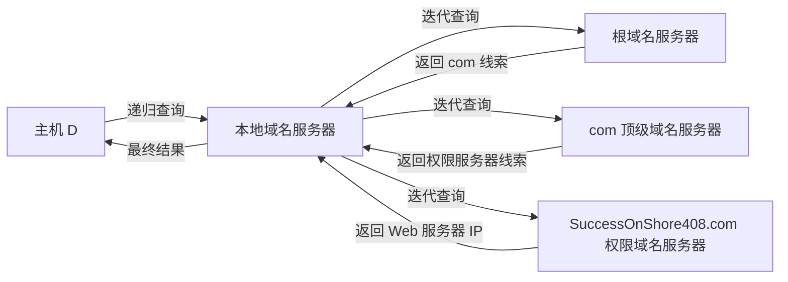

> 描述：DNS 与 HTTP 综合题先计算域名解析，再计算 TCP 建连和 HTTP 请求。核心是识别缓存、递归/迭代查询层级和计时起点：DNS 每次 UDP 查询-响应通常按 1 RTT，小 Web 页在得到 IP 后通常再用 1 RTT 建 TCP、1 RTT 请求响应。

> **TIP** · 章节导航：[返回第六章：应用层总纲](/en/notes/cs408-a8acba740351/)

## 3.1 DNS 基础

### 3.1.1 常用协议与端口

DNS 使用 53 端口：

+ 普通查询通常使用 UDP 53。
+ 响应过大、截断后重试或区域传送等场景可以使用 TCP 53。
+ 本资料各题明确或默认按 UDP 查询，因此每个远端查询-响应不需要额外建立 TCP，计为 1 RTT。

### 3.1.2 域名层次

解析 `www.abc.xyz.com` 时，可能涉及：

```text
根域名服务器
-> .com 顶级域名服务器
-> xyz.com 权限域名服务器
-> abc.xyz.com 权限域名服务器
-> www.abc.xyz.com 的资源记录
```

具体需要访问几级服务器，取决于域名的区域委派和缓存情况。

## 3.2 递归查询与迭代查询

### 3.2.1 递归查询

请求方要求被查询服务器给出最终答案：

+ 若服务器已有答案，直接返回。
+ 若没有，它代表请求方继续查询其他服务器。
+ 主机向本地域名服务器的请求通常按递归查询理解。

### 3.2.2 迭代查询

被查询服务器若没有最终答案，就返回下一步应访问的域名服务器线索；查询方自己继续询问：

```text
本地 DNS -> 根 DNS
本地 DNS -> 顶级域 DNS
本地 DNS -> 权限 DNS
```

因此题目若说“本地域名服务器提供递归服务，Internet 中其他 DNS 只提供迭代服务”，含义是：主机只把问题交给本地 DNS，本地 DNS 依次访问各层服务器。

## 3.3 缓存如何影响次数与时间

可利用的缓存包括：

+ 浏览器或操作系统 DNS 缓存。
+ 主机配置的本地域名服务器缓存。
+ 各级 DNS 服务器缓存。

若主机缓存已有目标映射，主机不发 DNS 查询；若本地 DNS 缓存已有映射，主机到本地 DNS 的一次交互仍可能存在，但题目常明确忽略局域网内时延，所以这部分计时可为 0。

解题时必须区分：

+ “发出多少次查询”：要数实际 DNS 请求报文。
+ “消耗多少 RTT”：只数题目要求计时的远端查询-响应。

## 3.4 2016 年真题：DNS 查询最少与最多次数

### 3.4.1 条件

+ 所有域名服务器均采用迭代查询。
+ 目标规范域名为 `www.abc.xyz.com`。
+ 问域名服务器完成解析时可能发出的 DNS 查询最少和最多次数。

### 3.4.2 最少次数

若主机或相关解析器缓存中已有完整域名到 IP 的映射，不需要继续访问任何 DNS 服务器：

```text
最少查询次数 = 0
```

### 3.4.3 最多次数

所有相关缓存都未命中时，本地域名服务器依次查询：

1. 根域名服务器。
2. `.com` 顶级域名服务器。
3. `xyz.com` 权限域名服务器。
4. `abc.xyz.com` 权限域名服务器。

```text
最多查询次数 = 4
```

**答案：最少 0 次，最多 4 次。**

## 3.5 得到 IP 后的 HTTP 时间

在忽略 DNS、发送时间且只获取一个小型纯文本页面的经典模型中：

```text
建立 TCP 连接：1 RTT
发送 HTTP 请求并收到页面：1 RTT
```

因此：

$$
T_{HTTP}=2RTT
$$

这一部分与 DNS 解析时间相加：

$$
T_{总}=T_{DNS}+2RTT
$$

## 3.6 2020 年真题：最短 20 ms、最长 50 ms

### 3.6.1 条件

+ 本地域名服务器只提供递归查询。
+ Internet 中其他域名服务器只提供迭代查询。
+ 目标为 `http://www.abc.com/index.html`。
+ 主机到 Internet 上各服务器的 RTT 为 10 ms。
+ 忽略其他各种时延，包括题设中的本地主机到本地 DNS 的时延。
+ 页面为纯文本，不含其他引用对象。

### 3.6.2 最短时间

主机或本地 DNS 缓存已有 `www.abc.com` 映射：

```text
DNS：0 RTT
TCP 建连：1 RTT
HTTP 请求-响应：1 RTT
```

$$
T_{min}=2RTT=20\ \mathrm{ms}
$$

### 3.6.3 最长时间

主机和本地 DNS 均无缓存。本地 DNS 迭代访问：

```text
根 DNS：1 RTT
.com 顶级 DNS：1 RTT
abc.com 权限 DNS：1 RTT
```

DNS 共 3 RTT，再加 Web 访问 2 RTT：

$$
T_{max}=(3+2)RTT=5RTT=50\ \mathrm{ms}
$$

**答案：D，20 ms、50 ms。**

## 3.7 模拟题：`SuccessOnShore408.com`

### 3.7.1 条件

+ 本地 DNS 提供递归查询。
+ Internet 中其他 DNS 只提供迭代查询。
+ DNS 使用 UDP。
+ 访问 Internet 各服务器的往返时间均为 RTT，忽略其他时延。
+ URL 为 `http://www.SuccessOnShore408.com/index.html`。
+ 页面为纯文本，不含其他对象。

### 3.7.2 DNS 查询流程



最少情况：本地 DNS 已缓存最终映射，且题目忽略主机到本地 DNS 时延：

$$
T_{DNS,min}=0
$$

最多情况：根、`.com`、权限服务器各一次迭代查询：

$$
T_{DNS,max}=3RTT
$$

### 3.7.3 加上 HTTP

得到 Web 服务器 IP 后，还需 2 RTT：

```text
1 RTT：TCP 三次握手建立连接
1 RTT：请求并接收 index.html
```

所以：

$$
T_{min}=0+2RTT=2RTT
$$

$$
T_{max}=3RTT+2RTT=5RTT
$$

**答案：最短 2 RTT，最长 5 RTT。**

## 3.8 通用计算模板

对于不含引用对象的小页面：

$$
T=T_{本地DNS}+kRTT_{DNS}+1RTT_{TCP}+1RTT_{HTTP}
$$

其中：

+ $T_{本地DNS}$ 是否计算由题目决定，很多题明确忽略。
+ $k$ 是实际访问的远端 DNS 层级数。
+ 缓存每命中一级，就可能减少后续迭代查询。
+ 若页面还引用图片、脚本等对象，应在 HTTP 部分继续按持久/非持久、流水线/非流水线规则增加时间。

## 3.9 解题步骤

1. 从完整域名拆出根、顶级域、各级权限域，判断最多需要几次迭代。
2. 检查主机、本地 DNS 或中间 DNS 是否可能缓存命中。
3. 区分主机到本地 DNS 的递归请求与本地 DNS 对外的迭代请求。
4. 明确 DNS 使用 UDP 还是 TCP；本题型按 UDP，每次远端查询-响应为 1 RTT。
5. 域名解析完成后不要停，继续加 TCP 建连 1 RTT 和 HTTP 请求-响应 1 RTT。
6. 若存在引用对象，转入 HTTP 连接类型题继续计算。

## 3.10 易错点

+ DNS 最少查询次数可以是 0，因为缓存可能直接命中。
+ 域名层级多不等于固定查询次数多；缓存和区域委派会改变实际次数。
+ 2016 年 `www.abc.xyz.com` 最多是根、`.com`、`xyz.com`、`abc.xyz.com` 四次，不是三次。
+ 2020 年题忽略主机到本地 DNS 的时延，所以最长只把三次 Internet 迭代计为 3 RTT。
+ DNS 解析完成后仍需 TCP 建连和 HTTP 请求，共 2 RTT。
+ “DNS 使用 UDP”是这些题每次查询只算 1 RTT 的依据之一，但现实 DNS 也可能改用 TCP。
+ 查询次数与 RTT 数不能混为一谈；本地交互可能发生但被题目设为 0 时延。

## 相关知识

+ **科目导航**：[计算机网络导航](/en/notes/cs408-b78f75dd8c69/)
+ **阅读顺序**：[上一篇：DHCP 应用](/en/notes/cs408-c001d492e92c/)
+ **关联专题**：[应用层总纲](/en/notes/cs408-a8acba740351/)

## 3.11 本节复盘

+ 主机通常向本地 DNS 发递归查询，本地 DNS 再向根、顶级和权限 DNS 发迭代查询。
+ 普通 DNS 查询常用 UDP 53，每次远端查询-响应在题目模型中计 1 RTT。
+ 缓存命中时 DNS 查询可降到 0；缓存全未命中时按实际域名委派层级逐次查询。
+ 2016 年 `www.abc.xyz.com` 最少 0 次、最多 4 次。
+ 单个小 Web 页面在获得 IP 后通常还需 1 RTT 建 TCP、1 RTT 完成 HTTP 请求响应。
+ 2020 年题最短 2 RTT=20 ms，最长 5 RTT=50 ms，答案 D。
+ `SuccessOnShore408.com` 模拟题最短 2 RTT、最长 5 RTT。
