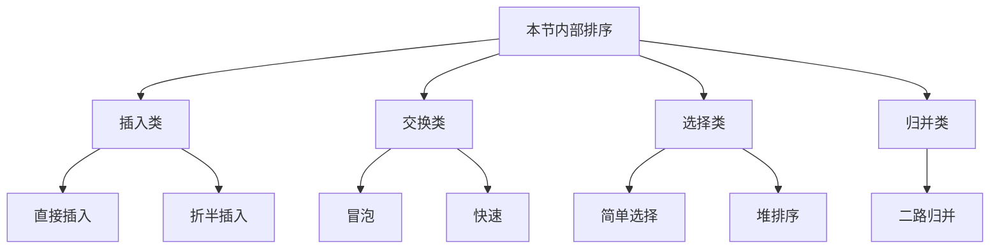

> **ABSTRACT** · 本节范围
> 本笔记逐页覆盖原 PDF 的 8 页和 7 道实际题目：题 1、2、4、5、6、7、8。原文件本身没有题 3。内容包括直接插入、链表插入、折半插入、冒泡、快速、简单选择、堆和归并排序；代码统一为 C++17。

> **IMPORTANT** · 先统一下标
> 除题 1 的哨兵版本明确使用 `records[1..n]` 外，其余顺序表代码都使用 `values[0..n-1]`。稳定是指关键字相等的记录在排序后仍保持原相对次序。

## 1. 插入排序

### 题 1：直接插入排序 - 顺序表

在第 $i$ 趟开始时，`records[1..i-1]` 已经有序。先把 `records[i]` 暂存在哨兵 `records[0]`，再从右向左移动所有严格大于它的元素，最后写入空位。只移动“大于”而不移动“等于”，因此算法稳定。

~~~cpp
#include <algorithm>
#include <cstddef>
#include <vector>

// records[0] 是哨兵，真正数据位于 records[1..n]。
void insertionSortWithSentinel(std::vector<int>& records) {
    if (records.size() <= 2) {
        return;
    }

    const int n = static_cast<int>(records.size()) - 1;
    for (int current = 2; current <= n; ++current) {
        records[0] = records[current];
        int previous = current - 1;
        while (records[0] < records[previous]) {
            records[previous + 1] = records[previous];
            --previous;
        }
        records[previous + 1] = records[0];
    }
}
~~~

最好情况为已有序，只需 $\Theta(n)$ 次比较且几乎不移动；平均和最坏时间为 $\Theta(n^2)$，辅助空间 $\Theta(1)$。

> **DANGER** · 原稿错误
> 原稿把 `j` 声明在 `for` 的局部作用域中，却在循环结束后继续使用 `R[j+1]`，标准 C++ 无法编译。当前版本把下标声明移到循环外，并保留哨兵防止向左越界。

### 题 1：直接插入排序 - 带头结点单链表

先让第一个数据结点独立成为有序链，再逐个摘下无序区结点，在有序区寻找插入前驱。寻找时越过所有“小于或等于”当前关键字的结点，才能让后出现的相等记录仍排在后面。

~~~cpp
struct ListNode {
    int key = 0;
    ListNode* next = nullptr;
};

// head 是带头结点、无环的单链表。
void insertionSortList(ListNode* head) {
    if (head == nullptr || head->next == nullptr) {
        return;
    }

    ListNode* unsorted = head->next->next;
    head->next->next = nullptr;
    while (unsorted != nullptr) {
        ListNode* node = unsorted;
        unsorted = unsorted->next;

        ListNode* previous = head;
        while (previous->next != nullptr
                && previous->next->key <= node->key) {
            previous = previous->next;
        }
        node->next = previous->next;
        previous->next = node;
    }
}
~~~

链表不支持随机访问，因此不能用折半查找降低定位比较次数；整体时间仍为 $O(n^2)$，只改指针而不搬移记录，辅助空间 $O(1)$。

> **DANGER** · 原稿错误
> 原稿未处理空链表与只有头结点的情况，并在判断 `pre->next != null` 之前先访问 `pre->next->data`，可能解引用空指针；用 `<` 寻找位置还会把后出现的相等结点插到前面，破坏稳定性。

### 题 2：折半插入排序

有序前缀上使用二分查找，找到当前关键字的上界位置 `[low, high)`：若相等则继续向右，因此插入到已有相等元素之后。二分只减少比较次数，后移元素仍可能达到 $\Theta(n^2)$。

~~~cpp
void binaryInsertionSort(std::vector<int>& values) {
    for (std::size_t current = 1;
         current < values.size(); ++current) {
        const int key = values[current];
        std::size_t low = 0;
        std::size_t high = current;

        while (low < high) {
            const std::size_t middle =
                low + (high - low) / 2;
            if (key < values[middle]) {
                high = middle;
            } else {
                low = middle + 1;
            }
        }

        for (std::size_t move = current;
             move > low; --move) {
            values[move] = values[move - 1];
        }
        values[low] = key;
    }
}
~~~

关键字比较次数为 $\Theta(n\log n)$；最好总时间为 $\Theta(n\log n)$，平均和最坏时间为 $\Theta(n^2)$，辅助空间 $\Theta(1)$，算法稳定。

> **DANGER** · 原稿错误
> 原稿把移动循环放进二分循环的错误层级，并使用未声明的 `i`、`j`；`high = mid - 1` 与最终插入 `high + 1` 的边界也没有统一。当前版本直接在半开区间中求稳定上界。

## 2. 交换排序

### 题 4：冒泡排序

第 1 趟把未排序区最大元素交换到末尾；每完成一趟，右侧有序区扩大 1。只有相邻元素严格逆序时才交换，所以相等记录不会越过彼此。

~~~cpp
void bubbleSort(std::vector<int>& values) {
    for (std::size_t end = values.size(); end > 1; --end) {
        bool changed = false;
        for (std::size_t current = 1;
             current < end; ++current) {
            if (values[current] < values[current - 1]) {
                std::swap(values[current], values[current - 1]);
                changed = true;
            }
        }
        if (!changed) {
            return;
        }
    }
}
~~~

带提前结束标志时，最好时间 $\Theta(n)$，平均和最坏时间 $\Theta(n^2)$；辅助空间 $\Theta(1)$，算法稳定。

> **DANGER** · 原稿错误
> 原稿把 `false` 拼成 `flase`，且注释把标志语义说反：`changed == true` 表示本趟发生过交换，只有 `changed == false` 才能证明序列已有序。

### 题 5：快速排序

以下“挖坑法”取区间首元素为枢轴。右侧扫描跳过大于或等于枢轴的元素，左侧扫描跳过小于或等于枢轴的元素；必须包含等号，否则遇到大量重复关键字时两个指针可能都不移动。

~~~cpp
int partition(std::vector<int>& values, int low, int high) {
    const int pivot = values[low];
    while (low < high) {
        while (low < high && values[high] >= pivot) {
            --high;
        }
        values[low] = values[high];

        while (low < high && values[low] <= pivot) {
            ++low;
        }
        values[high] = values[low];
    }
    values[low] = pivot;
    return low;
}

void quickSortRange(std::vector<int>& values,
                    int low,
                    int high) {
    if (low >= high) {
        return;
    }
    const int pivotPosition = partition(values, low, high);
    quickSortRange(values, low, pivotPosition - 1);
    quickSortRange(values, pivotPosition + 1, high);
}

void quickSort(std::vector<int>& values) {
    if (!values.empty()) {
        quickSortRange(values, 0,
                       static_cast<int>(values.size()) - 1);
    }
}
~~~

划分较均衡时，最好和平均时间为 $\Theta(n\log n)$、递归栈平均 $O(\log n)$；若每次枢轴都是极值，时间和递归栈分别退化为 $\Theta(n^2)$ 与 $O(n)$。算法通常不稳定。随机选枢轴或三数取中可降低持续退化的概率，但不能改变理论最坏界。

> **DANGER** · 原稿错误
> 原稿缺少分号并把实参写成 `part(A[], low, high)`，函数边界也被花括号截断；更关键的是两侧扫描都使用严格不等号，重复值可能使循环停滞。

## 3. 选择排序

### 题 6：简单选择排序

第 $i$ 趟在无序区 `[i, n)` 中找最小元素，与 `values[i]` 交换。长距离交换可能让相等记录跨越，所以标准简单选择排序不稳定。

~~~cpp
void selectionSort(std::vector<int>& values) {
    for (std::size_t first = 0;
         first + 1 < values.size(); ++first) {
        std::size_t minimum = first;
        for (std::size_t current = first + 1;
             current < values.size(); ++current) {
            if (values[current] < values[minimum]) {
                minimum = current;
            }
        }
        if (minimum != first) {
            std::swap(values[first], values[minimum]);
        }
    }
}
~~~

最好、平均、最坏时间均为 $\Theta(n^2)$，但交换次数最多 $n-1$；辅助空间 $\Theta(1)$，算法不稳定。原稿主体思路正确，本稿只避免无意义的自交换并补全性质边界。

### 题 7：堆排序

0 下标数组中，结点 $i$ 的左右孩子分别为 $2i+1$、$2i+2$。升序排列使用大根堆：先在线性时间内建堆，再反复把堆顶最大值换到当前堆尾，并对缩小后的堆向下调整。

~~~cpp
void siftDown(std::vector<int>& values, int root, int high) {
    const int rootValue = values[root];
    for (int child = 2 * root + 1;
         child <= high;
         child = 2 * root + 1) {
        if (child < high
                && values[child] < values[child + 1]) {
            ++child;
        }
        if (rootValue >= values[child]) {
            break;
        }
        values[root] = values[child];
        root = child;
    }
    values[root] = rootValue;
}

void heapSort(std::vector<int>& values) {
    const int n = static_cast<int>(values.size());
    for (int root = n / 2 - 1; root >= 0; --root) {
        siftDown(values, root, n - 1);
    }
    for (int end = n - 1; end > 0; --end) {
        std::swap(values[0], values[end]);
        siftDown(values, 0, end - 1);
    }
}
~~~

建堆为 $\Theta(n)$，随后 $n-1$ 次调整总计 $\Theta(n\log n)$；最好、平均和最坏排序时间均为 $\Theta(n\log n)$，辅助空间 $\Theta(1)$，算法不稳定。

> **DANGER** · 原稿错误
> 原稿在确认 `j < high` 之前先访问 `arr[j+1]`，可能越界；下沉后又拿已被覆盖的 `arr[i]` 与孩子比较，而非与暂存根值比较。建堆循环误写成 `i++`，排序阶段还混用了 `a` 与 `arr`。

## 4. 归并排序

### 题 8：二路归并排序

递归排序左右半区后，用辅助数组保存原区间，再以 `left`、`right` 两个指针归并。相等时先取左半区记录，才能保持稳定；辅助数组只在入口申请一次，避免每层递归重复分配。

~~~cpp
void mergeRange(std::vector<int>& values,
                std::vector<int>& buffer,
                int low,
                int middle,
                int high) {
    for (int index = low; index <= high; ++index) {
        buffer[index] = values[index];
    }

    int left = low;
    int right = middle + 1;
    for (int output = low; output <= high; ++output) {
        if (left > middle) {
            values[output] = buffer[right++];
        } else if (right > high) {
            values[output] = buffer[left++];
        } else if (buffer[left] <= buffer[right]) {
            values[output] = buffer[left++];
        } else {
            values[output] = buffer[right++];
        }
    }
}

void mergeSortRange(std::vector<int>& values,
                    std::vector<int>& buffer,
                    int low,
                    int high) {
    if (low >= high) {
        return;
    }
    const int middle = low + (high - low) / 2;
    mergeSortRange(values, buffer, low, middle);
    mergeSortRange(values, buffer, middle + 1, high);
    mergeRange(values, buffer, low, middle, high);
}

void mergeSort(std::vector<int>& values) {
    if (values.empty()) {
        return;
    }
    std::vector<int> buffer(values.size());
    mergeSortRange(values, buffer, 0,
                   static_cast<int>(values.size()) - 1);
}
~~~

最好、平均和最坏时间均为 $\Theta(n\log n)$，辅助数组占 $\Theta(n)$，递归栈占 $O(\log n)$，总体辅助空间 $\Theta(n)$；算法稳定。

> **DANGER** · 原稿错误
> `new B[maxsize]` 不是合法的动态数组表达式；主归并循环的控制变量与条件混乱，一侧剩余时又从已被覆盖的 `A` 而非备份 `B` 复制，且辅助数组既未复用也未释放。

## 5. 复杂度与性质总表

| 算法 | 最好时间 | 平均时间 | 最坏时间 | 主要辅助空间 | 稳定性 |
|---|---:|---:|---:|---:|---|
| 直接插入 | $\Theta(n)$ | $\Theta(n^2)$ | $\Theta(n^2)$ | $\Theta(1)$ | 稳定 |
| 折半插入 | $\Theta(n\log n)$ | $\Theta(n^2)$ | $\Theta(n^2)$ | $\Theta(1)$ | 稳定 |
| 优化冒泡 | $\Theta(n)$ | $\Theta(n^2)$ | $\Theta(n^2)$ | $\Theta(1)$ | 稳定 |
| 快速排序 | $\Theta(n\log n)$ | $\Theta(n\log n)$ | $\Theta(n^2)$ | 平均 $O(\log n)$，最坏 $O(n)$ | 不稳定 |
| 简单选择 | $\Theta(n^2)$ | $\Theta(n^2)$ | $\Theta(n^2)$ | $\Theta(1)$ | 不稳定 |
| 堆排序 | $\Theta(n\log n)$ | $\Theta(n\log n)$ | $\Theta(n\log n)$ | $\Theta(1)$ | 不稳定 |
| 二路归并 | $\Theta(n\log n)$ | $\Theta(n\log n)$ | $\Theta(n\log n)$ | $\Theta(n)$ | 稳定 |

> **NOTE** · 折半插入的最好情况
> 即使输入已有序，本实现仍会对每个有序前缀执行二分查找，因此关键字比较总数为 $\Theta(n\log n)$；它只把移动次数降到 $\Theta(n)$，不能像直接插入那样达到线性总时间。

## 6. 原题覆盖与纠错索引

| 原题号 | 内容 | 状态 |
|---:|---|---|
| 1 | 顺序表直接插入 + 链表插入排序 | 已覆盖，补全空链与稳定性 |
| 2 | 折半插入排序 | 已覆盖，统一半开区间边界 |
| 4 | 冒泡排序 | 已覆盖，修正标志含义与拼写 |
| 5 | 快速排序 | 已覆盖，修正重复值停滞与递归边界 |
| 6 | 简单选择排序 | 已覆盖，补全性质 |
| 7 | 堆排序 | 已覆盖，修正越界、建堆方向和变量名 |
| 8 | 归并排序 | 已覆盖，修正缓冲区、循环和剩余段复制 |

> **NOTE** · 题号说明
> 原 PDF 的实际编号是题 1、2、4、5、6、7、8，共 7 题；文件中没有题 3，并非本稿遗漏。

## 相关知识

+ **科目导航**：[数据结构导航](/en/notes/cs408-5620bc526d96/)
+ **阅读顺序**：[上一篇：图代码](/en/notes/cs408-d690a826208c/)
+ **关联专题**：[排序原理](/en/notes/cs408-2e90359dd8ec/)

## 7. 本节复盘

+ 先写清数组下标体系、有序区和无序区边界，再写循环；哨兵版的 `records[0]` 不属于数据区。
+ 插入排序和冒泡排序只让严格逆序记录移动，因而可以稳定；折半插入要把新记录放到相等记录之后。
+ 快排两侧扫描必须防止指针交叉，并妥善处理等于枢轴的记录；枢轴选择影响划分质量。
+ 简单选择排序比较次数不随初始序列改变；堆排序建堆为 $\Theta(n)$，完整排序为 $\Theta(n\log n)$。
+ 0 下标堆的左右孩子是 $2i+1$、$2i+2$；比较右孩子前必须先确认它存在。
+ 归并时相等先取左表才能稳定，且剩余元素必须从未被覆盖的辅助数组复制。
+ 所有模板都要验证空表、单元素、重复值、负数、已有序和逆序输入。
