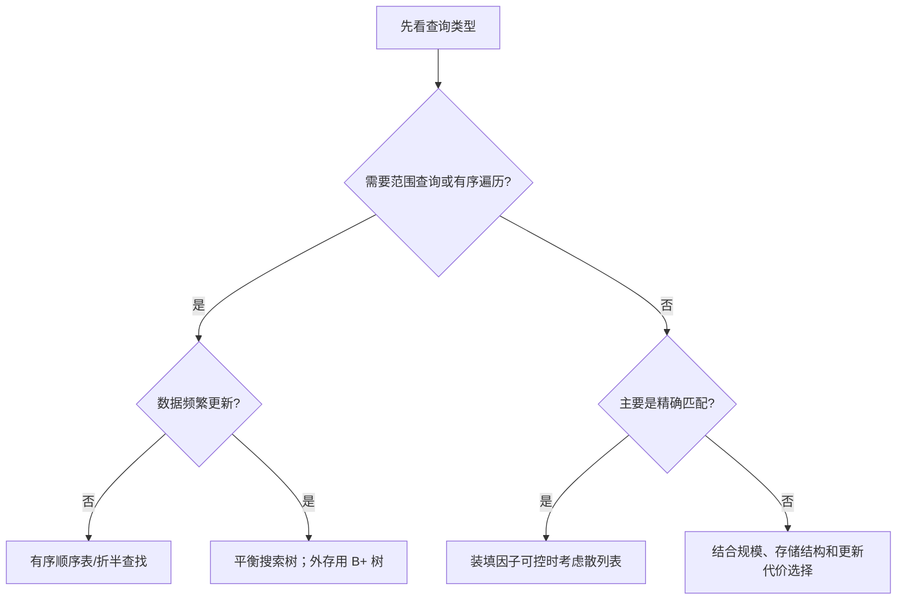

> 查找不是“把数据排好序”的同义词，而是在查找表中根据某个条件定位记录的过程。后续所有查找算法都围绕两个问题展开：**比较多少次**，以及为了更快查找要付出多少维护、空间或预处理代价。

## 24.1 查找、查找表与关键字

### 24.1.1 查找的对象

##### **定义**：#查找 #查找表
> 描述：在数据集合中寻找满足给定条件的数据元素的过程，称为查找（search）。供查找使用、由同类记录组成的数据集合称为查找表（search table）。

+ 查找结果可以是一个记录、记录所在位置、指向记录的指针，也可以是“查找失败”。
+ 408 中通常以记录的**关键字**作为比较依据；若题目只要求判断是否存在，返回位置或指针的写法不同，但查找过程相同。
+ 查找表不要求天然有序。顺序查找可用于无序表；折半查找则对表的有序性和存储结构有额外要求。

##### **定义**：#关键字
> 描述：关键字是记录中可用于标识、区分或检索记录的某个数据项的值；一般关键字不一定能唯一确定一条记录。

+ 能唯一标识记录的字段称为**主关键字**；例如学号、身份证号。
+ 若多个记录可具有相同的某个字段，该字段称为**次关键字**，仍可作为查找条件，但一次查找可能对应多条记录；题目会另行说明如何处理重复关键字。
+ 比较的是关键字，不要把“比较记录个数”和“关键字比较次数”混为一谈；本章的查找长度默认统计后者。

### 24.1.2 查找表的基本操作

| 操作 | 含义 | 典型关注点 |
| --- | --- | --- |
| 查找 | 定位关键字等于 `key` 的记录 | 比较次数、访问次数 |
| 插入 | 增加一条新记录 | 是否需要保持有序、是否会失衡或冲突 |
| 删除 | 移除一条已有记录 | 是否破坏原有结构、是否需要重组织 |

##### **两类查找表**：

+ **静态查找表**：建立后只查找、不插入删除。此时可把主要代价放在预处理和提升查找速度上，例如有序顺序表上的折半查找。
+ **动态查找表**：查找之外还要插入、删除。评价算法时必须同时看三种操作，例如二叉排序树、散列表。
+ 不能因为“查找很快”就断定结构更好：若数据频繁更新，维护有序表或平衡树的成本也应计入。

---

## 24.2 查找长度与平均查找长度

### 24.2.1 查找长度

##### **定义**：#查找长度
> 描述：一次查找中，关键字之间进行比较的次数称为查找长度（Search Length，SL）。

+ 找到目标前比较了几次，成功查找的查找长度就是几。
+ 查找失败也有查找长度：算法必须比较到能确定“目标不存在”为止。
+ 在同一种算法中，不同关键字所在位置、树的形状或散列冲突情况不同，查找长度往往不同，所以不能只看某一次查找。

### 24.2.2 平均查找长度

##### **定义**：#平均查找长度 #ASL
> 描述：所有可能查找的查找长度按其发生概率加权后的平均值，称为平均查找长度（Average Search Length，ASL）。

设第 $i$ 种查找结果发生的概率为 $P_i$，其查找长度为 $C_i$，则：

$$
ASL=\sum_{i=1}^{n}P_iC_i
$$

+ 必须先确定统计对象：**查找成功**和**查找失败**通常分别计算 $ASL_{\text{成功}}$、$ASL_{\text{失败}}$。
+ 若题目说明各记录等概率被查找，成功查找时 $P_i=\frac{1}{n}$，于是：

$$
ASL_{\text{成功}}=\frac{1}{n}\sum_{i=1}^{n}C_i
$$

+ 若题目给出访问概率，必须使用给定概率；把“概率大的记录放前面”正是顺序查找的优化依据。
+ ASL 反映的是比较次数的期望值；若题目改为统计磁盘块访问、散列探测次数或 I/O 次数，应以题目明确的代价单位为准。

### 24.2.3 用判定树理解 ASL

##### **定义**：#查找判定树
> 描述：把一次次关键字比较表示为树的分支，成功或失败的结果表示为结点或外部叶子，就得到查找判定树。成功结点的层数可直接对应比较次数；失败外部结点本身不再与关键字比较，须按到达它之前经过的内部结点数计数。

+ 查找成功时，根结点按第 $1$ 层计，关键字所在结点的**层数**就是比较次数；若采用“根的深度为 $0$”的定义，则比较次数等于深度加 $1$。
+ 查找失败时，若把空指针位置画成外部结点，并仍把根记为第 $1$ 层，则比较次数等于该外部结点的层数减 $1$；例如在根结点比较一次后走向空孩子，外部结点在第 $2$ 层，但查找长度是 $1$。
+ 在二叉排序树中，树越高，深层结点越多，ASL 往往越大；这解释了为什么极端退化的 BST 查找会变慢。
+ 对顺序查找和折半查找，失败结果也可看作外部结点。折半查找含 $n$ 个成功结点时有 $n+1$ 个失败结点，对应有序表中的 $n+1$ 个空隙。

### 题型：#平均查找长度计算

#### 第一部分：解题方法

1. 明确题目要求的是成功、失败，还是二者的综合 ASL。
2. 为每个结果写出查找长度 $C_i$：树题看层数；顺序表题看比较到第几项；散列表题看探测次数。
3. 写出概率 $P_i$。未给概率时，只有在题目默认等概率的前提下才能取 $\frac{1}{n}$。
4. 代入 $ASL=\sum P_iC_i$，最后检查概率之和是否为 $1$。

#### 第二部分：典型例题

某二叉排序树有 8 个结点，各层成功结点数依次为 $1,2,4,1$。若各关键字等概率被查找，则：

$$
ASL_{\text{成功}}
=\frac{1\times1+2\times2+3\times4+4\times1}{8}
=\frac{21}{8}=2.625
$$

这里的 $1,2,3,4$ 是层数，后面的 $1,2,4,1$ 是各层结点数；不要把二者颠倒。

> 图中根结点 $50$ 比较 $1$ 次，结点 $26,66$ 各比较 $2$ 次，结点 $21,30,60,70$ 各比较 $3$ 次，结点 $68$ 比较 $4$ 次，正好对应分子中的四项。

#### 第三部分：知识点复盘

+ ASL 是**期望比较次数**，不是最坏情况，也不是时间复杂度的记号。
+ 计算前必须区分成功与失败，并确认概率是否等同。
+ 后续各算法的差别，本质上是怎样让常用记录更快被定位，以及为此付出何种结构维护成本。

## 教材补充：查找算法的分析与应用

### 结构、操作与适用场景对照

| 方法 | 关键前提 | 查找量级 | 更新与典型用途 |
| --- | --- | --- | --- |
| 顺序查找 | 无需有序；顺序表、链表均可 | 成功/失败均为 $O(n)$ | 结构最简单，适合小表、无序表或一次性查找 |
| 折半查找 | 关键字有序且能随机访问 | $O(\log n)$ | 静态顺序表合适；链表无法高效访问中点 |
| 分块查找 | 块间有序，块内可无序 | 索引查找加块内顺序查找 | 在全局有序与完全无序之间折中，插删可限制在块内 |
| 普通 BST | 动态维护关键字有序关系 | 与树高 $h$ 同阶；最坏 $O(n)$ | 支持动态插删和有序遍历，树形受插入次序影响 |
| AVL / 红黑树 | 维护额外平衡约束 | 最坏 $O(\log n)$ | 动态字典；AVL 查询更紧，红黑树更新通常调整较少 |
| B 树 / B+ 树 | 多路平衡，结点按外存块组织 | 结点访问约为 $O(\log_m n)$ | 减少磁盘 I/O；B+ 树叶链尤其适合范围查询 |
| 散列表 | 散列函数与冲突处理规则固定 | 期望接近 $O(1)$，最坏 $O(n)$ | 精确匹配快；通常不直接支持有序遍历和范围查找 |

> 表中的复杂度是常见实现的量级，不代替题目给定结构的实际 ASL。已画出树或散列表时，应按真实比较/探测路径计算，不能只写渐近复杂度。

### 选择方法的判断顺序

### 分析题的统一口径

1. **先定代价单位**：关键字比较、数组访问、探测次数、结点访问和磁盘 I/O 不是同一指标。
2. **再定输入模型**：最坏、最好、等概率平均、给定概率期望或随机化期望必须区分。
3. **成功与失败分开**：失败结果通常对应空隙、外部结点、空链或首次未使用单元，分母也可能不同。
4. **计入维护代价**：静态表可接受一次排序或建索引；动态表还要考虑每次插入、删除引起的移动、旋转、分裂、合并或重散列。
5. **检查功能边界**：散列虽快却不保序；折半虽快却依赖随机访问；普通 BST 可退化；B/B+ 树优势主要体现在较少的外存块访问。

### 常见错误结论

+ “折半查找一定比顺序查找快”不成立：表很小、链式存储、访问概率极不均匀，或排序预处理代价不能摊销时，顺序查找可能更合适。
+ “散列表查找恒为 $O(1)$”不成立：它是均匀散列、装填因子受控时的期望结论，最坏仍可退化为 $O(n)$。
+ “平衡树只看查找”不完整：旋转、染色以及 B 树结点分裂/合并都是动态操作代价的一部分。
+ “ASL 小就代表实际运行一定更快”不成立：ASL 通常只统计比较次数，缓存局部性、指针访问和磁盘 I/O 也会影响真实代价。

## 相关知识

+ **科目导航**：[数据结构导航](/en/notes/cs408-5620bc526d96/)
+ **阅读顺序**：[上一篇：图的经典应用](/en/notes/cs408-a1c21fbceeaf/) · [下一篇：顺序查找和折半查找](/en/notes/cs408-141b2cb5b281/)
+ **关联专题**：[查找代码](/en/notes/cs408-18a77c541c35/)

## 24.3 本节复盘

+ 查找表是查找的对象；静态表重点看查询，动态表还要看插入、删除。
+ 关键字是比较依据，主关键字才能唯一标识记录。
+ 查找长度统计关键字比较次数；平均查找长度为 $ASL=\sum P_iC_i$。
+ 看到树形题先用层数列出 $C_i$；看到概率题先确认是否等概率，避免机械套平均公式。
