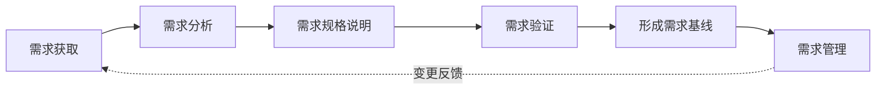

> 描述：本节围绕“软件系统必须做什么”，整理需求获取、分析、规格说明、验证和管理五项任务，并系统说明 UML 用例图中的参与者、包含、扩展、泛化关系，以及活动图的行为建模方法。

## 3.1 软件需求工程的基本任务

需求工程要准确回答：

> 软件系统必须做什么，以及在什么约束和质量要求下完成。

它不是一次访谈，而是贯穿生命周期的五类活动：

### 3.1.1 需求获取

开发人员与客户、最终用户和其他利益相关者沟通，聆听他们的目标与问题，并观察实际工作行为。

常用方法：

+ 访谈、问卷和研讨会。
+ 现场观察和民族志式调查。
+ 文档、法规和现有系统分析。
+ 原型、场景和用例讨论。
+ 头脑风暴与焦点小组。

获取到的往往是原始愿望，其中可能有遗漏、冲突和方案化表述，不能直接当作最终规格。

### 3.1.2 需求分析

对原始信息进行分类、建模、协商和优先级排序：

+ 明确系统范围与外部边界。
+ 区分业务目标、用户需求和系统需求。
+ 发现冲突、重复、遗漏和歧义。
+ 分析数据、状态、业务规则、异常和非功能约束。
+ 评估需求的可行性、风险和依赖关系。

### 3.1.3 需求规格说明

把经确认的需求写成软件需求规格说明（SRS）或等价的受控需求文档。它应成为设计、实现、测试和验收的共同依据。

常见内容：

+ 系统目标、范围、术语和假设。
+ 功能需求与业务规则。
+ 外部接口和数据需求。
+ 性能、可靠性、安全、易用性、可维护性等非功能需求。
+ 约束、验收标准和追踪标识。

### 3.1.4 需求验证

通过评审、原型、测试用例推导和利益相关者协商确认需求是否合格。

重点检查：

| 性质 | 检查问题 |
| --- | --- |
| 正确性 | 是否真实反映业务和用户目标 |
| 完整性 | 功能、异常、数据和质量要求是否遗漏 |
| 一致性 | 不同需求之间是否矛盾 |
| 无歧义 | 关键语句是否只有一种合理解释 |
| 可行性 | 技术、成本和进度上是否能实现 |
| 可验证性 | 是否能通过测试、分析或检查判定满足 |
| 可追踪性 | 是否可追到来源，并追到设计、代码和测试 |

### 3.1.5 需求管理

验证通过的需求形成**需求基线**。后续变更不能直接口头插入开发，应受控处理：

1. 提交并记录变更请求。
2. 分析对范围、架构、成本、进度、测试和风险的影响。
3. 由授权角色批准、拒绝或延期。
4. 更新需求基线及相关模型、设计和测试。
5. 维护双向追踪并通知所有相关方。

> **WARNING**
> 课件原文出现“生命基线”，结合上下文明显应为“需求基线”。

## 3.2 需求类型

| 类型 | 含义 | 示例 |
| --- | --- | --- |
| 功能需求 | 系统必须提供的行为或服务 | 用户可以查询订单状态 |
| 非功能需求 | 对质量、性能或实现的约束 | 95% 查询在 2 秒内返回 |
| 领域需求 | 来自业务领域、法规或专业规则 | 金融交易必须保留审计记录 |

需求应尽量可度量。例如“系统响应要快”不可验证；“在给定负载下，95% 请求不超过 2 秒”才可测试。

## 3.3 用例图

### 3.3.1 定义与作用

用例图是由参与者（Actor）、用例（Use Case）、系统边界及其关系组成的 UML 行为图，用于从外部观察者角度描述系统提供的功能。

+ **参与者**：与系统交互的外部角色，可以是人、外部系统或设备，不等同于具体个人。
+ **用例**：参与者借助系统实现的有价值目标，名称通常使用动宾短语。
+ **系统边界**：限定哪些用例属于目标系统。
+ **关联**：表示参与者参与某个用例。

用例图可以帮助确定系统范围、讨论功能，并为用例描述和系统测试提供线索，但它不描述详细算法或严格时间顺序。

### 3.3.2 `<<include>>` 包含关系

当多个基础用例都必然执行一段公共行为时，可把公共行为提取为被包含用例。

+ 基础用例每次执行到该处，都要执行被包含用例。
+ 用于复用必需行为，避免在多个用例中重复描述。
+ UML 虚线箭头从**基础用例**指向**被包含用例**。

例如，“转账”和“修改密码”都必须“验证身份”，可以包含“验证身份”。

### 3.3.3 `<<extend>>` 扩展关系

扩展用例在指定条件成立时，把附加行为插入基础用例的扩展点。

+ 基础用例自身应能独立完成。
+ 扩展行为通常是可选、条件性或异常性流程。
+ UML 虚线箭头从**扩展用例**指向**基础用例**。

例如，“结账”在用户有优惠券时可被“使用优惠券”扩展。

> **WARNING**
> 课件说“扩展用例必须由基础用例启动”容易误解。准确表述是：基础用例在扩展条件满足并到达扩展点时引入扩展行为；基础用例不能依赖扩展用例才能成立。

### 3.3.4 包含与扩展对比

| 对比项 | `include` | `extend` |
| --- | --- | --- |
| 行为性质 | 必需、公共、可复用 | 可选、条件或异常附加 |
| 基础用例能否缺少该行为 | 不能 | 能 |
| 箭头方向 | 基础用例指向被包含用例 | 扩展用例指向基础用例 |
| 触发位置 | 基础流程规定位置 | 命名扩展点且条件成立 |

被包含用例是否能被参与者独立启动，要看其是否本身代表独立用户目标，不能仅凭 `include` 关系一概而论。

### 3.3.5 泛化关系

当多个参与者或用例具有共同结构和行为时，可抽象父元素，子元素继承并可增加或改写特征。

+ 用例泛化：子用例是父用例的特殊形式。
+ 参与者泛化：特殊参与者继承一般参与者可参与的用例。
+ 实线空心三角箭头指向较一般的父元素。

泛化表达“is-a”关系，不应用来代替必需复用的 `include`。

## 3.4 用例描述

用例图只给出功能总览，完整需求还应配套文字用例：

+ 用例名称和目标。
+ 主要参与者与其他利益相关者。
+ 前置条件和触发事件。
+ 主成功场景。
+ 备选、异常和扩展流程。
+ 后置条件或成功保证。
+ 特殊非功能要求和业务规则。

测试人员可从主流程、备选流程、边界条件和失败保证中设计测试用例。

## 3.5 活动图建模法

### 3.5.1 定义

活动图是描述系统或业务行为流程的 UML 行为图，可以记录：

+ 单个操作或方法的逻辑。
+ 单个用例的工作流。
+ 跨角色业务过程的控制流和数据流。
+ 顺序、分支、循环和并发行为。

### 3.5.2 常用元素

| 元素 | 含义 |
| --- | --- |
| 初始节点 | 流程开始，实心圆 |
| 动作/活动 | 一个处理步骤，圆角矩形 |
| 控制流 | 动作之间的执行路径 |
| 判断与合并 | 按守卫条件分支或汇合，菱形 |
| 分叉与汇合 | 并发路径的开始与同步，粗横线或竖线 |
| 对象节点/对象流 | 表示活动间传递的数据对象 |
| 泳道 | 按角色、部门或组件划分责任 |
| 活动终结 | 终止整个活动，靶心样式 |
| 流终结 | 只终止当前路径，带叉圆形 |

### 3.5.3 与其他图的区别

+ 用例图回答“系统对外提供哪些目标”。
+ 活动图回答“某目标或过程怎样流转”。
+ 顺序图回答“对象按时间顺序怎样发送消息”。

## 3.6 常考辨析

### 3.6.1 用例是否等于一个按钮或函数

不等于。用例表达参与者希望达到的有价值目标，可能涉及多个页面、对象和函数。

### 3.6.2 `include` 和 `extend` 是否只是箭头方向不同

不是。前者是必需公共行为，后者是条件附加行为，语义差异比箭头方向更重要。

### 3.6.3 需求基线形成后是否不能改变

可以改变，但必须经过影响分析、批准、版本控制和追踪更新，不能无控制地改变。

## 相关知识

+ **科目导航**：[复试常考科目导航](/en/notes/cs408-53cbe59d76f3/)
+ **阅读顺序**：[上一篇：软件过程](/en/notes/cs408-0cf81cc84b46/) · [下一篇：软件设计与实现](/en/notes/cs408-f652c4049d0f/)
+ **关联专题**：[数据库设计](/en/notes/cs408-9c185b7e5178/)

## 本节复盘

+ 需求工程包含获取、分析、规格说明、验证和管理，最终形成并维护需求基线。
+ 好需求应正确、完整、一致、无歧义、可行、可验证并可追踪。
+ 用例图从外部角色视角描述系统功能；用例是用户目标，不是界面按钮或代码函数。
+ `include` 表示必需公共行为，`extend` 表示条件附加行为，泛化表示一般与特殊关系。
+ 活动图适合描述控制流、数据流、分支、循环、并发和责任分工。
