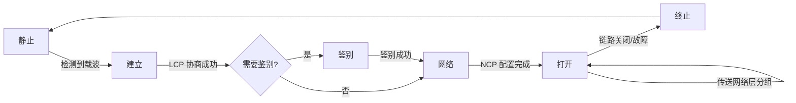
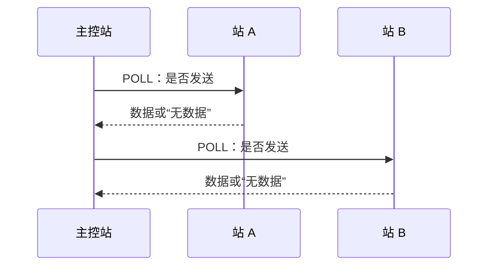
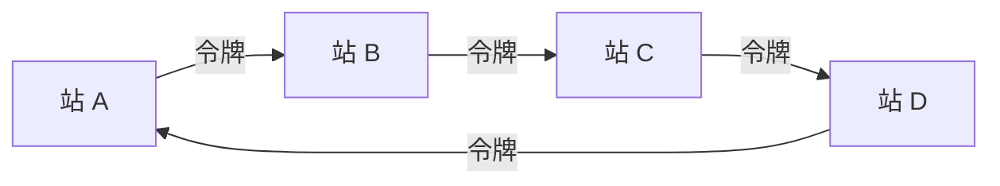
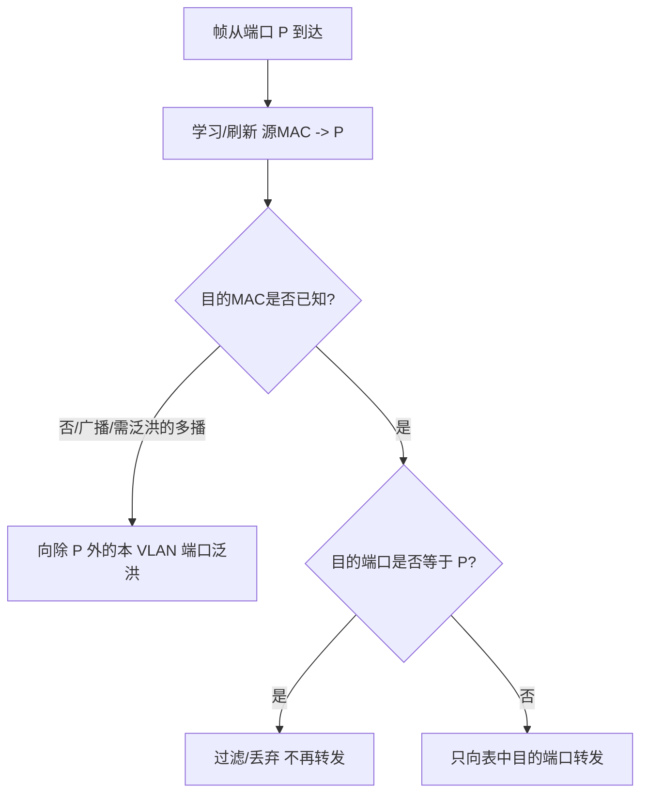
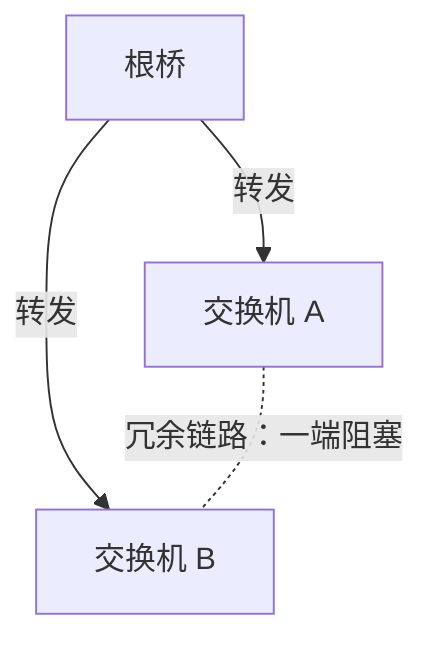
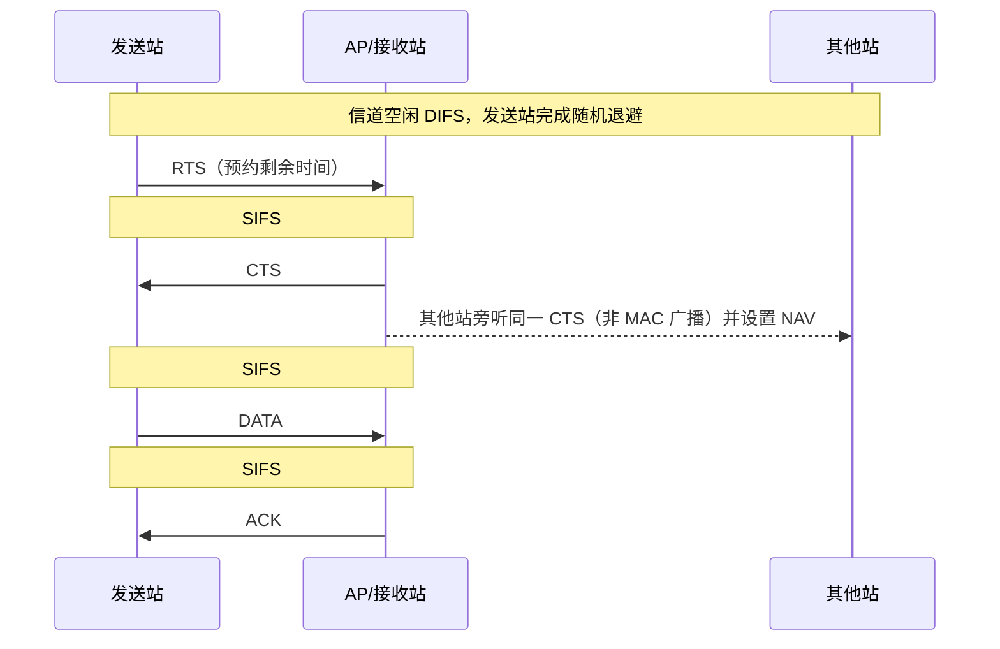

> 描述：数据链路层在相邻节点间传输帧。主线是：把网络层分组封装成帧并透明传输；检出比特差错；在需要时以 ARQ 提供可靠传输。局域网侧再延伸到 MAC、以太网、交换机、VLAN 和 802.11 无线 LAN。

> **NOTE** · 原始知识网（点击展开）
> 

本篇按“**链路层基本问题 → PPP 点到点链路 → 共享介质访问 → 以太网与交换 → VLAN → 802.11 WLAN**”整理。公式中的传播时延、发送时延和窗口均先统一单位；涉及 ACK 编号时以题目给出的语义为准。

## 3.1 数据链路层的三大功能

> **NOTE** · 教材补充：链路、数据链路与服务边界
> **链路**是相邻节点之间的物理通道；**数据链路**是在物理链路上加入实现帧同步、介质访问、差错处理等所需的硬件和协议后形成的逻辑传输通道。数据链路层主要解决同一段链路上相邻节点间的帧传送，不负责跨越多台路由器的端到端选路。

不同链路协议可向网络层提供不同强度的服务：

| 服务 | 是否先建立逻辑连接 | 是否逐帧确认 | 适用思路 |
| --- | --- | --- | --- |
| 无确认的无连接服务 | 否 | 否 | 误码率低或由上层恢复，如常见以太网数据服务 |
| 有确认的无连接服务 | 否 | 是 | 每帧独立确认，适合误码率较高的链路 |
| 有确认的面向连接服务 | 是 | 是，并维持顺序与状态 | 建立、传输、释放三个阶段，适合要求链路层可靠有序交付的场景 |

这些是服务模型，不等于所有数据链路协议都必须实现三种。链路层是否重传、是否流量控制，必须看具体协议；以太网能用 FCS 检错并丢弃坏帧，但通常不在 MAC 层为普通数据帧确认和重传。

```text
网络层分组
   -> 封装成帧与透明传输
   -> 差错检测
   -> 发生差错后按需可靠传输
   -> 相邻节点的网络层
```

### 3.1.1 封装成帧与透明传输

+ **封装成帧**：在网络层分组前后加入首部、尾部，形成帧；首部/尾部包含地址、控制、帧界定、检错等信息。
+ **透明传输**：无论帧的数据部分出现何种比特组合，接收端均能正确还原原始数据，不把数据误认为帧定界符。
+ 若数据中恰出现帧首/尾界定符，就会破坏边界，需字节填充或比特填充。
+ **MTU**（最大传送单元）限制一帧数据部分可封装的最大网络层分组；超过 MTU 时需由上层或网络层按协议规则处理。

| 成帧/透明传输方法 | 适用与规则 | 关键风险 |
| --- | --- | --- |
| 字符计数法 | 首部用计数字段指出帧内字符数 | 计数字段出错会使后续边界连续失步 |
| 字节填充 | 面向字节；特殊字节前插入转义字节，接收端反转义 | 必须区分帧标志、转义字节与普通数据 |
| 比特填充 | 面向比特；发送端在连续 5 个 `1` 后插入 `0`，接收端删除该填充 `0` | 处理两个边界标志之间的帧内容，不处理边界标志本身 |
| 违规编码法 | 使用物理编码中不会表示普通数据的保留信号界定帧 | 依赖物理层编码存在可用的非法/保留组合 |

PPP 是点到点链路常见协议：异步链路采用字节填充，同步链路采用零比特填充；HDLC 等比特面向协议也常结合比特填充。

### 3.1.2 差错检测

| 方法 | 能力与要点 |
| --- | --- |
| 奇偶校验 | 加 1 位使 1 的总数为奇/偶；可检奇数位错误，不能可靠检偶数位错误 |
| CRC 循环冗余校验 | 发送端按生成多项式 $G(x)$ 对数据做模 2 除法，将余数作为 FCS；接收端再除，余数为 0 才通过校验 |

若生成多项式 $G(x)$ 的最高次数为 $r$，发送端把数据 $M$ 左移 $r$ 位，再做模 2 除法：

$$R=(M\cdot 2^r)\bmod G$$

发送序列为 $M\cdot2^r+R$。模 2 加减均为异或，不产生进位或借位。接收端用同一 $G$ 相除；余数非 0 可判错，余数为 0 只表示“未检出错误”，并非数学上绝对无错。

CRC 是**检错**机制，不自动纠错；FCS 是帧中实际携带的检错序列。校验失败后是否重传由可靠传输协议决定。

### 3.1.3 可靠传输

无线链路误码率较高，常要求链路层向网络层提供可靠传输。核心机制是确认、序号、超时和重传。

| 协议 | 发送窗口 | 接收窗口 | 确认与重传 | 接收失序帧 |
| --- | ---: | ---: | --- | --- |
| 停止—等待 | 1 | 1 | 每帧确认；超时只重传当前帧 | 不涉及流水失序 |
| 回退 N 帧 GBN | $1<W_S\le2^m-1$ | 1 | 通常累计确认；最早未确认帧超时后重传它及其后所有已发送未确认帧 | 丢弃 |
| 选择重传 SR | 通常 $W_S\le2^{m-1}$ | $W_R>1$ | 逐帧/选择确认；只重传超时或被拒绝帧 | 缓存接收窗口内的帧 |

其中 $m$ 为帧序号位数，序号空间为 $2^m$。一般约束为：

$$GBN:\quad W_S\le2^m-1$$

$$SR:\quad W_S+W_R\le2^m$$

若 SR 收发窗口相等，则 $W_S=W_R\le2^{m-1}$。`ACK i` 可能表示“已经确认到帧 $i$”，也可能表示“下一期待帧为 $i$”；必须先读题目定义。

设 $T_D$、$T_A$ 分别为数据帧和确认帧的发送时延，$T_p$ 为**单向传播时延**。忽略处理与排队时延时，停止等待利用率为：

$$U=\frac{T_D}{T_D+2T_p+T_A}$$

若发送窗口为 $W$，忽略处理时间，流水线发送时间利用率为：

$$U=\min\left(1,\frac{WT_D}{T_D+2T_p+T_A}\right)$$

满流水至少需要：

$$W_{min}=\left\lceil\frac{T_D+2T_p+T_A}{T_D}\right\rceil$$

若题目给的是“往返传播时延”，可直接用它替换 $2T_p$；若给的是从开始发送数据帧到完整收到 ACK 的实测确认周期，则该数值通常已含 $T_D$、$T_A$，不能再重复相加。这里不把含处理、排队和发送时延的广义网络 RTT 与 $2T_p$ 混为一谈。

流水线协议可同时发送多帧，提升链路利用率；窗口大小受序号位数、带宽时延积和接收缓冲限制。若题目问有效载荷 goodput，还需在 $U\times R$ 基础上乘 $L_{payload}/L_{frame}$，不能把首部、尾部和填充当作有效载荷。

## 3.2 点对点协议 PPP

PPP 面向点到点全双工链路，可承载多种网络层协议。它结构简单、支持链路参数协商和身份鉴别，但**不提供序号、确认、重传与流量控制**；FCS 出错的帧直接丢弃，因此 PPP 本身提供无连接、不可靠的数据报服务。

### 3.2.1 PPP 的组成与帧格式

PPP 由三部分组成：

1. **封装方法**：把 IP 等网络层分组封装为 PPP 帧，并用 FCS 检错。
2. **LCP（链路控制协议）**：建立、配置、测试和终止数据链路，可协商 MRU、鉴别协议等参数。
3. **NCP（网络控制协议）**：为不同网络层协议配置参数；承载 IPv4 时常用 IPCP。

```text
| Flag | Address | Control | Protocol | Information | FCS | Flag |
|  1B  |   1B    |   1B    |  1/2B    | 0~1500B*   |2/4B |  1B  |
   7E       FF        03
```

`*` 信息字段默认最大长度为 1500 B，可经 LCP 协商。`Protocol` 指明信息字段承载 IP、LCP、NCP 等哪类分组。首尾 `Flag=0x7E` 可共用；`Address=0xFF`、`Control=0x03` 在常规 PPP 中固定，不承担多站寻址或可靠传输序号功能。

### 3.2.2 透明传输

| 链路方式 | 发送端规则 | 接收端规则 |
| --- | --- | --- |
| 异步、面向字节 | 对两个边界标志之间需转义的帧字节执行字节填充；`0x7E -> 0x7D 0x5E`，`0x7D -> 0x7D 0x5D`，控制字节按 ACCM 规则处理 | 读到 `0x7D` 后，将下一字节与 `0x20` 异或以恢复原字节 |
| 同步、面向比特 | 两个边界标志之间每出现连续 5 个 `1` 就插入一个 `0` | 连续 5 个 `1` 后若为填充 `0`，删除它 |

> **WARNING** · 易错
> “加 `0x20`”不是通用反转义规则。PPP 异步字节转义的统一表达是与 `0x20` **异或**；例如 `0x5E XOR 0x20 = 0x7E`。

### 3.2.3 链路工作阶段



链路主线是“静止 → 建立 → 可选鉴别 → 网络 → 打开 → 终止”。LCP 管链路本身，NCP 配置对应网络层协议；二者不能混淆。

## 3.3 MAC 与局域网

IEEE 802 把局域网数据链路层划分为 LLC（逻辑链路控制）与 MAC（介质访问控制）两个子层。LLC 向网络层提供统一接口；MAC 负责成帧、MAC 寻址以及共享介质访问。现代以太网考题主要集中在 MAC 帧、交换与 VLAN。

### 3.3.1 介质访问控制方法

广播信道上多个站共享介质，必须决定“谁在何时发送”。常见方法可分为：

| 类别 | 典型方法 | 特点 |
| --- | --- | --- |
| 静态划分 | FDM、TDM、WDM、CDM | 预先分资源，无碰撞；突发业务时可能浪费空闲份额 |
| 随机访问 | ALOHA、时隙 ALOHA、CSMA、CSMA/CD、CSMA/CA | 站点自主竞争，负载低时灵活；负载高时碰撞/退避增多 |
| 受控访问 | 轮询、令牌传递 | 发送权受控，重负载时较稳定；存在控制开销和单点/令牌故障处理 |

+ **纯 ALOHA**：随时发送，碰撞后随机重传；易受干扰时间为两倍帧时，最大吞吐量 $1/(2e)\approx18.4\%$。
+ **时隙 ALOHA**：只能在时隙边界发送，最大吞吐量 $1/e\approx36.8\%$。
+ **1-坚持 CSMA**：信道空闲立即发送，忙则持续监听；容易在刚转为空闲时集中碰撞。
+ **非坚持 CSMA**：忙时随机等待后再监听，碰撞较少但时延和空闲浪费可能增大。
+ **$p$-坚持 CSMA**：时隙信道空闲时以概率 $p$ 发送，以 $1-p$ 推迟到下一时隙。

> 纯 ALOHA 与时隙 ALOHA 的上述最大吞吐量来自固定帧长、独立随机发送/重传且总到达近似泊松过程的经典模型；它们用于比较协议机制，不应脱离这些假设当作任意实际网络的固定上限。

#### 轮询访问

> **NOTE** · 教材补充
> 轮询由一个主控站按顺序询问各从站是否需要发送。只有获得许可的站才能占用信道，因此正常工作时不会因争用而碰撞。



+ **优点**：访问次序确定，可给出等待时间上界；负载高时不会把大量带宽浪费在碰撞和随机退避上，也便于按优先级或配额调度。
+ **开销**：每次询问、应答和主控站切换都占用时间；大量空闲站仍会产生轮询开销，低负载下往往不如随机访问灵活。
+ **故障边界**：主控站是单点故障；某从站无响应时，主控站必须依靠超时跳过，否则整个轮询可能停滞。
+ **等待上界**：正常、有限站点且每站占用时间受限时，一个站最多等待一轮轮询；若允许某站无限期占用，便不能据此声称有界等待。

#### 令牌传递

> **NOTE** · 教材补充
> 令牌是一个表示“发送许可”的特殊控制帧。站点按规定的逻辑顺序传递令牌，只有持有令牌的站可发送；发送完毕或达到持有时间上限后，再把令牌交给下一站。



+ **优点**：正常情况下无碰撞；每站最长持有时间受限时可形成有界等待，重负载下吞吐量和时延比随机争用更可预测。
+ **开销**：即使没有数据，也要传递令牌；站点少、负载低或环很长时，等待令牌本身可能比直接争用更慢。
+ **管理问题**：令牌丢失需要监测并重新生成；重复令牌必须删除；站点或链路故障时还要重构逻辑环。系统必须保证“恢复令牌”不会长期产生多个有效令牌。
+ **逻辑环不等于物理环**：令牌传递描述的是发送权的逻辑顺序，具体物理拓扑与实现可以不同，不能仅凭“有令牌”断定所有链路一定是物理环形。

#### 三类方法的负载边界

| 场景 | 更合适的思路 | 原因与代价 |
| --- | --- | --- |
| 业务持续且每站需求稳定 | 静态划分 | 无争用，但空闲份额不易临时让给别站 |
| 业务突发、平均负载较低 | 随机访问 | 无需维护发送权，轻载时接入快；重载时碰撞和退避急剧增加 |
| 负载较高或需要确定性等待 | 受控访问 | 无碰撞且可调度；要承担轮询/令牌和故障恢复开销 |

以上只是一般取舍，不是绝对结论；传播时延、站点数量、帧长分布、优先级和实现协议都会改变实际性能。

### 3.3.2 MAC 地址与以太网帧

MAC 地址是网络接口的链路层标识，IEEE 802 MAC 通常为 48 bit：前 24 bit 通常含 OUI 厂商标识，后 24 bit 由厂商分配。一个 48 bit 地址常写作 6 个十六进制字节，如 `02-11-22-33-44-55`。

+ 单播目的地址只交付给一个接口；广播 MAC 为 `FF-FF-FF-FF-FF-FF`；多播有特定地址范围。
+ MAC 只用于同一链路/局域网内交付；跨网通信仍靠 IP 与路由。
+ 首字节最低有效位是 **I/G 位**：0 表示单个地址，1 表示组地址（多播/广播）。次低位是 **U/L 位**：0 表示全局管理，1 表示本地管理。
+ 判断 I/G、U/L 位时看**首字节的低位**，不要误看整串地址最右端。

#### Ethernet II 与 IEEE 802.3

```text
前导码 7B | SFD 1B | 目的 6B | 源 6B | 类型/长度 2B | 数据+填充 46~1500B | FCS 4B
                       <------------ MAC 帧：64~1518B ------------>
```

| 项目 | Ethernet II | IEEE 802.3 |
| --- | --- | --- |
| 2 B 字段含义 | EtherType，指出上层协议 | 数据字段长度，后接 LLC/SNAP 等 |
| 常用判别 | 值 $\ge1536$（`0x0600`）按类型解释 | 值 $\le1500$ 按长度解释 |
| 其余主体 | 目的/源 MAC、数据、FCS 基本相同 | 目的/源 MAC、数据、FCS 基本相同 |

+ MAC 帧最小 64 B、最大 1518 B，均从目的 MAC 算到 FCS；**不包含** 7 B 前导码与 1 B 帧开始定界符 SFD。
+ 最小数据字段为 46 B，不足时补填充；接收端如何区分有效数据与填充依赖上层长度信息。
+ 相邻以太网帧之间至少保留 96 bit time 的帧间间隔。
+ IEEE 802.1Q 在源 MAC 后插入 4 B VLAN 标签（常见 TPID 为 `0x8100`），普通最大标记帧由 1518 B 增至 **1522 B**。

### 3.3.3 共享式以太网：CSMA/CD

共享总线/集线器以太网使用 CSMA/CD：先载波监听，空闲再发送；边发边检测冲突，冲突后立即停止、发送强化干扰信号，按截断二进制指数退避等待后重发。

+ 只有共享、半双工以太网需要 CSMA/CD；交换式全双工以太网无冲突，不使用它。
+ 最小帧长保证发送端在发送结束前能检测最远端冲突；最远端往返传播时间决定槽时间。

设最远两站单向传播时延为 $\tau$、链路速率为 $R$：

$$T_{frame}\ge2\tau,\qquad L_{min}\ge2\tau R$$

争用期（槽时间）为 $2\tau$。传统以太网将其取为 512 bit time；10 Mb/s 下为 $51.2\,\mu s$。发生第 $i$ 次碰撞后：

$$k=\min(i,10),\qquad r\in\{0,1,\ldots,2^k-1\}$$

$$T_{backoff}=r\times512\text{ bit time}$$

发送站检测到碰撞后立即停止当前帧、发送强化干扰信号，再退避重传；连续碰撞 16 次仍失败则放弃并向上层报告。常用近似效率公式为：

$$\eta\approx\frac{1}{1+5a},\qquad a=\frac{\tau}{T_{frame}}$$

它用于估算传播时延相对帧发送时间对效率的影响；若题目给出另一模型或精确参数，以题设为准。

### 3.3.4 集线器、网桥与交换机

| 设备 | 层次 | 转发依据 | 冲突域 | 广播域 |
| --- | --- | --- | --- | --- |
| 集线器 Hub | 物理层 | 比特复制到其他端口 | 所有端口共 1 个 | 所有端口共 1 个 |
| 网桥 Bridge | 数据链路层 | MAC 表 | 每个端口隔离 | 默认仍为 1 个 |
| 交换机 Switch | 数据链路层，多端口网桥 | MAC 表/端口 | 每个端口 1 个 | 每个 VLAN 1 个 |
| 路由器/三层交换 | 网络层 | IP 路由表 | 每接口隔离 | 每三层接口/VLAN 隔离 |

交换机是多端口二层设备，维护 MAC 地址表。对每个到达帧，先按**源 MAC + 入端口**学习或刷新表项，再处理目的 MAC：



+ MAC 表是动态软状态；超时未刷新会**老化**删除，主机移动后也可通过新源帧更新端口。
+ 未知单播泛洪不等于广播：目的 MAC 仍是单播，只是交换机暂时不知道出口。
+ 透明网桥/交换网络若存在二层环路，泛洪帧可能无限循环并造成广播风暴；STP 通过逻辑阻塞冗余路径形成无环生成树，链路故障时可重新收敛。

#### 生成树协议 STP

> **NOTE** · 教材补充
> 以太网帧没有类似 IP TTL 的逐跳寿命字段。二层出现环路时，广播、未知单播或某些多播帧可能不断复制循环，同时导致 MAC 表在不同端口间反复抖动。STP 保留物理冗余链路，但把部分端口置为不转发状态，使当前的**逻辑转发拓扑**成为一棵无环树。

经典 STP 的选举主线是：

1. **选根桥**：桥 ID 最小的交换机成为根桥；桥 ID 由优先级和地址等字段共同决定，不能只比较 MAC 地址而忽略优先级。
2. **选根端口**：每台非根交换机选择一条到根桥累计路径开销最小的端口作为根端口；并列时再按上游桥 ID、端口 ID 等规则打破平局。
3. **选指定端口**：每个网段选择到根桥路径最优的桥所连接端口作为该段指定端口，负责向该网段转发。
4. **阻塞剩余冗余端口**：根端口和指定端口参与正常转发，其他端口不转发普通数据帧，从而切断环路。

交换机用 BPDU 交换根桥、路径开销和拓扑信息。链路或设备故障后会重新计算并启用备用路径，因此 STP 的目的不是删除冗余，而是在某一时刻只让无环子集转发。重新收敛期间可能短时中断；RSTP 等改进协议用于加快状态迁移。



#### 交换方式

| 方式 | 开始转发时机 | 优点 | 局限 |
| --- | --- | --- | --- |
| 存储转发 | 收完整帧并校验 FCS 后 | 可丢弃错误帧，支持不同端口速率 | 时延至少包含完整帧接收时间 |
| 直通交换 | 读到目的 MAC 后即可 | 转发时延低 | 可能传播坏帧，且更依赖端口速率/缓存条件 |

+ 每端口形成独立冲突域；全双工下不发生冲突。
+ 交换机的学习、转发、泛洪、老化是高频考点，不能把它写成路由器的 IP 路由表。

#### 冲突域与广播域示意

```text
主机 -- Hub -- 主机       整个 Hub：1 个冲突域、1 个广播域
          |
        Switch            每个交换机端口：独立冲突域
       /      \
   VLAN 10   VLAN 20      每个 VLAN：独立广播域
       \      /
       三层转发            跨 VLAN 必须经过路由/三层交换
```

### 3.3.5 VLAN

VLAN 在交换网络中把一个物理 LAN 划分为多个逻辑广播域，隔离广播流量、改善安全与管理。

| 端口模式 | 常见用途 | 入/出方向的典型标签处理 |
| --- | --- | --- |
| Access | 连接普通终端，只承载一个 VLAN | 入端无标签帧按 PVID 归入 VLAN；出端通常去标签 |
| Trunk | 交换机、AP、路由器等之间承载多个 VLAN | 多数 VLAN 帧保留 802.1Q 标签；本征/PVID VLAN 是否无标签依配置 |
| Hybrid | 一个端口按策略承载多个 VLAN | 可分别配置哪些 VLAN 出端带标签、哪些不带标签 |

跨 VLAN 的三层通信必须经过路由/三层交换，二层交换机本身不会跨 VLAN 转发广播域流量。

### 3.3.6 以太网速率演进

| 代际 | 典型速率 | 双工与 CSMA/CD 要点 |
| --- | ---: | --- |
| 标准以太网 | 10 Mb/s | 共享/半双工使用 CSMA/CD，最小帧 64 B |
| 快速以太网 | 100 Mb/s | 兼容 MAC 帧格式；半双工仍可用 CSMA/CD，全双工不用 |
| 千兆以太网 | 1 Gb/s | 主要采用交换式全双工；半双工为兼容 CSMA/CD 曾引入载波延伸/帧突发 |
| 10 吉比特以太网 | 10 Gb/s | 只工作于全双工交换链路，不使用 CSMA/CD |

速率提升没有改变 48 bit MAC 地址与常见以太网 MAC 帧主体。判断是否使用 CSMA/CD 的关键不是“是否叫以太网”，而是链路是否处于**共享、半双工冲突域**。

## 3.4 无线局域网 IEEE 802.11

无线介质不能可靠边发边听，存在隐藏站等问题，故 802.11 使用 CSMA/CA（载波侦听多路访问/冲突避免），而不是 CSMA/CD。

### 3.4.1 体系结构

| 名称 | 含义 |
| --- | --- |
| STA | 具有 802.11 接口的站点 |
| BSS | 基本服务集；一组可直接协调通信的站点 |
| BSA | 基本服务区；一个 BSS 的无线覆盖范围 |
| AP | 接入点；基础设施 BSS 的中心站，并接入分配系统 |
| SSID | 用户可见的网络名称；多个 BSS 可配置相同 SSID |
| BSSID | 标识具体 BSS 的地址；基础设施网络中通常是 AP 无线接口 MAC |
| DS | 分配系统；连接多个 AP/BSS，常由有线以太网实现 |
| Portal | 802.11 分配系统与其他 802.x LAN/外部网络的逻辑入口 |
| ESS | 扩展服务集；由 DS 连接的一个或多个基础设施 BSS，对上层呈现为一个 LAN |

+ **基础设施网络**：STA 先与 AP 关联，通常通过 AP 转发，即使通信双方处于同一 BSS。
+ **Ad hoc/IBSS**：没有 AP，站点临时组成独立基本服务集并直接通信。
+ SSID 是网络名，BSSID 标识具体 BSS，BSA 是覆盖区域；三者不要混淆。

### 3.4.2 CSMA/CA 与帧间间隔

+ 发送前进行物理/虚拟载波监听；新到达的帧若发现信道已持续空闲 DIFS，可按规则直接发送。若信道忙、需要重传或处于发送后退避，则在信道重新空闲 DIFS 后执行随机退避。
+ 对典型普通单播数据帧，计数到 0 后发送 DATA；接收方经 SIFS 回 ACK。未收到预期 ACK 时按规则扩大竞争窗口并重试，直到成功或达到重试上限；组播/广播通常不逐帧 ACK，块确认等模式另有确认方式。
+ RTS/CTS 可缓解隐藏站：RTS、CTS 中携带持续时间，旁听站设置 NAV 虚拟载波监听。
+ SIFS 小于 DIFS，使 ACK、CTS 等即时控制帧优先于普通竞争发送。

帧间间隔优先级为：

$$SIFS<PIFS<DIFS$$

| 间隔 | 典型用途 |
| --- | --- |
| SIFS | ACK、CTS、分片间响应等即时应答，优先级最高 |
| PIFS | 点协调功能 PCF 的无竞争访问，优先于普通 DCF 站 |
| DIFS | DCF 普通数据站竞争介质前等待 |

退避计数每经过一个空闲时隙减 1；一旦介质变忙就**冻结**，待介质再次空闲并持续 DIFS 后从剩余值继续，而不是重新抽取。发送失败时扩大竞争窗口；成功后按规则执行发送后退避，防止单个站持续独占。

### 3.4.3 隐藏站、RTS/CTS 与 NAV

+ **隐藏站**：A、C 彼此听不到，却都能到达同一 AP；二者同时发送会在 AP 处碰撞。
+ **暴露站**：某站听到邻站发送后过度退避，但它向另一接收方发送本可不造成干扰，导致空间复用下降。
+ RTS/CTS 主要缓解隐藏站：旁听 RTS 或 CTS 的站按 Duration 设置 NAV，在预约期内保持静默。它不能消除控制帧碰撞、误码或所有无线冲突。

CTS 发出后的 NAV 为：

$$NAV_{CTS}=SIFS+T_{DATA}+SIFS+T_{ACK}$$



### 3.4.4 802.11 地址字段

| 去往 DS | 来自 DS | 地址 1 | 地址 2 | 地址 3 | 地址 4 |
| ---: | ---: | --- | --- | --- | --- |
| 0 | 0 | DA/RA | SA/TA | BSSID | 未使用 |
| 1 | 0 | BSSID/RA（接收 AP） | SA/TA（无线源站） | DA（最终目的） | 未使用 |
| 0 | 1 | DA/RA（无线目的站） | BSSID/TA（发送 AP） | SA（原始源） | 未使用 |
| 1 | 1 | RA | TA | DA | SA |

RA/TA 是当前无线一跳的接收方/发送方，DA/SA 是 MSDU 的最终目的/原始源。普通基础设施 BSS 最常考 `To DS=1, From DS=0` 与 `To DS=0, From DS=1`；四地址同时使用主要见无线分配系统桥接。

## 3.5 高频边界与易错点

+ 数据链路层解决相邻节点的帧传输；端到端可靠性属于运输层问题，二者层次不同。
+ CRC/FCS 是检错，不等于纠错或自动重传；余数为 0 也只能说“未检出错误”。
+ PPP 有 FCS 却仍不可靠，因为它没有序号、ACK、超时重传和流量控制。
+ 以太网 64~1518 B 不含前导码与 SFD；802.1Q 普通最大标记帧为 1522 B，帧间间隔为 96 bit time。
+ Hub 不隔离冲突域；交换机每端口隔离冲突域，但同一 VLAN 默认仍属于同一广播域。
+ 交换机按源 MAC 学习、按目的 MAC 查表；目的端口等于入端口时过滤，未知单播才泛洪。
+ 全双工交换式以太网不使用 CSMA/CD；10 Gb/s 以太网只支持全双工。
+ VLAN 是二层广播域划分；跨 VLAN 必须三层转发。Access、Trunk、Hybrid 的具体标签行为要结合 PVID/端口配置。
+ 802.11 用 CSMA/CA，退避遇忙冻结；RTS/CTS 缓解但不能彻底消除隐藏站和碰撞。

## 3.6 题型索引

+ [1 题型 - 三种可靠传输协议](/en/notes/cs408-0d03dc451308/)：停止等待、GBN、SR 的窗口、ACK 与重传范围。
+ [2 题型 - 信道利用率相关计算](/en/notes/cs408-df715a00a371/)：传播/发送时延、流水窗口、序号位数与 goodput。
+ [3 题型 - CSMA CD相关信息计算](/en/notes/cs408-b5bf851a87da/)：争用期、最小帧长、Hub 延迟与二进制指数退避。
+ [4 题型 - 透明传输与PPP协议](/en/notes/cs408-34e57b06068c/)：零比特填充、字节反转义、PPP 状态与不可靠性。
+ [5 题型 - CSMA CA协议](/en/notes/cs408-b4e470ce1426/)：SIFS/DIFS、退避、RTS/CTS、NAV 与四地址映射。

## 相关知识

+ **科目导航**：[计算机网络导航](/en/notes/cs408-b78f75dd8c69/)
+ **阅读顺序**：[上一篇：检错与纠错机制](/en/notes/cs408-1c2f720beeaf/) · [下一篇：三种可靠传输协议](/en/notes/cs408-0d03dc451308/)

## 3.7 本节复盘

+ 数据链路层围绕“成帧透明传输、检错、可靠传输”展开；透明传输靠字节/比特填充。
+ CRC 用模 2 除法检错；停止等待、GBN、SR 通过确认、序号、超时重传提供不同程度的可靠性与效率。
+ MAC 是二层本地标识；共享以太网用 CSMA/CD，交换式全双工不使用 CSMA/CD。
+ 交换机按源 MAC 学习、按目的 MAC 转发；VLAN 划分逻辑广播域，跨 VLAN 需三层转发。
+ 802.11 用 CSMA/CA、退避及可选 RTS/CTS 缓解无线冲突/隐藏站；典型单播交换另用 ACK/重传提高单跳可靠性，不能概括为所有帧必达或逐帧确认。
+ PPP 由封装、LCP 和 NCP 组成；同步链路零比特填充，异步链路按 `XOR 0x20` 字节转义。
+ 以太网帧、VLAN 标签、交换机学习/STP 与 WLAN 四地址必须结合具体字段和转发方向判断，不能只背设备层次。
