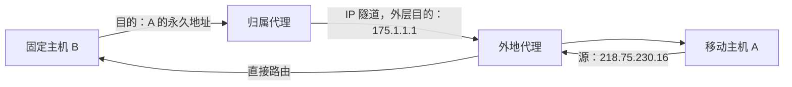

> 描述：移动 IP 让主机离开归属网络后仍使用永久地址。外部主机发给移动主机的分组先到归属代理，再经 IP 隧道送往转交地址；移动主机回包可以经外地代理直接发给通信对端，形成三角路由。

## 8.1 地址与代理角色

| 概念 | 作用 |
| --- | --- |
| 移动主机 | 在不同网络间移动，但保持永久归属地址 |
| 归属网络 | 移动主机永久地址所属的网络 |
| 永久地址/归属地址 | 通信对端始终用来标识移动主机的稳定 IP 地址 |
| 归属代理 | 位于归属网络，截获发往移动主机永久地址的分组并建立隧道 |
| 外地网络 | 移动主机当前接入的非归属网络 |
| 外地代理 | 在外地网络中协助移动主机接收隧道分组并向外转发 |
| 转交地址 COA | 表示移动主机当前位置，是隧道外层首部的目的地址 |

本题地址对应关系：

| 对象 | 地址 |
| --- | --- |
| 移动主机 A 的永久地址 | `218.75.230.16/24` |
| A 的归属网络 | `218.75.230.0/24` |
| A 在外地代理处获得的转交地址 | `175.1.1.1/16` |
| 外地网络 | `175.1.0.0/16` |
| 固定主机 B | Internet 中的固定通信对端，具体 IP 未给出 |

注意：`218.75.230.0/24` 是归属网络前缀，不是 A 的主机地址；A 的永久地址是 `218.75.230.16`。

## 8.2 移动主机离开归属网络后的准备

移动主机到达外地网络后，需要完成：

1. 发现外地代理或获得可用转交地址。
2. 把“永久地址 -> 当前转交地址”的绑定注册给归属代理。
3. 归属代理以后把发往永久地址的分组封装到隧道中，送到该转交地址。

移动主机改变的是当前接入位置，不是通信对端看到的永久地址。

## 8.3 固定主机 B 向移动主机 A 发送 P1

### 8.3.1 原始数据报

B 不需要知道 A 当前在哪个外地网络，仍按 A 的永久地址发送：

```text
原始源 IP：固定主机 B 的 IP
原始目的 IP：218.75.230.16
```

普通 IP 路由会先把该数据报送到 A 的归属网络，由归属代理截获。

### 8.3.2 归属代理建立隧道

归属代理保留原 IP 数据报作为隧道载荷，再添加一个外层 IP 首部：

```text
外层源 IP：归属代理地址（题目未给出）
外层目的 IP：175.1.1.1
载荷：原始 B -> A 数据报
```

所以题目问“P1 从归属代理转发出来时的目的地址”，指隧道外层目的地址，答案是转交地址：

```text
175.1.1.1
```

外地代理收到隧道分组后解封装，再把原始数据报交付给移动主机 A。

## 8.4 移动主机 A 向固定主机 B 发送 P2

按题图采用的直接回程方式，A 的 P2 可由外地代理直接发往 B，不必再绕行归属代理：

```text
源 IP：218.75.230.16
目的 IP：固定主机 B 的 IP
```

即使 A 当前位于 `175.1.0.0/16`，对 B 呈现的源地址仍是 A 的永久地址，而不是转交地址 `175.1.1.1`，也不是归属网络地址 `218.75.230.0`。

## 8.5 三角路由

本题形成的路径不对称：



+ 去程：`B -> 归属代理 -> 外地代理 -> A`。
+ 回程：`A -> 外地代理 -> B`。

这种“去程绕归属代理、回程直接返回”的不对称路径称为三角路由。

## 8.6 模拟题

题目询问：

1. P1 从 A 的归属代理转发出来时的目的地址。
2. P2 从外地代理转发出来时的源地址。

分析：

+ P1 需要由归属代理封装并隧道转发到 A 当前的转交地址，所以外层目的地址为 `175.1.1.1`。
+ P2 可由外地代理直接发给 B，但源主机身份仍是移动主机 A，所以源地址为永久地址 `218.75.230.16`。

```text
P1 的目的地址：175.1.1.1
P2 的源地址：218.75.230.16
```

**答案：A。**

## 8.7 解题步骤

1. 先区分永久地址、归属网络前缀和转交地址。
2. 对固定主机发往移动主机的分组，画出 `通信对端 -> 归属代理 -> 外地代理 -> 移动主机`。
3. 区分原始 IP 首部与隧道外层 IP 首部：原始目的仍是永久地址，外层目的才是转交地址。
4. 对移动主机向外发送的分组，按题设判断是否直接回程；若直接回程，源 IP 仍填永久地址。
5. 地址选择题要检查给出的是主机地址还是网络地址，不能把 `/24` 网络前缀当作主机源地址。

## 8.8 易错点

+ 通信对端始终把数据发往移动主机的永久地址，不直接使用转交地址。
+ 归属代理隧道外层首部的目的地址是转交地址；内层原始目的地址仍是移动主机永久地址。
+ `218.75.230.0/24` 是网络，`218.75.230.16/24` 才是 A 的永久主机地址。
+ A 从外地网络直接回包时，源地址仍使用 `218.75.230.16`，不能改成外地代理 `175.1.1.1`。
+ 外地代理与归属代理角色不同：归属代理截获并封装，外地代理接收隧道并向移动主机交付。
+ 去程和回程可能不对称，这正是三角路由的特征。

## 相关知识

+ **科目导航**：[计算机网络导航](/en/notes/cs408-b78f75dd8c69/)
+ **阅读顺序**：[上一篇：IPv6](/en/notes/cs408-324f552507c6/) · [下一篇：运输层思维导图](/en/notes/cs408-59e41ea74a00/)
+ **关联专题**：[网络层总纲](/en/notes/cs408-fe8e22cc2489/)

## 8.9 本节复盘

+ 移动 IP 通过永久地址保持主机身份，通过转交地址表示当前接入位置。
+ 固定主机发给移动主机的数据先到归属代理，再由归属代理隧道转发到外地代理。
+ P1 的原始目的地址是 `218.75.230.16`，隧道外层目的地址是 `175.1.1.1`。
+ 移动主机可经外地代理直接向固定主机回包，源地址仍为永久地址 `218.75.230.16`。
+ 本题两个空依次为 `175.1.1.1`、`218.75.230.16`，答案 A。
+ 去程绕归属代理、回程直接返回，构成三角路由。
