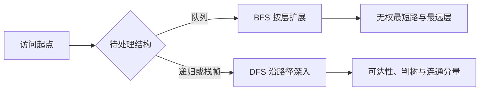

> **ABSTRACT** · 本节范围
> 本笔记逐页覆盖原 PDF 的 13 页和 12 道实际题目：题 0～8、10、11、13。原文件本身没有题 9、12。内容包括两种存储结构、欧拉路、BFS/DFS、无权最短路、可达性、判树、最远点、非递归 DFS、连通分量和存储转换。代码统一为 C++17。

## 0. 图的存储结构与基本操作

### 题 0：邻接表、邻接矩阵与无向边插入

以下结构统一支持顶点编号 `0...n-1`。`edgeCount` 统计逻辑边数：无向边虽然在邻接表中存两份邻接关系，但只计 1 条边。

~~~cpp
#include <algorithm>
#include <cstddef>
#include <queue>
#include <stack>
#include <stdexcept>
#include <utility>
#include <vector>

struct AdjListGraph {
    bool directed = false;
    std::size_t edgeCount = 0;
    std::vector<std::vector<int>> adjacent;

    explicit AdjListGraph(std::size_t vertexCount = 0,
                          bool isDirected = false)
        : directed(isDirected), adjacent(vertexCount) {}
};

struct AdjMatrixGraph {
    bool directed = false;
    std::size_t edgeCount = 0;
    std::vector<std::vector<int>> edge;

    explicit AdjMatrixGraph(std::size_t vertexCount = 0,
                            bool isDirected = false)
        : directed(isDirected),
          edge(vertexCount,
               std::vector<int>(vertexCount, 0)) {}
};

void checkVertex(std::size_t vertexCount, int vertex) {
    if (vertex < 0
            || static_cast<std::size_t>(vertex) >= vertexCount) {
        throw std::out_of_range("vertex index");
    }
}

void addEdge(AdjListGraph& graph, int from, int to) {
    checkVertex(graph.adjacent.size(), from);
    checkVertex(graph.adjacent.size(), to);
    graph.adjacent[from].push_back(to);
    if (!graph.directed) {
        graph.adjacent[to].push_back(from);
    }
    ++graph.edgeCount;
}

void addEdge(AdjMatrixGraph& graph, int from, int to) {
    checkVertex(graph.edge.size(), from);
    checkVertex(graph.edge.size(), to);
    ++graph.edge[from][to];
    if (!graph.directed && from != to) {
        ++graph.edge[to][from];
    }
    ++graph.edgeCount;
}
~~~

邻接表空间为 $O(|V|+|E|)$，适合稀疏图；邻接矩阵空间为 $O(|V|^2)$，判断两点是否邻接为 $O(1)$。原 PDF 的转换题按简单图、无自环理解时，矩阵元素只需 0/1；本稿的矩阵元素记录边的条数，后文转换实现还可处理重边和自环。欧拉路函数按此约定正确计算对角线自环的度数贡献。

> **DANGER** · 原稿错误
> 原稿先使用 `VNode`、`ArcNode` 再声明它们，结点指针和对象成员访问混用 `.`/`->`，最后还返回未声明的 `G`。无向边必须对两个端点各加入一条邻接记录。

## 1. 欧拉路判定

### 题 1：无向图是否存在经过全部边一次的路

对含边的无向图，存在欧拉通路当且仅当：

1. 所有度数非 0 的顶点位于同一连通分量；
2. 奇度顶点数为 0 或 2。

奇度数为 0 时存在欧拉回路；为 2 时存在端点不同的欧拉通路。原题已给“无向连通图且 $|E|>0$”，因此只数奇度顶点也足够；下列实现保留完整检查。

~~~cpp
int matrixDegree(const AdjMatrixGraph& graph, int vertex) {
    int degree = 0;
    for (std::size_t other = 0;
         other < graph.edge.size(); ++other) {
        degree += graph.edge[vertex][other];
    }
    degree += graph.edge[vertex][vertex];
    return degree;  // 自环对无向图度数贡献 2。
}

bool hasEulerTrail(const AdjMatrixGraph& graph) {
    if (graph.directed || graph.edgeCount == 0) {
        return false;
    }

    const int n = static_cast<int>(graph.edge.size());
    int start = -1;
    int oddDegreeVertices = 0;
    for (int vertex = 0; vertex < n; ++vertex) {
        const int degree = matrixDegree(graph, vertex);
        if (degree > 0 && start == -1) {
            start = vertex;
        }
        oddDegreeVertices += degree % 2;
    }

    std::vector<bool> visited(n, false);
    std::queue<int> pending;
    visited[start] = true;
    pending.push(start);
    while (!pending.empty()) {
        const int vertex = pending.front();
        pending.pop();
        for (int next = 0; next < n; ++next) {
            if (graph.edge[vertex][next] > 0 && !visited[next]) {
                visited[next] = true;
                pending.push(next);
            }
        }
    }
    for (int vertex = 0; vertex < n; ++vertex) {
        if (matrixDegree(graph, vertex) > 0 && !visited[vertex]) {
            return false;
        }
    }
    return oddDegreeVertices == 0 || oddDegreeVertices == 2;
}
~~~

矩阵求度和连通检查均需扫描行，时间 $O(|V|^2)$，辅助空间 $O(|V|)$。

## 2. BFS 与无权最短路

### 题 2：广度优先遍历

顶点在“首次发现、准备入队”时立即标记，保证每个顶点最多入队一次。

~~~cpp
std::vector<int> breadthFirstOrder(const AdjListGraph& graph,
                                   int start) {
    checkVertex(graph.adjacent.size(), start);
    std::vector<int> order;
    std::vector<bool> visited(graph.adjacent.size(), false);
    std::queue<int> pending;

    visited[start] = true;
    pending.push(start);
    while (!pending.empty()) {
        const int vertex = pending.front();
        pending.pop();
        order.push_back(vertex);
        for (int next : graph.adjacent[vertex]) {
            if (!visited[next]) {
                visited[next] = true;
                pending.push(next);
            }
        }
    }
    return order;
}
~~~

### 题 3：BFS 求无权图最短距离

`distance[v]` 表示源点到 $v$ 的最少边数，`-1` 表示不可达。首次发现邻点时：

$$
distance[next]=distance[vertex]+1.
$$

~~~cpp
std::vector<int> unweightedDistances(const AdjListGraph& graph,
                                     int source) {
    checkVertex(graph.adjacent.size(), source);
    std::vector<int> distance(graph.adjacent.size(), -1);
    std::queue<int> pending;
    distance[source] = 0;
    pending.push(source);

    while (!pending.empty()) {
        const int vertex = pending.front();
        pending.pop();
        for (int next : graph.adjacent[vertex]) {
            if (distance[next] == -1) {
                distance[next] = distance[vertex] + 1;
                pending.push(next);
            }
        }
    }
    return distance;
}
~~~

邻接表 BFS 和无权最短路均为时间 $O(|V|+|E|)$、空间 $O(|V|)$。原稿把 `visited` 初始化语句放到了循环外，还使用 `INT16_MAX` 作为通用距离哨兵，顶点较多时会溢出；`-1` 足以表达不可达。

## 3. 递归 DFS、可达性与判树

### 题 4：递归深度优先遍历

~~~cpp
void depthFirstImpl(const AdjListGraph& graph,
                    int vertex,
                    std::vector<bool>& visited,
                    std::vector<int>& order) {
    visited[vertex] = true;
    order.push_back(vertex);
    for (int next : graph.adjacent[vertex]) {
        if (!visited[next]) {
            depthFirstImpl(graph, next, visited, order);
        }
    }
}

std::vector<int> depthFirstOrder(const AdjListGraph& graph,
                                 int start) {
    checkVertex(graph.adjacent.size(), start);
    std::vector<bool> visited(graph.adjacent.size(), false);
    std::vector<int> order;
    depthFirstImpl(graph, start, visited, order);
    return order;
}
~~~

### 题 5：判断从顶点 $i$ 到 $j$ 是否有路径

有向图按弧方向判断，故“$i$ 可达 $j$”不一定推出“$j$ 可达 $i$”；无向图才具有对称性。

~~~cpp
bool reachableImpl(const AdjListGraph& graph,
                   int vertex,
                   int target,
                   std::vector<bool>& visited) {
    if (vertex == target) {
        return true;
    }
    visited[vertex] = true;
    for (int next : graph.adjacent[vertex]) {
        if (!visited[next]
                && reachableImpl(graph, next, target, visited)) {
            return true;
        }
    }
    return false;
}

bool hasPath(const AdjListGraph& graph, int from, int to) {
    checkVertex(graph.adjacent.size(), from);
    checkVertex(graph.adjacent.size(), to);
    std::vector<bool> visited(graph.adjacent.size(), false);
    return reachableImpl(graph, from, to, visited);
}
~~~

### 题 6：判断无向图是否为树

非空无向图是树，当且仅当它连通且

$$
|E|=|V|-1.
$$

~~~cpp
bool isUndirectedTree(const AdjListGraph& graph) {
    const std::size_t n = graph.adjacent.size();
    if (graph.directed || n == 0 || graph.edgeCount != n - 1) {
        return false;
    }

    std::vector<bool> visited(n, false);
    std::queue<int> pending;
    visited[0] = true;
    pending.push(0);
    std::size_t reached = 0;
    while (!pending.empty()) {
        const int vertex = pending.front();
        pending.pop();
        ++reached;
        for (int next : graph.adjacent[vertex]) {
            if (!visited[next]) {
                visited[next] = true;
                pending.push(next);
            }
        }
    }
    return reached == n;
}
~~~

单顶点、无边图满足树定义；空图不视为树。三题在邻接表上的时间均为 $O(|V|+|E|)$。

> **DANGER** · 原稿错误
> 多个 DFS 函数混用了 `vertex/v`、`p.adjVertex/p->adjVertex`、`nextArc/netxArc`，数组实参还错误写成 `visit[]`。判树代码把指针与对象混用，并存在同一分支中连续 `return true; return false;` 的不可达语句。

## 4. 最远顶点与非递归 DFS

### 题 7：求无向连通图中距顶点 $v$ 最远的一个顶点

这里的“距离”指最短路径所含的边数。BFS 按距离非递减顺序处理顶点，所以最后一层中的顶点都最远；但同一层可能有多个顶点，单说“最后出队者”会依赖邻接表次序。下列实现规定：若最远顶点不唯一，返回编号最小者，使结果确定。

~~~cpp
int farthestVertex(const AdjListGraph& graph, int source) {
    if (graph.directed || graph.adjacent.empty()) {
        throw std::invalid_argument(
            "a nonempty undirected graph is required");
    }
    const std::vector<int> distance =
        unweightedDistances(graph, source);

    int farthest = source;
    for (int vertex = 0;
         vertex < static_cast<int>(distance.size()); ++vertex) {
        if (distance[vertex] == -1) {
            throw std::invalid_argument(
                "the graph must be connected");
        }
        if (distance[vertex] > distance[farthest]
                || (distance[vertex] == distance[farthest]
                    && vertex < farthest)) {
            farthest = vertex;
        }
    }
    return farthest;
}
~~~

单顶点图返回该顶点自身。时间 $O(|V|+|E|)$，辅助空间 $O(|V|)$。

### 题 8：深度优先遍历的非递归算法

若只在栈中保存顶点，每次回到栈顶后都从第一条邻边重新扫描，虽可借助 `visited` 得到遍历结果，却会反复扫描，且不容易严格复现递归 DFS 的邻接次序。准确模拟递归调用时，栈帧还应保存“下一条待检查邻边”的位置。

~~~cpp
struct DfsFrame {
    int vertex;
    std::size_t nextNeighbor;
};

std::vector<int> depthFirstOrderIterative(
        const AdjListGraph& graph, int start) {
    checkVertex(graph.adjacent.size(), start);
    std::vector<bool> visited(graph.adjacent.size(), false);
    std::vector<int> order;
    std::vector<DfsFrame> path;

    visited[start] = true;
    order.push_back(start);
    path.push_back({start, 0});

    while (!path.empty()) {
        DfsFrame& frame = path.back();
        const auto& neighbors = graph.adjacent[frame.vertex];
        if (frame.nextNeighbor == neighbors.size()) {
            path.pop_back();
            continue;
        }

        const int next = neighbors[frame.nextNeighbor++];
        if (!visited[next]) {
            visited[next] = true;
            order.push_back(next);
            path.push_back({next, 0});
        }
    }
    return order;
}
~~~

每条邻接记录最多检查一次，时间 $O(|V|+|E|)$，显式栈、访问数组和结果均占 $O(|V|)$。其输出与本节递归版本在相同邻接表次序下完全一致。

> **DANGER** · 原稿错误
> 题 7 的代码声明为 `void` 却返回顶点，并把队列下标写成容易越界的前置自增形式；“最后出队”也没有说明同层平局。题 8 出栈后又在 `p == null` 分支重复 `top--`，会跳过栈帧；同时每次都把邻接指针重置到首边，无法正确保存递归回溯位置。

## 5. 连通分量

### 题 10：求无向图的连通分量个数

依次扫描所有顶点；每遇到一个未访问顶点，就从它开始一次 DFS，并把计数加 1。一次 DFS 恰好覆盖一个连通分量。空图的连通分量数为 0。

~~~cpp
std::size_t countConnectedComponents(
        const AdjListGraph& graph) {
    if (graph.directed) {
        throw std::invalid_argument(
            "connected components require an undirected graph");
    }

    std::vector<bool> visited(graph.adjacent.size(), false);
    std::size_t components = 0;
    for (int start = 0;
         start < static_cast<int>(graph.adjacent.size()); ++start) {
        if (visited[start]) {
            continue;
        }

        ++components;
        std::stack<int> pending;
        visited[start] = true;
        pending.push(start);
        while (!pending.empty()) {
            const int vertex = pending.top();
            pending.pop();
            for (int next : graph.adjacent[vertex]) {
                if (!visited[next]) {
                    visited[next] = true;
                    pending.push(next);
                }
            }
        }
    }
    return components;
}
~~~

时间 $O(|V|+|E|)$，辅助空间 $O(|V|)$。对有向图必须先明确求弱连通分量还是强连通分量，不能直接套用本函数。

> **DANGER** · 原稿错误
> 原稿调用 `DFS(G, v, visit[])`，其中 `v` 未定义，数组实参语法也错误；它还没有声明算法只适用于无向图。

## 6. 邻接表与邻接矩阵互转

本文矩阵元素记录边的条数，因此简单图取值为 0/1，也能表示重边；无向图对角元素记录自环条数，而邻接表按常规定义为每个自环保存两条邻接记录。

### 题 11：邻接表转换为邻接矩阵

先逐条统计邻接记录。对无向图，还要验证矩阵关于主对角线对称，并把对角线上成对的自环邻接记录折算为自环条数。

~~~cpp
AdjMatrixGraph toAdjMatrix(const AdjListGraph& graph) {
    const std::size_t n = graph.adjacent.size();
    AdjMatrixGraph result(n, graph.directed);

    for (int from = 0; from < static_cast<int>(n); ++from) {
        for (int to : graph.adjacent[from]) {
            checkVertex(n, to);
            ++result.edge[from][to];
            if (graph.directed) {
                ++result.edgeCount;
            }
        }
    }

    if (!graph.directed) {
        for (int vertex = 0;
             vertex < static_cast<int>(n); ++vertex) {
            if (result.edge[vertex][vertex] % 2 != 0) {
                throw std::logic_error(
                    "an undirected self-loop needs two list entries");
            }
            result.edge[vertex][vertex] /= 2;
            result.edgeCount += result.edge[vertex][vertex];

            for (int other = vertex + 1;
                 other < static_cast<int>(n); ++other) {
                if (result.edge[vertex][other]
                        != result.edge[other][vertex]) {
                    throw std::logic_error(
                        "the undirected adjacency list is asymmetric");
                }
                result.edgeCount += result.edge[vertex][other];
            }
        }
    }

    if (result.edgeCount != graph.edgeCount) {
        throw std::logic_error("inconsistent edge count");
    }
    return result;
}
~~~

### 题 13：邻接矩阵转换为邻接表

有向图扫描全部矩阵元素；无向图只处理主对角线及上三角，避免把一条无向边加入两次。矩阵必须为方阵、元素非负；无向矩阵还必须对称。

~~~cpp
AdjListGraph toAdjList(const AdjMatrixGraph& graph) {
    const std::size_t n = graph.edge.size();
    for (const auto& row : graph.edge) {
        if (row.size() != n) {
            throw std::invalid_argument("the matrix must be square");
        }
    }

    AdjListGraph result(n, graph.directed);
    if (graph.directed) {
        for (int from = 0; from < static_cast<int>(n); ++from) {
            for (int to = 0; to < static_cast<int>(n); ++to) {
                if (graph.edge[from][to] < 0) {
                    throw std::invalid_argument(
                        "edge multiplicity cannot be negative");
                }
                for (int copy = 0;
                     copy < graph.edge[from][to]; ++copy) {
                    addEdge(result, from, to);
                }
            }
        }
    } else {
        for (int vertex = 0;
             vertex < static_cast<int>(n); ++vertex) {
            if (graph.edge[vertex][vertex] < 0) {
                throw std::invalid_argument(
                    "edge multiplicity cannot be negative");
            }
            for (int copy = 0;
                 copy < graph.edge[vertex][vertex]; ++copy) {
                addEdge(result, vertex, vertex);
            }

            for (int other = vertex + 1;
                 other < static_cast<int>(n); ++other) {
                if (graph.edge[vertex][other] < 0
                        || graph.edge[other][vertex] < 0) {
                    throw std::invalid_argument(
                        "edge multiplicity cannot be negative");
                }
                if (graph.edge[vertex][other]
                        != graph.edge[other][vertex]) {
                    throw std::invalid_argument(
                        "an undirected matrix must be symmetric");
                }
                for (int copy = 0;
                     copy < graph.edge[vertex][other]; ++copy) {
                    addEdge(result, vertex, other);
                }
            }
        }
    }

    if (result.edgeCount != graph.edgeCount) {
        throw std::logic_error("inconsistent edge count");
    }
    return result;
}
~~~

邻接表转矩阵需要初始化 $|V|^2$ 个单元并遍历 $O(|E|)$ 条邻接记录，时间为 $O(|V|^2+|E|)$、结果空间为 $O(|V|^2)$；邻接矩阵转邻接表扫描矩阵的时间为 $O(|V|^2+|E|)$，结果空间为 $O(|V|+|E|)$。在简单图中 $|E|=O(|V|^2)$，前者时间才可简写为 $O(|V|^2)$。

> **DANGER** · 原稿错误
> 两个转换函数都把输出图按值传递，调用者得不到修改结果；`edgeNum` 被错误赋成 `vertexNum`。邻接表转矩阵未清零无边位置；矩阵转邻接表把顶点结点误赋为 `null`，也没有区分有向图与无向图的重复计边。

## 7. 原稿纠错与题目覆盖

| 范围 | 原稿主要问题 | 本稿处理 |
|---|---|---|
| 存储与插边 | 类型声明顺序、指针访问、返回值均有编译错误 | 统一两种结构与插边接口 |
| 欧拉路 | 只数奇度，不检查非零度顶点连通性 | 同时检查连通性与 0/2 个奇度顶点 |
| BFS/最短路 | 初始化位置、队列下标、距离哨兵错误 | 首次发现即标记，`-1` 表示不可达 |
| DFS/可达性 | 变量名、成员名和数组实参混乱 | 递归状态显式传引用 |
| 判树 | 指针对象混用，返回分支矛盾 | 严格检查非空、无向、连通和 $|E|=|V|-1$ |
| 最远顶点 | 未说明最远层平局，函数返回类型错误 | 规定平局取最小编号 |
| 非递归 DFS | 重复出栈，未保存下一邻边 | 栈帧保存顶点与邻边位置 |
| 连通分量 | 未定义变量，适用图类型不明 | 逐顶点启动 DFS，并限定无向图 |
| 存储转换 | 按值输出、边数错误、重复计边 | 返回新图并验证矩阵/邻接表不变量 |

| 原题号 | 内容 | 状态 |
|---:|---|---|
| 0 | 图的存储结构与无向边插入 | 已覆盖 |
| 1 | 欧拉通路判定 | 已覆盖并补全连通条件 |
| 2 | BFS | 已覆盖 |
| 3 | BFS 求无权最短路 | 已覆盖 |
| 4 | 递归 DFS | 已覆盖 |
| 5 | 可达性 | 已覆盖 |
| 6 | 无向图判树 | 已覆盖 |
| 7 | 最远顶点 | 已覆盖并规定平局 |
| 8 | 非递归 DFS | 已覆盖并修正回溯状态 |
| 10 | 无向图连通分量 | 已覆盖 |
| 11 | 邻接表转邻接矩阵 | 已覆盖 |
| 13 | 邻接矩阵转邻接表 | 已覆盖 |

> **NOTE** · 题号说明
> 原 PDF 的实际编号就是题 0～8、10、11、13，共 12 题；文件中没有题 9 和题 12，并非本稿遗漏。

## 相关知识

+ **科目导航**：[数据结构导航](/en/notes/cs408-5620bc526d96/)
+ **阅读顺序**：[上一篇：查找代码](/en/notes/cs408-18a77c541c35/) · [下一篇：排序代码](/en/notes/cs408-c558f3264d82/)
+ **关联专题**：[图的存储与操作](/en/notes/cs408-5a6e8759de60/)

## 8. 本节复盘

+ BFS 用队列按层扩展，可直接求无权最短距离；最远点来自最大距离层，同层答案可能不唯一。
+ DFS 用递归或显式栈沿路径深入；若要复现递归次序，栈帧必须保存下一邻接位置。
+ 无向图是树，当且仅当非空、连通且 $|E|=|V|-1$；单顶点无边图是树。
+ 无向图存在欧拉通路，需要所有非零度顶点连通，并且奇度顶点恰有 0 个或 2 个。
+ 从每个尚未访问的顶点启动一次 DFS，启动次数就是无向图的连通分量数。
+ 存储转换必须同步顶点数、图方向和逻辑边数；无向图要处理矩阵对称性、自环与重复邻接记录。
+ 邻接表适合稀疏图，邻接矩阵适合稠密图或频繁进行邻接判定的场景。
