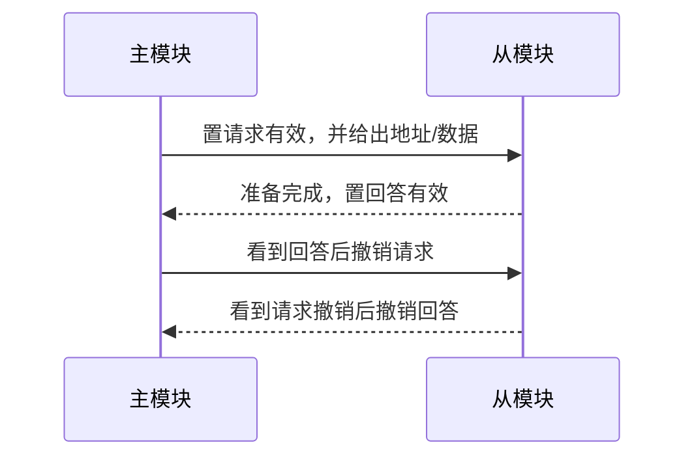

> 描述：总线是一组可由多个部件分时共享的公共传输线路。复习总线要把“线路按什么信息分工”“一次事务如何进行”“同步或握手如何定时”“带宽怎样计算”四件事连起来。

## 6.1 总线的基本概念

**总线**是能为多个部件**分时共享**的公共信息传送线路。“分时”表示同一时刻只有一个部件能发送数据；“共享”表示可以有多个部件接收该发送的数据。一条总线不是只含一根导线，而是一组各有功能的信号线。

+ 早期分散连接中，每增加一种 I/O 设备都要增加专用连接，扩展困难；总线连接把部件接到统一接口，改善主机与外设的连接灵活性。
+ 优点：简化系统结构和接口设计、减少连线和体积、易于模块化扩充、便于设备软件设计与故障检测。

### 6.1.1 总线特性

| 特性 | 关注内容 |
| --- | --- |
| 机械特性 | 尺寸、外形、管脚数量及排列顺序 |
| 电气特性 | 传输方向、有效电平范围 |
| 功能特性 | 每根线传送地址、数据还是控制信息 |
| 时间特性 | 各信号之间应遵守的时序关系 |

### 6.1.2 常见标准的辨析

| 标准 | 分类/特点 |
| --- | --- |
| ISA | 早期系统并行总线，速率低、CPU 占用和中断资源开销较大 |
| EISA | ISA 的扩展，兼容 ISA，支持多个总线主控器和突发传送；系统并行总线 |
| VESA | 面向多媒体活动图像的 32 位局部并行总线 |
| PCI | 与处理器时钟无关的 32/64 位高速局部并行总线，支持即插即用，常接显卡/声卡/网卡 |
| AGP | 主存与图形卡之间传送视频/三维图形数据的局部并行接口 |
| PCI-Express | 高速串行双向通道，可全双工，速率高于 PCI/AGP；局部串行总线 |
| RS-232C | DTE 与 DCE 间串行二进制交换接口；设备串行总线 |
| USB | 可热插拔、即插即用的外部 I/O 串行总线，可经 Hub 组成分层星形/树形拓扑连接多台设备 |
| PCMCIA | 笔记本扩展接口，支持即插即用；设备并行总线 |
| IDE/ATA、SCSI | 磁盘/光驱等设备接口；教材分类为设备并行总线 |
| SATA | 串行高级技术附件，硬盘驱动器串行接口 |

> 易错：USB 是串行总线，不能在一根串行链路上“同时传输 2 位数据”；但它可以通过级联连接多台外设。不要凭“并行”就断言更快。

## 6.2 总线的分类与组成

### 6.2.1 按数据传送方式

| 类型 | 含义 | 优点 | 局限 |
| --- | --- | --- | --- |
| 串行总线 | 每条串行通道/每个 lane 在一个符号时刻传串行比特流 | 线少、成本低、适于远距离、内部可节省布线 | 收发端需串/并转换；多 lane 链路仍可并行提高总吞吐 |
| 并行总线 | 一次传多位 | 逻辑时序较简单，电路实现容易 | 线多、远距离成本高；高频下串扰和等长要求限制频率 |

+ 低频时并行总线常有优势；频率很高时，串行线间干扰较少，整体效率可能更高。因此“并行总比串行快”错误。

### 6.2.2 按功能位置

| 类别 | 定义 |
| --- | --- |
| 片内总线 | CPU 芯片内寄存器—寄存器、寄存器—ALU 等公共连接线 |
| 系统总线 | CPU、主存、I/O 接口等功能部件之间的连接总线 |
| I/O 总线 | CPU 与 I/O 接口间传输信息的总线 |
| 通信总线（外部总线） | 计算机系统间，或与远程通信/测试设备间的信息传送总线 |

系统总线由地址、数据、控制三组信号组成：

| 组别 | 传送内容 | 根数关联 | 方向 |
| --- | --- | --- | --- |
| 数据总线 DB | 指令、操作数等数据信息 | 与机器字长、存储字长有关 | 双向 |
| 地址总线 AB | 主存单元或 I/O 端口地址 | 与主存地址空间、设备数有关 | 由当前总线主控器发往从设备；CPU 主控时表现为 CPU 单向发出，DMA 等主控也可驱动 |
| 控制总线 CB | 命令、反馈、定时信号 | 由具体控制信号决定 | 单根线各自单向，整组可看作双向 |

+ 控制信号可包括时钟、复位、总线请求/允许、中断请求/回答、存储器读写、I/O 读写和传输确认。
+ 在教材的程序控制 I/O 场景中，I/O 总线数据线在 CPU 与接口间双向传送命令字、状态字、中断类型号等，地址/命令通常由 CPU 送往 I/O 端口；发生 DMA 或其他设备取得总线主控权时，地址和部分控制信号可改由该主控设备发出。
+ 题目问“握手信号走哪里”时答**控制总线**；指令、操作数和中断类型号都经**数据总线**传送。

## 6.3 系统总线结构

| 结构 | 组织与特点 |
| --- | --- |
| 单总线 | CPU、主存、I/O 接口均接同一组总线。结构简单、成本低、易扩充；但带宽低、负载重，各部件争用同一总线，不能并行传送。单总线不等于只有一根信号线。 |
| 双总线 | 主存总线连接 CPU、主存和通道；I/O 总线连接通道与外设。通道是统一管理 I/O 的专用处理器，通道程序存于主存。I/O 从单总线分离，可支持突发传送，但需增加通道硬件。 |
| 三总线 | 主存总线、I/O 总线、DMA 总线独立，能提高设备响应和系统吞吐，但硬件/协调更复杂。 |
| 四总线/多总线 | 通过桥接器连接不同速度或层次的总线；靠近 CPU 的总线一般更快。 |

**桥接器**在不同总线之间提供数据缓冲、转换和控制功能，完成流量交换；它连接的是总线层次，不应与 I/O 接口或总线仲裁器混淆。

## 6.4 总线事务与传送方式

一次从申请使用总线到完成使用的操作序列叫**总线事务**，通常包括：

1. 申请/分配：主模块提出请求，仲裁机构把下一个传输周期的使用权授予某申请者。
2. 寻址：主模块给出从模块地址和命令，启动本次访问。
3. 传输：主、从模块单向或双向交换数据。
4. 结束：主模块撤去总线信息，释放使用权。

### 6.4.1 非突发与突发传输

| 方式 | 地址与数据 | 总线占用 |
| --- | --- | --- |
| 非突发 | 每次传送都先送地址再送一个总线字 | 每个字一次完整传送过程 |
| 突发 | 只给连续数据块首地址，随后连续传多个相邻单元 | 一组数据结束后才释放总线 |

突发传输使后续字不再重复传地址；在题设采用流水化、每个数据节拍传一个总线字的模型中，后续可每时钟周期传一个字长数据，故提高总线数据传输率。实际每拍传几次、是否插入等待周期仍由总线协议和从设备速度决定。读取 Cache 块时尤有意义。

设总线宽度为 $W$ bit，块大小为 $B$ byte，且每拍可传 $W/8$ byte，则至少需 $\lceil B/(W/8)\rceil$ 个数据拍；仅当 $B$ 恰为总线字节宽度的整数倍时，才可直接写成 $B/(W/8)$。非突发方式应把每字的地址、准备和数据时间都累计；突发方式只付一次首地址时间，再加首字准备与连续数据传输时间。末拍不足一总线字时，仍可能占用一个传输拍，并按协议处理有效字节标记。

> 例：1 GHz 总线每周期 $1\,ns$，总线宽 64 bit（8 B）；若每个非突发字需地址 1 ns、准备 6 ns、传送 1 ns，则 32 B 块需 $4\times8=32\,ns$。

同一参数若采用突发传输，并按“首地址 1 ns + 首字准备 6 ns + 4 个数据节拍”计，则总时间为 $1+6+4=11\,ns$。公式必须以题设是否把首个数据节拍含在准备时间内为准，不能只背 11 ns。

### 6.4.2 经典综合题：突发事务、交叉存储与 Cache（2013）

已知 CPU 主频 $800\,MHz$，Cache 命中时 CPI 为 4，Cache 块为 32 B；主存为 8 体低位交叉存储，每体字长 32 bit、存储周期 40 ns；存储器总线宽 32 bit、时钟 $200\,MHz$，支持突发事务。每个地址/命令或 32 bit 数据均占一个总线时钟周期。

1. CPU 时钟周期与总线时钟周期分别为
   $$
   T_{CPU}=\frac{1}{800\,MHz}=1.25\,ns,\qquad
   T_{bus}=\frac{1}{200\,MHz}=5\,ns.
   $$
   在每个总线周期传 32 bit $=4\,B$ 的模型中，理论峰值带宽为
   $$
   BW=200\,MHz\times4\,B=800\,MB/s.
   $$
2. 一个 Cache 块为 32 B，等于 $8\times4\,B$。8 个交叉存储体可流水准备连续的 8 个字，因此一次读突发事务恰好传回一个 Cache 块。
3. **按该题图的简化时序**，一次读突发事务依次经历：地址/命令 5 ns、首体准备 40 ns、8 个数据节拍共 $8\times5=40\,ns$，故
   $$
   T_{burst}=5+40+8\times5=85\,ns.
   $$
   题目给的是每体**存储周期** 40 ns，原图计算把它同时用作首字准备延迟；一般硬件的存取时间与存储周期可不同，不能仅凭存储周期就普遍推出首字恰在 40 ns 后就绪。8 体交叉能每隔 $40/8=5\,ns$ 启动下一体，恰与总线数据节拍匹配。这个 5 ns 启动间隔来自交叉体数和存储周期，不应归因于“若存储字长更小就能同时启动”。
4. 若程序执行 100 条指令，平均每条指令访存 1.2 次，Cache 缺失率 5%，并忽略替换等其他开销，则基础执行时间为
   $$
   100\times4\times1.25\,ns=500\,ns,
   $$
   Cache 缺失次数为 $100\times1.2\times0.05=6$，额外开销为 $6\times85=510\,ns$，总执行时间为
   $$
   T_{CPU,total}=500+510=1010\,ns.
   $$

### 6.4.3 存储周期与总线周期

**存取时间**是从启动一次存储器操作到完成的时间；**恢复时间**用于恢复内部状态；两次独立访问的最小间隔为**存储周期**。一次存取不必只读一个总线字，因此一个存储周期可包含多个总线传输周期。在源 PDF 的“主存慢于总线”模型中通常有：

$$T_{memory\ cycle}>T_{bus\ cycle}$$

这不是任何系统都必须满足的物理定律：高速存储器配慢速外部总线时关系可能不同，做题应以给定时序和定义为准。

多体交叉存储可把不同存储体按流水线轮流启动，缩短连续字的等待；配合突发传输，可在一个读突发事务中读入一整个 Cache 块。

## 6.5 总线定时与通信方式

**总线定时**是双方交换数据时的时间配合规则，相关控制信号在控制总线上传输。

| 方式 | 工作机制 | 优点 | 缺点/适用 |
| --- | --- | --- | --- |
| 同步定时 | 统一时钟划出固定总线周期 | 快、控制简单 | 强制同步，难即时检验有效性；适于总线短且设备存取时间接近 |
| 异步定时 | 无固定间隔，以请求/回答握手完成一次通信 | 周期可变，适配速度差大的设备且可靠 | 控制复杂、通常较慢 |
| 半同步 | 统一时钟加 `WAIT` 响应，可动态插入等待周期 | 兼顾时钟协调与慢设备等待 | 仍需规定时钟边界 |

+ 同步总线的设备遵循同一时钟，但“时钟频率”不必等于“总线工作频率”。
+ 异步定时的握手：主设备请求，经过接口到从设备；从设备准备好后回答。一次握手可以交换多位数据，不是每次只交换一位。

异步握手按撤销信号是否互锁分三类：

| 类型 | 请求/回答撤销关系 | 握手次数 | 速度与可靠性 |
| --- | --- | ---: | --- |
| 不互锁 | 双方各自延时撤销，无等待对方 | 1 | 最快，最不可靠 |
| 半互锁 | 主方等到回答才撤请求；从方不等请求撤销 | 2 | 折中 |
| 全互锁 | 主方等回答才撤请求；从方等请求撤销才撤回答 | 3 | 最可靠，最慢 |

**分离式通信**把事务拆成两个独立子周期：主模块申请并使用总线后立即释放；从模块准备好后再申请总线送回信息。双方准备数据时不占总线，所有模块可申请，故能提高总线利用率。

### 6.5.1 异步串行通信

典型 UART 异步串行通信在收发时钟不严格一致时，以字符帧边界重新同步：空闲为逻辑 1，先发逻辑 0 的开始位；常按低位到高位发送数据位，其后可加奇偶校验位，最后以停止位结束。具体位序、校验和停止位数量仍由所用协议配置决定。

若 7 数据位、1 开始位、1 奇偶位、1 停止位，则一字符为 10 位。若每字符用时 $0.5\,ms$，1 秒可传 $1/0.5\,ms=2000$ 个字符。

## 6.6 性能指标与计算

| 指标 | 含义与关系 |
| --- | --- |
| 总线时钟周期 | 驱动总线时序的时钟周期 $T$，$f_{clk}=1/T$；可由系统时钟分频/倍频，也可使用独立总线时钟 |
| 总线传输周期 | 一次总线操作时间，含申请、寻址、传输、结束；常由多个时钟周期构成 |
| 总线周期频率 | 每秒完成的总线周期数。仅当每个总线周期固定占 $N$ 个时钟周期时，才有 $f_{cycle}=f_{clk}/N$ |
| 总线宽度 | 同时传输的数据位数，通常为数据线根数 |
| 总线带宽 | 理论最高数据率取决于每秒数据传送拍数和每拍位数：$BW=f_{beat}\times W$；若每周期恰有 $q$ 个数据拍，则 $BW=f_{cycle}\times q\times W$ |
| 总线复用 | 同一信号线在不同时刻传不同信息，省线/省成本，但不提高传输效率 |
| 信号线数 | 地址、数据、控制三类线的总根数 |

### 题型：#总线带宽与事务时间

1. 先区分“时钟频率”“工作频率”“每次传送字节数”，不要把 CPU 主频直接代入总线带宽。
2. 先确定每秒总线周期数、每周期数据拍数和每拍字节数。只有每周期恰传一拍时，字节带宽才可简写为 $f_{cycle}\times W/8$；突发、多倍数据率和协议开销都要按题设另算。
3. 地址/数据复用只减少线路，不会提高效率，反而可能增加时序开销。
4. Cache 缺失读块题按实际传送方式计算：非突发逐字重复地址阶段；突发只传一次首地址，并注意交叉存储体首字延迟与后续流水间隔。

## 相关知识

+ **科目导航**：[计算机组成原理导航](/notes/cs408-2406c8c61473/)
+ **阅读顺序**：[上一篇：多处理器](/notes/cs408-cd74b2a4d67e/) · [下一篇：中断](/notes/cs408-a58dbd00622a/)

## 6.7 本节复盘

+ 总线是多个部件分时共享的公共线路；同一时刻一方发送、可多方接收。
+ 系统总线由数据、地址、控制三组线构成；握手在控制线，指令/操作数/中断类型号在数据线。
+ 单总线简单但争用严重；双/三/多总线用通道、DMA、桥等增加并行性与带宽层次。
+ 突发传输只传首地址并连续传块数据；同步靠统一时钟，异步靠握手，半同步以 `WAIT` 动态延长周期，分离事务提高利用率。
+ 带宽为每秒有效数据传送拍数乘以每拍字节数；若一周期多拍或若干周期才完成一拍，必须计入相应系数。并行不一定快于串行，复用不等于提高带宽。
