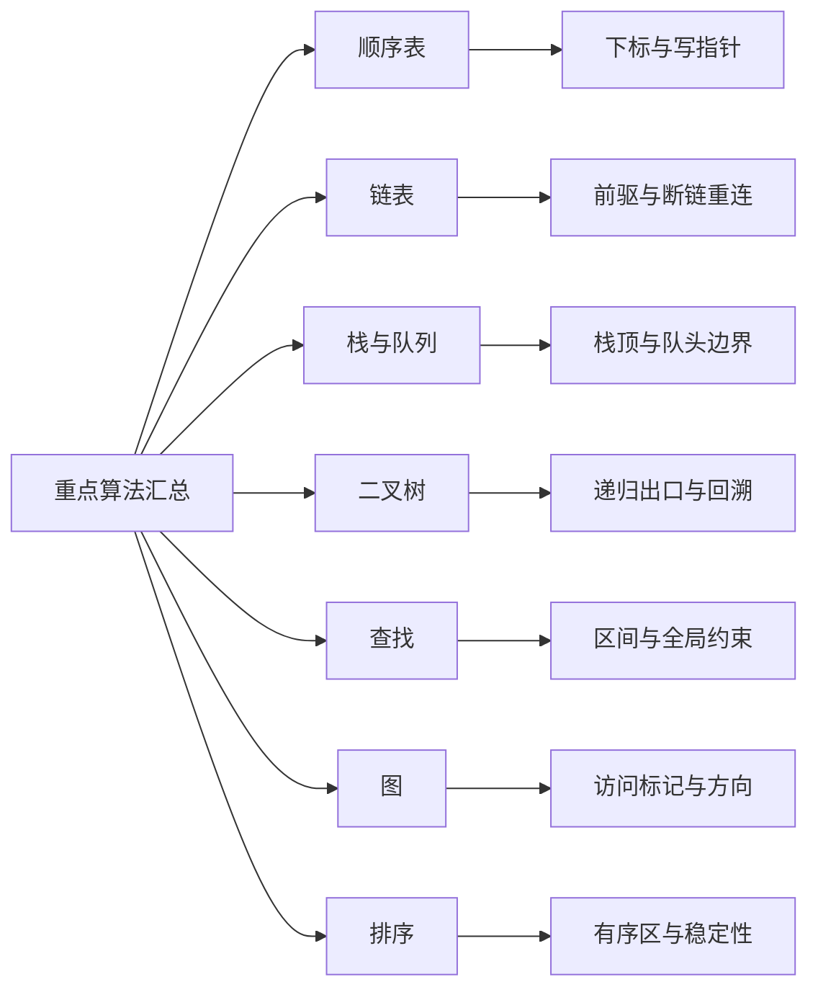

> **ABSTRACT** · 定位
> 本页是数据结构代码题的总入口，逐页覆盖原 PDF 的 30 页：顺序表、链表、栈与队列、二叉树、查找、图和排序。原 PDF 只有文字与代码，没有独立知识图；正文用可编辑 Mermaid 图补充导航。

> **IMPORTANT** · 唯一权威代码
> 汇总页保留每个原算法的核心不变量、边界、复杂度和专题深链接，不再复制同一份 C++。完整实现只维护在 1～7 篇专题笔记中，避免“专题代码已修正、汇总代码仍旧错误”的双份漂移。七篇现有 97 个 C++17 代码块，并已分别通过 7 套可执行测试。

## 1. 专题入口与验证状态

| 专题   | 原资料范围                            | 权威笔记                                      | 当前验证              |
| ---- | -------------------------------- | ----------------------------------------- | ----------------- |
| 顺序表  | 逆置、删除、去重、合并、中位数、最小未出现正整数         | [顺序表专题](/notes/cs408-7528c27ca114/)    | 11 页，14 个代码块，断言通过 |
| 链表   | 删除、逆置、拆分、合并、公共元素、倒数第 $k$ 个、对称、重排 | [链表专题](/notes/cs408-200f7524e253/)       | 24 页，25 个代码块，断言通过 |
| 栈与队列 | 队列逆置、中心对称、括号匹配                   | [栈与队列专题](/notes/cs408-19ccba30ce38/) | 6 页，7 个代码块，断言通过   |
| 二叉树  | 递归统计、查找、路径、构造、层次遍历、完全性、线索化       | [二叉树专题](/notes/cs408-033ead68e5bc/)    | 30 页，23 个代码块，断言通过 |
| 查找   | 有序表查找/插入、折半、BST 判断与操作            | [查找专题](/notes/cs408-18a77c541c35/)       | 7 页，8 个代码块，断言通过   |
| 图    | 存储、BFS/DFS、最短路、可达性、判树、连通分量、转换    | [图专题](/notes/cs408-d690a826208c/)          | 13 页，12 个代码块，断言通过 |
| 排序   | 插入、冒泡、快速、选择、堆、归并                 | [排序专题](/notes/cs408-c558f3264d82/)       | 8 页，8 个代码块，断言通过   |

## 2. 顺序表与虚拟数组

| 原 PDF 算法 | 核心不变量 | 边界与复杂度 | 权威入口 |
|---|---|---|---|
| 原地逆置 | 左右下标向中间收缩，每次交换一对 | 空表、单元素均不交换；$O(n)$ 时间、$O(1)$ 空间 | [原地逆置](/notes/cs408-7528c27ca114/#section-6) |
| 删除指定值或区间 | 读下标扫描原表，写下标始终指向下一个保留位置 | 写指针只在保留时前进；$O(n)$、$O(1)$ | [删除指定值](/notes/cs408-7528c27ca114/#section-9)、[删除区间](/notes/cs408-7528c27ca114/#section-12) |
| 递增表去重 | `write` 指向最后一个已保留的不同值 | 依赖“原表有序”；空表单独处理；$O(n)$、$O(1)$ | [有序表去重](/notes/cs408-7528c27ca114/#section-13) |
| 合并两个递增表 | 两个读指针指向各自未处理首元，写指针指向输出尾 | 输出容量至少 $m+n$；$O(m+n)$ | [递增表合并](/notes/cs408-7528c27ca114/#section-14) |
| 两递增序列中位数 | 只需归并到合并序列目标下标，不必复制全部结果 | 先明确总长度奇偶与题目采用的中位数口径；$O(m+n)$ 上界 | [合并中位数](/notes/cs408-7528c27ca114/#section-15) |
| 最小未出现正整数 | 长度为 $n$ 时答案只可能位于 $[1,n+1]$，记录 $1..n$ 是否出现 | 忽略非正数和大于 $n$ 的数；$O(n)$ 时间、$O(n)$ 空间 | [最小缺失正整数](/notes/cs408-7528c27ca114/#section-18) |

> [!tip]- 专题页补充题型
> [有序插入](/notes/cs408-7528c27ca114/#section-2)、[末元素覆盖最小值](/notes/cs408-7528c27ca114/#section-4)、[交换连续子序列](/notes/cs408-7528c27ca114/#section-7)和[Boyer-Moore 主元素](/notes/cs408-7528c27ca114/#section-20)也已纳入专题笔记。

> **DANGER** · 原汇总代码的代表性错误
> 去重时覆盖位置和 `length` 少 1；合并函数混用 `l/l3` 且漏分号；虚拟数组写成 `int record = new int[n]`，返回时又使用未定义的 `maxNumber`。以上均不能直接编译，专题版本已按空表、容量和下标边界重写。

## 3. 链表

链表题的通用动作是：先保存后继，再断链或重连；释放结点后绝不再访问；带头结点与无头链表不能混用同一套首结点处理。

| 原 PDF 算法 | 核心不变量与边界 | 复杂度 | 权威入口 |
|---|---|---:|---|
| 递归删除无头链表中所有 `x` | 头指针必须按引用传递；命中首结点后更新头再递归 | $O(n)$ 时间，$O(n)$ 递归栈 | [递归删除](/notes/cs408-200f7524e253/#section-2) |
| 非递归删除带头链表中所有 `x` | `previous` 指向待检查结点前驱；删除后不前移前驱 | $O(n)$、$O(1)$ | [非递归删除](/notes/cs408-200f7524e253/#section-3) |
| 删除唯一最小结点 | 扫描并保存最小结点的前驱，最后统一摘链释放 | $O(n)$、$O(1)$ | [删除最小结点](/notes/cs408-200f7524e253/#section-8) |
| 递增链表去重 | 只比较相邻结点；删除重复者后当前基准不前移 | $O(n)$、$O(1)$ | [链表去重](/notes/cs408-200f7524e253/#section-13) |
| 原地逆置 | 保存 `next`，把当前结点头插到已逆置区 | $O(n)$、$O(1)$ | [单链表逆置](/notes/cs408-200f7524e253/#section-6) |
| 按奇偶位置稳定拆分 | 两条尾指针分别接收奇位、偶位结点，结尾都置空 | $O(n)$、$O(1)$ | [稳定拆分](/notes/cs408-200f7524e253/#section-11) |
| 奇位正序、偶位逆序拆分 | 奇位尾插，偶位头插；每次先保存下一结点 | $O(n)$、$O(1)$ | [正逆序拆分](/notes/cs408-200f7524e253/#section-12) |
| 两递增链表合并为非递减链表 | 尾指针接较小原结点；相等时选择顺序决定稳定口径 | $O(m+n)$、$O(1)$ | [递增链合并](/notes/cs408-200f7524e253/#section-14) |
| 公共元素生成新链 `C` | 两指针比较：相等则复制并双双前进，否则较小者前进 | $O(m+n)$，另需结果空间 | [公共元素](/notes/cs408-200f7524e253/#section-16) |
| 倒数第 $k$ 个结点 | 快指针先走 $k$ 步，再与慢指针同步前进 | $k\ge1$ 且长度不少于 $k$；$O(n)$ | [倒数第 k 个](/notes/cs408-200f7524e253/#section-19) |
| 循环双链表对称 | 首尾指针相向移动；奇偶长度分别在相遇或交叉时停止 | $O(n)$、$O(1)$ | [循环双链表对称](/notes/cs408-200f7524e253/#section-21) |
| 重排为 $a_1,a_n,a_2,a_{n-1},\ldots$ | 快慢指针分半、逆置后半、两链交替合并 | $O(n)$、$O(1)$ | [链表重排](/notes/cs408-200f7524e253/#section-25) |

> **DANGER** · 原汇总代码的代表性错误
> 递归删除按值传递头指针；非递归删除无条件前移前驱而跳过连续 `x`；空指针检查写在解引用之后；`new LNode*` 把“结点”误写成“指针对象”；循环双链表向左移动却写成 `q = q->next`。专题页已统一内存所有权、头结点约定和循环终止条件。

## 4. 栈与队列

| 原 PDF 算法 | 核心不变量与边界 | 复杂度 | 权威入口 |
|---|---|---:|---|
| 用空栈逆置队列 | 所有队列元素依次入栈，再全部出栈回队；必须检查容量 | $O(n)$ 时间、$O(n)$ 栈空间 | [队列逆置](/notes/cs408-19ccba30ce38/#section-2) |
| 判断带头单链表是否中心对称 | 前半段入栈；奇数长度跳过中点；后半段与栈逆序比较 | $O(n)$ 时间、$O(n)$ 空间 | [中心对称](/notes/cs408-19ccba30ce38/#section-7) |
| 圆括号匹配 | 左括号入栈；右括号到来时栈不得空；扫描结束栈必须空 | $O(n)$ 时间、$O(n)$ 空间 | [括号匹配](/notes/cs408-19ccba30ce38/#section-17) |

> [!tip]- 专题页补充题型
> [共享栈](/notes/cs408-19ccba30ce38/#section-12)补全了两栈判满、判空、入栈与出栈；[字符序列重排](/notes/cs408-19ccba30ce38/#section-21)补全了按字符类别分区题型。该实现会逆转 `H` 组；只有字符完全相同时逆序才不可见，不能称为一般意义上的稳定分区。

> **DANGER** · 原汇总代码的代表性错误
> 队列与栈对象、指针访问方式混用，`front/rear/top` 有时漏写所属对象；括号匹配在空栈上直接 `pop`，结尾真假分支相反且包含连续两个 `return`。

## 5. 二叉树

树递归先写空树出口，再明确“本结点贡献”和“左右子树结果如何组合”。根位于第 1 层；WPL 的根路径长度按边数记为 0。

| 原 PDF 算法组 | 关键条件与易错边界 | 权威入口 |
|---|---|---|
| 统计结点总数、双分支结点数、树高 | 空树分别返回 0；双分支要求左右孩子均非空；高度为两侧最大值加 1 | [递归统计](/notes/cs408-033ead68e5bc/#section-2) |
| 表达式树求值 | 叶结点返回操作数；内部结点必须有两个孩子并按运算符组合 | [表达式树](/notes/cs408-033ead68e5bc/#section-8) |
| 判断结构相似、镜像二叉树 | 两空相似、一空一非空不相似；镜像须交换每个结点的左右子树，既可先递归后交换，也可先交换再分别递归两棵新子树 | [结构相似](/notes/cs408-033ead68e5bc/#section-10)、[镜像](/notes/cs408-033ead68e5bc/#section-11) |
| 查找值为 `key` 的结点与层号 | 返回指针或层号必须向上传播“已找到”状态，不能找到后继续覆盖 | [查找与层号](/notes/cs408-033ead68e5bc/#section-12) |
| 叶结点串链、输出根到叶路径 | `head/tail` 必须按引用更新；路径进入压栈、每个分支返回时都回溯弹栈 | [叶链表](/notes/cs408-033ead68e5bc/#section-17)、[根到叶路径](/notes/cs408-033ead68e5bc/#section-18) |
| 叶结点带权路径长度 WPL | 只在叶结点累计 $w\times d$，根深度为 0；兄弟分支深度不能互相污染 | [WPL](/notes/cs408-033ead68e5bc/#section-35) |
| 满二叉树先序转后序 | 仅适用于各层全满、结点数为 $2^h-1$ 的完美二叉树，左右子树才可等分 | [先序转后序](/notes/cs408-033ead68e5bc/#section-20) |
| 先序 + 中序重建 | 关键字互异时唯一；先序首元定位中序根，左段长度决定两边递归范围 | [遍历序列重建](/notes/cs408-033ead68e5bc/#section-21) |
| 顺序存储转链式二叉树 | 0 下标孩子为 $2i+1,2i+2$；普通树数组必须显式保留空位置 | [顺序存储建树](/notes/cs408-033ead68e5bc/#section-22) |
| 层次遍历与完全性 | 队列保存待访问结点；判完全树时首个空位置之后不得再出现非空结点 | [层次遍历](/notes/cs408-033ead68e5bc/#section-30)、[完全二叉树](/notes/cs408-033ead68e5bc/#section-34) |
| 中序线索化 | 当前无左孩子才设前驱线索；应检查“前驱无右孩子”后给前驱设后继线索 | [中序线索化](/notes/cs408-033ead68e5bc/#section-37) |

除由先序/中序重建在直接线性定位根时最坏为 $O(n^2)$ 外，上述遍历、统计、查找和转换通常都访问每个结点一次，为 $O(n)$；递归辅助空间为 $O(h)$，层次遍历为 $O(w)$。

> **DANGER** · 原汇总代码的代表性错误
> 多处左右递归写成两次左子树；深度与 WPL 递归进入子树后未正确恢复；表达式树使用未声明的 `p`；查找结果按值传递；叶链表 `head/tail` 按值传递；顺序建树把右孩子再次赋给左孩子；完整树空树判断写成 `bt == true`；线索化检查的是当前结点右孩子而不是前驱右孩子。

## 6. 查找

| 原 PDF 算法 | 核心不变量与边界 | 复杂度 | 权威入口 |
|---|---|---:|---|
| 递增顺序表查找：找到则与后继交换，否则插入 | 折半区间统一为半开区间 `[low, high)`；未找到时 `low` 就是插入位置；末元素命中时没有后继可换。若命中后与更大的后继交换，表不再有序，不能不经重排就再次折半查找 | 查找 $O(\log n)$，插入移动 $O(n)$ | [查找后交换或插入](/notes/cs408-18a77c541c35/#section-2) |
| BST 最大值 | 非空树沿真实右孩子走到底；空树没有合法最大值，不能用 0 冒充 | $O(h)$ | [BST 最值](/notes/cs408-18a77c541c35/#section-14) |

> [!tip]- 专题页补充题型
> 专题还覆盖[链表命中后与前驱交换](/notes/cs408-18a77c541c35/#section-5)、[两种折半查找](/notes/cs408-18a77c541c35/#section-8)、[BST 全局范围验证](/notes/cs408-18a77c541c35/#section-11)、[BST 层次](/notes/cs408-18a77c541c35/#section-15)和[中序范围输出](/notes/cs408-18a77c541c35/#section-16)。

> **DANGER** · 原汇总代码的代表性错误
> 折半查找把 `high = mid - 1` 放到循环外，插入移动时混用 `list.data` 与 `list[]`，还未检查容量；BST 空树直接返回 0 会把“无结果”和合法关键字 0 混为一谈。

## 7. 图

| 原 PDF 算法组 | 核心不变量与边界 | 权威入口 |
|---|---|---|
| 邻接表、邻接矩阵与无向边插入 | 无向边在邻接表存两条邻接记录，但逻辑边数只加 1；自环度数贡献 2 | [图存储](/notes/cs408-d690a826208c/#section-1) |
| BFS | 顶点首次发现、准备入队时立即标记，保证最多入队一次 | [BFS](/notes/cs408-d690a826208c/#section-6) |
| BFS 求无权最短路 | `distance[source]=0`，未发现为 -1；首次发现邻点时距离加 1 | [无权最短路](/notes/cs408-d690a826208c/#section-7) |
| 递归 DFS 与可达性 | 进入结点立即标记；有向图必须按弧方向判断，不能假设可达对称 | [DFS](/notes/cs408-d690a826208c/#section-9)、[可达性](/notes/cs408-d690a826208c/#section-10) |
| 无向图判树 | 非空、无向、连通且 $\lvert E\rvert=\lvert V\rvert-1$；单顶点无边图是树 | [无向图判树](/notes/cs408-d690a826208c/#section-11) |
| 无向图连通分量 | 每从一个未访问顶点启动一次 DFS，就完整覆盖一个新分量 | [连通分量](/notes/cs408-d690a826208c/#section-16) |

邻接表上的 BFS、DFS、可达性、判树与连通分量均为 $O(|V|+|E|)$；邻接矩阵遍历通常为 $O(|V|^2)$。

> [!tip]- 专题页补充题型
> [欧拉通路](/notes/cs408-d690a826208c/#section-4)补全了非零度顶点连通性与奇度条件；[最远顶点](/notes/cs408-d690a826208c/#section-13)规定了同层平局；[非递归 DFS](/notes/cs408-d690a826208c/#section-14)保存下一邻接位置；[存储转换](/notes/cs408-d690a826208c/#section-17)处理方向、自环、重边和边数一致性。

> **DANGER** · 原汇总代码的代表性错误
> 类型在使用后才声明，`new AGraph*`/`new ArcNode*` 分配了错误对象，成员访问混用 `.` 与 `->`；BFS 初始化在循环外，队列前置自增易错；DFS 混用 `p.adjVertex`、`visit[]` 和未声明变量；可达性分支含不可达 `return`；连通分量调用未定义的 `v`。

## 8. 排序

原汇总 PDF 只重复了直接插入与快速排序，完整排序族以排序专题为准。

| 算法 | 最好时间 | 平均/最坏时间 | 空间与稳定性 | 权威入口 |
|---|---:|---:|---|---|
| 直接插入 | $\Theta(n)$ | $\Theta(n^2)$ | $\Theta(1)$，稳定 | [直接插入](/notes/cs408-c558f3264d82/#section-2) |
| 折半插入 | $\Theta(n\log n)$ | 平均/最坏 $\Theta(n^2)$ | $\Theta(1)$，稳定 | [折半插入](/notes/cs408-c558f3264d82/#section-4) |
| 优化冒泡 | $\Theta(n)$ | $\Theta(n^2)$ | $\Theta(1)$，稳定 | [冒泡](/notes/cs408-c558f3264d82/#section-6) |
| 快速排序 | $\Theta(n\log n)$ | 平均 $\Theta(n\log n)$，最坏 $\Theta(n^2)$ | 平均栈 $O(\log n)$，不稳定 | [快速排序](/notes/cs408-c558f3264d82/#section-7) |
| 简单选择 | $\Theta(n^2)$ | $\Theta(n^2)$ | $\Theta(1)$，不稳定 | [简单选择](/notes/cs408-c558f3264d82/#section-9) |
| 堆排序 | $\Theta(n\log n)$ | $\Theta(n\log n)$ | $\Theta(1)$，不稳定 | [堆排序](/notes/cs408-c558f3264d82/#section-10) |
| 二路归并 | $\Theta(n\log n)$ | $\Theta(n\log n)$ | $\Theta(n)$，稳定 | [归并排序](/notes/cs408-c558f3264d82/#section-12) |

> **DANGER** · 原汇总代码的代表性错误
> 直接插入在 `j` 离开作用域后继续使用，并把哨兵写回成 `R[j]` 而非 `R[0]`；快排使用严格不等号，重复关键字可能使双指针停滞，递归调用又被错误放到了函数花括号之外。

## 9. 30 页逐页覆盖记录

| 页码 | 原 PDF 内容 | 复核去向 |
|---:|---|---|
| 1～3 | 顺序表逆置、删除、去重、合并、中位数、虚拟数组 | 本文第 2 节 + 顺序表专题 |
| 4～10 | 链表删除、最小值、去重、逆置、拆分、合并、交集、倒数第 $k$ 个、循环双链表、重排 | 本文第 3 节 + 链表专题 |
| 11～12 | 栈/队列结构、队列逆置、中心对称思路、括号匹配 | 本文第 4 节 + 栈与队列专题 |
| 13～24 | 二叉树递归统计、表达式、相似/镜像、查找、叶链表、路径、WPL、构造、层次遍历、完全性 | 本文第 5 节 + 二叉树专题 |
| 25 | 中序线索化与有序顺序表查找/插入 | 本文第 5、6 节 |
| 26 | BST 最大值与图的存储结构 | 本文第 6、7 节 |
| 27～28 | 无向边插入、BFS、无权最短路、DFS、可达性 | 本文第 7 节 + 图专题 |
| 29 | 图判树、连通分量、直接插入排序 | 本文第 7、8 节 |
| 30 | 快速排序 | 本文第 8 节 + 排序专题 |

> **SUCCESS** · 完整性结论
> 30 页中的每个算法项都已在本页建立检索项并指向权威专题；水印、错位花括号、未声明变量和不可编译旧代码没有带入正式笔记。没有独立知识图被遗漏。

## 10. 代码题统一检查清单

1. **结构约定**：是否带头结点、是否循环、数组从 0 还是 1 开始、图是有向还是无向。
2. **空与单元素**：空表、空树、单结点、无边图分别返回什么，是否允许空答案。
3. **指针所有权**：改变头指针或输出指针时是否按引用传递；`new/delete` 与 `malloc/free` 不混用。
4. **保存下一位置**：覆盖数组元素、摘链、释放结点、移动图邻接指针之前，先保存仍需使用的位置。
5. **标记时机**：BFS/DFS 在首次发现结点时标记，避免重复入队、入栈或递归。
6. **递归状态**：空结构出口、左右递归方向、返回值传播、路径/深度回溯是否全部正确。
7. **数学前提**：BST 的全局范围、欧拉路的连通性、完全树的连续位置、排序稳定性的相等元素处理。
8. **复杂度**：区分总时间、关键字比较、元素移动、递归栈和结果空间；写明最坏退化条件。
9. **验证输入**：至少覆盖空、单元素、重复值、负数、已有序、逆序、断连与非法边界。

## 相关知识

+ **科目导航**：[数据结构导航](/notes/cs408-5620bc526d96/)
+ **阅读顺序**：[上一篇：排序算法总结](/notes/cs408-160888f26a5f/) · [下一篇：顺序表代码](/notes/cs408-7528c27ca114/)
+ **关联专题**：[算法与算法评价](/notes/cs408-01ad73094eab/)

## 11. 本节复盘

+ 顺序表题抓“读指针/写指针”和容量；链表题抓“前驱、后继、断链、重连、所有权”。
+ 栈队列题先画清栈顶和队头队尾含义；括号匹配同时检查提前右括号和最终剩余左括号。
+ 二叉树递归统一为“空树出口 + 当前贡献 + 左右结果”，路径与深度状态必须在回溯时恢复。
+ 查找题统一折半区间并写明失败后的插入点；BST 递归必须传递全局上下界。
+ 图遍历在首次发现时标记；无向判树、欧拉路和连通分量都必须明确连通条件。
+ 排序先写下标体系、有序区边界和稳定性；快排重复值、堆孩子越界、归并剩余段是高频错误。
+ 汇总页负责导航和审查，专题页负责唯一可编译实现；修改算法时只更新专题权威代码，再回查本页链接与口径。
