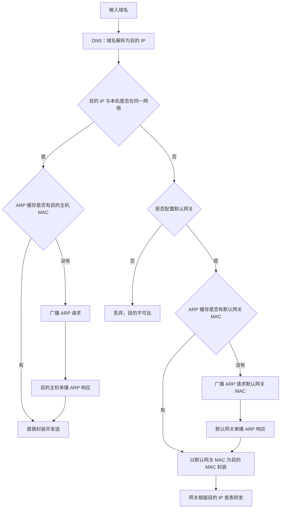

> 描述：路由协议题主要考查 RIP 的距离向量更新与慢收敛、OSPF 的链路代价与最短路径、BGP 的会话和 AS_PATH 选择，以及路由结果与 TTL、默认网关、MAC/IP 地址变化的综合分析。

## 3.1 三类路由协议总览

### 3.1.1 自治系统与协议范围

+ 自治系统 AS 是由同一管理机构控制、采用一致路由策略的一组网络和路由器。
+ AS 内部使用内部网关协议 IGP，常见协议有 RIP、OSPF。
+ AS 之间使用外部网关协议 EGP，当前主要使用 BGP-4。

| 协议 | 使用范围 | 工作层次与封装 | 依据 | 关键特点 |
| --- | --- | --- | --- | --- |
| RIP | AS 内部 | 应用层，UDP 端口 520 | 距离向量、跳数 | 简单；最大有效距离为 15；慢收敛 |
| OSPF | AS 内部 | 网络层，直接封装在 IP 中；IPv4 协议号 89 | 链路状态、链路代价 | 收敛快；适合大型网络；支持等价负载均衡 |
| BGP | AS 之间及 AS 内传播外部路由 | 应用层，TCP 端口 179 | 路径向量、策略与路径属性 | eBGP 跨 AS，iBGP 位于同一 AS |

### 3.1.2 RIP 与 OSPF 对比

| 比较项 | RIP | OSPF |
| --- | --- | --- |
| 掌握的信息 | 从邻居获得距离向量 | 获得区域内链路状态信息 |
| 路径度量 | 经过路由器的跳数 | 链路代价之和 |
| 算法思想 | 距离向量 | 最短路径算法 |
| 网络规模 | 距离 16 表示不可达，适合小型网络 | 不以 15 跳限制规模，适合较大网络 |
| 收敛特性 | 可能出现“坏消息传播慢”和路由环路 | 更新效率高、收敛快 |

## 3.2 RIP 距离向量更新

### 3.2.1 收到邻居通告后的处理

设路由器 X 收到邻居 Y 的条目：

```text
<目的网络 N, 距离 d, 下一跳 Z>
```

X 先把它改写为：

```text
<目的网络 N, 距离 min(d + 1, 16), 下一跳 Y>
```

然后与自己的路由表比较：

1. 原表中没有 N：直接加入新条目。
2. 原表中已有 N，且下一跳不同：只有新距离更小时才更新。
3. 原表中已有 N，且下一跳相同：不比较新旧距离大小，直接采用邻居发来的最新结果。

第三条尤其容易漏掉。相同下一跳说明原路由本来就依赖该邻居；即使邻居报告的距离变大，也必须同步拓扑变化。

### 3.2.2 距离上限与慢收敛

+ RIP 距离等于跳数，距离 1 表示目的网络与本路由器直接相连。
+ 最大有效距离是 15，距离 16 表示不可达。
+ 路由器启动后立即构造并交换初始距离向量，之后通常每 30 s 交换一次。
+ 当可达网络突然失效时，旧信息可能继续在邻居间传播，产生“坏消息传播慢”甚至计数到无穷问题。

## 3.3 OSPF 链路状态路由

OSPF 根据链路带宽计算代价，题目通常会给出具体公式。若规定：

$$
\text{Cost}=\frac{100\ \mathrm{Mb/s}}{\text{链路带宽}}
$$

并规定结果小于 1 仍记为 1、大于 1 且有小数时舍去小数，则：

| 链路带宽 | 计算 | 代价 |
| ---: | ---: | ---: |
| 100 Mb/s | $100/100$ | 1 |
| 1 Gb/s | $100/1000<1$ | 1 |
| 1.544 Mb/s | $100/1.544\approx64.76$ | 64 |

OSPF 选择链路代价总和最小的路径。若多条路径代价相同，可以形成等价路由并进行负载均衡。

在同一区域的链路状态数据库一致且协议已经收敛后，各路由器基于一致的**区域拓扑**运行 SPF，所得最短路径树不会含环。多区域 OSPF 的普通路由器并不保存整个自治系统所有其他区域的完整详细拓扑。拓扑刚发生变化、链路状态信息尚未完全洪泛时，不同路由器的数据库还可能短暂不一致，因此不能脱离“同一区域数据库一致并已收敛”这一前提，绝对地说 OSPF 在任何瞬间都不会出现转发环路。

## 3.4 BGP 会话、报文与选路

### 3.4.1 四种 BGP-4 报文

| 报文 | 作用 |
| --- | --- |
| OPEN | 与相邻 BGP 发言人建立关系并初始化通信 |
| KEEPALIVE | 周期性证实邻站的连通性并维持会话 |
| UPDATE | 通告可达路由并列出需要撤销的路由 |
| NOTIFICATION | 报告检测到的差错并关闭会话 |

### 3.4.2 eBGP 与 iBGP

+ eBGP 是不同 AS 的两个 BGP 对等端之间的连接。
+ iBGP 是同一 AS 内两个 BGP 对等端之间的连接。
+ 两者使用相同报文格式和属性类型，均通过 TCP 可靠传输。
+ 从 eBGP 对等端收到的路由，可以通过 iBGP 通告给同一 AS 内的对等端。
+ 从 iBGP 对等端收到的路由，不能再通告给同一 AS 内的其他 iBGP 对等端；这也是传统 iBGP 需要全互连或路由反射器的原因。

### 3.4.3 题目中的常见选路顺序

当题目说明“无策略约束”且只给出 AS_PATH 和内部拓扑时，通常先比较 AS_PATH 长度，再在外部路径同样优先时执行“热土豆”原则，选择 AS 内部代价更小、离当前路由器更近的出口。

## 3.5 历年真题

### 3.5.1 2016 年：RIP 坏消息传播慢

R1、R2、R3 已使用 RIP 收敛。把网络 `201.1.2.0/25` 记为 N。R3 检测到 N 不可达，并向 R2 通告一次新的距离向量，求 R2 更新后到 N 的距离。

分析：

1. R3 把到 N 的距离改为 16。
2. R2 原来到 N 的下一跳是 R3，因此收到 R3 的新通告后必须接受，暂时得到距离 16。
3. R1 还没有收到坏消息，仍认为可经 R3 到达 N，向 R2 通告的旧距离仍为 2。
4. R2 比较来自 R1 与 R3 的结果，经 R1 的新距离为 $2+1=3$，比 16 小，因此更新为 3。

这不是 N 真的恢复可达，而是 RIP 慢收敛造成的错误路由信息。

**答案：B，3。**

### 3.5.2 2021 年：距离向量计算

路由器 E 到邻居 A、B、C、D 的直接链路距离分别为 8、10、12、6。四个邻居通告的距离向量为：

| 目的网络 | A | B | C | D |
| --- | ---: | ---: | ---: | ---: |
| Net1 | 1 | 23 | 20 | 22 |
| Net2 | 12 | 35 | 30 | 28 |
| Net3 | 24 | 18 | 16 | 36 |
| Net4 | 36 | 30 | 8 | 24 |

E 经每个邻居到达目的网络的总距离为“E 到邻居的距离 + 邻居通告距离”：

| 目的网络 | 经 A | 经 B | 经 C | 经 D | 最小值 |
| --- | ---: | ---: | ---: | ---: | ---: |
| Net1 | $8+1=9$ | $10+23=33$ | $12+20=32$ | $6+22=28$ | 9 |
| Net2 | $8+12=20$ | $10+35=45$ | $12+30=42$ | $6+28=34$ | 20 |
| Net3 | $8+24=32$ | $10+18=28$ | $12+16=28$ | $6+36=42$ | 28 |
| Net4 | $8+36=44$ | $10+30=40$ | $12+8=20$ | $6+24=30$ | 20 |

更新后到 Net1-Net4 的距离依次为：

```text
9, 20, 28, 20
```

**答案：D。**

### 3.5.3 2024 年：RIP、OSPF 与 BGP 综合题

题设包含 AS1-AS4。AS1 内部使用 RIP；AS3 内任意两台主机通信可能经过超过 20 个路由器；AS4 规模较大。外部目的网络为 `136.5.16.0/20`，AS1 的两个内部网络为 `210.2.3.0/24` 和 `210.2.4.0/24`。

#### （1）AS4 的内部网关协议

RIP 一条有效路径最多经过 15 个路由器，距离 16 即不可达；OSPF 不受这一跳数上限限制，且适合大型网络。

**答案：OSPF。**

#### （2）经过 15 个路由器时的最小 TTL

每经过一个路由器，TTL 先减 1；若结果为 0，路由器丢弃分组。要让第 15 个路由器仍能转发：

$$
TTL_{\min}=15+1=16
$$

**答案：16。**

#### （3）RIP 获得两个内部网络正确路由的时间

路由器启动后立即构建并交换初始距离向量，以后每隔 30 s 交换一次。初始交换可把直连网络传播 1 段，此后每轮再向外传播 1 段。必须分别追踪两个网络，原讲义图上的绿色时间标注把二者顺序写反了：

+ 对 `210.2.3.0/24`（N1），它直连 R14；图中其他路由器距 R14 最远为 2 段（例如 `R14 -> R11 -> R12` 或 `R14 -> R15 -> R13/R16`）。$t=0$ 到达相邻路由器，$t=30\ \mathrm{s}$ 到达距离为 2 的路由器，因此全体至少需要 **30 s**。
+ 对 `210.2.4.0/24`（N2），它直连 R16；最远的 R11 距 R16 为 3 段（`R16 -> R13 -> R12 -> R11`，或 `R16 -> R15 -> R14 -> R11`）。$t=0$ 传播第 1 段，$t=30\ \mathrm{s}$ 传播第 2 段，$t=60\ \mathrm{s}$ 传播第 3 段，因此全体至少需要 **60 s**。

**答案：`210.2.3.0/24` 至少 30 s；`210.2.4.0/24` 至少 60 s。** 公开的 2024 真题版本只询问 `210.2.4.0/24`，对应答案为 $2\times30=60\ \mathrm{s}$。

#### （4）BGP 会话、报文与下一跳

+ R44 属于 AS4，R13 属于 AS1，两者跨 AS 建立 **eBGP** 会话。
+ 可达性信息通过 **UPDATE** 报文通告。
+ R13 再通过 **iBGP** 把外部路由通告给同一 AS 内的 R14、R15。
+ 按题图给出的结果，R15 到 `136.5.16.0/20` 的下一跳为 **R13**。

#### （5）AS_PATH 与热土豆选择

R14、R15 收到三条外部可达信息：

| 通告者 | AS_PATH | 长度 |
| --- | --- | ---: |
| R11 | `AS2 AS8 AS19` | 3 |
| R12 | `AS3 AS7 AS11 AS19` | 4 |
| R13 | `AS4 AS10 AS19` | 3 |

先排除 AS_PATH 更长的 R12 路由。R11 与 R13 的 AS_PATH 长度相同，再按 AS1 内部 RIP 代价选择离自己更近的出口：

+ R14 离 R11 更近，下一跳选择 **R11**。
+ R15 离 R13 更近，下一跳选择 **R13**。

## 3.6 模拟题一：同一拓扑下比较 RIP、OSPF 与静态路由

### 3.6.1 拓扑条件

| 节点或链路 | 地址/带宽 |
| --- | --- |
| 主机 A | `192.168.16.1/25` |
| A 所在网的 R0 接口 0 | `192.168.16.126/25` |
| 主机 B | `192.168.16.129/26` |
| B 所在网的 R1 接口 0 | `192.168.16.190/26` |
| R0 接口 2 - R1 接口 2 | `30.0.0.1/30` - `30.0.0.2/30`，1.544 Mb/s |
| R0 接口 1 - R2 接口 0 | `10.0.0.1/30` - `10.0.0.2/30`，1 Gb/s |
| R2 接口 1 - R1 接口 1 | `20.0.0.2/30` - `20.0.0.1/30`，1 Gb/s |
| A-R0、R1-B | 100 Mb/s |

### 3.6.2 采用 RIP

#### （1）使用 RIPv1 还是 RIPv2

题目用 CIDR 前缀表示地址，并包含 `/25`、`/26`、`/30` 等不同长度子网。

+ RIPv1 是分类路由协议，报文不携带子网掩码，不能支持 CIDR 和 VLSM。
+ RIPv2 报文携带子网掩码，支持 CIDR、FLSM 与 VLSM。

原讲义把 RIPv1 说成“任何子网划分都不支持”过于绝对：RIPv1 可在同一有类主网络内、各子网采用相同掩码且能从接收接口推断掩码等条件下使用 FLSM；它**不能可靠表达不同长度前缀**，所以不能满足本题的 VLSM/CIDR 拓扑。

**答案：RIPv2。**

#### （2）A、B 的默认网关

A、B 位于不同网络，必须进行间接交付：

```text
A 的默认网关：192.168.16.126
B 的默认网关：192.168.16.190
```

是否启用 NAT 不决定需不需要默认网关；只要目的地址与本机不在同一网络，就要把分组交给路由器。

#### （3）A 向 B 发送分组的最小 TTL

RIP 只比较跳数，选择：

```text
A -> R0 -> R1 -> B
```

分组经过 R0、R1 两个路由器。若初始 TTL 为 2，分组到 R1 后 TTL 减为 0，被丢弃并返回 ICMP 时间超过报文；所以：

$$
TTL_{\min}=2+1=3
$$

### 3.6.3 采用 OSPF

#### （1）A 向 B 的路径与地址

各相关链路的 OSPF 代价为：

```text
A-R0 = 1
R0-R2 = 1
R2-R1 = 1
R1-B = 1
R0-R1 = 64
```

因此最短路径是：

```text
A -> R0 -> R2 -> R1 -> B
总代价 = 1 + 1 + 1 + 1 = 4
```

P2 从第一个路由器 R0 转发出来时：

| 字段 | 值 |
| --- | --- |
| 以太网源 MAC | R0 接口 1 的 MAC 地址 |
| 以太网目的 MAC | R2 接口 0 的 MAC 地址 |
| IPv4 源地址 | A 的 `192.168.16.1` |
| IPv4 目的地址 | B 的 `192.168.16.129` |

没有 NAT/NAPT 时，端到端源、目的 IP 不变；每经过一段链路，以太网源、目的 MAC 重新封装。

#### （2）R2 ping R1 接口 2

到 R1 接口 2 所在端点有两条总代价均为 65 的路径：

```text
R2 -> R1 -> R1 接口 2：1 + 64 = 65
R2 -> R0 -> R1 接口 2：1 + 64 = 65
```

OSPF 可把它们作为等价路由进行负载均衡。`ping` 使用 ICMP 回送请求与回送回答报文，IPv4 首部的协议字段值为：

```text
1
```

#### （3）OSPF 相对 RIP 的优势

+ OSPF 使用链路状态和最短路径算法；链路状态数据库一致并完成收敛后，SPF 结果无环，也不会出现 RIP 的“计数到无穷”问题。收敛过程中仍可能因数据库短暂不一致而出现瞬时转发环路。
+ OSPF 没有 RIP 距离 16 不可达的规模限制。
+ OSPF 更新效率更高、收敛速度更快。

### 3.6.4 R2 不存在时配置静态路由

R0 与 R1 只通过 `30.0.0.0/30` 直连，需要各添加一条到对端局域网的路由：

| 路由器 | 目的网络 | 子网掩码 | 下一跳 |
| --- | --- | --- | --- |
| R0 | `192.168.16.128/26` | `255.255.255.192` | `30.0.0.2` |
| R1 | `192.168.16.0/25` | `255.255.255.128` | `30.0.0.1` |

## 3.7 模拟题二：相同下一跳必须接受新距离

R2 原有 RIP 路由：

```text
<N1, 4, R1>
```

现在收到邻居 R1 的更新：

```text
<N1, 8, Rx>
```

R2 先将邻居通告改为：

```text
<N1, 8 + 1, R1> = <N1, 9, R1>
```

虽然新距离 9 大于原距离 4，但两条路由的下一跳都是 R1，说明 R1 到 N1 的最新距离已经发生变化，R2 必须同步更新。

**答案：A，更新为 `<N1, 9, R1>`。**

## 3.8 输入域名后的转发流程



ARP 请求使用广播目的 MAC `FF-FF-FF-FF-FF-FF`；ARP 响应通常单播返回。判断直接交付还是间接交付，依据是本机 IP 与目的 IP 分别和子网掩码按位与后得到的网络号是否相同。

## 3.9 相关路由与地址知识

### 3.9.1 路由类型

+ 子网路由：目的地址写网络地址，即主机号全 0 的地址。
+ 特定主机路由：只匹配一个具体主机，IPv4 掩码为 `255.255.255.255`，即 `/32`。
+ 默认路由：其他条目均不匹配时使用，IPv4 写作 `0.0.0.0/0`。

### 3.9.2 NAT 与 NAPT

内网主机向外网发送分组时，NAPT 路由器：

1. 把源 IP 改为 NAT 设备可用于公网通信的地址；常见端口复用使用其外部接口地址，也可使用分配给设备的地址池。
2. 在公网侧映射中选择一个可用源端口；原端口可用时可以保留，发生冲突或策略要求时再改写为另一端口号。
3. 把地址和端口映射记录在 NAPT 转换表中。

外网返回分组时，NAPT 路由器根据转换表恢复内部目的 IP 与目的端口号。若不使用 NAT/NAPT，IP 分组的端到端源、目的地址保持不变。

## 3.10 易错点

+ RIP 的 16 表示不可达，不是“最多经过 16 个路由器”。
+ 同一目的网络、同一下一跳时，即使邻居通告的新距离更大，也必须更新。
+ RIP 比较跳数，OSPF 比较链路代价；带宽高通常意味着 OSPF 代价小。
+ TTL 经过每个路由器都先减 1；若要成功经过 $n$ 个路由器，初值至少为 $n+1$。
+ BGP 的 OPEN 用于建立会话，KEEPALIVE 用于维持会话，UPDATE 才用于通告或撤销路由。
+ eBGP 与 iBGP 的区别在是否跨 AS；两者都使用 TCP 179。
+ 从 iBGP 学到的路由不能直接再通告给同一 AS 的另一个 iBGP 邻居。
+ BGP 题先按题设比较策略和 AS_PATH，再考虑 AS 内部到出口的代价，不能只看物理距离。
+ 默认网关用于跨网转发，与是否启用 NAT 无关。
+ 链路带宽描述端口把数据发送到链路上的速率；OSPF 代价必须按题目给定规则取整。

## 相关知识

+ **科目导航**：[计算机网络导航](/notes/cs408-b78f75dd8c69/)
+ **阅读顺序**：[上一篇：网络层转发](/notes/cs408-f3115f915ba6/) · [下一篇：虚拟局域网](/notes/cs408-b0e7f0582b88/)
+ **关联专题**：[网络层总纲](/notes/cs408-fe8e22cc2489/)
+ **算法基础**：[图的经典应用](/notes/cs408-a1c21fbceeaf/)中的 Dijkstra 算法是 OSPF SPF 计算的核心。

## 3.11 本节复盘

+ RIP 工作于应用层，使用 UDP 520，以跳数为距离；距离 16 表示不可达，且存在坏消息传播慢的问题。
+ RIP 收到同一目的、同一下一跳的新消息时必须直接更新；模拟题中 `<N1,4,R1>` 应更新为 `<N1,9,R1>`。
+ OSPF 工作于网络层，IPv4 协议号为 89，根据链路状态和代价计算最短路径，收敛快并支持等价路由；“无环”结论以链路状态数据库一致且已经收敛为前提。
+ BGP 工作于应用层，使用 TCP 179；四种报文是 OPEN、KEEPALIVE、UPDATE、NOTIFICATION。
+ 2024 年题中 AS4 选 OSPF，经过 15 个路由器时 TTL 至少为 16；R11-R16 全部获得 `210.2.3.0/24` 的正确路由至少需 30 s，获得 `210.2.4.0/24` 的正确路由至少需 60 s，原讲义把两项时间标注对调。
+ 2024 年 BGP 选路先排除 AS_PATH 更长的 R12，再按热土豆原则得到 R14 下一跳 R11、R15 下一跳 R13。
+ 综合拓扑中，RIP 路径为 `A -> R0 -> R1 -> B`，最小 TTL 为 3；OSPF 路径为 `A -> R0 -> R2 -> R1 -> B`，总代价为 4。
