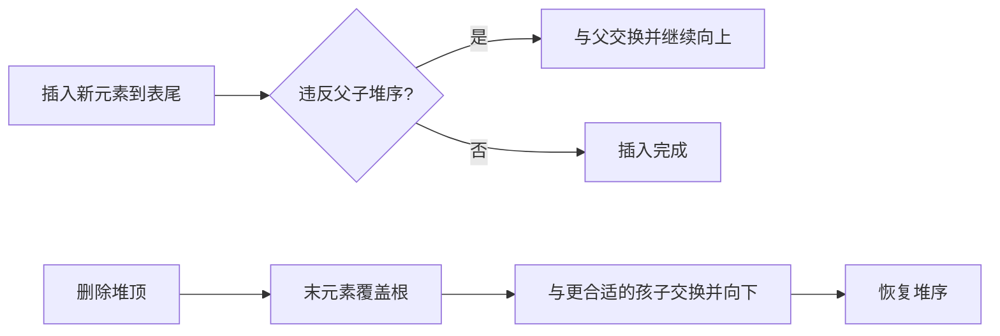

## 19.1 二叉排序树
### 19.1.1 定义与查找
##### **定义**：#二叉排序树
> 描述：
> 二叉排序树是一棵空树，或者是满足“左子树结点值小于根结点值，右子树结点值大于根结点值”的二叉树，并且它的左、右子树也分别是二叉排序树。

**性质**
$$
\text{左子树结点值}<\text{根结点值}<\text{右子树结点值}
$$

**中序遍历性质**
+ 在关键字互异、重复关键字不插入的约定下，对二叉排序树进行中序遍历，可以得到一个严格递增序列。
+ 这是二叉排序树能够用于查找、排序的基础。

#### 如何查找
若树非空，将目标值 `key` 与根结点关键字比较：

1. 若相等，则查找成功。
2. 若 `key` 小于根结点值，则在左子树中继续查找。
3. 若 `key` 大于根结点值，则在右子树中继续查找。
4. 查找成功返回结点指针。
5. 查找失败返回 `NULL`。

#### 结点定义
```c
typedef struct BSTNode {
    int key;
    struct BSTNode *lchild, *rchild;
} BSTNode, *BSTree;
```

#### 非递归查找
```c
BSTNode *BST_Search(BSTree T, int key) {
    while (T != NULL && key != T->key) {
        if (key < T->key) {
            T = T->lchild;
        } else {
            T = T->rchild;
        }
    }

    return T;
}
```

**复杂度**
+ 非递归查找不使用递归工作栈。
+ 最坏空间复杂度为：
$$
O(1)
$$

#### 递归查找
```c
BSTNode *BSTSearch(BSTree T, int key) {
    if (T == NULL) {
        return NULL;             // 查找失败
    }

    if (key == T->key) {
        return T;                // 查找成功
    } else if (key < T->key) {
        return BSTSearch(T->lchild, key);
    } else {
        return BSTSearch(T->rchild, key);
    }
}
```

**递归空间复杂度**
若树高为 $h$，递归栈最坏空间复杂度为：
$$
O(h)
$$


**图示说明**
+ 查找 `60` 时依次比较 `50、66、60`：大于 `50` 向右，小于 `66` 向左，最后命中 `60`。
+ 红色结点和箭头是实际访问路径，因此成功查找长度为 $3$。

### 19.1.2 插入
##### **定义**：#二叉排序树插入
> 描述：
> 二叉排序树插入是将一个新关键字按二叉排序树性质插入到树中，使插入后仍保持左小右大的有序关系。

**如何插入**
1. 若原二叉排序树为空，则新结点直接作为根结点。
2. 若关键字 $k$ 小于根结点值，则插入到左子树。
3. 若关键字 $k$ 大于根结点值，则插入到右子树。
4. 若关键字 $k$ 等于已有结点值，通常不插入。

**重要结论**
+ 新插入的结点一定是叶子结点。
+ 插入过程本质上是一次查找失败的过程。

#### 插入代码
```cpp
int BST_Insert(BSTree &T, int k) {
    if (T == NULL) {
        T = (BSTree)malloc(sizeof(BSTNode));
        T->key = k;
        T->lchild = T->rchild = NULL;
        return 1;                // 插入成功
    } else if (k == T->key) {
        return 0;                // 树中已有相同关键字
    } else if (k < T->key) {
        return BST_Insert(T->lchild, k);
    } else {
        return BST_Insert(T->rchild, k);
    }
}
```

**空间复杂度**
递归插入最坏空间复杂度为：
$$
O(h)
$$

### 19.1.3 构造与删除
#### 二叉排序树的构造
**思想**
+ 初始时二叉排序树为空。
+ 按给定关键字序列顺序，依次插入每个关键字。
+ 插入顺序不同，最终构造出的二叉排序树可能不同。

```cpp
void Creat_BST(BSTree &T, int str[], int n) {
    T = NULL;

    int i = 0;
    while (i < n) {
        BST_Insert(T, str[i]);
        i++;
    }
}
```

#### 二叉排序树的删除
删除前先搜索找到目标结点 `z`。

**情况一：`z` 是叶子结点**
+ 直接删除。
+ 不会破坏二叉排序树性质。

**情况二：`z` 只有一棵左子树或右子树**
+ 让 `z` 的子树替代 `z` 的位置。
+ 也就是让 `z` 的孩子成为 `z` 父结点的孩子。

**情况三：`z` 有左、右两棵子树**
+ 令 `z` 的直接后继或直接前驱替代 `z`。
+ 然后从二叉排序树中删除这个直接后继或直接前驱。
+ 这样会转换成情况一或情况二。

**为什么可行**
+ 直接前驱是左子树中最大的结点。
+ 直接后继是右子树中最小的结点。
+ 用它们替代 `z` 后，仍能保持左小右大的性质。

### 19.1.4 查找效率分析
#### 查找长度
##### **定义**：#查找长度
> 描述：
> 在查找运算中，需要对比关键字的次数称为查找长度。

**单次查找的最好情况**
+ 目标关键字就在根结点时，只需比较 $1$ 次，时间复杂度为 $O(1)$；这与整棵树是否平衡是两个不同问题。

**树形对等概率成功查找平均长度的影响**
+ 二叉排序树较平衡时，$n$ 个结点的二叉树最小高度为：
$$
\left\lfloor\log_2 n\right\rfloor+1
$$
+ 在各结点等概率被成功查找等常见假设下，平均查找长度为：
$$
O(\log_2 n)
$$

+ 当每个结点只有一个分支、二叉排序树退化为单链时，树高为：
$$
h=n
$$
+ 此时等概率成功查找的平均长度和单次查找的最坏长度均为：
$$
O(n)
$$

#### 查找失败的 ASL
##### **定义**：#ASL
> 描述：
> ASL 是 Average Search Length，即平均查找长度。

查找失败时，通常给每个空指针补一个外部结点，将外部结点视为失败位置。含有 $n$ 个内部结点的二叉树共有 $n+1$ 个外部结点。

> **IMPORTANT** · 比较次数口径
> 若根的深度记为 $0$，某外部结点的深度就等于到达该失败位置前进行的关键字比较次数。若把根记作第 $1$ 层，则失败比较次数等于“外部结点层次减 $1$”。PDF 公式中的“本层高度”应理解为对应失败位置的比较次数，不能把两种层次口径混用。

PDF 给出的计算思想：
$$
ASL_{\text{失败}}=\frac{\sum(\text{该失败位置的比较次数}\times\text{同类外部结点数})}{n+1}
$$

**PDF 示例**
+ 较平衡的树：
$$
ASL=\frac{3\times 7+4\times 2}{9}=3.22
$$

+ 退化较明显的树：
$$
ASL=\frac{2\times 3+3+4+5+6+7\times 2}{9}=4.22
$$

**解释**
+ 查找失败时，会走到某个空指针位置。
+ 每个空指针位置都可以看作一个“失败叶子”。
+ 深度越大的失败位置，查找失败时比较次数越多。


**图示说明**
+ 紫色方块是补出的外部结点；左图较平衡，失败比较次数主要为 $3$，右图退化更明显，深层失败位置更多。
+ 计算时应平均所有 $n+1$ 个外部结点，而不是只挑某一条失败路径。

## 19.2 平衡二叉树
### 19.2.1 定义
##### **定义**：#平衡二叉树
> 描述：
> AVL 树首先是一棵二叉排序树，并且树上任一结点的左、右子树高度之差的绝对值不超过 $1$。只有“高度平衡”但不满足二叉排序树有序性的二叉树，不是本章所说的 AVL 树。

**平衡因子**
结点的平衡因子定义为：
$$
\text{平衡因子}=\text{左子树高}-\text{右子树高}
$$

平衡二叉树中任意结点的平衡因子只能是：
$$
-1,\ 0,\ 1
$$

#### 结点定义
```c
typedef struct AVLNode {
    int key;                    // 数据域
    int balance;                // 平衡因子
    struct AVLNode *lchild, *rchild;
} AVLNode, *AVLTree;
```

### 19.2.2 调整最小不平衡子树
##### **定义**：#最小不平衡子树
> 描述：
> 插入结点后，沿插入路径向上检查，第一个失去平衡的结点作为根的子树，称为最小不平衡子树。

**调整目标**
1. 恢复平衡。
2. 保持二叉排序树性质。

**四种失衡类型**
| 类型 | 插入位置 | 调整方法 |
| --- | --- | --- |
| LL | 在 `A` 的左孩子的左子树中插入 | 对 `A` 右单旋 |
| RR | 在 `A` 的右孩子的右子树中插入 | 对 `A` 左单旋 |
| LR | 在 `A` 的左孩子的右子树中插入 | 先左旋左孩子，再右旋 `A` |
| RL | 在 `A` 的右孩子的左子树中插入 | 先右旋右孩子，再左旋 `A` |

#### LL 型：右单旋
**触发条件**
+ 在结点 `A` 的左孩子 `B` 的左子树中插入新结点。
+ 导致 `A` 的平衡因子由 $1$ 增至 $2$。

**调整**
+ 对 `A` 做一次右旋。
+ `B` 上升为子树根。
+ `A` 下降为 `B` 的右孩子。
+ `B` 原来的右子树变成 `A` 的左子树。

**有序关系**
若子树按大小关系为：
$$
BL < B < BR < A < AR
$$

右旋后仍保持二叉排序树性质。

#### RR 型：左单旋
**触发条件**
+ 在结点 `A` 的右孩子 `B` 的右子树中插入新结点。
+ 导致 `A` 的平衡因子由 $-1$ 减至 $-2$。

**调整**
+ 对 `A` 做一次左旋。
+ `B` 上升为子树根。
+ `A` 下降为 `B` 的左孩子。
+ `B` 原来的左子树变成 `A` 的右子树。

#### LR 型：先左后右双旋
**触发条件**
+ 在结点 `A` 的左孩子 `B` 的右子树中插入新结点。
+ 导致以 `A` 为根的子树失去平衡。

**调整**
1. 先对 `B` 做左旋，使 `B` 的右孩子 `C` 上升。
2. 再对 `A` 做右旋，使 `C` 上升为最小不平衡子树的新根。

**记忆**
```text
LR = 先 L 后 R
```

也就是：
+ 先左旋。
+ 再右旋。

#### RL 型：先右后左双旋
**触发条件**
+ 在结点 `A` 的右孩子 `B` 的左子树中插入新结点。
+ 导致以 `A` 为根的子树失去平衡。

**调整**
1. 先对 `B` 做右旋，使 `B` 的左孩子 `C` 上升。
2. 再对 `A` 做左旋，使 `C` 上升为最小不平衡子树的新根。

**记忆**
```text
RL = 先 R 后 L
```

也就是：
+ 先右旋。
+ 再左旋。


**图示说明**
+ LL、RR 是一次单旋；LR、RL 先处理较低层拐弯，再旋转最小不平衡子树的根。
+ 图中红色 `A` 是调整前的最小不平衡子树根；旋转后仍保持中序关键字次序不变。

### 19.2.3 AVL 查找效率
设树高为 $h$，则最坏情况下查找一个关键字最多比较 $h$ 次。

**平衡二叉树的最少结点数递推**
这里把空树高度记为 $0$、单结点树高度记为 $1$。设 $n_h$ 表示高度为 $h$ 的 AVL 树中含有的最少结点数，则：
$$
n_0=0,\quad n_1=1,\quad n_2=2
$$

并且：
$$
n_h=n_{h-1}+n_{h-2}+1
$$

**结论**
+ 含有 $n$ 个结点的平衡二叉树最大深度为：
$$
O(\log_2 n)
$$

+ 平衡二叉树的平均查找长度为：
$$
O(\log_2 n)
$$

## 19.3 哈夫曼树
### 19.3.1 带权路径长度
##### **定义**：#权
> 描述：
> 权是赋予结点的某种现实意义的数值，例如频率、概率、重要性等。

##### **定义**：#结点的带权路径长度
> 描述：
> 从树的根到该结点的路径长度，与该结点权值的乘积，称为该结点的带权路径长度。

##### **定义**：#WPL
> 描述：
> 树中所有叶结点的带权路径长度之和，称为树的带权路径长度，即 WPL。

公式为：
$$
WPL=\sum_{i=1}^{n}w_i l_i
$$

其中：
+ $w_i$ 表示第 $i$ 个叶结点的权值。
+ $l_i$ 表示第 $i$ 个叶结点到根的路径长度。

**PDF 示例**
四个叶结点权值为：
```text
1, 3, 4, 5
```

它们到根的路径长度都为 $2$，因此：
$$
WPL=2\times 1+2\times 3+2\times 4+2\times 5=26
$$


**图示说明**
+ 路径长度按边数计算；图中四个叶结点都在深度 $2$，所以每个权值都乘 $2$。

### 19.3.2 哈夫曼树的定义与构造
##### **定义**：#哈夫曼树
> 描述：
> 在含有 $n$ 个带权叶结点的二叉树中，带权路径长度 WPL 最小的二叉树称为哈夫曼树，也称最优二叉树。

#### 哈夫曼树构造方法
假设给定 $n$ 个权值：
$$
W_1,W_2,\cdots,W_n
$$

> **NOTE** · 教材补充：权值与单符号边界
> 标准哈夫曼树问题取 $n\ge 1$ 且 $W_i\ge 0$；编码实际出现的字符通常具有正频数或正概率。若允许负权值，“反复合并两个最小权值”不再具有这里的标准最优性语境。$n=1$ 时树就是唯一叶结点，不发生合并；实际编码接口通常仍给该符号约定一个比特（如 `0`），而不是使用不可传输的空码字。

构造步骤如下：
1. 将这 $n$ 个结点分别作为 $n$ 棵仅含一个结点的二叉树，构成森林 $F$。
2. 从 $F$ 中选取两棵根结点权值最小的树，作为新结点的左、右子树。
3. 新结点的权值等于左、右子树根结点权值之和。
4. 从 $F$ 中删除刚才选出的两棵树。
5. 将新得到的树加入 $F$。
6. 重复步骤 2 到步骤 5，直到 $F$ 中只剩下一棵树。

**PDF 示例权值**
```text
a:1, b:3, c:2, d:7, e:2
```

构造过程：
1. 选 `a:1` 和 `c:2`，合并为权值 `3`。
2. 按 PDF 图示，在并列的权值 `3` 中选 `b:3`，与 `e:2` 合并为权值 `5`。
3. 将前两步得到的 `3` 和 `5` 合并为权值 `8`。
4. 将 `d:7` 和 `8` 合并为权值 `15`，只剩一棵树。并列权值也可选另一棵根为 `3` 的树，树形可能不同。

PDF 示例最终：
$$
WPL=1\times 7+3\times(1+2+2+3)=31
$$

**哈夫曼树特点**
1. 每个初始结点最终都成为叶结点。
2. 较大权值应尽量靠近根；在最优排列中可以使较大权值的路径不长于较小权值。权值相等或合并时出现并列最小，会造成多种同样最优的树形。
3. 哈夫曼树的结点总数为：
$$
2n-1
$$
4. 哈夫曼树中不存在度为 $1$ 的结点。
5. 哈夫曼树不唯一，但 WPL 必然相同且最优。

**为什么结点总数是 $2n-1$**
+ 初始有 $n$ 个叶结点。
+ 每次合并两棵树会新增一个结点。
+ 合并到只剩一棵树，需要合并 $n-1$ 次。
+ 因此总点数为：
$$
n+(n-1)=2n-1
$$


**图示说明**
+ 每一步都从当前森林中取根权值最小的两棵树合并，新根权值为两者之和。
+ 左右子树可以互换，遇到相同权值时选择次序也可能不同，因此树形和编码不唯一，但最小 WPL 数值相同。

### 19.3.3 哈夫曼编码
##### **定义**：#可变长度编码
> 描述：
> 可变长度编码允许不同字符用不等长的二进制位表示。

##### **定义**：#固定长度编码
> 描述：
> 固定长度编码中，每个字符都用相等长度的二进制位表示。

##### **定义**：#前缀编码
> 描述：
> 若没有任何一个编码是另一个编码的前缀，则称这样的编码为前缀编码。

**前缀编码的意义**
+ 接收方读到一串编码后，可以无歧义地解码。
+ 不会出现“已经读到的编码可能还是另一个编码前半部分”的问题。

##### **定义**：#哈夫曼编码
> 描述：
> 哈夫曼编码是用哈夫曼树构造的一种字符集编码方案。字符作为叶结点，字符出现频率作为权值，根据哈夫曼树得到编码。

**构造方法**
1. 每个字符作为一个叶结点。
2. 每个字符出现频率作为该叶结点权值。
3. 按哈夫曼树构造方法建树。
4. 通常约定左分支为 `0`，右分支为 `1`。
5. 从根到某个叶结点路径上的 `0/1` 序列，就是该字符的编码。

**特点**
+ 高频字符路径短，编码短。
+ 低频字符路径长，编码长。
+ 哈夫曼编码结果不唯一。
+ 对给定字符权值，在二元前缀码的范围内，哈夫曼编码使加权平均码长最小；不能把这一结论直接扩大为所有压缩方法或允许跨多个字符联合编码的方案。

## 19.4 并查集
### 19.4.1 逻辑结构
##### **定义**：#并查集
> 描述：
> 并查集是一种用于管理若干互不相交集合的数据结构，主要支持查找和合并两类操作。

**集合**
+ 各个集合之间互不相交。
+ 代码实现集合的思想是：将不同的不相交集合放到不同的树下，构成森林。

**树与集合**
+ 一棵树表示一个集合。
+ 树中所有结点属于同一个集合。
+ 根结点代表这个集合。

### 19.4.2 基本操作
#### 查找操作：Find
##### **定义**：#Find
> 描述：
> Find 操作用于确定一个指定元素所属集合。

**方法**
+ 从当前元素出发。
+ 一路向上找父结点。
+ 找到根结点。
+ 根结点代表该元素所属集合。

#### 判同
**目的**
+ 判断两个元素是否属于同一个集合。

**方法**
+ 分别对两个元素执行 `Find`。
+ 若两个元素的根结点相同，则属于同一个集合。
+ 若根结点不同，则属于不同集合。

#### 合并操作：Union
##### **定义**：#Union
> 描述：
> Union 操作用于将两个互不相交的集合合并为一个集合。

**方法**
+ 让一棵树成为另一棵树的子树。
+ 本质上是修改其中一个根结点的父指针。

### 19.4.3 存储结构
并查集使用树的双亲表示法进行存储。

**核心思想**
+ 用一个数组 `S[]` 保存每个结点的父结点下标。
+ 若 `S[i] < 0`，表示 `i` 是根结点。
+ 初始时每个元素都是独立集合，因此：
$$
S[i]=-1
$$

**PDF 示例**
| 元素 | A | B | C | D | E | F | G | H | I | J | K | L |
| --- | ---: | ---: | ---: | ---: | ---: | ---: | ---: | ---: | ---: | ---: | ---: | ---: |
| 下标 | 0 | 1 | 2 | 3 | 4 | 5 | 6 | 7 | 8 | 9 | 10 | 11 |
| `S[]` | -1 | 0 | -1 | -1 | 1 | 1 | 2 | 3 | 3 | 3 | 4 | 4 |

**含义**
+ `S[0] = -1`，说明 `A` 是一个集合的根。
+ `S[1] = 0`，说明 `B` 的父结点是 `A`。
+ `S[4] = 1`，说明 `E` 的父结点是 `B`。
+ 多个 `S[i] < 0` 的位置对应多个集合的根。


**图示说明**
+ 图中有三棵树，因此数组中有三个负值根：`A、C、D`。
+ 箭头由孩子指向双亲，数组 `S[i]` 保存同一关系中的双亲下标。

### 19.4.4 基本代码
#### 初始化
```c
#define SIZE 13
int UFSets[SIZE];       // 集合元素数组

void Initial(int S[]) {
    for (int i = 0; i < SIZE; i++) {
        S[i] = -1;
    }
}
```

#### 查找
```c
int Find(int S[], int x) {
    while (S[x] >= 0) {
        x = S[x];
    }

    return x;
}
```

**复杂度**
+ `Find` 的时间复杂度与树高直接相关。
+ 未优化时最坏为：
$$
O(n)
$$

#### 合并
```c
void Union(int S[], int Root1, int Root2) {
    if (Root1 == Root2) {
        return;
    }

    S[Root2] = Root1;    // 将 Root2 连接到 Root1 下面
}
```

**复杂度**
+ 已知两个根结点时，`Union` 只修改一个数组元素。
+ 时间复杂度为：
$$
O(1)
$$
+ 若接口传入的是任意两个元素而不是两个根，必须先执行两次 `Find`；此时一次完整合并的复杂度是两次查根代价再加 $O(1)$，不能只写成 $O(1)$。

### 19.4.5 对并操作的优化
##### **定义**：#按规模合并
> 描述：
> 每次 Union 时，将小树合并到大树下面，尽可能让树不长高。

**思想**
+ 在根结点中保存集合规模。
+ 根结点的数组值使用负数表示集合大小。
+ 例如：
$$
S[0]=-13
$$
表示下标为 `0` 的根下面共有 $13$ 个元素。

**操作**
1. 用根结点数组值的绝对值表示树的结点总数。
2. 执行 `Union` 时，让小树合并到大树下面。
3. 新根结点的负值更新为两个集合规模之和的相反数。

**树高**
该方法构造的树高不超过：
$$
\left\lfloor\log_2 n\right\rfloor+1
$$

**效率**
查找复杂度降为：
$$
O(\log_2 n)
$$

#### 按规模合并代码
```c
void Union(int S[], int root1, int root2) {
    if (root1 == root2) {
        return;
    }

    // S[root] 为负数，绝对值越大，集合规模越大
    if (S[root2] > S[root1]) {
        // root1 规模更大，将 root2 合并到 root1
        S[root1] += S[root2];
        S[root2] = root1;
    } else {
        // root2 规模更大或相等，将 root1 合并到 root2
        S[root2] += S[root1];
        S[root1] = root2;
    }
}
```


**图示说明**
+ 根数组值的绝对值表示集合规模；小集合的根被挂到大集合的根下。
+ 新根的负值更新为两个负规模之和，从而同时保留根标记与集合大小。

### 19.4.6 对查操作的优化
##### **定义**：#路径压缩
> 描述：
> 路径压缩是在执行 Find 时，先找到根结点，再把查找路径上的所有结点都直接挂到根结点下面。

**思想**
1. 先沿父指针找到根。
2. 再处理查找路径上的各个顶点。
3. 把这些顶点的父结点直接改成根结点。

**效果**
+ 之后再查找这些结点时，路径会大幅变短。
+ 查找效率接近常数级。

#### 路径压缩代码
```c
int Find(int S[], int x) {
    int root = x;

    while (S[root] >= 0) {
        root = S[root];        // 先找到根
    }

    while (x != root) {
        int t = S[x];          // t 指向 x 的父结点
        S[x] = root;           // x 直接挂在根结点下
        x = t;
    }

    return root;
}
```

**复杂度**
+ 路径压缩会显著加速后续查找，但不能把一次孤立 `Find` 的最坏时间直接写成 $O(\alpha(n))$。
+ 当路径压缩与按规模（或按秩）合并同时使用时，对一个包含 $m$ 次 `Find/Union` 的操作序列，总时间为：
$$
O(m\alpha(n))
$$
+ 因而每次操作的均摊复杂度为 $O(\alpha(n))$。其中 $\alpha(n)$ 是增长极慢的反阿克曼函数，在实际规模下可视为很小的常数，但它不是严格的 $O(1)$ 结论。


**图示说明**
+ 左图中蓝色查找路径为 `L -> E -> B -> A`。
+ 右图为对 `L` 执行路径压缩后：路径上的 `L、E、B` 都直接挂到根 `A` 下；未访问的 `K、F、C、G` 分支保持原结构。

### 19.4.7 并查集复杂度总结
下表的“总合并流程”指从任意元素出发、每次合并都包含必要的查根过程，而不是已经给定两个根后只改一个父指针。

| 情况 | 单次 `Find` | 执行 $n-1$ 次含查根的合并流程 |
| --- | --- | --- |
| 无优化 | $O(n)$ | $O(n^2)$ |
| 仅 Union 优化 | $O(\log_2 n)$ | $O(n\log_2 n)$ |
| 按规模合并 + 路径压缩 | 均摊 $O(\alpha(n))$ | $O(n\alpha(n))$ |

> **NOTE** · 已知根时的连接代价
> 如果每次都已直接给出两个不同集合的根，那么连接本身始终是 $O(1)$，做 $n-1$ 次连接是 $O(n)$；表中的更高复杂度来自查根。

**理解**
+ 无优化时，树可能退化成链。
+ Union 优化让树尽量不长高。
+ Find 优化把查找路径压缩到根下。
+ 两者结合，是并查集高效的关键。

## 教材补充：堆及其应用

> **NOTE** · 补充范围
> 原 PDF 在排序章讲了建堆和堆排序；这里从完整教材体系补齐堆作为抽象数据结构时的操作、优先队列和 Top-K，并与[堆排序](/notes/cs408-0c5623624226/#section-4)互链。2027 年 408 数据结构大纲也把“堆及其应用”列作最低覆盖项。

### 二叉堆的结构不变量

二叉堆同时满足两个条件：

1. **结构性**：它是一棵完全二叉树，适合按层序放在连续数组中。
2. **堆序性**：大根堆满足父键不小于孩子，小根堆满足父键不大于孩子。

堆序只约束父子边，不保证左右兄弟、不同子树之间有序。因此：

+ 大根堆只能立即确定堆顶是最大值。含至少 $2$ 个元素时，按允许重复的次序统计口径，第二个最大元素必在根**现有的**孩子中产生：$n=2$ 时只有左孩子，$n=1$ 时不存在第二个元素。若题目问“第二大的不同关键字”，而根与孩子可能同值，则还可能需要继续向下搜索。
+ 对堆做中序遍历不会得到有序序列；堆不是二叉搜索树。
+ 本节的“堆”是二叉堆数据结构，不是程序运行时用于动态分配的内存堆。

### 基本操作及复杂度

| 操作 | 方法 | 时间复杂度 |
| --- | --- | --- |
| 读取堆顶 `Peek` | 直接访问根 | $O(1)$ |
| 插入 `Push` | 表尾加入，再向上调整 | $O(\log n)$ |
| 删除堆顶 `Pop` | 末元素覆盖根，再向下调整 | $O(\log n)$ |
| 删除任意已知下标 | 末元素覆盖；按与父、子的关系决定上调或下调 | $O(\log n)$ |
| 自底向上建堆 | 从最后一个非叶结点依次向下调整 | $O(n)$ |
| 逐个插入建堆 | 对 $n$ 个元素逐次执行插入 | $O(n\log n)$ |



向下调整大根堆时必须与两个孩子中的**较大者**比较，小根堆则与**较小者**比较；只固定选择左孩子会在另一孩子更优时留下非法堆。

### 优先队列

##### **定义**：#优先队列
> 优先队列中的元素按优先级而不是到达先后接受服务。最大优先队列可用大根堆实现，最小优先队列可用小根堆实现。

+ 入队对应堆插入，$O(\log n)$。
+ 查看最高优先级元素对应读堆顶，$O(1)$。
+ 取出最高优先级元素对应删除堆顶，$O(\log n)$。
+ 普通 FIFO 队列在队尾插入、队头删除；优先队列不保证先进先出。若相同优先级还要求保持到达顺序，需要把到达序号作为次关键字，或使用额外的稳定机制。

### Top-K 与第 $k$ 大问题

在 $1\le k\le n$ 的前提下，从 $n$ 个元素中保留最大的 $k$ 个元素，适合维护一个容量为 $k$ 的**小根堆**；$k=0$ 或 $k>n$ 时，“前 $k$ 个元素建堆”和“第 $k$ 大”均无定义，应由接口另行处理：

1. 用前 $k$ 个元素建小根堆。
2. 依次读取其余元素 $x$。
3. 若 $x$ 不大于堆顶，忽略；若 $x$ 大于堆顶，用 $x$ 替换堆顶并向下调整。
4. 扫描结束后，堆中就是按出现次数计算的最大 $k$ 个元素；堆顶是这 $k$ 个元素中的最小者，即整体第 $k$ 大值。

$$
\text{时间}=O\!\left(n\log\max\{2,k\}\right),\qquad \text{额外空间}=O(k)
$$

当 $k\ge 2$ 时通常简写为 $O(n\log k)$；当 $k=1$ 时只需线性扫描最大值，时间为 $O(n)$，不能把 $\log 1=0$ 机械解释成零时间。

求最小的 $k$ 个元素则对称地维护容量为 $k$ 的**大根堆**。若题目要求“互不相同的 Top-K”，还必须额外去重；普通堆会把重复关键字当作多个独立元素。

### 动态数据流的中位数

教材中常见的进一步应用是用两个堆维护动态中位数：

+ 大根堆保存较小的一半，小根堆保存较大的一半；
+ 保持两堆大小之差不超过 $1$，并保持大根堆顶不大于小根堆顶；
+ 每插入一个元素，先按边界放入一侧，再在两堆之间移动堆顶恢复平衡，单次 $O(\log n)$；
+ 元素总数为奇数时，中位数来自较大一侧的堆顶；为偶数时，按题意取两个堆顶的均值或上下中位数。

> **WARNING** · 易错边界
> 堆擅长反复取得一个极值，不擅长按关键字做任意查找：在普通堆中查找给定关键字最坏仍需 $O(n)$。若题目要求有序遍历、范围查找或快速定位任意键，应考虑 BST、B+ 树或散列表等结构。

## 19.5 题型：树与二叉树应用
### 题型一：二叉排序树操作
#### 第一部分：解题方法
1. 查找：小往左，大往右。
2. 插入：按查找失败位置插入，新结点一定是叶子。
3. 构造：按序列顺序依次插入。
4. 删除：
	+ 叶子直接删。
	+ 单子树用子树顶上。
	+ 双子树用直接前驱或后继替换。

#### 第二部分：典型例题
给定序列：
```text
50, 26, 66, 21, 30, 60, 70
```

依次插入得到二叉排序树：
```text
        50
      /    \
    26      66
   /  \    /  \
 21   30 60   70
```

查找 `60` 的路径为：
```text
50 -> 66 -> 60
```

查找长度为：
$$
3
$$

#### 第三部分：知识点复盘
+ 二叉排序树中序遍历有序。
+ 插入顺序会影响树形。
+ 删除双子树结点时，要找直接前驱或直接后继。

### 题型二：AVL 旋转判断
#### 第一部分：解题方法
1. 找插入后第一个失衡的祖先结点 `A`。
2. 看新结点插入在 `A` 的哪条路径上。
3. 按路径判断旋转类型：

| 路径 | 类型 | 调整 |
| --- | --- | --- |
| 左-左 | LL | 右单旋 |
| 右-右 | RR | 左单旋 |
| 左-右 | LR | 先左后右 |
| 右-左 | RL | 先右后左 |

#### 第二部分：典型例题
若在 `A` 的左孩子的右子树中插入新结点导致失衡，则属于：
```text
LR 型
```

调整方法：
```text
先对左孩子左旋，再对 A 右旋
```

#### 第三部分：知识点复盘
+ LL 和 RR 是单旋。
+ LR 和 RL 是双旋。
+ 调整后仍必须保持二叉排序树性质。

### 题型三：哈夫曼树与 WPL
#### 第一部分：解题方法
1. 每次选择两个最小权值合并。
2. 新结点权值为两者之和。
3. 重复直到只剩一棵树。
4. 用叶结点权值乘路径长度求 WPL。

#### 第二部分：典型例题
给定权值：
```text
1, 2, 2, 3, 7
```

构造哈夫曼树时：
1. 选 `1` 和 `2` 合并为 `3`。
2. 再从当前森林中继续选两个最小权值。
3. 直到只剩一棵树。

若最终路径长度对应 PDF 示例，则：
$$
WPL=1\times 7+3\times(1+2+2+3)=31
$$

#### 第三部分：知识点复盘
+ 哈夫曼树不唯一。
+ 对固定权值集合，最小 WPL 数值确定；达到该 WPL 的哈夫曼树和编码可能不唯一。
+ 哈夫曼树没有度为 $1$ 的结点。
+ $n$ 个叶结点的哈夫曼树共有 $2n-1$ 个结点。

### 题型四：并查集操作
#### 第一部分：解题方法
1. `Find(x)`：沿父指针找到根。
2. 判同：比较两个元素的根是否相同。
3. `Union(a,b)`：把一个根挂到另一个根下面。
4. 优化：
	+ 小树并到大树。
	+ 查找路径压缩。

#### 第二部分：典型例题
若有：
```text
S[4] = 1
S[1] = 0
S[0] = -1
```

则 `Find(4)` 的路径为：
```text
4 -> 1 -> 0
```

根结点为：
$$
0
$$

因此元素 `4` 属于以 `0` 为根的集合。

#### 第三部分：知识点复盘
+ `S[i] < 0` 表示 `i` 是根。
+ 未优化时 `Find` 可能是 $O(n)$。
+ 按规模合并让树不容易长高。
+ 路径压缩让后续查找更快。

## 相关知识

+ **科目导航**：[数据结构导航](/notes/cs408-5620bc526d96/)
+ **阅读顺序**：[上一篇：树、森林](/notes/cs408-c0568749182e/) · [下一篇：图基本概念](/notes/cs408-312cfdf36075/)
+ **关联专题**：[二叉树代码](/notes/cs408-033ead68e5bc/)

## 19.6 本节复盘
**二叉排序树**
| 操作 | 核心 |
| --- | --- |
| 查找 | 小往左，大往右 |
| 插入 | 查找失败处插入 |
| 构造 | 按序列依次插入 |
| 删除 | 叶子、单子树、双子树三类讨论 |

**AVL**
AVL 必须同时满足二叉排序树有序性和高度平衡性。

| 类型 | 插入位置 | 调整 |
| --- | --- | --- |
| LL | 左孩子的左子树 | 右单旋 |
| RR | 右孩子的右子树 | 左单旋 |
| LR | 左孩子的右子树 | 先左后右 |
| RL | 右孩子的左子树 | 先右后左 |

**哈夫曼树**
| 概念 | 结论 |
| --- | --- |
| WPL | $\sum_{i=1}^{n}w_i l_i$ |
| 构造 | 每次合并两个最小权值 |
| 结点总数 | $2n-1$ |
| 度为 $1$ 的结点 | 不存在 |
| 是否唯一 | 树不唯一，WPL 最优 |

**并查集**
| 操作 | 含义 |
| --- | --- |
| `Find` | 找根，确定所属集合 |
| `Union` | 合并两个集合 |
| 按规模合并 | 小树挂到大树 |
| 路径压缩 | 查找路径上的点直接挂根 |

**堆及其应用**
| 操作或场景 | 核心结论 |
| --- | --- |
| 自底向上建堆 | $O(n)$ |
| 插入、删除堆顶 | $O(\log n)$ |
| 读堆顶 | $O(1)$ |
| 优先队列 | 大根堆服务最高键，小根堆服务最低键 |
| 最大 Top-K | $1\le k\le n$；维护容量为 $k$ 的小根堆，统一写为 $O(n\log\max\{2,k\})$，$k=1$ 时即 $O(n)$ |

**复杂度**
| 情况 | 单次 `Find` | $n-1$ 次含查根的合并流程 |
| --- | --- | --- |
| 无优化 | $O(n)$ | $O(n^2)$ |
| Union 优化 | $O(\log_2 n)$ | $O(n\log_2 n)$ |
| 按规模合并 + 路径压缩 | 均摊 $O(\alpha(n))$ | $O(n\alpha(n))$ |

**易错点**
+ 二叉排序树插入的新结点一定是叶子。
+ 二叉排序树删除双子树结点时，不是随便找一个孩子替代，而是找直接前驱或直接后继。
+ 失败 ASL 必须统一外部结点层次与关键字比较次数的口径。
+ AVL 不只是“左右高度差不超过 $1$”，还必须满足二叉排序树性质。
+ AVL 的 LL、RR、LR、RL 要按插入路径判断。
+ 哈夫曼编码不唯一，但必须是前缀编码。
+ 并查集中负数表示根，负数绝对值可表示集合规模。
+ 已知根时连接是 $O(1)$；传入任意元素时，完整 `Union` 还要计入两次 `Find`。
+ 按规模合并在 `Union` 时控制树高，路径压缩在 `Find` 时压平访问路径；两者结合才有均摊 $O(\alpha(n))$。
+ 堆只保证父子堆序，不是整体有序；优先队列也不是普通 FIFO 队列。
