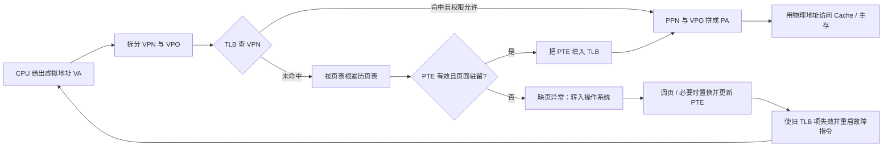
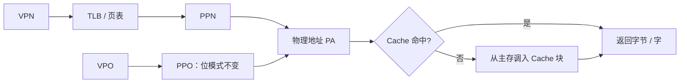

> **NOTE** · 补充属性
> 本文不是 Lecture 1-27 原 PDF 的改写，而是为完整表达组成原理教材中的虚拟存储器体系而新增的教材补充，覆盖页式虚拟存储器、页表、地址转换、TLB、段式与段页式虚拟存储器。2027 年 408 大纲只用于确认最低覆盖范围，不是本文的内容上限；硬件地址转换是本篇重点，页面置换与工作集等操作系统策略见文末链接。

> 描述：虚拟存储器让每个进程看到连续、统一的虚拟地址空间，而主存中只保留当前需要的页面。CPU 给出虚拟地址，MMU 通过 TLB 和页表得到物理地址；若页面不在主存，则触发缺页异常，由操作系统调页后重启原指令。

## 3.1 地址空间、页与页框

| 概念 | 含义 | 易错边界 |
| --- | --- | --- |
| 虚拟地址 VA | CPU 执行程序时产生、进程可见的地址 | 不是磁盘地址，也不一定能直接送主存 |
| 物理地址 PA | 主存实际使用的地址 | 由 MMU 完成虚实转换后形成 |
| 虚拟页（page） | 虚拟地址空间按固定大小划分的块 | 页号属于虚拟地址 |
| 物理页框（frame） | 主存按同样大小划分的块 | 页框号属于物理地址 |
| 页表 | 保存“虚拟页号 -> 物理页框号”及权限、状态 | 通常每个进程拥有自己的页表根 |

若页面大小为 $2^p$ B，则虚拟地址和物理地址都可拆成：

$$
VA=[VPN\mid VPO],\qquad PA=[PPN\mid PPO]
$$

+ $VPN$ 是虚拟页号，$PPN$ 是物理页框号；页内偏移分别记作 $VPO$、$PPO$。
+ 页面装入任意页框时，页内相对位置不变，所以 **$VPO=PPO$**。地址转换只替换页号，不改变低 $p$ 位页内偏移。
+ 页面大小必须先换成 $2^p$ B，再确定低 $p$ 位。题目若按字编址，应以“每页含多少可寻址单元”计算偏移位，不能机械按字节数取对数。

## 3.2 页表与页表项

页表存放在主存中，CPU/MMU 用页表基址寄存器（PTBR，名称依体系结构而异）定位当前进程的页表根。单级页表可抽象为：

$$
PTE\_addr=PTBR+VPN\times\text{PTE 大小}
$$

典型页表项 PTE 不只保存 PPN，还包含控制信息：

| 字段 | 作用 |
| --- | --- |
| 有效/存在位 | 表示该虚拟页当前是否有合法驻留映射；不存在时可能触发缺页 |
| 物理页框号 PPN | 与页内偏移拼接成物理地址 |
| 读/写/执行权限 | 区分可读、可写、可执行，权限不满足产生保护异常 |
| 用户/内核权限 | 防止用户态访问内核页 |
| 访问位/引用位 | 记录近期是否访问，可辅助页面置换 |
| 修改位/脏位 | 页面是否被写过；淘汰脏页时须先写回辅存 |

> **WARNING** · 易错边界
> “页面不在主存”和“访问权限非法”不是同一件事。前者是缺页/不存在异常，调页后通常可重启；后者是保护异常，即使页面在主存也不能直接继续访问。

### 3.2.1 单级页表容量

虚拟地址 $v$ 位、页面大小 $2^p$ B 时，虚拟页数为 $2^{v-p}$。若每个 PTE 占 $e$ B，则单级页表大小为：

$$
2^{v-p}\times e\ \text{B}
$$

例如 32 位虚拟地址、4 KiB 页面、PTE 为 4 B：页内偏移 12 位，VPN 为 20 位，共 $2^{20}$ 个 PTE；单个进程完整单级页表需 $2^{20}\times4=4$ MiB。

### 3.2.2 多级页表

多级页表把 VPN 再拆成多段。高层表项指向下一级页表，只有被实际使用的虚拟地址区域才分配下级表，适合稀疏地址空间。

+ 多级页表既避免为完整单级页表保留一大块连续主存，又因下级页表按需分配而减少稀疏地址空间中页表实际占用的主存；它不改变程序虚拟地址位数和页面大小。
+ 它没有消除页表访问；TLB 未命中时，页表级数越多，最坏情况下页表遍历需要的主存访问次数越多。
+ 32 位地址、4 KiB 页面、4 B PTE 时，一页页表可放 $4096/4=1024=2^{10}$ 个表项，因此常见二级拆分是 `10 位页目录号 + 10 位页表号 + 12 位页内偏移`。

## 3.3 TLB：页表项的高速缓存

TLB（Translation Lookaside Buffer，快表）是位于 MMU 附近、按内容查找的页表项高速缓存。它缓存近期使用的 `VPN -> PPN + 权限/状态`，解决“每次访存都先查主存页表”的速度问题。

### 3.3.1 命中、未命中与缺页的关系

| 情况 | 含义 | 后续动作 |
| --- | --- | --- |
| TLB 命中 | 所需有效 PTE 已在 TLB | 检查权限后直接形成 PA |
| TLB 未命中、页表命中 | TLB 没缓存，但 PTE 有效且页面在主存 | 遍历页表、回填 TLB，再重试地址转换 |
| TLB 未命中、页表不存在/页面不驻留 | PTE 表示页面不在主存或映射不存在 | 触发缺页或地址异常 |

+ **TLB 未命中不等于缺页**：绝大多数 TLB 未命中可通过查页表得到有效 PTE。
+ 在软硬件正确维护页表与 TLB 一致性的前提下，**TLB 命中项可作为当前有效映射使用**。操作系统修改或撤销映射时，必须在旧项可能再次被使用前完成对应 TLB 失效；多处理器还可能需要发起 TLB shootdown（跨核失效通知）。否则即使查询“命中”，得到的也只是过期翻译，不能据此断言当前页表仍有效。
+ 进程切换时，可清空相关 TLB 项；若 TLB 支持 ASID/PCID 等地址空间标识，则可让不同进程的翻译共存，但匹配时必须同时比较标识。

### 3.3.2 有效访问时间

设 TLB 查询时间为 $t_T$、一次主存访问时间为 $t_M$、TLB 命中率为 $h$。在“TLB 与主存串行、单级页表、忽略 Cache 和缺页”的简化模型中：

$$
EAT=h(t_T+t_M)+(1-h)(t_T+2t_M)
$$

命中时查 TLB 后访问一次数据；未命中时还要多访问一次主存页表。若题目允许 TLB 查询与 Cache/页表访问并行，或采用多级页表，必须按给定时序重列路径，不能直接套此式。

例：$h=98\%$、$t_T=10\,ns$、$t_M=100\,ns$，则

$$EAT=0.98\times110+0.02\times210=112\,ns$$

缺页需访问辅存，代价通常比纳秒级主存访问大许多数量级；若题目给缺页率，应把缺页服务时间按概率另行计入，不能把缺页当作普通 TLB 未命中。

## 3.4 TLB、页表与 Cache 的整机路径

在 408 常见的“物理地址访问 Cache”模型中，访问链为：

`虚拟地址 -> TLB/页表完成地址转换 -> 物理地址 -> Cache -> 主存`

| 组合 | 是否可能 | 解释 |
| --- | --- | --- |
| TLB 命中、Cache 命中 | 可能 | 翻译与数据都在高速缓存 |
| TLB 命中、Cache 未命中 | 可能 | 有地址翻译，但数据块不在 Cache，须访问主存 |
| TLB 未命中、页表命中、Cache 命中 | 可能 | 先由页表得到 PA；对应物理块仍可能已在 Cache |
| TLB 未命中、发生缺页、Cache 命中 | 在普通一致模型中不可能 | 页面尚未驻留主存，不能存在可供本次正常访问的有效数据 Cache 副本 |

> **TIP** · 易错边界
> TLB 缓存的是**地址翻译**，Cache 缓存的是**指令或数据块**，页表是主存中的映射数据结构。三者都会“命中/未命中”，但对象、粒度、缺失代价和管理者完全不同。

若 Cache 的组索引位全部落在页内偏移范围内，硬件可在 TLB 翻译 VPN 的同时用页内偏移开始索引 Cache；但 tag 比较仍须使用正确的物理标记。408 题未说明这种并行优化时，按题给的串行路径计算最稳妥。

## 3.5 缺页处理与精确异常

一次可恢复缺页的典型过程：

1. MMU 在取指或 Load/Store 时发现 PTE 不存在/页面不驻留，保存故障虚拟地址和原因。
2. CPU 以异常方式进入内核；断点应指向**尚未完成的故障指令**，以便调页后重执行。
3. 操作系统定位页面在辅存中的位置，取得空闲页框；无空闲页框时选择牺牲页。
4. 若牺牲页为脏页，先写回辅存；再把所需页面读入目标页框。
5. 更新页表项及相关状态，使过期 TLB 项失效。
6. 执行异常返回，重新执行故障指令；这一次地址转换应得到有效映射。

这里的页面置换算法、驻留集、抖动等属于操作系统策略；组成原理重点是 MMU、PTE、TLB、异常入口和重启之间的硬件协作。

## 3.6 段式与段页式虚拟存储器

### 3.6.1 段式虚拟存储器

段式地址由 `段号 s + 段内偏移 d` 构成。每段对应程序的逻辑单元，如代码段、数据段、栈段；段长可不同。

段表项至少给出段基址、段长/界限和权限。访问过程为：

1. 用段号索引段表，检查段是否存在及访问权限。
2. 检查 $d<\text{段长}$；越界产生异常。
3. 形成物理地址 $PA=\text{段基址}+d$。

| 对比 | 页式 | 段式 |
| --- | --- | --- |
| 划分 | 固定大小页面 | 按逻辑意义、可变长分段 |
| 地址 | 页号 + 页内偏移 | 段号 + 段内偏移 |
| 碎片 | 可能有页内碎片 | 可能有外部碎片 |
| 共享保护 | 以页面为单位 | 逻辑段边界更直观 |

### 3.6.2 段页式虚拟存储器

段页式先按逻辑分段，再把每段划成固定大小的页。虚拟地址通常为：

$$VA=[\text{段号}\mid\text{段内页号}\mid\text{页内偏移}]$$

地址转换先由段表项得到该段页表的基址和段界限，再由段内页号查页表得到物理页框号，最后与页内偏移拼接。它兼有分段的逻辑保护/共享和分页的离散装入能力，但地址转换层次、表项和硬件控制更复杂。

## 3.7 典型题型与计算顺序

### 题型：#虚拟地址转换

给定 32 位虚拟地址、30 位物理地址、页面大小 4 KiB：

+ 页内偏移为 $\log_2 4\,KiB=12$ 位；
+ VPN 为 $32-12=20$ 位；
+ PPN 为 $30-12=18$ 位；
+ 转换只把高 20 位 VPN 查成 18 位 PPN，低 12 位原样保留。

固定解题步骤：

1. 由页面大小求页内偏移位数。
2. 分别用虚拟/物理地址位数减偏移位数，得到 VPN/PPN 位数。
3. 按 VPN 查 TLB/页表，先检查有效位和权限，再取 PPN。
4. 拼接 `PPN + 原页内偏移` 得 PA。
5. 若还考 Cache，再用 PA 按 `tag + 组号 + 块内偏移` 继续分解；不要把 VPN 直接当 Cache tag。

### 题型：#页表与TLB综合

+ 页表容量：虚拟页数乘 PTE 大小；多级页表按“每级索引位数、实际分配表页数”计算。
+ TLB 容量：表项数乘每项的 VPN tag、PPN、有效位、权限位、ASID 等；题目若只问数据项，不要擅自漏算或增加控制位。
+ 平均时间：把 TLB 命中、页表命中、缺页三条路径分别列出“各访问几次、每次多长”，再按概率加权。

## 相关知识

+ **科目导航**：[计算机组成原理导航](/notes/cs408-2406c8c61473/)
+ **阅读顺序**：[上一篇：Cache](/notes/cs408-d5113c15e970/) · [下一篇：指令系统的基本概念](/notes/cs408-e93053729cfd/)
+ **操作系统视角**：[内存管理基础](/notes/cs408-6e190f5755e2/) · [虚拟内存管理](/notes/cs408-dd853a0ed1a2/)
+ **异常机制**：[异常与中断](/notes/cs408-a58dbd00622a/)

## 3.8 本节复盘

+ 页式地址转换把 VPN 映射为 PPN，页内偏移原样保留；页表项还保存有效、权限、访问和脏等状态。
+ TLB 是 PTE 的高速缓存：TLB 未命中不等于缺页；页表命中后可回填 TLB，页面不驻留才进入缺页异常。
+ 物理地址 Cache 的常见路径是“VA -> TLB/页表 -> PA -> Cache/主存”；TLB 缓存翻译，Cache 缓存数据，二者不可混淆。
+ 缺页是可恢复异常时，应保存故障指令地址，调页、更新 PTE/TLB 后重执行原指令。
+ 段式按逻辑单元用基址加界限保护，段页式先分段再分页；三类地址结构与表项职责必须分清。
