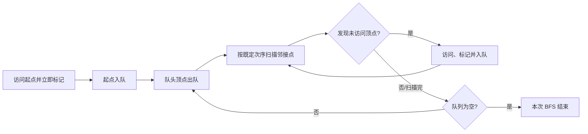

> 图的遍历是从一个顶点出发，按照某种规则访问其**可达范围**内的每个顶点且只访问一次；若要覆盖非连通图，还需通过外层循环选择新的起点。核心是 `visited[]`：图可能有环，不标记已访问顶点会在环中反复访问。

## 22.1 广度优先遍历

### 22.1.1 基本概念

##### **定义**：#广度优先遍历 #BFS
> 描述：广度优先遍历（Breadth-First Search，BFS）从起始顶点 $v$ 出发，先依次访问 $v$ 的所有未访问邻接顶点，再依次访问这些邻接顶点的所有未访问邻接顶点，按“由近到远、逐层扩展”的方式直至不能继续。

若从 $v$ 开始，$v$ 的未访问邻接顶点为：

$$
w_1,w_2,\cdots,w_n
$$

则 BFS 的访问层次是：

$$
v\longrightarrow \{w_1,w_2,\cdots,w_n\}\longrightarrow \text{这些顶点的未访问邻接点}\longrightarrow\cdots
$$

##### **三个关键动作**：

1. 找到当前顶点的所有邻接顶点。
2. 只处理尚未访问过的邻接顶点。
3. 使用一个**辅助队列**保存“已经发现但还没有展开邻接点”的顶点。

##### **队列含义**：#BFS队列
+ 顶点被首次访问时，立刻标记并入队。
+ 队头顶点出队后，扫描它的所有邻接点。
+ 新发现的顶点按发现次序进入队尾，因此先发现的顶点先展开。
+ “访问时标记”而非“出队时标记”，可防止同一顶点被多个邻接点重复入队。



以边 $1-2,1-3,2-4,3-4$ 且按编号递增扫描邻接点为例：

| 时刻 | 动作 | 队列（队头在左） | 已访问序列 |
| --- | --- | --- | --- |
| 初始 | 访问并入队 1 | $[1]$ | $1$ |
| 展开 1 | 发现 2、3 | $[2,3]$ | $1,2,3$ |
| 展开 2 | 发现 4 | $[3,4]$ | $1,2,3,4$ |
| 展开 3 | 4 已访问，不重复入队 | $[4]$ | 不变 |
| 展开 4 | 无新顶点 | $[]$ | 遍历结束 |

### 22.1.2 BFS 遍历序列是否唯一

##### **邻接矩阵**：
在**顶点编号顺序固定、起始顶点固定、按固定列序扫描邻接点**的条件下，邻接矩阵确定，因此 BFS 访问序列唯一。若改变顶点编号或扫描顺序，序列仍可能改变。

##### **邻接表**：
同一个图的邻接表表示通常不唯一：同一顶点边表中邻接点的链接次序可以不同。因此即使起点相同，BFS 访问序列也可能不同。

##### **易错点**：#BFS序列
+ 图本身固定并不自动保证遍历序列唯一。
+ 题目若给邻接表，应严格按边表给出的次序访问。
+ 题目若只给图而未规定邻接点访问次序，多个合法遍历序列都可能成立。

### 22.1.3 性能分析

##### **空间复杂度**：
$$
O(\lvert V\rvert)
$$

+ `visited[]` 需要 $O(\lvert V\rvert)$ 空间。
+ 辅助队列最多可保存 $O(\lvert V\rvert)$ 个顶点。
+ 队列达到最大长度的典型情况是：当前访问顶点连接着大量尚未访问的顶点。

##### **时间复杂度**：

| 存储结构 | 分析 | 时间复杂度 |
| --- | --- | --- |
| 邻接矩阵 | 每个顶点出队后均要扫描完整一行，扫描 $\lvert V\rvert$ 次 | $O(\lvert V\rvert^2)$ |
| 邻接表 | 访问顶点共 $O(\lvert V\rvert)$；沿边表查找邻接点共 $O(\lvert E\rvert)$ | $O(\lvert V\rvert+\lvert E\rvert)$ |


> 无向邻接表实际会扫描 $2\lvert E\rvert$ 个边表结点，有向邻接表扫描 $\lvert E\rvert$ 个弧结点；二者在渐近复杂度中都写成 $O(\lvert V\rvert+\lvert E\rvert)$。图中右侧邻接表的链内次序只是其中一种合法排列。

### 22.1.4 算法实现

##### **从单一起点开始的 BFS**：

```c
bool visited[MAX_VERTEX_NUM];

void BFS(Graph G, int v) {
    visit(v);
    visited[v] = TRUE;
    EnQueue(Q, v);

    while (!isEmpty(Q)) {
        DeQueue(Q, v);
        for (int w = FirstNeighbor(G, v);
             w >= 0;
             w = NextNeighbor(G, v, w)) {
            if (!visited[w]) {
                visit(w);
                visited[w] = TRUE;
                EnQueue(Q, w);
            }
        }
    }
}
```

##### **逐行理解**：

| 代码动作 | 含义 |
| --- | --- |
| `visit(v)` | 处理或输出顶点 $v$ |
| `visited[v] = TRUE` | 标明 $v$ 已被发现，不能重复入队 |
| `EnQueue(Q, v)` | 等待后续扫描 $v$ 的邻接点 |
| `DeQueue(Q, v)` | 取出当前最早发现、尚未展开的顶点 |
| `FirstNeighbor` / `NextNeighbor` | 依次枚举 $v$ 的邻接点 |
| `if (!visited[w])` | 只把第一次发现的顶点加入遍历 |

##### **代码易错点**：#BFS代码
+ 课件中 `TREUE` 是拼写错误，应为 `TRUE`。
+ `w >= 0` 与前一讲 `FirstNeighbor` 返回 $-1$ 的约定匹配。
+ 若在 `DeQueue` 后才设置 `visited[w]`，同一个 $w$ 可能被多次入队。
+ 单次 `BFS(G, v)` 只能覆盖从 $v$ 可达的顶点，不能保证覆盖非连通图全部顶点。
+ 代码是沿用课件抽象 `Graph`、队列 `Q` 与邻接点接口的算法片段；调用 `BFS` 前须先初始化队列，`EnQueue/DeQueue` 的具体实现及容量失败处理也须由所用队列接口提供。

### 22.1.5 非连通图的处理

##### **遍历框架**：#非连通图BFS
> 描述：先将所有顶点标记为未访问，再按顶点编号逐一检查。每遇到一个未访问顶点，就以它为起点执行一次 BFS。

```c
void BFSTraverse(Graph G) {
    for (int i = 0; i < G.vexnum; ++i) {
        visited[i] = FALSE;
    }

    InitQueue(Q);

    for (int i = 0; i < G.vexnum; ++i) {
        if (!visited[i]) {
            BFS(G, i);
        }
    }
}
```

##### **连通分量结论**：
+ 对**无向图**，外层循环中实际调用 `BFS` 的次数等于图的连通分量个数。
+ 因而可用 BFS 确定无向图的连通分量。
+ 对连通无向图，只需要调用 $1$ 次 BFS。
+ 对有向图，调用次数取决于起点及弧方向，不能直接等同于强连通分量个数。

### 22.1.6 广度优先生成树

##### **定义**：#广度优先生成树
> 描述：在 BFS 过程中，每当首次访问一个新顶点 $w$ 时，把“发现 $w$ 的顶点”记为其双亲，并把对应边记为树边。

+ 对含 $n$ 个顶点的**连通无向图**，这些树边组成一棵 BFS 生成树，恰有 $n-1$ 条树边。
+ 对含 $c$ 个连通分量的无向图，外层遍历得到 BFS 生成森林，共有 $n-c$ 条树边。
+ 对有向图，单次 BFS 得到的是从起点沿弧可达部分的搜索树；只有起点能到达全部顶点时，才覆盖全图并形成以起点为根的有向外向树，不能把一般情形直接称为无向意义下的生成树。
+ BFS 生成树体现起点到各顶点的“最少边数层次”。
+ 在无权图中，BFS 首次到达一个可达顶点所处的层数，等于从起点到它的最短路径边数；双亲链给出其中一条最短路径，但最短路径本身可能不唯一。


> 两张图从同一顶点 $2$ 出发，但顶点 $6$ 的邻接点次序不同，导致 $3$、$7$ 的发现先后和最终 BFS 树不同；各顶点的层次仍保持最短路层次。


> 非连通无向图需由外层循环重新选择起点，每个连通分量产生一棵树，合起来是生成森林。

---

## 22.2 深度优先遍历

### 22.2.1 基本概念

##### **定义**：#深度优先遍历 #DFS
> 描述：深度优先遍历（Depth-First Search，DFS）从起始顶点出发，在当前顶点的未访问邻接点中任选一个继续访问；只要还能向下，就持续深入。当当前顶点没有未访问邻接点时，回退到最近一个仍有未访问邻接点的顶点，继续搜索。

DFS 的过程可概括为：

$$
\text{访问一个顶点}\rightarrow\text{选择一个未访问邻接点}\rightarrow\text{递归深入}\rightarrow\text{无法深入时回溯}
$$

##### **直观理解**：
+ BFS 是“先横向、后纵向”，按层扩展。
+ DFS 是“先纵向、后回退”，沿一条路尽可能走到底。
+ DFS 的递归调用过程等价于使用一个辅助栈；递归返回就是出栈回溯。

> **TIP** · 回溯位置
> 当当前顶点没有未访问邻接点时，DFS 返回到递归调用者，并从调用者上次暂停的位置继续扫描“下一个邻接点”，而不是重新从整张图任意选点。只有当前连通/可达部分结束后，外层循环才选择新的起点。

### 22.2.2 性能分析

##### **空间复杂度**：
$$
O(\lvert V\rvert)
$$

+ `visited[]` 占用 $O(\lvert V\rvert)$。
+ 递归最深时，递归工作栈最多保存 $\lvert V\rvert$ 个顶点。

##### **时间复杂度**：

| 存储结构 | 分析 | 时间复杂度 |
| --- | --- | --- |
| 邻接矩阵 | 每访问一个顶点，都扫描一整行寻找邻接点 | $O(\lvert V\rvert^2)$ |
| 邻接表 | 顶点被访问一次，边表结点总共扫描一次 | $O(\lvert V\rvert+\lvert E\rvert)$ |

无向邻接表中每条边对应两个边表结点，实际扫描 $2\lvert E\rvert$ 次；有向邻接表扫描 $\lvert E\rvert$ 个弧结点，渐近复杂度相同。

课件也将邻接矩阵的时间写作：

$$
O(\lvert V\rvert+\lvert V\rvert^2)=O(\lvert V\rvert^2)
$$

### 22.2.3 算法实现

```c
bool visited[MAX_VERTEX_NUM];

void DFS(Graph G, int v) {
    visit(v);
    visited[v] = TRUE;

    for (int w = FirstNeighbor(G, v);
         w >= 0;
         w = NextNeighbor(G, v, w)) {
        if (!visited[w]) {
            DFS(G, w);
        }
    }
}
```

##### **递归过程**：
1. 访问当前顶点 $v$，立即做已访问标记。
2. 按既定顺序扫描 $v$ 的邻接点。
3. 若发现未访问顶点 $w$，递归执行 `DFS(G, w)`。
4. 当 $w$ 的分支遍历结束后，函数自动返回到 $v$，继续枚举 $v$ 的下一个邻接点。

##### **代码易错点**：#DFS代码
+ 课件中 `NextNeighor` 少写了 `b`，应为 `NextNeighbor`。
+ 条件应使用 `w >= 0`，因为合法顶点编号可以为 $0$；写成 `w > 0` 会漏掉 $0$ 号顶点。
+ `visited[v] = TRUE` 必须在递归进入邻接点之前完成，否则有环时会无限递归。
+ 用显式栈改写 DFS 时，若希望得到与递归版相同的访问顺序，通常要按**相反顺序**压入邻接点；否则算法仍正确，但遍历序列可能不同。

### 22.2.4 非连通图的处理

```c
void DFSTraverse(Graph G) {
    for (int v = 0; v < G.vexnum; ++v) {
        visited[v] = FALSE;
    }

    for (int v = 0; v < G.vexnum; ++v) {
        if (!visited[v]) {
            DFS(G, v);
        }
    }
}
```

##### **调用次数**：
+ 对无向图，外层遍历从未访问顶点启动 `DFS` 的次数等于连通分量数；不要与递归函数的总调用次数混淆，后者通常对每个首次发现的顶点调用一次。
+ 对连通无向图，外层只需启动 $1$ 次 DFS。
+ 对有向图，外层启动次数要具体分析；若指定起始顶点能沿弧到达其他所有顶点，则外层只需启动 $1$ 次。

### 22.2.5 深度优先生成树

##### **定义**：#深度优先生成树
> 描述：DFS 中每次递归访问一个未访问邻接点时，把触发递归的边记为树边。

+ 含 $n$ 个顶点的连通无向图得到一棵 DFS 生成树，含 $n-1$ 条树边；含 $c$ 个连通分量的无向图得到 DFS 生成森林，共有 $n-c$ 条树边。
+ 对有向图，得到的是按弧方向展开的 DFS 搜索树/森林；是否覆盖全部顶点取决于可达性和外层起点次序。
+ 给定起点和邻接点访问顺序后，生成树随 DFS 过程确定。
+ 在顶点编号、起点（或外层起点次序）及邻接点扫描顺序都固定时，邻接矩阵对应的遍历序列和搜索树唯一。
+ 邻接表的边表顺序不唯一时，遍历序列和生成树也不唯一。


> 图中先从顶点 $2$ 深入其可达部分，回溯完成后，外层循环再从未访问的顶点 $3$ 启动 DFS；红、绿、蓝箭头表示不同递归分支的树边。

---

## 22.3 BFS 与 DFS 对比

| 对比项 | BFS | DFS |
| --- | --- | --- |
| 中文名称 | 广度优先遍历 | 深度优先遍历 |
| 核心思想 | 逐层扩展，先访问距离近的顶点 | 沿一条分支尽量深入，再回溯 |
| 辅助结构 | 队列 | 递归工作栈或显式栈 |
| 空间复杂度 | $O(\lvert V\rvert)$ | $O(\lvert V\rvert)$ |
| 邻接矩阵时间 | $O(\lvert V\rvert^2)$ | $O(\lvert V\rvert^2)$ |
| 邻接表时间 | $O(\lvert V\rvert+\lvert E\rvert)$ | $O(\lvert V\rvert+\lvert E\rvert)$ |
| 生成结构 | 连通无向图得到 BFS 生成树；非连通图得到森林 | 连通无向图得到 DFS 生成树；非连通图得到森林 |
| 无权图最短路 | 可得到起点到每个可达顶点的最少边数 | 不保证最短路 |

##### **共同点**：
+ 都须记录已发现/访问状态以避免重复处理；本讲示例用 `visited[]`，也可以在图结构中保存等价标记。
+ 都要通过外层循环覆盖非连通图。
+ 都会受邻接表中邻接点存储顺序影响。
+ 无向图中，外层循环启动次数等于连通分量数。
+ 有向图中，外层启动次数由顶点次序和有向可达性共同决定，既不等于强连通分量数，也不一定等于弱连通分量数。

---

## 相关知识

+ **科目导航**：[数据结构导航](/notes/cs408-5620bc526d96/)
+ **阅读顺序**：[上一篇：图的存储及其操作](/notes/cs408-5a6e8759de60/) · [下一篇：图的经典应用](/notes/cs408-a1c21fbceeaf/)
+ **关联专题**：[图代码](/notes/cs408-d690a826208c/)

## 22.4 题型与复盘

### 22.4.1 常见题型

##### **题型一：写出 BFS / DFS 序列**
+ 先写清起始顶点和邻接点访问顺序。
+ BFS 用队列模拟：入队时访问，出队时展开邻接点。
+ DFS 按递归路径模拟：先深入，走不通后回溯。
+ 遇到尚未访问的顶点，完成当前可达部分后按外层约定从下一个未访问顶点重新开始；无向图中每个这样的可达部分恰是一个连通分量，有向图中不能这样等同。

##### **题型二：画生成树**
+ 首次发现一个顶点时使用的边为树边。
+ BFS 树按层次展开；DFS 树通常呈现较长的深入分支。
+ 含 $n$ 个顶点、$c$ 个连通分量的无向图，生成森林有 $n-c$ 条树边；连通时 $c=1$，即 $n-1$ 条。
+ 有向图先判断从根的可达范围，不要直接套用无向图“生成树”结论。

##### **题型三：复杂度判断**
+ 邻接矩阵：不管实际边数多少，每次都扫描一行，所以是 $O(\lvert V\rvert^2)$。
+ 邻接表：顶点和边各处理一次，所以是 $O(\lvert V\rvert+\lvert E\rvert)$。
+ BFS 队列与 DFS 递归栈的辅助空间均为 $O(\lvert V\rvert)$。

##### **题型四：连通分量**
+ 无向图中，外层循环每新启动一次 BFS/DFS，就发现一个新的连通分量。
+ 不能把有向图中的调用次数直接当作强连通分量数。

### 22.4.2 本节复盘

| 关键词 | 必须掌握的结论 |
| --- | --- |
| BFS | 队列；按层访问；入队时标记 |
| DFS | 递归或栈；一路深入；无法深入时回溯 |
| `visited[]` | 防止图中有环时重复访问或无限递归 |
| 非连通图 | 外层循环逐个启动 BFS/DFS |
| 无向图连通分量 | BFS/DFS 的外层启动次数等于连通分量数 |
| 生成森林边数 | 无向图有 $n$ 个顶点、$c$ 个连通分量时，树边数为 $n-c$ |
| 邻接矩阵 | BFS、DFS 时间均为 $O(\lvert V\rvert^2)$ |
| 邻接表 | BFS、DFS 时间均为 $O(\lvert V\rvert+\lvert E\rvert)$ |
| 遍历序列 | 邻接表次序不唯一时，序列和生成树不唯一 |
| 无权最短路 | BFS 层数给出起点到可达顶点的最少边数；DFS 不保证最短 |
