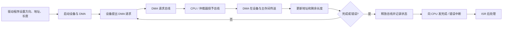

> 描述：I/O 方式按 CPU 参与程度递减可理解为程序查询、中断、DMA、通道。核心区别：查询和中断的数据搬运都靠 CPU/软件；DMA 由硬件直接在主存与接口间搬运整块数据；通道进一步把多设备管理交给专用处理器。

## 6.1 程序查询方式

程序查询（轮询）方式中，CPU 与 I/O 设备串行通信。CPU 不断读取 I/O 接口的状态寄存器，直到设备就绪，然后才进行一次数据传送。

```text
初始化主存地址和传送计数 -> 发控制命令 -> 读状态寄存器
                                      ├─ 未就绪：继续查询
                                      └─ 就绪：读/写数据端口
                                               -> 修改地址和计数
                                               -> 未完成则启动下一次传送
```

典型独立编址指令可写为：

| 指令 | 含义 |
| --- | --- |
| `IN Rd, Rs` | 将 I/O 端口 `Rs` 的数据读入 CPU 寄存器 `Rd` |
| `OUT Rd, Rs` | 将 CPU 寄存器 `Rs` 的数据写至 I/O 端口 `Rd` |

不同教材对操作数书写顺序可能不同，解题时以题给 ISA 为准；本质永远是**通用寄存器与 I/O 数据端口**之间传输。

### 6.1.1 以打印机输出为例

1. CPU 向控制端口写命令字，启动打印机。
2. 打印机/控制器把忙、就绪等状态写入状态寄存器。
3. CPU 持续用 `IN` 读取状态端口。
4. 判断就绪后，CPU 用 `OUT` 把待打印数据写到数据缓冲寄存器，再开始下一字节/字传送。

该方式实现简单、硬件少，但 CPU 花费大量时间查询和等待，一段时间通常只能同一个外设交换信息，利用率低。

### 6.1.2 独占查询与定时查询

| 方式 | CPU 行为 | 特点 |
| --- | --- | --- |
| 独占查询 | 100% 时间反复检查设备状态 | 最直接但完全串行，CPU 空等严重 |
| 定时查询 | 在不丢失数据的前提下每隔一段时间查询一次 | 查询间隙可执行其他程序，需选好最大间隔 |

在**单字缓冲、无流控且新数据可能覆盖旧数据**的题设中，若设备每次准备/填满一个端口字的时间为 $T_d$，定时查询间隔必须不大于 $T_d$。若接口带 FIFO、握手流控或能暂停发送端，则最大安全间隔还取决于 FIFO 深度和流控机制，不能只套用一个端口字的时间。

> 例（2018 年真题参数）：CPU 主频为 $500\,MHz$，设备 A 以 $2\,MB/s$ 准备数据，端口缓冲为 32 bit $=4\,B$，填满时间为 $4\,B/(2\,MB/s)=2\,\mu s$，因此最多间隔 $2\,\mu s$ 查询一次，即每秒至少查询 $5\times10^5$ 次。若每次 I/O 需执行 10 条指令、CPI 为 4，则每秒占用
> $$
> 5\times10^5\times10\times4=2\times10^7\ \text{个时钟周期},
> $$
> 占 CPU 总时间至少为 $(2\times10^7)/(5\times10^8)=4\%$。这里的 MB 按真题常用十进制单位 $10^6\,B$ 计算。

## 6.2 程序中断 I/O 方式

中断方式让 CPU 在设备准备数据期间执行其他程序。设备就绪/完成后，I/O 控制器向 CPU 发外部中断请求；CPU 在指令边界响应后转入 ISR，完成一次端口数据传送并可启动设备下一次工作。

```text
CPU 启动设备 -> CPU 执行其他程序
设备就绪 -> I/O 控制器请求中断 -> CPU 响应 -> ISR 读/写端口
-> 重新启动设备（若需要） -> 中断返回原程序
```

### 6.2.1 特点与限制

+ 适合相对慢速的设备。若设备极快、每个字节/字都中断一次，CPU 会被大量 ISR 淹没，利用率反而严重下降；磁盘块传输通常不适宜逐字采用中断 I/O。
+ 中断 I/O 的数据传输由**软件**执行：CPU 在 ISR 中读/写 I/O 端口，再通过程序把数据写入/读出主存。
+ CPU 和 I/O 端口间传送的信息中不需要把“数据所在主存地址”交给接口；内存地址由执行 I/O 的程序/ISR 自己使用，接口只看到端口数据与控制信息。
+ 可屏蔽外部中断只有 CPU 开中断、且在指令执行结束边界时才能响应。

### 6.2.2 查询与中断的比较

| 对比 | 程序查询 | 程序中断 |
| --- | --- | --- |
| 谁发现就绪 | CPU 定期/连续读状态 | 设备控制器主动请求 |
| CPU 等待期间 | 忙等或按时轮询 | 可执行其他程序 |
| 单次数据搬运 | CPU 指令 | CPU 在 ISR 中的软件指令 |
| 硬件/控制复杂度 | 低 | 需中断机构与 ISR |
| 适用 | 极简单、可容忍忙等 | 慢速、事件不频繁设备 |

## 6.3 DMA 方式

### 6.3.1 基本思想与角色

DMA（Direct Memory Access）接口也是一种 I/O 接口。它使 DMA 控制器能作为总线主控者，在主存和高速 I/O 设备之间建立直接数据通路，使数据不必经 CPU 的通用寄存器逐字搬运。教材三总线示意图把这条通路画成“DMA 总线”；实际系统也可能复用系统互连或内存总线，因此“直接”是指**不经 CPU 搬运**，不等于必定有一组独立物理导线。

CPU 只在传送前设置参数：

1. 输入还是输出（传送方向）；
2. 主存起始地址，以及控制器需要的设备端地址/位置参数（若设备协议需要）；
3. 传送的数据量/长度；
4. 读写等控制命令。

随后 DMA 控制器自动完成主存与设备控制器间的数据读写。正常情况下整块传输结束后向 CPU 发一次**完成中断**；总线错误、设备错误等也可能使 DMA 提前终止并发出错误中断，故“整块结束才中断一次”是常见正常路径而非无条件定律。

### 6.3.2 DMA 控制器的必要状态

为自动传送，DMA 控制器需维护/使用：

| 信息 | 传送中的作用 |
| --- | --- |
| 主存地址计数 | 给出当前主存单元，传送后自动修改 |
| 数据传送长度计数 | 记录剩余字/字节数，逐次递减至完成 |
| 数据缓冲寄存器 | 暂存设备端与内存总线之间本次传送的数据字 |
| 设备/端口相关信息 | 指向目标设备或缓冲寄存器 |
| 控制状态 | 保存方向、读写命令、完成/错误状态 |

不同教材的寄存器缩写并不统一：主存地址寄存器常写作 `AR` 或地址计数器，设备地址寄存器可写作 `DAR`，传送字计数器常写作 `WC`，数据缓冲寄存器常写作 `DR`。考试应依据功能和连线辨认，不能只背缩写。

主存不再只由 CPU 访问：CPU 与 DMA 都可成为访问主存的发起者，但二者同时提出请求时仍需仲裁，不能理解为同一组内存端口可无条件在同一时刻服务二者。DMA 传送前有程序预处理，结束后由中断进行后处理；传送期间 CPU 可执行不需要被占用总线的工作，因此总体效率高。

### 6.3.3 DMA 请求与传送链路

设备控制器与 DMA 控制器用 `DMA-request` / `DMA-acknowledge` 线路握手：

1. 设备有数据需要传输，向 DMA 控制器提出 DMA 请求。
2. DMA 控制器向 CPU 申请**总线使用权**（不是中断请求）。
3. CPU 在可让出的总线边界响应，DMA 取得总线控制权并送出主存地址、读写控制。
4. DMA 向设备发确认，设备控制器经数据通路传送一个字/块，并清除本次请求。
5. 地址/长度计数器更新；未结束则继续，正常完成或发生错误后 DMA 再按状态中断 CPU。

+ DMA 控制器占用内存总线时，CPU 暂时不能通过该总线访问主存，但通常仍可进行纯寄存器运算，或在体系结构允许时使用 Cache 命中的数据。
+ DMA 与 CPU Cache 之间还存在一致性问题：非一致性 DMA 系统中，设备读内存前可能需要把 CPU 脏 Cache 行写回，设备写内存后可能需要使 CPU 对应 Cache 行失效；具备一致性互连的系统可由硬件协议承担这些工作。IOMMU 负责 DMA 地址转换、权限检查与设备隔离，本身不等同于 Cache 一致性机制。408 计算题若未说明，通常忽略这一实现细节。
+ 多数 DMA 使用物理地址；采用直接虚拟内存访问（DVMA）时，DMA 可用虚拟地址，需完成虚实地址转换。

### 6.3.4 DMA 与中断方式的本质区别

| 对比 | 程序中断 I/O | DMA |
| --- | --- | --- |
| CPU/控制器申请的资源 | CPU 的处理时间 | 总线使用权 |
| 数据搬运 | 软件、CPU 指令逐次完成 | DMA 硬件直接完成 |
| 通知粒度 | 通常每次设备就绪/每字可中断 | 正常时整块传送结束后一次完成中断，错误也可提前中断 |
| 响应边界 | 一条指令执行结束 | 一个总线事务结束/总线空闲时 |
| 主存地址是否须交给接口 | 一般不交给普通 I/O 接口 | CPU 初始化时交给 DMA 控制器 |

## 6.4 DMA 与 CPU 争用主存的三种方式

I/O 数据若不及时写入主存/从主存取出可能丢失，DMA 的访存优先级通常高于 CPU 访存。两者争用时有三种经典安排：

| 方式 | DMA 对 CPU 的影响 | 特点 |
| --- | --- | --- |
| 停止 CPU 访存 | DMA 获得总线后，CPU 停止访问主存，直到一整块传完 | DMA 块传输连续、快；CPU 停顿较长 |
| 周期挪用（cycle stealing） | DMA 每次挪用一个存取周期传一个字，立刻释放总线 | 单字传送；CPU 变慢但可在间隔中访存 |
| 交替使用 | 一个 CPU 工作周期分为 CPU 访存和 DMA 访存时间片 | 固定分时，无需反复申请/归还总线；必须给两方各留出足够的访存时间 |

在原资料的**两个等长时间片**模型中，若两方各要完成一次完整主存访问，需满足 $T_{CPU}\ge2T_m$，而不只是 $T_{CPU}>T_m$。原页举例 CPU 工作周期 $1.2\,\mu s$、主存存取周期小于 $0.6\,\mu s$，才可把一个 CPU 周期分成两个约 $0.6\,\mu s$ 的访存时隙；具体硬件还应考虑切换与建立时间。

### 6.4.1 周期挪用细节

周期挪用在每次传一个数据字后就释放总线。设备再次准备好数据后才会再占用总线，可能出现：

1. CPU 没在访存：DMA 直接使用空闲总线。
2. CPU 正在访存：DMA 等当前存取周期结束后再取得总线。
3. CPU 与 I/O 同时请求主存：CPU 暂时让出总线，DMA 优先。

> 易错：周期挪用是**单字传送**，但不是“每传一个字 CPU 永远不能访问主存”；DMA 释放总线后 CPU 可再次访存。

### 6.4.2 典型计算

若 DMA 缓冲寄存器宽度为 $W$ bit，周期挪用每请求传一个缓冲字，则传送 $B$ byte 数据需要：

$$N_{DMA}=\left\lceil\frac{B}{W/8}\right\rceil$$

若 $B$ 恰好为缓冲字节数的整数倍，可直接相除；最后不足一个字时通常仍需一次传送，并由字节使能或长度字段标识有效字节。

**例（2012 年真题）**：CPU 主频 $80\,MHz$、CPI 为 4，平均每条指令访存 1.5 次；Cache 命中率为 99%，仅在 Cache 缺失后访问主存，而这些主存访问的缺页率为 $0.0005\%$。页面为 4 KB，DMA 数据缓冲寄存器为 32 bit。

$$
\begin{aligned}
\text{指令数/s} &= 80\,M/4=20\,M,\\
\text{访存数/s} &= 20\,M\times1.5=30\,M,\\
\text{Cache 缺失数/s} &= 30\,M\times(1-0.99)=300\,000,\\
\text{缺页数/s} &= 300\,000\times0.0005\%=1.5.
\end{aligned}
$$

一次调入 4 KB 页面需 $4096/(32/8)=1024$ 次单字 DMA 请求，故每秒至少 $1024\times1.5=1536$ 次。CPU 与 DMA 同时请求存储器总线时，按该题的经典周期挪用模型让 DMA 优先，以避免设备缓冲溢出；实际系统仲裁策略仍由硬件的优先级和服务质量规则决定。

多体低位交叉存储达到流水稳定后，若每体每存储周期取 $w$ B、存储周期为 $T_m$、有 $m$ 个体且启动间隔满足交叉要求，理想最大带宽：

$$BW_{max}=\frac{m\times w}{T_m}$$

例如 4 体、每体每 50 ns 取 4 B，则 $BW=4\times4\,B/50\,ns=320\,MB/s$。该结果还假定总线与控制器能支持每 $T_m/m$ 启动一次传送；若总线峰值更低，实际最大带宽应受总线瓶颈限制。

> 2020 年真题边界：周期挪用传送 512 B 数据块、I/O 端口缓冲为 32 bit 时，共需 $512/4=128$ 次单字传送/总线请求。DMA 每传完一个字便释放总线，所以“整个 512 B 传送期间 CPU 都不能访问主存”是错误说法；CPU 可在相邻挪用周期之间访存。

## 6.5 DMA 工作流程（按阶段）

| 阶段 | 关键操作 |
| --- | --- |
| 传送前 | 设备驱动程序设置方向、地址、长度等 DMA 参数；DMA 请求总线，CPU 给出总线响应，DMA 接管总线进入操作周期 |
| 传送中 | DMA 自主给出主存地址、自动更新地址/长度计数、发读写控制，在设备和主存间传数据；CPU 不参与数据总线控制 |
| 结束后 | DMA 控制器向 CPU 发中断请求报告完成，CPU 执行 DMA 完成的 ISR 做后处理 |



基于教材三总线结构时，主存与 DMA 接口有直接数据通路，数据传送无需穿过 CPU；这让 I/O 与主机程序可并行，但 CPU 和 DMA 同时访问同一主存通路仍须由上述仲裁方式解决冲突。三总线是便于理解的一种结构，不是所有 DMA 系统的唯一拓扑。

## 6.6 通道控制方式

大型机/中型机可能连接大量 I/O 设备，若都由 CPU 细管控，CPU 负担很重。**通道**是具专门 I/O 管理功能的处理器，可理解为功能更专一的处理器；它有自己的通道指令系统，不等同于 CPU ISA。

流程：

1. CPU 发 I/O 指令给通道，指出主存中通道程序的位置和待操作设备。
2. CPU 继续执行其他任务；通道读取并执行一系列通道指令，分别控制相应 I/O 设备完成动作。
3. 通道完成规定任务后向 CPU 发中断请求，CPU 再处理完成事件。

通道相对 DMA 进一步承担多设备的控制序列管理；DMA 的重点是主存与设备间大块直接数据搬运，通道的重点是按通道程序统一管理 I/O 任务。

### 题型：#选择 I/O 方式与 DMA 计算

#### 第一部分：快速判别

+ “CPU 不断读状态寄存器” -> 程序查询。
+ “设备就绪后请求中断，ISR 由 CPU 搬数据” -> 程序中断。
+ “CPU 预设地址和长度，控制器直接搬块，结束一次中断” -> DMA。
+ “CPU 启动通道程序，专用处理器管理一串 I/O 指令” -> 通道。

#### 第二部分：计算步骤

1. 每秒执行指令数为 $f_{CPU}/CPI$；乘平均每指令访存次数和 Cache 缺失率等，逐层得到主存访问/缺页次数。
2. 每次 DMA 请求传输量由 DMA 数据缓冲寄存器宽度决定；块大小除以每请求字节数得到请求数。
3. 对程序查询，查询间隔由端口容量/设备速率决定，CPU 开销按查询次数乘每次 I/O 的指令周期计算。
4. 对交叉存储，先算单体带宽 $w/T_m$，再乘可稳定流水的体数。

## 相关知识

+ **科目导航**：[计算机组成原理导航](/notes/cs408-2406c8c61473/)
+ **阅读顺序**：[上一篇：I/O 接口](/notes/cs408-67e2b38e518a/)
+ **关联专题**：[操作系统 I/O 路径](/notes/cs408-39b45084fd1d/)

## 6.7 本节复盘

+ 程序查询让 CPU 轮询状态，简单但忙等；独占查询全程等待，定时查询在安全间隔内可穿插其他程序。
+ 中断方式由设备主动通知，CPU 在 ISR 中用软件搬数据，适合慢速设备；它申请 CPU 处理时间。
+ DMA 初始化后由硬件在主存与设备间直接搬整块数据，申请总线使用权，结束才中断 CPU。
+ DMA 争用主存可停止 CPU、周期挪用或交替使用；周期挪用每次只传一个字并释放总线。
+ 通道执行主存中的通道程序，统一管理大量 I/O 设备，完成后中断 CPU。
