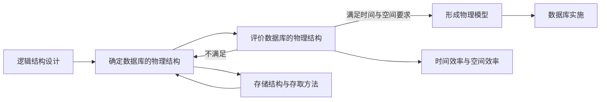

> 描述：本节按需求分析、概念设计、逻辑设计、物理设计、数据库实施、运行与维护六个阶段整理数据库设计，并完整转写数据字典、E-R 图、自底向上集成、E-R 模型到关系模式的转换规则，以及物理结构评价流程。

## 6.1 数据库设计的六个阶段

数据库设计不是直接建表，而是从用户需求逐步抽象到可运行数据库的过程。

| 阶段 | 核心任务 | 主要产物 |
| --- | --- | --- |
| 需求分析 | 明确用户的信息、处理、安全性和完整性需求 | 数据流图、数据字典、需求说明 |
| 概念结构设计 | 把现实世界抽象为独立于具体 DBMS 的概念模型 | 基本 E-R 图或类图 |
| 逻辑结构设计 | 将概念模型转换成目标 DBMS 支持的数据模型 | 关系模式、完整性约束、用户子模式 |
| 物理结构设计 | 选择存储结构、存取路径和索引等 | 物理模型、存储与索引方案 |
| 数据库实施 | 建库建表、装载数据、编写和调试应用程序 | 可试运行的数据库系统 |
| 运行与维护 | 监测性能，备份恢复，调整和修改数据库结构 | 持续可用并逐步优化的系统 |

> **TIP**
> 概念模型回答“现实世界中有什么以及它们如何联系”；逻辑模型回答“在某种数据模型中如何表示”；物理模型回答“在具体 DBMS 中如何存取得更快、更省空间”。

## 6.2 需求分析

### 6.2.1 参与者与需求类型

需求由数据库设计人员和用户共同收集、分析和确认，不能只由技术人员单方面推断。

课件列出三类核心需求：

+ **信息需求**：系统需要保存哪些对象、属性和联系。
+ **处理需求**：需要执行哪些查询、统计、更新和业务流程，以及频率、响应时间和数据量。
+ **安全性与完整性需求**：谁能访问或修改哪些数据，数据必须满足哪些规则。

需求分析还应关注数据生命周期、并发规模、备份恢复目标和未来数据增长，否则后续物理设计缺少依据。

### 6.2.2 结构化分析方法

结构化分析方法（Structured Analysis，SA）是一种自顶向下、逐层分解的分析方法：

1. 从系统最上层的组织和业务目标入手。
2. 把复杂系统分解成若干处理过程。
3. 继续逐层细化，直到处理逻辑足够明确。
4. 用数据流图（Data Flow Diagram，DFD）描述数据如何流动和被处理。
5. 用数据字典（Data Dictionary，DD）定义 DFD 中出现的数据。

DFD 偏重“数据从哪里来、经过什么处理、到哪里去”；数据字典负责消除图中名称的歧义。

### 6.2.3 数据字典

数据字典是对数据流图中所有数据元素给出逻辑定义和详细说明的文档。课件图示包含五方面：

| 组成 | 含义 |
| --- | --- |
| 数据项 | 不可再分的最小数据单位，如学号、姓名 |
| 数据结构 | 数据项或其他数据结构的组合关系，如“学生信息” |
| 数据流 | 数据结构在系统内部传输的路径 |
| 数据存储 | 数据结构停留或保存的位置 |
| 处理过程 | 对数据进行加工的逻辑，可用判定表或判定树描述 |

一份可用的数据字典通常还要写明名称、别名、类型、长度、取值范围、来源、去向、约束和使用频率。

## 6.3 概念结构设计

### 6.3.1 目标与输入

概念结构设计是把需求分析得到的用户需求抽象为信息结构，即概念模型的过程。

+ 输入：需求分析形成的数据流图、数据字典和业务规则。
+ 输出：独立于具体 DBMS 的基本 E-R 图。
+ 目标：准确表达实体、属性、联系、基数和约束，同时尽量消除语义冲突与冗余。

### 6.3.2 E-R 图的基本符号

| 概念 | 常用表示 |
| --- | --- |
| 实体型 | 矩形，框内写实体名 |
| 联系 | 菱形，框内写联系名，并用无向边连接相关实体 |
| 属性 | 椭圆，与所属实体或联系相连 |
| 码属性 | 属性名加下划线 |
| 多值属性 | 双椭圆 |
| 派生属性 | 虚线椭圆 |
| 弱实体 | 双矩形，识别联系常用双菱形 |

联系边旁标明基数：

+ $1:1$：一对一。
+ $1:n$：一对多。
+ $m:n$：多对多。

联系本身也可以具有属性。例如“学生选修课程”这一联系可以有“成绩”属性，因为成绩取决于具体的学生和课程组合。

### 6.3.3 课件 E-R 图的信息转写

课件示例包含四个实体：系、教师、学生、课程。

+ **系**：系名、电话。
+ **教师**：教师号、姓名、性别、职称。
+ **学生**：学号、姓名、性别、年龄。
+ **课程**：课程号、课程名。

主要联系如下：

+ 一个系拥有多名教师，教师属于一个系，为 $1:m$。
+ 一个系拥有多名学生，学生属于一个系，为 $1:m$。
+ 教师与课程之间通过“讲授”联系关联，图中标为 $m:n$。
+ 学生与课程之间通过“选修”联系关联，为 $m:n$，联系具有“成绩”属性。
+ 系与课程之间还画有“开设”联系。

图中用“消除冗余”标出三个需要重新审视的元素：平均成绩、课程实体中的教师号，以及可由其他联系推导的“开设”联系。判断原则是：

+ 若“平均成绩”可以由选修成绩计算，应作为派生属性，不应重复存储为独立事实。
+ 已用“讲授”联系表达教师与课程时，再把教师号放进课程实体可能造成重复和更新异常；是否保留取决于业务是否明确规定唯一责任教师。
+ 若课程所属系能通过稳定且唯一的其他联系推导，“开设”联系可能冗余；若课程归属系是独立业务事实，则仍应保留。

> **WARNING**
> 是否冗余必须依据业务语义和函数依赖判断，不能只看图形相似就删除。课件圈注是设计检查提示，不是对所有系统都成立的固定结论。

### 6.3.4 自底向上设计 E-R 模型

课件给出两步：

1. 抽象数据，逐步形成各部门或应用的局部视图。
2. 自底向上集成局部视图，得到全局概念结构。

集成时需要处理：

+ **命名冲突**：同名异义或异名同义。
+ **结构冲突**：同一对象在不同视图中被表示为实体、属性或联系。
+ **约束冲突**：不同视图给出的基数、可选性或取值范围不一致。
+ **冗余**：同一事实被多次表示，或某联系可由其他联系推导。

最后还要验证全局 E-R 图是否完整、正确、可理解，并由用户确认。

## 6.4 逻辑结构设计

逻辑结构设计把基本 E-R 图转换为目标 DBMS 支持的数据模型。关系数据库中，结果是二维表形式的关系模式。

### 6.4.1 实体型的转换

每个实体型通常转换为一个关系模式：

$$
\text{实体关系}(\text{实体属性},\ldots).
$$

实体的码转换为关系的候选码或主码。

例如：

$$
\operatorname{Student}(\underline{Sno},Sname,Sex,Age).
$$

### 6.4.2 联系的转换

“联系可以转换为独立关系”是总原则，但不同基数有更直接的实现方法。

| 联系类型 | 常用转换规则 |
| --- | --- |
| $1:1$ | 可把任一方主码作为外码放入另一方，并加入 `UNIQUE`；也可单独建联系表 |
| $1:n$ | 把“1”端主码作为外码加入“n”端关系，并把联系属性一并放入“n”端 |
| $m:n$ | 必须建立独立联系关系，两端主码作为外码，通常共同组成主码，并加入联系属性 |
| 三元及以上联系 | 通常建立独立关系，参与实体的码作为外码，主码由业务基数决定 |

例如“学生选修课程”是 $m:n$ 联系：

$$
\operatorname{Enroll}(
\underline{Sno},
\underline{Cno},
Grade
).
$$

其中 `Sno` 和 `Cno` 分别引用学生表和课程表。

多值属性也应独立成表。例如一个教师有多个电话号码：

$$
\operatorname{TeacherPhone}(\underline{Tno},\underline{Phone}).
$$

### 6.4.3 逻辑结构优化与验证

转换后还需：

+ 根据函数依赖检查关系模式是否达到适当范式。
+ 检查分解是否无损连接并尽量保持依赖。
+ 定义主码、外码、`UNIQUE`、`CHECK`、`NOT NULL` 等约束。
+ 为不同用户或应用设计视图。
+ 验证所有业务查询与更新是否能由逻辑模式支持。

> **TIP**
> 不能机械地把每个菱形都建成独立表。$1:n$ 联系通常可通过“n”端外码实现；$m:n$ 联系才必须单独建表。

## 6.5 物理结构设计

### 6.5.1 核心目标

物理结构设计是在逻辑结构基础上选择合适的存储结构和存取路径，以提高时间效率、空间效率和系统可维护性。

常见决策包括：

+ 文件组织、页和记录的存储方式。
+ 索引类型、索引列和联合索引顺序。
+ 聚簇方式、分区、分片或物化视图。
+ 数据与日志、备份文件的存放位置。
+ 是否保留受控冗余以换取查询性能。

### 6.5.2 图示流程

课件物理设计图可整理为以下反馈循环：

评价不能只看“有没有索引”。索引可提高部分查询速度，但也占空间，并增加插入、删除和更新成本。

## 6.6 数据库实施

数据库实施阶段把设计结果落地：

1. 用 DDL 创建数据库、表、索引、视图和约束。
2. 组织、清洗并装载初始数据。
3. 编写和调试应用程序、存储过程或接口。
4. 进行功能、性能、安全、并发与恢复测试。
5. 试运行，发现问题后反馈到逻辑或物理设计。

## 6.7 运行与维护

数据库投入运行后仍需持续维护：

+ 性能监测和查询优化。
+ 定期备份与恢复演练。
+ 权限、审计和安全策略维护。
+ 索引、统计信息和存储空间维护。
+ 随业务变化调整表、视图和约束。
+ 监控数据质量并修复不一致数据。

运行与维护不是一次性阶段；它会把新需求和性能问题反馈给前面的设计阶段。

## 6.8 常考辨析

### 6.8.1 DFD 与 E-R 图

+ DFD 描述数据在系统中的流动和处理过程，属于需求分析工具。
+ E-R 图描述实体、属性和联系，属于概念结构设计工具。

### 6.8.2 概念结构与逻辑结构

+ 概念结构独立于 DBMS，强调业务语义。
+ 逻辑结构依赖选用的数据模型，但通常仍不涉及具体磁盘组织。

### 6.8.3 逻辑结构与物理结构

+ 关系模式、主外码和约束属于逻辑结构。
+ 索引、分区、文件组织和存取路径属于物理结构。

### 6.8.4 实体和联系是否都必须单独建表

实体通常单独建表；联系如何转换取决于基数。$m:n$ 联系需要独立表，$1:n$ 联系通常用外码即可实现。

## 相关知识

+ **科目导航**：[复试常考科目导航](/notes/cs408-53cbe59d76f3/)
+ **阅读顺序**：[上一篇：关系数据理论](/notes/cs408-8f1f495f90b2/) · [下一篇：数据库恢复技术](/notes/cs408-871e91cac1d7/)
+ **关联专题**：[软件需求工程](/notes/cs408-c7b75c1ae846/)

## 本节复盘

+ 数据库设计依次经历需求分析、概念设计、逻辑设计、物理设计、实施、运行与维护。
+ 需求分析的核心产物是 DFD 和数据字典；数据字典包含数据项、数据结构、数据流、数据存储和处理过程。
+ E-R 图用实体、属性、联系和基数表达现实世界，局部视图集成时要解决冲突和冗余。
+ E-R 模型转换为关系模型时，实体通常成表，$1:n$ 联系常放到“n”端，$m:n$ 联系必须单独成表。
+ 物理设计要在存储结构、存取方法、时间效率和空间效率之间权衡，并经评价后再实施。
+ 数据库上线后仍需性能监测、备份恢复、安全维护和结构调整。
