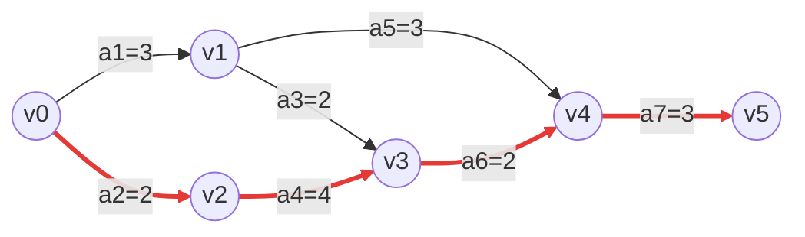

> 本讲把图的遍历用于四类典型问题：用最小生成树连接所有顶点、求最短路径、安排有先后约束的活动，以及用关键路径确定工程工期。做题前先判断图是否带权、是否有向、是否有环，以及要求的是单源还是多源。

## 23.1 最小生成树

### 23.1.1 基本概念

##### **定义**：#最小生成树 #MST
> 描述：对于一个**带权连通无向图** $G=(V,E)$，它的生成树中，边权值之和最小的那一棵称为最小生成树（Minimum Spanning Tree，MST）。

设 $T$ 是 $G$ 的一棵生成树，则其总权值为：

$$
w(T)=\sum_{e\in T}w(e)
$$

若对任意生成树 $T'$ 都有 $w(T)\le w(T')$，则 $T$ 是 $G$ 的最小生成树。

##### **前提与性质**：

+ MST 的对象是**带权、连通、无向图**；无向图不连通时只有生成森林，没有覆盖全图的一棵生成树。
+ 含 $n=\lvert V\rvert$ 个顶点的任意生成树都恰有：

$$
\lvert E_T\rvert=n-1
$$

+ 因此 MST 也有 $n-1$ 条边。课件“顶点数 $+1$”是排版笔误，不能照写。
+ 删去树中任一边，树会不连通；在树中增加任一非树边，必产生唯一回路。
+ 图本身已经是一棵树时，它就是唯一的 MST。
+ MST 可能不唯一；但所有 MST 的**最小总权值相同**。
+ 若所有边权互不相同，则 MST 唯一。
+ 边权可以为 $0$ 或负数；MST 不要求边权非负。"所有边权互不相同"只是 MST 唯一的**充分条件**，不是必要条件。

##### **切分性质与避环原则**：

+ 将顶点集分为两个非空部分 $S$ 与 $V-S$，连接两部分的边称为该割的横切边。
+ 对任意割，权值最小的横切边可以安全加入某棵 MST；这是 Prim 算法每轮选边的依据。
+ 按边权从小到大尝试加入，只要加入后形成回路就舍弃；这是 Kruskal 算法的依据。


> 同一个连通图可以有多棵生成树。它们都含 $n-1$ 条边，但总权值未必相同；MST 是其中总权值最小者。

### 23.1.2 通用构造思路

```text
// 维护一组已选择的边 T（抽象伪代码）
GENERIC_MST(G) {
    T = empty;
    while (T 未形成一棵生成树) {
        选一条满足安全条件的最小代价边 (u, v);
        T = T ∪ {(u, v)};
    }
    return T;
}
```

这段只表示“选安全边直至连通”的贪心框架，并非可直接编译的 C 程序。若每轮在所有连接不同连通块的边中选最小者，就是 Kruskal 式选边；Prim 则只考虑当前树与树外之间的横切边。

##### **读代码时要抓住的条件**：

+ 最终不是选满所有边，而是选到 $n-1$ 条边。
+ 每次新增的边必须连接当前不同的连通块，不能让 $T$ 出现回路。
+ “最小”不是不加条件地选全图最小边，而是在当前安全候选边中选最小者。

### 23.1.3 Prim 算法

##### **定义**：#Prim算法
> 描述：Prim 算法从任意一个顶点出发，维护已经纳入生成树的顶点集合 $U$；每轮选择一条连接 $U$ 与 $V-U$、且权值最小的边，把该边的另一个端点并入 $U$。

##### **过程**：

1. 任选起点 $s$，令 $U=\{s\}$。
2. 在所有一端属于 $U$、另一端不属于 $U$ 的边中，选权值最小的一条 $(u,v)$。
3. 把 $v$ 和边 $(u,v)$ 加入生成树，更新 $U$。
4. 重复，直到 $\lvert U\rvert=n$。

##### **数组含义**：

| 数组 | 含义 |
| --- | --- |
| `lowcost[v]` | 当前集合 $U$ 到未加入顶点 $v$ 的最小连边权值 |
| `adjvex[v]` | 使 `lowcost[v]` 取得当前最小值的 $U$ 中顶点，即连接边的另一端 |
| `inMST[v]` | 顶点 $v$ 是否已经加入 MST；不能借用 `lowcost[v]==0` 表示，否则会误伤合法的零权边 |

##### **邻接矩阵版核心**：

```c
bool Prim(MGraph G, int s) {
    for (int v = 0; v < G.vexnum; ++v) {
        lowcost[v] = INF;
        adjvex[v] = -1;
        inMST[v] = FALSE;
    }
    lowcost[s] = 0;

    for (int round = 0; round < G.vexnum; ++round) {
        int u = -1, min = INF;
        for (int v = 0; v < G.vexnum; ++v)
            if (!inMST[v] && lowcost[v] < min) {
                min = lowcost[v];
                u = v;
            }

        if (u == -1) return false;  // 图不连通，不存在覆盖全图的 MST
        inMST[u] = TRUE;
        if (adjvex[u] != -1) AddToMST(adjvex[u], u);

        for (int v = 0; v < G.vexnum; ++v)
            if (!inMST[v] && G.arcs[u][v] < lowcost[v]) {
                lowcost[v] = G.arcs[u][v];
                adjvex[v] = u;
            }
    }
    return true;
}
```

##### **复杂度与适用场景**：

$$
O(\lvert V\rvert^2)
$$

+ 每轮在线性表中找最小 `lowcost` 需 $O(\lvert V\rvert)$；代码共取出 $n$ 个顶点，其中起点不对应新增树边，其余 $n-1$ 轮各加入一条边。
+ 复杂度主要与顶点数有关；采用邻接矩阵时适合**稠密图**。
+ 若改用邻接表和二叉堆，复杂度为 $O((\lvert V\rvert+\lvert E\rvert)\log\lvert V\rvert)$，常简写为 $O(\lvert E\rvert\log\lvert V\rvert)$。
+ 起点不同、并列最小边的处理次序不同，得到的 MST 边集可能不同；最小总权值不变。


> 从 $V_0$ 开始时，`lowcost[]` 记录当前树到各树外顶点的最低代价；之后每轮选最小值对应的顶点，再用新顶点的邻边更新数组。


> 图中红边构成一棵总权值为 $15$ 的 MST。


> 并列最小边可能产生不同的 MST 边集，但它们的总权值都等于全局最小值。本例两棵 MST 的总权值均为 $15$。

### 23.1.4 Kruskal 算法

##### **定义**：#Kruskal算法
> 描述：Kruskal 算法不固定起点，而是将所有边按权值从小到大排序，依次检查；若当前边的两个端点属于不同连通块就选中，否则跳过，直到选出 $n-1$ 条边。

##### **并查集判断回路**：

```c
// edges 已按 w 从小到大排序
int count = 0;
InitUnionFind(parent, n);

for (int i = 0; i < edgeCount && count < n - 1; ++i) {
    int ru = Find(parent, edges[i].u);
    int rv = Find(parent, edges[i].v);
    if (ru != rv) {
        AddToMST(edges[i]);
        Union(parent, ru, rv);
        ++count;
    }
}

if (count != n - 1)
    ReportDisconnected();  // 只能得到最小生成森林
```

##### **为什么不会成环**：

+ `Find(u)==Find(v)`：两端已有路径连通，再加这条边必形成回路，跳过。
+ `Find(u)!=Find(v)`：这条边连接两个不同连通块，可安全加入。
+ 选满 $n-1$ 条边时，应已经把全部顶点连成一棵树；若仍未选满，原图不连通。

##### **复杂度与适用场景**：

$$
O(\lvert E\rvert\log\lvert E\rvert)
$$

+ 排序是主要开销；优化并查集的查询和合并接近常数时间。
+ 使用路径压缩和按秩（或按大小）合并后，单次并查集操作的均摊复杂度为 $O(\alpha(\lvert V\rvert))$，其中 $\alpha$ 是增长极慢的反阿克曼函数。
+ 复杂度主要与边数有关，适合**稀疏图**。
+ Prim 是“不断扩展一棵树”，Kruskal 是“不断合并多个连通块”。
+ Kruskal 与 Prim 一样允许零权边和负权边；必要前提仍是带权连通无向图。

| 算法 | 每轮选择对象 | 典型存储 | 更适合 |
| --- | --- | --- | --- |
| Prim | 当前树到树外的最小横切边 | 邻接矩阵 | 稠密图 |
| Kruskal | 全局未处理的最小安全边 | 边集 + 并查集 | 稀疏图 |


> 图中按标号 $1\to2\to3\to4\to5$ 依次选入安全边。若某条候选边的两个端点已经属于同一连通块，就跳过它，直至选满 $n-1$ 条边。

---

## 23.2 最短路径

### 23.2.1 问题分类

| 问题 | 要求 | 本讲对应算法 |
| --- | --- | --- |
| 单源最短路径 | 固定源点到其余各顶点 | 无权图用 BFS；带非负权图用 Dijkstra |
| 多源最短路径 | 每一对顶点之间的最短路径 | Floyd |

##### **路径长度**：

+ 无权图通常以路径经过的**边数**作为长度。
+ 带权图的一条路径 $P$ 的长度为边权之和：

$$
w(P)=\sum_{e\in P}w(e)
$$

+ 不可达顶点的距离记作 $\infty$；不要把它当成一个可参与普通加法的有限数。

### 23.2.2 BFS 求无权图单源最短路径

##### **结论**：#BFS最短路径
> 在无权图中，BFS 首次访问顶点 $w$ 时经过的边数，就是从源点到 $w$ 的最短路径长度。若每条边都是相同的正权值 $c$，则带权最短距离为 $c\cdot d[w]$。

原因是 BFS 按距离从小到大分层扩展：第 $k$ 层所有顶点都先于第 $k+1$ 层顶点出队。

##### **辅助数组**：

| 数组 | 初始化 | 含义 |
| --- | --- | --- |
| `d[v]` | `INF` | 源点到 $v$ 的最短边数 |
| `path[v]` | `-1` | 最短路中 $v$ 的直接前驱 |
| `visited[v]` | `FALSE` | 是否已经发现该顶点 |

```c
void BFS_MIN_Distance(Graph G, int s) {
    for (int i = 0; i < G.vexnum; ++i) {
        d[i] = INF;
        path[i] = -1;
        visited[i] = FALSE;
    }
    InitQueue(Q);
    d[s] = 0;
    visited[s] = TRUE;
    EnQueue(Q, s);

    while (!isEmpty(Q)) {
        int u;
        DeQueue(Q, u);
        for (int w = FirstNeighbor(G, u); w >= 0;
             w = NextNeighbor(G, u, w)) {
            if (!visited[w]) {
                d[w] = d[u] + 1;
                path[w] = u;
                visited[w] = TRUE;
                EnQueue(Q, w);
            }
        }
    }
}
```

##### **还原路径**：

+ 从终点 $t$ 开始不断令 $t=\texttt{path}[t]$，直到到达源点或 $-1$。
+ 该过程得到的是逆序路径，输出时再反转即可。
+ 若 `d[t] == INF`，则源点到 $t$ 不可达，不能沿 `path[]` 强行回溯。
+ 对有向图，BFS 只沿弧方向扩展；对无向图，沿无向边扩展。两种情况下邻接表实现的时间复杂度都是 $O(\lvert V\rvert+\lvert E\rvert)$。


> 从顶点 $2$ 出发时，BFS 按层发现 $1,6$，再发现 $5,3,7$，最后发现 $4,8$。实际同层次序受邻接点枚举顺序影响，但 `d[]` 的最短距离不受影响。

### 23.2.3 Dijkstra 算法

##### **定义**：#Dijkstra算法
> 描述：Dijkstra 算法用于**边权非负**的有向图或无向图的单源最短路径。每轮从尚未确定的顶点中选取当前 `dist` 最小者，将其最短距离永久确定，再用该顶点松弛相邻顶点。


##### **数组含义**：

| 数组 | 含义 |
| --- | --- |
| `final[v]` | $v$ 的最短距离是否已最终确定 |
| `dist[v]` | 源点到 $v$ 的当前最短距离上界 |
| `path[v]` | 当前最短路径中 $v$ 的直接前驱 |

##### **松弛条件**：

若已选定顶点 $u$，且经过 $u$ 到 $v$ 更短，则更新：

$$
\text{dist}[u]+w(u,v)<\text{dist}[v]
$$

```c
void Dijkstra(MGraph G, int s) {
    for (int v = 0; v < G.vexnum; ++v) {
        final[v] = FALSE;
        dist[v] = G.arcs[s][v];
        path[v] = (dist[v] < INF) ? s : -1;
    }
    dist[s] = 0;
    path[s] = -1;

    for (int round = 0; round < G.vexnum; ++round) {
        int u = -1, min = INF;
        for (int v = 0; v < G.vexnum; ++v)
            if (!final[v] && dist[v] < min) {
                min = dist[v];
                u = v;
            }
        if (u == -1) break;  // 剩余顶点都不可达
        final[u] = TRUE;

        for (int v = 0; v < G.vexnum; ++v)
            if (!final[v] && G.arcs[u][v] < INF &&
                dist[u] + G.arcs[u][v] < dist[v]) {
                dist[v] = dist[u] + G.arcs[u][v];
                path[v] = u;
            }
    }
}
```

##### **复杂度与限制**：

$$
O(\lvert V\rvert^2)
$$

+ 上述邻接矩阵实现每轮线性选最小值并扫描一整行。
+ 采用邻接表和二叉最小堆时，复杂度为 $O((\lvert V\rvert+\lvert E\rvert)\log\lvert V\rvert)$；仅在 $\lvert E\rvert=\Omega(\lvert V\rvert)$ 等条件下，才可简写为 $O(\lvert E\rvert\log\lvert V\rvert)$。对于稀疏且含大量孤立顶点的图，不能省掉 $\lvert V\rvert$ 项。
+ 课件中的 `ture`、`finali`、`arçsl` 等均为排版/OCR 错误；应理解为 `TRUE`、`final[i]`、`arcs`。
+ **不能用于含负权边的图**：后续负边可能让已经“最终确定”的距离继续变小，贪心正确性失效。
+ 同一顶点可以有多条最短路径；`path[]` 只记录本次算法按扫描次序保留下来的其中一条。
+ 不可达顶点会一直保持 `dist[v]=INF`、`path[v]=-1`；当选不出有限距离的顶点时即可提前结束。


> 每轮只把一个 `dist` 最小的未确定顶点标为 `final`，再通过它松弛邻接边；手写推演时必须同步更新 `dist[]` 与 `path[]`。

原图从 $V_0$ 出发到 $V_2$ 的结果为 `dist[2]=9`。沿 `path[]` 逆向回溯得到 $V_2\leftarrow V_1\leftarrow V_4\leftarrow V_0$，正向路径为 $V_0\to V_4\to V_1\to V_2$，权值核对为 $5+3+1=9$。

### 23.2.4 Floyd 算法

##### **定义**：#Floyd算法
> 描述：Floyd 算法使用动态规划求任意两顶点之间的最短路径。它按顶点编号逐个开放中转点，逐步允许更大的中转点集合。

令 $A^{(k)}[i][j]$ 表示只允许顶点 $V_0,\ldots,V_k$ 作为中转点时，$V_i$ 到 $V_j$ 的最短距离，则：

$$
A^{(k)}[i][j]=\min\left(A^{(k-1)}[i][j],\ A^{(k-1)}[i][k]+A^{(k-1)}[k][j]\right)
$$


> 初始距离矩阵直接记录边权：通常主对角线为 $0$，无直接边的位置为 $\infty$。若允许负权自环，须保留该自环的负权值，否则会漏检负权回路。`path[i][j]` 初始为 $-1$，表示当前路径没有中转点。

原地更新时，最外层循环必须是中转点 `k`：

```c
for (int k = 0; k < n; ++k) {
    for (int i = 0; i < n; ++i) {
        for (int j = 0; j < n; ++j) {
            if (A[i][k] < INF && A[k][j] < INF &&
                A[i][j] > A[i][k] + A[k][j]) {
                A[i][j] = A[i][k] + A[k][j];
                path[i][j] = k;  // 记录一个中转点
            }
        }
    }
}
```

##### **根据 `path[][]` 还原路径**：

若 `path[i][j]=k`，说明当前记录的 $i\to j$ 最短路在本轮被拆成 $i\to k$ 与 $k\to j$。递归展开两个子区间即可得到全部中转点：

```c
void PrintMid(int i, int j) {
    int k = path[i][j];
    if (k == -1) return;
    PrintMid(i, k);
    printf("V%d ", k);
    PrintMid(k, j);
}

// 已确认 A[i][j] < INF 且该点对不受负环影响后：
// 先输出 Vi，再调用 PrintMid(i, j)，最后输出 Vj。
```

这里的 `path[i][j]` 存的是**中转点**，不是 Dijkstra、BFS 中的直接前驱，二者不能用同一种回溯方式。

##### **复杂度**：

$$
\text{时间复杂度}=O(\lvert V\rvert^3),\qquad
\text{空间复杂度}=O(\lvert V\rvert^2)
$$

##### **适用范围与易错点**：

+ 可以处理负权边；若存在负权回路，则某些顶点对之间不存在有限最短路，因为可以反复绕环使路径权值无限减小。
+ 无负权自环时，初始化 `A[i][i] = 0`；若有自环，取 `A[i][i] = min(0, w(i,i))`。不同顶点间无边的位置置为 `INF`。
+ 更新 `INF + x` 前要先判断可达性，避免“无穷大”参与运算造成溢出或伪更新。
+ Floyd 完成后，只要存在某个 $k$ 满足 $A[k][k]<0$，就能判定图中存在负权回路；这意味着存在从 $k$ 出发又能回到 $k$ 的负权闭合游走，不能仅凭“$k$ 能到达某负环”下结论。
+ 对任意顶点对 $(i,j)$，若存在这样的 $k$，且 $i$ 可达 $k$、$k$ 可达 $j$，那么 $i\to j$ 会受负环影响，不存在有限最短路径。

##### **三顶点更新示例**：

初始有 $V_0\to V_1=1$、$V_0\to V_2=7$、$V_1\to V_2=-5$。当允许 $V_1$ 作为中转点时：

$$
A[0][2]=\min(7,\ 1+(-5))=-4,
\qquad path[0][2]=1
$$

因此 $V_0\to V_2$ 的最短路径从直接边改为 $V_0\to V_1\to V_2$。这正是三重循环每次更新一个矩阵元素的含义。

### 23.2.5 三种最短路算法对比

| 算法 | 解决范围 | 权值要求 | 邻接表或优化实现 | 邻接矩阵实现 |
| --- | --- | --- | --- | --- |
| BFS | 单源 | 无权，或所有边为相同正权 | $O(\lvert V\rvert+\lvert E\rvert)$ | $O(\lvert V\rvert^2)$ |
| Dijkstra | 单源 | 所有边权非负 | 二叉堆：$O((\lvert V\rvert+\lvert E\rvert)\log\lvert V\rvert)$ | $O(\lvert V\rvert^2)$ |
| Floyd | 所有顶点对 | 可有负边；受负环影响的点对无有限最短路 | 不依赖邻接表优化 | $O(\lvert V\rvert^3)$，空间 $O(\lvert V\rvert^2)$ |

> 先按“单源还是所有点对”缩小范围，再检查权值条件。看到负边不能选 Dijkstra；看到无权单源通常优先选 BFS。

---

## 23.3 DAG 与拓扑排序

### 23.3.1 DAG 描述表达式

##### **定义**：#DAG
> 描述：有向无环图（Directed Acyclic Graph，DAG）是没有任何有向环的有向图。

+ DAG 可以共享同一个子表达式，因此比把公共部分重复展开的表达式树更省空间和计算。
+ 图中同一个操作数或中间结果应只对应一个顶点；多个运算可共享它。
+ 有向环意味着一个结果依赖自己，无法形成合法的计算先后关系。


> 左图无有向环，是 DAG；右图存在有向回路，不是 DAG。判断时看箭头方向，不能把底图的无向轮廓误当成环。

##### **构造表达式 DAG 的方法**：

1. 将不同的操作数各放一个叶子顶点；相同操作数不重复建点。
2. 先按括号和运算优先级确定运算生效顺序。
3. 自底向上创建运算符顶点，并将它连向其操作数或中间结果。本节统一采用“**运算符顶点 $\to$ 操作数顶点**”的边方向。
4. 每次准备创建运算顶点时，在**整个已构造 DAG** 中查找“运算符相同、孩子列表相同”的已有顶点；若存在就复用，而不是只检查同一层。

对二元运算，孩子按左右次序组成有序对 $(left,right)$。减法、除法等非交换运算必须区分左右孩子；即使是加法、乘法，也只有在题目明确允许按交换律做代数优化时，才可把交换后的孩子视为同一表达式。

例如 $(x+y)((x+y)/x)$ 中，$x+y$ 只需计算一次，两个父运算都可指向这同一个 `+` 顶点。


> 根结点 `*` 的两个孩子分别是共享的 `+` 结点和 `/` 结点；`/` 的左孩子再次指向同一个 `+` 结点。图中的共享是“复用同一顶点”，不是把相同子表达式复制两份。

图右侧的完整表达式为：

$$
\bigl((a+b)\cdot(b\cdot(c+d))+(c+d)\cdot e\bigr)\cdot\bigl((c+d)\cdot e\bigr)
$$

构图时，三个出现位置的 $(c+d)$ 合并为同一个 `+` 顶点；两处 $(c+d)\cdot e$ 合并为同一个 `*` 顶点。最终保留 $a,b,c,d,e$ 五个操作数顶点、三个不同的加法顶点和四个不同的乘法顶点，共 $12$ 个顶点。这里合并的是**运算符及其有序孩子均相同**的子表达式，而不是把所有 `+` 或所有 `*` 无条件合并。

> **WARNING** · 边方向语义不要混淆
> 表达式 DAG 常画成“运算 $\to$ 操作数”，表示语法组成关系；下面 AOV 网的边则画成“前驱活动 $\to$ 后继活动”，表示执行约束。两者都是 DAG，但箭头语义不同。

### 23.3.2 AOV 网

##### **定义**：#AOV网
> 描述：AOV 网（Activity On Vertex Network）用 DAG 表示活动的先后约束：顶点表示活动；弧 $\langle V_i,V_j\rangle$ 表示活动 $V_i$ 完成后，活动 $V_j$ 才能开始。

+ `V_i -> V_j` 只表示先后约束，不表示活动持续时间。
+ 入度为 $0$ 的顶点当前没有前置活动，可以优先执行。
+ AOV 网必须是 DAG；有环时一组活动互相等待，工程无法按依赖关系排出完整顺序。

### 23.3.3 拓扑排序

##### **定义**：#拓扑排序
> 描述：拓扑排序是 DAG 顶点的一个线性序列，满足每个顶点恰好出现一次；若存在从 $A$ 到 $B$ 的路径，则 $A$ 必须出现在 $B$ 之前。

##### **入度法（Kahn 思想）**：

1. 找到一个当前入度为 $0$ 的顶点并输出。
2. 删除该顶点及从它出发的所有弧；其各后继的入度相应减 $1$。
3. 将新出现的入度为 $0$ 顶点加入待处理集合。
4. 重复，直到输出全部顶点或再也找不到入度为 $0$ 顶点。

```c
bool TopologicalSort(Graph G, int indegree[]) {
    InitStack(S);
    for (int i = 0; i < G.vexnum; ++i)
        if (indegree[i] == 0) Push(S, i);

    int count = 0;
    while (!IsEmpty(S)) {
        int u;
        Pop(S, u);
        print[count++] = u;
        for (ArcNode *p = G.vertices[u].firstarc; p; p = p->nextarc) {
            int v = p->adjvex;
            if (--indegree[v] == 0) Push(S, v);
        }
    }
    return count == G.vexnum;
}
```

##### **判环与复杂度**：

+ 若 `count < G.vexnum`，剩余顶点全部存在前驱，说明图中有环，拓扑排序失败。
+ 邻接表中每个顶点和每条弧至多处理一次：

$$
O(\lvert V\rvert+\lvert E\rvert)
$$

+ 若用邻接矩阵扫描出边，复杂度为 $O(\lvert V\rvert^2)$。
+ 每轮可选的入度为 $0$ 顶点可能不止一个，因此拓扑序一般**不唯一**。
+ 代码会原地减少 `indegree[]`；若后续还要使用原入度，应先复制一份数组。

### 23.3.4 逆拓扑排序

##### **定义**：#逆拓扑排序
> 描述：逆拓扑排序每轮输出一个出度为 $0$ 的顶点，删除该顶点及所有指向它的弧。输出序列与某个拓扑序的反向相容。

+ 它同样要求图无环；若有环，不能输出全部顶点。
+ 可由 DFS 后序实现：当一个顶点及其全部后继都处理完毕后，再把该顶点加入结果。
+ 只有 `visited[]` 无法检测有向环；必须区分“正在递归栈中”和“已经完成”。遇到指向灰色顶点的边就是回边，说明存在环。

```c
enum Color { WHITE, GRAY, BLACK } color[MAXV];
int reverseOrder[MAXV], count;

bool DFSReverseTopo(Graph G, int v) {
    color[v] = GRAY;  // 已进入递归栈
    for (int w = FirstNeighbor(G, v); w >= 0;
         w = NextNeighbor(G, v, w)) {
        if (color[w] == GRAY) return false;  // 回边：存在有向环
        if (color[w] == WHITE && !DFSReverseTopo(G, w))
            return false;
    }
    color[v] = BLACK;
    reverseOrder[count++] = v;  // 后序保存，暂不输出
    return true;
}

bool ReverseTopologicalSort(Graph G) {
    for (int v = 0; v < G.vexnum; ++v) color[v] = WHITE;
    count = 0;

    for (int v = 0; v < G.vexnum; ++v)
        if (color[v] == WHITE && !DFSReverseTopo(G, v))
            return false;  // 有环，丢弃暂存结果

    for (int i = 0; i < count; ++i) print(reverseOrder[i]);
    return true;
}
```

`reverseOrder[]` 的保存次序就是一个逆拓扑序；将它整体逆置可得到一个拓扑序。使用邻接表时，三色 DFS 的时间复杂度仍为 $O(\lvert V\rvert+\lvert E\rvert)$。

---

## 23.4 关键路径

### 23.4.1 AOE 网

##### **定义**：#AOE网 #关键路径
> 描述：AOE 网（Activity On Edge Network）是带权 DAG：顶点表示事件，边表示活动，边权表示完成该活动所需时间或开销。

| 网络 | 顶点表示 | 边表示 | 常见用途 |
| --- | --- | --- | --- |
| AOV | 活动 | 活动间先后约束 | 拓扑排序 |
| AOE | 事件 | 活动及其耗时 | 关键路径 |

##### **基本约束**：

+ 标准 AOE 网通常规范化为一个入度为 $0$ 的源点和一个出度为 $0$ 的汇点。若原网络有多个源点，可由新增超级源点向各原源点连 $0$ 权边；若有多个汇点，可由各原汇点向新增超级汇点连 $0$ 权边。
+ 活动持续时间应为非负值，且网络必须无环；拓扑排序失败时不能继续套关键路径公式。
+ 某事件发生后，才能开始从该事件出发的活动。
+ 进入某事件的所有活动都结束后，该事件才发生。
+ 不同分支的活动可以并行；工程总工期由最长的源点到汇点路径决定，而非所有活动时长之和。

### 23.4.2 时间参数

设活动 $a_i$ 对应弧 $\langle v_j,v_k\rangle$，持续时间为 $w(j,k)$。

| 记号 | 名称 | 含义 | 计算关系 |
| --- | --- | --- |
| $ve(k)$ | 事件 $v_k$ 的最早发生时间 | 不推迟前序活动时，$v_k$ 最早何时发生 | 正向推进取最大值 |
| $vl(k)$ | 事件 $v_k$ 的最迟发生时间 | 不拖延总工期时，$v_k$ 最晚何时发生 | 逆向推进取最小值 |
| $e(i)$ | 活动 $a_i$ 的最早开始时间 | 起点事件最早发生时即可开工 | $e(i)=ve(j)$ |
| $l(i)$ | 活动 $a_i$ 的最迟开始时间 | 不拖延工期的最晚开工时刻 | $l(i)=vl(k)-w(j,k)$ |
| $d(i)$ | 活动 $a_i$ 的时间余量 | 可延误但不影响总工期的时间 | $d(i)=l(i)-e(i)$ |

##### **关键活动与关键路径**：

$$
d(i)=0\iff e(i)=l(i)
$$

+ 余量为 $0$ 的活动是**关键活动**，不能延误。
+ 由关键活动连续构成的源点到汇点路径是**关键路径**。
+ 关键路径长度就是完成整个工程的最短工期。
+ 关键路径可以有多条；不能只因一条路径上的某条边是关键活动，就不检查它是否能和其它关键活动连成完整路径。

### 23.4.3 求关键路径步骤

##### **第一步：正向求 $ve$**

+ 初始令各事件的 $ve=0$，源点自然为 $ve(\text{source})=0$。
+ 按拓扑序扫描每条活动弧 $\langle v_j,v_k\rangle$：

$$
ve(k)=\max\bigl(ve(k),\ ve(j)+w(j,k)\bigr)
$$

+ 汇点的 $ve$ 即工程最短完成时间。

##### **第二步：逆向求 $vl$**

+ 初始令所有事件的 $vl$ 等于工程总工期，即汇点的 $ve$。
+ 按逆拓扑序扫描活动弧：

$$
vl(j)=\min\bigl(vl(j),\ vl(k)-w(j,k)\bigr)
$$

##### **第三步：逐活动求 $e,l,d$**

对每条活动弧 $\langle v_j,v_k\rangle$：

$$
\begin{aligned}
e(i)&=ve(j)\\
l(i)&=vl(k)-w(j,k)\\
d(i)&=l(i)-e(i)
\end{aligned}
$$

最后标记 $d(i)=0$ 的活动，并从源点到汇点连接它们，得到全部关键路径。

##### **数值例题：完整计算 $ve/vl/e/l/d$**



正向计算时，例如：

$$
ve(3)=\max\{ve(1)+2,\ ve(2)+4\}=\max\{5,6\}=6
$$

最终得到：

| 事件 | $v_0$ | $v_1$ | $v_2$ | $v_3$ | $v_4$ | $v_5$ |
| --- | ---: | ---: | ---: | ---: | ---: | ---: |
| $ve$ | 0 | 3 | 2 | 6 | 8 | 11 |

工程总工期为 $ve(5)=11$。再令 $vl(5)=11$ 并逆向计算，例如：

$$
vl(1)=\min\{vl(3)-2,\ vl(4)-3\}=\min\{4,5\}=4
$$

| 事件 | $v_0$ | $v_1$ | $v_2$ | $v_3$ | $v_4$ | $v_5$ |
| --- | ---: | ---: | ---: | ---: | ---: | ---: |
| $vl$ | 0 | 4 | 2 | 6 | 8 | 11 |

逐边计算活动时间：

| 活动 | 边 | 时长 | $e(i)$ | $l(i)$ | $d(i)$ | 是否关键 |
| --- | --- | ---: | ---: | ---: | ---: | --- |
| $a_1$ | $v_0\to v_1$ | 3 | 0 | 1 | 1 | 否 |
| $a_2$ | $v_0\to v_2$ | 2 | 0 | 0 | 0 | 是 |
| $a_3$ | $v_1\to v_3$ | 2 | 3 | 4 | 1 | 否 |
| $a_4$ | $v_2\to v_3$ | 4 | 2 | 2 | 0 | 是 |
| $a_5$ | $v_1\to v_4$ | 3 | 3 | 5 | 2 | 否 |
| $a_6$ | $v_3\to v_4$ | 2 | 6 | 6 | 0 | 是 |
| $a_7$ | $v_4\to v_5$ | 3 | 8 | 8 | 0 | 是 |

所以关键活动为 $a_2,a_4,a_6,a_7$，关键路径为：

$$
v_0\to v_2\to v_3\to v_4\to v_5,
\qquad 2+4+2+3=11
$$

##### **题型：求关键路径**

#### 第一部分：解题模板

1. 先检查网络是 AOE 网，边权是活动时间，顶点是事件；不要与 AOV 网混淆。
2. 写出一组拓扑序，正向计算每个事件的 $ve$。
3. 令所有 $vl$ 先等于汇点的 $ve$，按逆拓扑序回推 $vl$。
4. 列活动表，逐边填入 $e(i)$、$l(i)$、$d(i)$。
5. 找 $d(i)=0$ 的活动，确认它们从源点到汇点形成的连续路径。

#### 第二部分：高频易错点

+ $ve$ 取 **max**：某事件必须等所有前驱活动结束，受最慢前驱限制。
+ $vl$ 取 **min**：为不拖延后续活动，必须满足所有后继的最晚要求。
+ 活动最早时间看弧尾 $ve$，活动最迟时间看弧头 $vl$ 减活动时长。
+ 关键活动的工期增加会延长总工期；缩短后，原关键路径可能不再是唯一的最长路径，关键活动集合也会改变。
+ 存在多条关键路径时，只缩短其中一条路径上的活动，另一条关键路径仍可能决定总工期。若要**保证**缩短总工期，应缩短所有当前关键路径的共同活动，或同步缩短各条关键路径上的活动。
+ 非关键活动可在余量范围内延误；超过余量后，它可能转化为关键活动并影响工期。

> **TIP** · 图示与计算的分工
> Mermaid 图负责展示 AOE 网络结构和关键边，表格保留全部可检索数值。复习时应能从图独立重算两张事件表和活动表，而不是只记住红色路径。

---

## 相关知识

+ **科目导航**：[数据结构导航](/notes/cs408-5620bc526d96/)
+ **阅读顺序**：[上一篇：图的遍历](/notes/cs408-5efaa92ea781/) · [下一篇：查找的基本概念](/notes/cs408-c58d699dca6a/)
+ **关联专题**：[图代码](/notes/cs408-d690a826208c/)
+ **跨科目应用**：[OSPF 路由协议](/notes/cs408-5064ace109f8/)使用 Dijkstra 算法计算最短路径树。

## 本节复盘

+ MST 只针对带权连通无向图，最终固定选 $n-1$ 条无环边；稠密图优先想到 Prim，稀疏图优先想到 Kruskal。
+ 无权单源最短路用 BFS；带非负权单源最短路用 Dijkstra；所有点对最短路用 Floyd。
+ Dijkstra 不能处理负权边；Floyd 可处理负边，但受负权回路影响的顶点对不存在有限最短路。
+ DAG 才能做拓扑排序；入度法输出不足 $\lvert V\rvert$ 个顶点即存在环，DFS 版则必须用三色状态检测回边。
+ AOV 是“顶点活动”，AOE 是“边活动、顶点事件”；关键活动满足 $e(i)=l(i)$，关键路径决定总工期。
+ 多条关键路径并存时，只缩短一条路径上的活动未必能缩短总工期。
