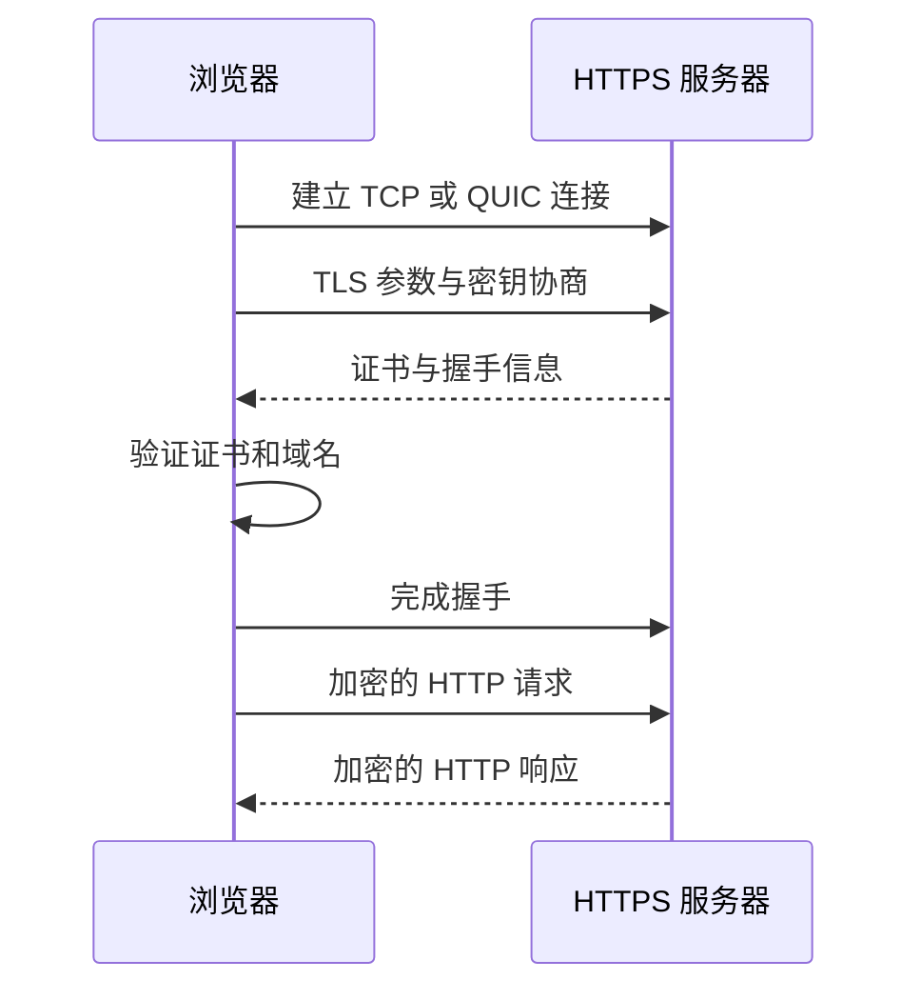

> 描述：应用层直接为用户程序提供网络服务。主线是：C/S 与 P2P 定义应用组织方式；DHCP 自动配置主机；DNS 完成域名到 IP 等信息的查询；FTP 传文件；SMTP、POP3、IMAP 与 MIME 组成电子邮件系统；HTTP 在万维网中请求和传输资源；教材补充专篇进一步给出 SNMP 与网络管理体系。

> **NOTE** · 原始知识网（点击展开）
> 

本篇按“**应用体系结构 -> DHCP -> DNS -> FTP -> 电子邮件 -> HTTP -> 网络管理与 SNMP**”整理。三类综合计算与一篇教材补充另设入口：

| 专题 | 入口 |
| --- | --- |
| HTTP 非持续/持续连接、流水线、并行与 RTT | [1 题型 - HTTP连接](/notes/cs408-0bb2d5ae08e6/) |
| DHCP 报文、地址字段、中继、租约与冲突处理 | [2 题型 - DHCP应用](/notes/cs408-c001d492e92c/) |
| DNS 查询次数、缓存与 HTTP 总时延 | [3 题型 - DNS与HTTP综合](/notes/cs408-b9c8f13ec3e6/) |
| 网络管理、MIB/SMI/OID、SNMP 操作、端口、通知与安全 | [教材补充：SNMP 与网络管理](/notes/cs408-1aaca18e58e7/) |

## 6.1 应用层概述

网络应用由运行在不同端系统上的进程组成，进程通过套接字使用运输层。应用层协议通常定义：

+ 报文类型，如请求与响应。
+ 各类报文的语法、字段与编码。
+ 字段的语义。
+ 进程何时发送报文、收到报文后如何处理。

选择运输服务时要权衡可靠性、吞吐、时延与安全。需要完整可靠数据时通常选择 TCP；能容忍少量丢失、强调实时性或自行实现可靠机制时可选择 UDP。加密、认证等安全需求常由 TLS 或应用自身补充。

### 6.1.1 常见端口

| 应用协议 | 默认端口 | 运输协议 | 主要用途 |
| --- | ---: | --- | --- |
| FTP 控制 | 21 | TCP | 发送命令与响应 |
| FTP 主动模式数据 | 20 | TCP | 主动模式服务器发起数据连接 |
| SSH | 22 | TCP | 安全远程登录 |
| Telnet | 23 | TCP | 明文远程终端 |
| SMTP 中继 | 25 | TCP | 邮件服务器之间传递；教材基础模型也常用它概括 SMTP |
| 邮件提交 | 587 | TCP | 邮件客户端向提交服务器发送邮件，通常配合认证与 STARTTLS |
| DNS | 53 | UDP/TCP | 查询常用 UDP；区域传送和特定大响应使用 TCP |
| DHCP 服务器/客户端 | 67/68 | UDP | 动态主机配置 |
| TFTP | 69 | UDP | 简单文件传输 |
| HTTP | 80 | TCP | Web 明文传输 |
| POP3 | 110 | TCP | 下载/管理服务器邮件 |
| IMAP | 143 | TCP | 服务器端邮件同步管理 |
| SNMP | 161 | UDP | 网络管理查询与操作；Trap 通知通常使用 UDP 162 |
| HTTPS | 443 | TCP，HTTP/3 使用 QUIC/UDP | 加密 Web 访问 |

## 6.2 C/S 与 P2P

### 6.2.1 客户/服务器 C/S

+ 服务器通常长期在线，具有固定或可解析地址，为多个客户提供服务。
+ 客户主动发起请求，客户之间一般不直接通信。
+ 数据中心可扩展服务器能力，但服务器上行带宽和处理能力可能成为瓶颈。

设要向 $N$ 个客户分发大小为 $F$ 的文件，服务器上传速率为 $u_s$，最慢客户端下载速率为 $d_{min}$，理想 C/S 分发时间至少为：

$$D_{CS}\ge\max\left(\frac{NF}{u_s},\frac{F}{d_{min}}\right)$$

### 6.2.2 对等 P2P

+ 对等方既是客户端又是服务器，可直接交换数据，具有自扩展性。
+ 节点上线、离线和地址变化频繁，管理、安全和内容发现更复杂。
+ 总上传能力随加入的对等方增加，适合大规模内容分发。

若第 $i$ 个对等方上传速率为 $u_i$，理想 P2P 分发时间至少为：

$$D_{P2P}\ge\max\left(\frac{F}{u_s},\frac{F}{d_{min}},\frac{NF}{u_s+\sum_{i=1}^{N}u_i}\right)$$

## 6.3 DHCP

DHCP 为主机动态分配 IP 地址，并可下发子网掩码、默认网关、DNS 服务器和租期等参数。客户端使用 UDP 68，服务器使用 UDP 67。

### 6.3.1 DORA 四步

```text
客户端                         DHCP服务器
DHCPDISCOVER  广播       -------->
                         <--------  DHCPOFFER
DHCPREQUEST   广播       -------->
                         <--------  DHCPACK
```

1. **Discover**：新客户端尚无可用 IP，以 `0.0.0.0:68` 向 `255.255.255.255:67` 广播发现服务器。
2. **Offer**：服务器提出可租用地址和配置。
3. **Request**：客户端广播选择某一服务器的提议，也让其他服务器撤回保留。
4. **ACK**：服务器确认租约；若请求不可接受可返回 DHCPNAK。

### 6.3.2 租约、续租与中继

+ 地址是有期限租用，不是永久归客户端所有。租期到约 $T_1=0.5$ 时，客户端通常单播 DHCPREQUEST 向原服务器续租；到约 $T_2=0.875$ 时仍未成功，则广播 DHCPREQUEST，向任意可用服务器重新绑定。租期到期仍失败就必须停用该地址并重新发现。
+ DHCPACK 后客户端还可用 ARP 做地址冲突检测；若发现冲突，发送 **DHCPDECLINE** 并重新开始发现。不再需要地址时可发送 **DHCPRELEASE**，让服务器提前回收租约。
+ DHCP 广播不能通过普通路由器跨网段。**DHCP 中继代理**接收客户端广播并以单播转发给远程 DHCP 服务器，使多个子网可共享服务器。
+ DHCP 依赖 UDP，但通过事务 ID、重试和超时在应用层处理报文丢失。

## 6.4 DNS

DNS 是分布式、层次化的命名系统，把域名映射为 IP 地址，也保存邮件交换、别名和权威服务器等信息。

### 6.4.1 层次结构与服务器

```text
根域名服务器
  -> 顶级域 TLD 服务器（com、cn、org...）
    -> 权威域名服务器
      -> 主机资源记录
```

+ **本地域名服务器/递归解析器**接受主机查询，使用缓存；缓存未命中时代表主机继续查询。
+ **根服务器**返回相应 TLD 服务器线索，通常不直接给最终主机地址。
+ **TLD 服务器**管理顶级域下的授权信息。顶级域可分为国家/地区顶级域（如 `.cn`、`.uk`）和通用顶级域（如 `.com`、`.org`）。
+ **权威服务器**保存某区域的正式资源记录并给出权威回答。
+ 根服务器有 A 至 M 共 **13 个逻辑标识**，但通过任播等方式在全球部署了大量物理实例，不能理解成全世界只有 13 台机器。

域名由点分隔的标签组成。单个标签的线格式长度最多 63 octet。完整域名的 DNS **线格式**最多 255 octet（包含每个标签的长度字段和结尾的根标签 `0`）；对应的常见文本 FQDN 最多 253 个字符（不写末尾根点），显式写出末尾根点时最多 254 个字符。教材笼统写“域名最长 255 字符”时，实际混用了线格式字节数与文本字符数，使用时必须说明口径。

### 6.4.2 递归查询与迭代查询

+ **递归查询**要求被询问服务器完成后续解析并返回最终结果或错误，客户端对本地 DNS 常使用递归查询。
+ **迭代查询**由服务器返回下一步应询问的服务器地址，查询者继续请求；本地 DNS 向根、TLD、权威服务器的过程通常按迭代理解。
+ 缓存记录具有 TTL，过期后需重新查询。缓存降低时延和 DNS 层次负载，但在 TTL 内可能暂时保留旧结果。

### 6.4.3 常见资源记录

| 类型 | 含义 |
| --- | --- |
| A | 域名到 IPv4 地址 |
| AAAA | 域名到 IPv6 地址 |
| NS | 某区域的权威域名服务器 |
| CNAME | 别名到规范域名 |
| MX | 接收该域邮件的邮件服务器及优先级 |
| PTR | IP 地址到域名的反向解析 |

DNS 普通查询通常使用 UDP 53；区域传送使用 TCP 53，响应过大或被截断时也可能改用 TCP。DNS 负责名字与记录查询，不负责自动给主机分配 IP，后者是 DHCP 的任务。

## 6.5 FTP

FTP 基于 TCP，使用独立的控制连接与数据连接，属于**带外控制**。

+ FTP 提供交互式访问，支持登录鉴权、目录浏览、文件上传与下载，也可按权限限制用户能执行的操作。
+ 传输时可协商 ASCII、二进制等文件表示类型以及相关格式，使异构主机之间不必由用户手工处理每一种系统差异；实际传普通二进制文件应使用图像/二进制类型，避免内容被换行转换破坏。
+ 控制连接通常由客户端连服务器 TCP 21，贯穿整个会话，用于登录、目录和传输命令。
+ 每次文件或目录数据传输另建数据连接，传输结束后关闭。
+ **主动模式**中服务器通常从 TCP 20 主动连接客户端指定端口。
+ **被动模式**中服务器告知临时端口，由客户端主动建立数据连接，更适合客户端位于 NAT/防火墙之后的场景。

FTP 的控制连接和数据连接均为 TCP，因此可靠性由 TCP 提供；“两条连接”不等于要建立两次控制会话。

## 6.6 电子邮件

### 6.6.1 系统组成与传输路径

电子邮件系统包含用户代理、邮件服务器和邮件协议：

```text
发送方用户代理
  -> SMTP 提交给发送方邮件服务器
  -> SMTP 在邮件服务器间转发
  -> 接收方邮件服务器保存邮箱
  -> POP3 或 IMAP 供接收方读取
```

+ **SMTP**是基于 TCP 的推送协议，负责邮件提交及邮件服务器之间转发。服务器间中继通常使用端口 25；现代邮件客户端向提交服务器发送邮件通常使用端口 587，并配合身份认证和 STARTTLS，隐式 TLS 提交还常见端口 465。教材只写“SMTP 使用 25”时，多指基础模型或服务器间中继。命令/响应使用文本形式，基本 SMTP 主要处理 7 bit ASCII。
+ **MIME**扩展邮件格式，通过内容类型、传输编码和多部分边界支持中文、附件、图片、音视频等非 ASCII 内容；它不是独立的邮件传输协议。
+ **POP3**通常把邮件下载到客户端，模型简单；可配置下载后是否保留服务器副本。
+ **IMAP**侧重在服务器上管理邮件、文件夹和状态，适合多设备同步，可只取邮件头或部分内容。
+ Webmail 浏览器与邮件网站之间使用 HTTP/HTTPS，但网站邮件服务器之间仍通常使用 SMTP。

一封 Internet 邮件由**首部**与**正文**组成，中间以空行分隔；首部包含 `From`、`To`、`Subject` 等字段。SMTP 的 `MAIL FROM`、`RCPT TO` 是传输信封命令，不等同于邮件首部中的同名信息。MIME 通过 `Content-Type`、`Content-Transfer-Encoding`、边界参数等字段描述正文类型、编码和多部分结构。

### 6.6.2 SMTP 基本会话

典型命令顺序为：`HELO/EHLO`、`MAIL FROM`、一个或多个 `RCPT TO`、`DATA`，正文以 `<CRLF>.<CRLF>` 标记结束，服务器返回状态码，最后 `QUIT`。多个收件人通常不需要重复发送完整邮件正文，服务器可依据多个 `RCPT TO` 投递。

## 6.7 万维网与 HTTP

### 6.7.1 URL 与 Web 对象

URL 用于定位资源，基本形式为：

```text
协议://主机名:端口/路径?查询参数#片段
```

一个网页常由基础 HTML 和图片、CSS、JavaScript 等多个对象组成。浏览器可边接收边解析 HTML，识别到引用地址后便可能请求其他对象；经典 RTT 题才常假定“先收齐基础 HTML，再请求引用对象”，详见 [HTTP 连接题的简化时序](/notes/cs408-0bb2d5ae08e6/#section-1)。

### 6.7.2 HTTP 特点与报文

+ HTTP 使用请求/响应模型，服务器本身按协议设计为无状态；Cookie、会话标识和应用数据库可在其上实现状态。
+ HTTP/1.0 通常按非持续连接使用；HTTP/1.1 默认持续连接并支持流水线思想，实际浏览器实现还会并行连接。
+ HTTP/2 在一个连接上多路复用二进制帧；HTTP/3 运行在 QUIC/UDP 上。408 基础计算若未特别说明，通常按题设的 HTTP/1.0 或 HTTP/1.1 模型。

HTTP/1.x 请求报文由**请求行、若干首部字段、空行和可选实体正文**组成；响应报文对应为**状态行、若干首部字段、空行和可选实体正文**。请求行包含方法、请求目标和版本，状态行包含版本、状态码和原因短语。HTTP/1.1 默认持续连接，但报文若明确含 `Connection: close`，则应在本次响应后关闭连接，相关计算按非持续/不再复用处理。

常见请求方法包括 `GET`、`HEAD`、`POST`、`PUT`、`DELETE`。常见状态码：

| 状态码 | 含义 |
| ---: | --- |
| 200 | 请求成功 |
| 301/302 | 永久/临时重定向 |
| 304 | 缓存资源仍有效，无需返回实体 |
| 400 | 请求语法错误 |
| 403 | 服务器理解但拒绝访问 |
| 404 | 资源不存在 |
| 500 | 服务器内部错误 |
| 505 | 不支持请求的 HTTP 版本 |

### 6.7.3 持续连接与 RTT 计算

忽略对象发送时间、DNS 和 TCP 关闭时延时：

+ 建立一个 TCP 连接约需 1 RTT。
+ 在已建立连接上发送 HTTP 请求并收到响应首字节约需 1 RTT。
+ 非持续 HTTP 获取一个对象通常约为 $2RTT$；每个对象需要新 TCP 连接。

若一个基础 HTML 引用 $N$ 个小对象，并采用“主 HTML 完整到达后才开始请求引用对象”的教材时序模型：

| 方式 | 近似 RTT 数（不计并行与发送时间） |
| --- | ---: |
| 非持续、串行 | $2(N+1)$ |
| 持续、非流水线 | $2+N$ |
| 持续、流水线 | 约 $3$ |

若允许 $k$ 条并行非持续连接，请把 $N$ 个对象分成 $\lceil N/k\rceil$ 批，每批约 2 RTT，再加基础 HTML 的 2 RTT。题目给出发送时延时，还要加上各对象大小除以链路速率，不能只数 RTT。

### 6.7.4 Cookie 与 Web 缓存

Cookie 机制通常包括响应中的 `Set-Cookie`、客户端保存的 Cookie、后续请求中的 `Cookie` 首部，以及服务器端关联状态的数据库。Cookie 可维持登录、购物车和个性化，但涉及隐私和安全，应配合 `Secure`、`HttpOnly`、`SameSite` 等属性。

Web 缓存/代理服务器保存对象副本。客户端可通过条件请求验证缓存：例如发送 `If-Modified-Since` 或实体标签，未修改时服务器返回 `304 Not Modified`，减少传输量与响应时间。

### 6.7.5 HTTPS 与 TLS 的职责

> **NOTE** · 教材补充
> HTTPS 不是另一套网页语义，而是让 HTTP 在经过认证和加密保护的安全传输通道上运行。HTTP/1.1、HTTP/2 通常在 TCP 之上使用 TLS；HTTP/3 则在 UDP 之上使用集成 TLS 1.3 的 QUIC。

TLS 建立安全会话时主要完成：

1. **身份认证**：服务器通常发送证书链。客户端验证受信 CA 签名、域名、有效期等，把公钥与所访问的服务器身份绑定；客户端证书是可选机制。
2. **密钥协商**：双方协商算法并产生本次会话使用的对称密钥；现代 TLS 通常使用临时 Diffie-Hellman 类密钥交换以提供前向保密。
3. **机密性与完整性**：后续应用数据加密传输并进行完整性/认证校验，防止旁路者直接读取或静默篡改。



边界必须分清：有效证书说明客户端建立的是被证书所标识端点的加密连接，不自动保证网站内容真实、程序无漏洞或服务器绝不泄露数据；用户忽略证书警告、中间端点被攻陷、终端恶意软件等也不由 TLS 单独解决。

做时延题时，经典 `2RTT` 非持续 HTTP 模型通常未计 TLS。若题目明确 HTTPS，应按给出的 TLS 版本、是否会话恢复、TCP/QUIC 建连能否合并等条件另加握手时延，不能擅自套固定 RTT 数。

## 6.8 网络管理与 SNMP（教材补充入口）

> **NOTE** · 教材补充
> 原始 Lecture 12 知识图只在端口表中列出 SNMP，没有展开网络管理体系。完整内容见 [教材补充：SNMP 与网络管理](/notes/cs408-1aaca18e58e7/)，其中覆盖 FCAPS、管理站与代理、SMI/MIB/OID、Get/Set/Trap/Inform、UDP 161/162、轮询与通知以及 SNMPv3 安全边界。

## 6.9 题型索引

+ [1 题型 - HTTP连接](/notes/cs408-0bb2d5ae08e6/)：非持续/持续连接、流水线、并行、慢开始与 RTT 计算。
+ [2 题型 - DHCP应用](/notes/cs408-c001d492e92c/)：UDP 端口、初始地址、DORA、中继、冲突检测和租约阶段。
+ [3 题型 - DNS与HTTP综合](/notes/cs408-b9c8f13ec3e6/)：缓存、递归/迭代查询次数及 DNS 与 HTTP 总时延。

## 相关知识

+ **科目导航**：[计算机网络导航](/notes/cs408-b78f75dd8c69/)
+ **阅读顺序**：[上一篇：连接控制](/notes/cs408-efc7c4d94382/) · [下一篇：SNMP 与网络管理](/notes/cs408-1aaca18e58e7/)

## 6.10 本节复盘

+ C/S 依赖集中服务器，P2P 汇聚各对等方上传能力；分发时间取服务器上传、客户端下载和系统总上传约束的最大值。
+ DHCP 用 DORA 和租约动态配置主机，跨网段需要 DHCP 中继。
+ DNS 是分布式层次命名系统；主机对本地解析器多用递归，本地解析器向根/TLD/权威服务器多用迭代，并依靠 TTL 缓存。
+ FTP 使用持久控制连接和按需数据连接；主动/被动模式的数据连接发起方不同。
+ SMTP 负责发送，POP3/IMAP 负责接收与管理，MIME 扩展非 ASCII 正文和附件格式。
+ HTTP 获取对象的时间由 DNS、TCP 建连、请求响应 RTT、对象发送时间以及是否持续/并行/流水线共同决定。
+ HTTPS 用 TLS 提供端点认证、密钥协商、机密性与完整性；它保护传输通道，但不等于自动保证站点内容和终端本身安全。
+ SNMP 通过管理站、代理与 MIB 对象完成查询、设置和事件通知；常见查询使用 UDP 161，Trap/Inform 通知接收使用 UDP 162，完整内容见教材补充专篇。
