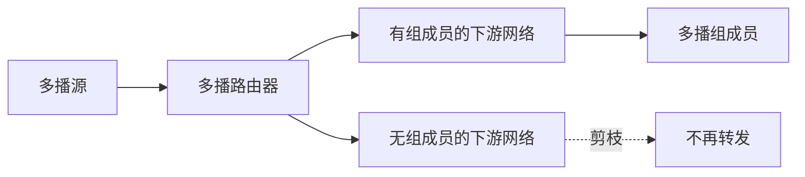

> 描述：IP 多播把一个分组交付给一个多播组。常考点是 IPv4 多播地址到以太网多播 MAC 的映射、`224.0.0.1` 的含义、IGMP 的作用范围与 TTL，以及多播转发树的建立和剪枝。

## 5.1 IPv4 多播基础

IPv4 多播地址使用 D 类地址空间：

```text
224.0.0.0/4
```

其 32 位结构为：

```text
高 4 位固定为 1110，低 28 位用于表示多播组
```

多播通信的接收者以“组”组织：

+ 发送者把目的 IPv4 地址设为多播组地址。
+ 加入该组的主机接收相应多播分组。
+ 多播路由器负责把分组沿多播转发树复制到存在组成员的网络。

`224.0.0.1` 是本地网络上的“所有主机”多播地址。在该网络中，参加 IP 多播的主机和路由器的网际层都应接收目的地址为 `224.0.0.1` 的分组。

## 5.2 IPv4 多播地址映射为以太网 MAC

### 5.2.1 映射规则

IANA 为 IPv4 多播保留的以太网 MAC 前缀为：

```text
01-00-5E
```

完整映射方法：

1. MAC 地址前 25 位固定为 `01-00-5E` 加一个 `0` 位。
2. IPv4 多播地址只取最低 23 位。
3. 把这 23 位填入 MAC 地址最低 23 位。

因此以太网多播目的 MAC 的形式为：

```text
01-00-5E-0xxxxxxx-xxxxxxxx-xxxxxxxx
```

其中后 23 位来自 IPv4 多播地址的低 23 位。

### 5.2.2 映射不是一一对应

IPv4 多播地址在固定前缀 `1110` 后还有 28 个可变位，但 MAC 只能携带其中低 23 位，最高的 5 个可变位没有参与映射。

$$
28-23=5
$$

所以同一个多播 MAC 最多对应：

$$
2^5=32
$$

个不同的 IPv4 多播地址。网卡按 MAC 过滤之后，IP 层还需要继续检查真正的目的多播 IP。

### 5.2.3 示例：`224.0.0.1`

`224.0.0.1` 的低 23 位为 1，映射结果为：

```text
IPv4 多播地址：224.0.0.1
以太网多播 MAC：01-00-5E-00-00-01
```

## 5.3 IGMP

### 5.3.1 作用

IGMP 用于让连接在本地局域网上的多播路由器获知：

+ 本局域网是否有主机加入某个多播组。
+ 本局域网是否有主机退出某个多播组。

IGMP 管理的是“主机与本地多播路由器之间的组成员关系”，不是路由器之间的全网多播选路协议。

### 5.3.2 能知道与不能知道的信息

通过 IGMP，多播路由器可以判断本地网络上是否存在某组成员，但不能仅靠 IGMP 得知：

+ 该多播组一共有多少成员。
+ 各成员具体是谁。
+ 这些成员分布在哪些远端网络。

### 5.3.3 `224.0.0.1` 与 TTL

IGMP 成员查询报文可以封装在目的地址为 `224.0.0.1` 的 IP 多播数据报中发送。为了把查询限制在本地网络，不让路由器转发到其他网络，IPv4 首部的 TTL 设为：

```text
1
```

IGMP 直接封装在 IP 中，其 IPv4 首部协议字段值为 2。

## 5.4 多播路由与转发树

IGMP 只解决本地组成员关系；要跨网络交付多播数据，还需要多播路由协议在多播路由器之间建立转发结构。

基本过程：

1. 为多播组建立多播转发树。
2. IP 多播数据报沿树进行复制和转发，到达所有存在该组成员的多播路由器。
3. 可利用反向路径广播建立初始广播转发树。
4. 再通过剪枝去掉下游没有该组成员的分支，避免无效泛洪。



## 5.5 模拟题：目的地址为 `224.0.0.1`（原题前提不足）

原题只说明“以太网中的某个 IP 多播数据报 P 的目的地址为 `224.0.0.1`”，随后要求单选判断错误项。按协议的严格语义，这些条件不足以唯一确定一个答案；下面把“由题干必然推出的结论”和“原讲义默认的 IGMP 查询语境”分开。

### A. 目的 MAC 为 `01-00-5E-00-00-01`

根据“固定前 25 位 + IP 低 23 位”的规则，映射结果确实是：

```text
01-00-5E-00-00-01
```

**A 正确。**

### B. 本以太网内参加多播的主机和路由器都会在网际层接收 P

`224.0.0.1` 表示本地网络上的所有 IP 多播主机，因此相应主机和路由器的网际层都会接收该目的地址的分组。

**B 正确。**

### C. P 的 TTL 初值为 1

仅知道目的地址为 `224.0.0.1`，**不能反推出任意发送方设置的 TTL 初值**。`224.0.0.0/24` 属于链路本地网络控制块，多播路由器不得把这类目的地址的分组转发到其他网络；这个转发范围规则与发送方究竟把 TTL 字段填写为多少是两回事。只有再补充“P 是 IGMP 成员查询等本地链路控制报文”这一前提时，才可依据 IGMP 规则判定其 TTL 为 1。

**C 按原题字面不能判为必然正确；若补充 P 是 IGMP 查询报文，则 C 正确。**

### D. P 的数据载荷不可能是 IGMP 成员查询报文

IGMP 成员查询报文确实可以封装在目的地址为 `224.0.0.1`、TTL 为 1 的 IP 多播数据报中。因此“载荷不可能是 IGMP 查询”这一绝对说法不成立。

**D 错误。原讲义把 D 作为单选答案。**

> **WARNING** · 原题严谨性
> 原讲义在解析 C 时静默假定 P 是“封装 IGMP 查询的本地控制报文”，但题干只说 P 是某个发往 `224.0.0.1` 的 IP 多播数据报。按字面，C 与 D 都不能成立，原单选题不严谨；若要保留答案 D，必须在题干中明确“P 是 IGMP 成员查询报文”，此时 C 才能随之确定为真。

## 5.6 解题步骤

1. 看到 `224.0.0.0/4`，先确认它是 IPv4 多播地址。
2. 求 MAC 时写出固定前缀 `01-00-5E`，只复制 IP 地址低 23 位。
3. 注意有 5 位未映射，因此 IP 多播地址与 MAC 多播地址不是一一对应。
4. 判断 IGMP 题时区分本地成员管理与跨网络多播路由。
5. 看到 `224.0.0.1` 且题干**明确**是 IGMP 本地查询场景，联想到“所有多播主机”和 TTL=1；不要只凭目的地址推断任意数据报的发送 TTL。若原题没有这个前提，应指出题目条件不足。
6. 转发树题先反向路径广播，再剪除没有组成员的下游分支。

## 5.7 易错点

+ 多播不是广播：只有加入相应多播组的主机才是目标接收者。
+ IPv4 多播的 28 个可变位并没有全部映射到 MAC，只有低 23 位参与。
+ 一个多播 MAC 最多对应 32 个 IPv4 多播地址，不能由 MAC 唯一反推出组地址。
+ `224.0.0.1` 映射为 `01-00-5E-00-00-01`，不能把整个 IP 地址机械拼到 MAC 后面。
+ IGMP 不能计算全网成员数，也不能建立路由器之间的多播转发树。
+ IGMP 查询的 TTL=1 是本地链路控制报文的规则；它不是“经过一个路由器后仍继续传播”，也不能推广到所有发往 `224.0.0.1` 的任意数据报。
+ 反向路径广播用于形成转发结构，剪枝用于删除下游没有成员的分支。

## 相关知识

+ **科目导航**：[计算机网络导航](/notes/cs408-b78f75dd8c69/)
+ **阅读顺序**：[上一篇：虚拟局域网](/notes/cs408-b0e7f0582b88/) · [下一篇：SDN 软件定义网络](/notes/cs408-cbd01644a3c3/)
+ **关联专题**：[网络层总纲](/notes/cs408-fe8e22cc2489/)

## 5.8 本节复盘

+ IPv4 多播地址属于 `224.0.0.0/4`，高 4 位固定为 `1110`。
+ 以太网多播 MAC 固定前缀为 `01-00-5E`，只映射 IPv4 多播地址的低 23 位。
+ 因有 5 位未映射，一个多播 MAC 最多对应 $2^5=32$ 个 IPv4 多播地址。
+ `224.0.0.1` 映射为 `01-00-5E-00-00-01`，表示本地网络上的所有 IP 多播主机。
+ IGMP 让本地多播路由器知道本网络是否有主机加入或退出某组，但不能得知全网成员数量和分布。
+ IGMP 成员查询可以使用目的地址 `224.0.0.1`，TTL 设为 1；原模拟题把 D 作为预期答案，但题干未声明 P 是 IGMP 查询，因此严格说 C 也不能由题干推出。
+ 多播路由协议建立多播转发树，可先反向路径广播，再剪枝删除无成员分支。
