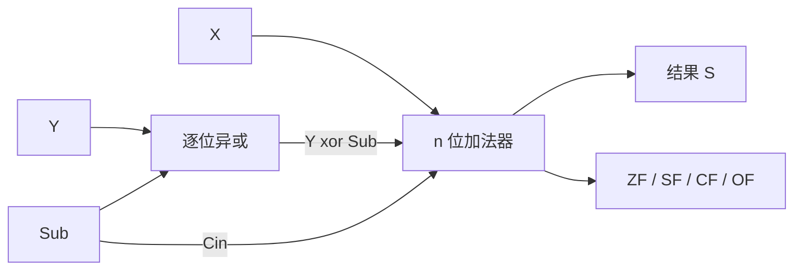
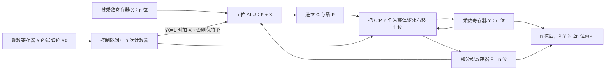
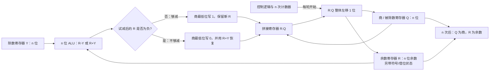

> 描述：运算器建立在逻辑门、组合逻辑和时序逻辑之上。408 的重点不只在“会算补码”，还在于会区分有符号/无符号溢出、标志位意义，以及乘除运算的硬件实现层次。

## 2.1 数字逻辑基础

### 2.1.1 组合逻辑与时序逻辑

| 类别 | 输出取决于 | 是否有记忆 | 例子 |
| --- | --- | --- | --- |
| 组合逻辑电路 | 当前输入 | 否 | 加法器、译码器、多路选择器 |
| 时序逻辑电路 | 当前输入与历史状态 | 是 | 寄存器、计数器、状态机 |

+ **组合逻辑**中给定当前输入，输出唯一；输入稳定后，经传播延迟输出稳定，不保存过去的信息。
+ **时序逻辑**由组合电路和存储元件组成，当前状态与输入共同决定输出和下一状态。触发器、寄存器等存储元件使电路具有记忆。
+ 时钟发生器提供周期性脉冲；钟控时序电路只在规定的时钟边沿更新状态，因此能在不同路径延迟下保持同步，便于设计。
+ 触发器通常提供正常值和反值两个输出，状态跳变仅在时钟规定的瞬间发生。具有适当延迟且信号绕环后不改变的反馈闭环可保存二进制信息。

### 2.1.2 译码器与多路选择器

##### **定义**：#译码器

$n$ 位输入编码至多有 $2^n$ 种组合；译码器把一个 $n$ 位输入码转换为 $m$ 位输出码（$m\le2^n$），使每一个有效输入产生唯一输出。典型例子是带使能端的 2-4 译码器。

+ **使能信号**控制电路是否工作：使能有效时按输入产生输出，使能无效时忽略输入并输出预定状态。
+ 原 PDF 的高电平有效 2-4 译码器可写成 $D_0=EN\bar A_1\bar A_0$、$D_1=EN\bar A_1A_0$、$D_2=ENA_1\bar A_0$、$D_3=ENA_1A_0$。$EN=0$ 时四路全为 0；$EN=1$ 时输入 `00/01/10/11` 依次只使 $D_0/D_1/D_2/D_3$ 为 1。其他器件也可能使用低电平有效输出，不能把这里的极性推广为所有译码器的定义。
+ **多路选择器（MUX）**从多条数据输入中选一路送到输出。2 选 1 MUX 满足 $Y=\bar S I_0+SI_1$：$S=0$ 选 $I_0$，$S=1$ 选 $I_1$。

### 2.1.3 半加器、全加器和行波进位

| 电路 | 输入 | 输出 | 关系 |
| --- | --- | --- | --- |
| 半加器 | $A,B$ | 和 $S=A\oplus B$，进位 $C=A\cdot B$ | 只处理本位两数 |
| 全加器 | $A,B,C_{in}$ | $S=A\oplus B\oplus C_{in}$，产生 $C_{out}$ | 两个半加器可组成一个全加器 |
| $n$ 位并行加法器 | $n$ 个全加器并行加载操作数 | $n$ 位和与最终进位 | 低位进位级联至高位 |

+ 4 个基本一位加法：$0+0=0$、$0+1=1$、$1+0=1$、$1+1=10$，故结果必须同时给出和位与进位。
+ 全加器除和位公式外，进位还满足 $C_{out}=AB+(A\oplus B)C_{in}=AB+AC_{in}+BC_{in}$；即三个输入中至少有两个 1 时产生进位。
+ 行波进位加法器中，最低位进位可能逐级传到最高位，传播延迟随位数增加；这正是其“行波”名称的由来。

## 2.2 运算器、移位与补码加减

### 2.2.1 运算器与 ALU

运算器通常由 **ALU、移位器、PSW（状态寄存器）、通用寄存器组**组成，完成加减乘除、与或非等逻辑运算、移位与求补等。

+ 加、减、乘、除最终都可归结为加法和移位，因此带标志加法器是 ALU 的核心。
+ ALU 具有 $n$ 位操作数输入 $A,B$、进位输入 $C_{in}$ 和操作控制端 $ALU_{op}$；控制端编码决定做加法、逻辑运算等何种功能。若操作控制端有 $k$ 位，最多选择 $2^k$ 种操作。
+ 同一个 $n$ 位二进制加法器既能产生无符号加法结果，也能产生补码加法的位串；硬件本身并不区分解释方式。为了统一减法并分别判断无符号进位/借位与有符号溢出，还需增加取反、进位控制及 CF/OF 等标志生成逻辑。

### 2.2.2 逻辑移位与算术移位

| 操作 | 视为 | 左移 | 右移 | 风险 |
| --- | --- | --- | --- | --- |
| 逻辑移位 | 无符号数 | 高位移出、低位补 0 | 低位移出、高位补 0 | 左移若高位 1 移出即无符号溢出 |
| 算术移位（补码） | 有符号数 | 高位移出、低位补 0 | 低位移出、高位补原符号位 | 左移可能溢出；右移若丢弃 1 会损失精度 |

+ 左移一位而不溢出时相当于乘 2；右移一位相当于除以 2 后按移位规则取整。无符号逻辑右移向 0 取整；负补码算术右移通常向负无穷取整，因此不一定等同于 C 语言有符号整数除法所要求的向 0 截断。
+ 有符号补码左移后，若移出高位与新符号位不同（即前后符号变化），则溢出。算术右移保持符号，负数不会被错误地填成正数。

### 2.2.3 补码加减与统一电路

$$
\begin{aligned}
[A+B]_{补}&=[A]_{补}+[B]_{补}\pmod{2^n}\\
[A-B]_{补}&=[A]_{补}+[-B]_{补}\pmod{2^n}
\end{aligned}
$$

+ 加法：两补码直接相加；减法：被减数加减数的负数补码。符号位和数值位一起参加运算，超过字长的最高进位丢弃，保留 $n$ 位补码结果。
+ 统一加/减电路：令 `Sub=0` 时直接选择 $Y$ 并令 $C_{in}=0$，实现 $X+Y$；令 `Sub=1` 时选择 $\bar Y$ 并令 $C_{in}=1$，实现 $X+\bar Y+1=X-Y$。
+ 运算器并不理解位串“有符号还是无符号”；同一结果位串的解释由指令/程序决定。例如全零减一产生全一，对有符号数是 $-1$，对无符号数却是最大值，后者表示借位溢出。

原 PDF 的 8 位补码例：$A=15=00001111_2$、$B=24=00011000_2$。相加得 `00100111`，表示 $39$；相减时 $[-24]_{补}=11101000_2$，故 `00001111 + 11101000 = 11110111`，表示 $-9$（本例没有第 9 位进位）。两次真值结果都在 8 位补码范围 $[-128,127]$ 内。

`Sub` 同时控制 $Y$ 是否取反和最低位进位，因此只用一套加法通路即可完成 $X+Y$ 与 $X-Y$。

## 2.3 溢出与状态标志

### 2.3.1 有符号补码溢出

+ 只有**同号相加**或**异号相减**可能发生有符号溢出。
+ 一位符号位判别：参与加法的两个操作数符号相同且结果符号不同则溢出。令 $A_s,B_s,S_s$ 分别为两个加数与结果的符号位：

$$V=\bar A_s\bar B_sS_s+A_sB_s\bar S_s$$

+ 双符号位（模 4 补码）判别：结果符号位为 `00` 表示正且无溢出，`11` 表示负且无溢出；`01` 正溢，`10` 负溢。两个符号位不同即溢出，最高位代表结果应有的符号。
+ 进位判别：符号位进位 $C_n$ 与最高数值位进位 $C_{n-1}$ 异或为 1 时溢出，即 $OF=C_n\oplus C_{n-1}$。

原 PDF 的 3 位图例：按补码解释，`101` 为 $-3$、`011` 为 $+3$，因此 `101 - 011` 的真值为 $-6$。计算 `011` 的负数补码为 `101`，位级加法 `101 + 101 = 1 010`；截成 3 位是 `010`（误看为 $+2$），但 3 位补码范围仅 $[-4,3]$，所以 $OF=1$。此时 $ZF=0$、$SF=0$；不能仅凭截断后符号位判断真实结果正负。

### 2.3.2 ZF、OF、SF、CF

| 标志 | 含义 | 对有符号数 | 对无符号数 |
| --- | --- | --- | --- |
| ZF | Zero Flag，结果为 0 时为 1 | 有意义 | 有意义 |
| OF | Overflow Flag，$C_n\oplus C_{n-1}$ | 判断有符号溢出 | 不用于判断无符号溢出 |
| SF | Sign Flag，结果最高位 | 反映结果符号（与 OF 配合比较） | 通常不用于无符号大小比较 |
| CF | Carry Flag | 不用于判断有符号溢出 | 加法进位或减法借位，判断无符号溢出 |

+ 无符号加法中 $CF=C_{out}$；无符号减法中 `CF=1` 代表有借位，故 $CF=Sub\oplus C_{out}$。
+ 上述减法 CF 公式采用本讲“CF=1 表示借位”的电路约定；不同 ISA 可能把减法进位标志定义为“无借位”，做体系结构题时必须以题设或手册为准。
+ 无符号比较做 $A-B$：`ZF=1, CF=0` 表示 $A=B$；`ZF=0, CF=0` 表示 $A>B$；`ZF=0, CF=1` 表示 $A<B$。
+ 有符号比较同样做 $A-B$：`ZF=1` 表示相等。若 $ZF=0$，按 $SF\oplus OF$ 判断，小于时为 1，大于时为 0；单看 SF 会在有符号溢出时出错。

### 2.3.3 原码加减

+ 原码中符号位与数值位分开处理：加法遵循“同号求和、异号求差”。同号时绝对值相加且结果符号不变；异号时大绝对值减小绝对值，结果符号随绝对值较大者。
+ 原码减法先将减数符号取反，再转成原码加法。它的符号判断与绝对值比较复杂，正是整数普遍采用补码的原因。

## 2.4 定点乘除与实现层次

### 2.4.1 乘法

+ 原码乘法中，乘积符号为两个乘数符号位异或；数值部分为两个绝对值相乘，可用“按位判断、部分积相加、移位”实现。
+ 补码乘法也可用加法和算术右移迭代实现。没有专用乘法指令时，编译器可生成比较、加法、移位组成的循环，即软件乘法。

原 PDF 的定点小数图例：$0.1101_2\times0.1011_2=(13/16)(11/16)=143/256=0.10001111_2$。逐位乘法把乘数为 1 的位对应的被乘数移位后相加；原码运算还需另行处理两个数的符号。

#### Booth 相邻位重编码

源 PDF 第 16 页给出 Booth 算法图。对 $n$ 位补码乘数，从最高位到最低位写作 $y_1y_2\cdots y_n$，在最低位后添 $y_{n+1}=0$。其带符号真值可写为

$$Y=\sum_{i=1}^{n}(y_{i+1}-y_i)2^{n-i}.$$

每对相邻位的差若为 0，本轮部分积不加不减；若为 $+1$，加被乘数；若为 $-1$，减被乘数。硬件迭代时对拼接部分积做**算术右移**，保持符号扩展。例如补码乘数 `0111` 表示 $+7$，相邻位差把连续的三个 1 重编码为 $+2^3-2^0=7$；`1111` 表示 $-1$，重编码为 $-2^0$。这与前文无符号乘法器的**逻辑右移**及其是否加数规则不同，不能直接混用。

| 实现方式 | 指令数/周期特征 | 相对时间 |
| --- | --- | --- |
| 无乘法指令，软件循环 | 反复执行取指、译码、加法、移位等多条指令 | 最长 |
| 乘法指令，由 ALU 与移位器迭代 | 一条指令但需多个时钟周期 | 居中 |
| 阵列乘法器专用硬件 | 一条乘法指令，组合阵列可在一个或很少周期完成 | 最短 |

这也回答了源 PDF 的 2020 年比较题：没有乘法指令、由软件循环模拟时通常最长；一条乘法指令配合 ALU/移位器迭代居中；使用专门阵列乘法器时通常最短。具体周期数仍取决于处理器实现与题目设定，表中比较的是原题给出的三种实现层次。

典型无符号乘法器含：部分积/乘积寄存器 $P$（初始 0）、被乘数寄存器 $X$、乘数寄存器 $Y$、进位位 $C_X$、计数器和 ALU。每次依据 $Y$ 的最低位决定是否把 $X$ 加到部分积，再对 $C_X,P,Y$ 作同步逻辑右移并计数，循环 $n$ 次。

> **NOTE** · 原书图示数字化（源 PDF 第 17-18 页）
> 下图把原书无符号“加法 + 右移”乘法器改写为可检索的数据通路。它描述的是无符号数值部分；原码乘法还须单独异或两个符号位，补码乘法则应按题给的补码算法和算术移位规则处理，不能把三者混成同一套位级步骤。

无符号移位加法乘法的固定步骤：

1. 初始化 $C\leftarrow0$、$P\leftarrow0$，$X$ 保存被乘数，$Y$ 保存乘数，计数器置 $n$。
2. 检查 $Y_0$：若为 1，则用 ALU 执行 $P\leftarrow P+X$，最高进位送 $C$；若为 0，则不加。
3. 将拼接寄存器 $C:P:Y$ **整体逻辑右移一位**，使本轮乘积最低位进入最终位置。
4. 计数器减 1，未到 0 则返回第 2 步；完成后 $P$ 是乘积高 $n$ 位，$Y$ 是低 $n$ 位。

> **WARNING** · 易错边界
> 每一轮是“先按当前 $Y_0$ 决定加不加，再整体右移”，并且 $C$ 必须参加拼接右移；若只移动 $P$ 或只移动 $Y$，部分积与乘数位权会错位。$n$ 位无符号数的完整乘积最多需要 $2n$ 位，若指令只保留低 $n$ 位，则高 $n$ 位非 0 表示发生截断/无符号溢出。

### 2.4.2 除法

+ 本讲常用硬件模型把被除数扩展到 $2n$ 位、除数取 $n$ 位，并产生至多 $n$ 位商；定点正小数与无符号整数的扩展位置不同，具体寄存器布局应以题图为准，不能把这一组织方式当成所有除法器的唯一形式。
+ 普通整数除法的逐位试商使用**算术减法**，需要正常处理借位：中间余数够减则商位写 1，不够减则写 0。CRC 使用的多项式除法才是“不借位的模 2 减法（异或）”，两者不能混为一种运算。
+ 整数除数为 0 时由处理器触发“除数为 0”异常；有操作系统时通常交由内核异常处理路径处置，裸机环境则由相应异常处理程序接管。
+ 对“$2n$ 位被除数、$n$ 位除数、仅保留 $n$ 位商”的无符号模型，若被除数高 $n$ 位已经大于或等于除数，则商至少需要 $n+1$ 位，属于商溢出；某些试商流程把它表现为首次试商得到 1。

源 PDF 第 20 页的普通整数除法图是 $00001111_2\div0010_2=0111_2$、余数 $0001_2$，即 $15\div2=7$ 余 1，逐位试减要按正常二进制减法处理借位。其同页模 2 除法图为 $100101_2\mathbin{\mathrm{mod2div}}1110_2$ 得商 $110_2$、余数 $1_2$：这里的“减”逐位异或、不产生借位，这个商不是普通整数商 $37\div14$。两种竖式外形相似，运算规则和用途不同。

> **NOTE** · 原书图示数字化（源 PDF 第 21 页）
> 原书除法器由除数寄存器 $Y$、余数寄存器 $R$、商/被除数寄存器 $Q$、加减 ALU 和控制计数器组成。下面采用与原图一致的“$R:Q$ 左移 + 恢复余数”表述；另一类教材也可固定被除数、逐步右移除数，二者位权过程等价，但微操作顺序不能混用。为了判断试减是否为负，硬件必须保留额外的符号/借位信息：可把 $R$ 实现为有效的 $n+1$ 位寄存器，也可用 $n$ 位余数加 ALU 借位标志，不能在无任何状态位的 $n$ 位无符号结果上直接判断“负数”。

恢复余数除法的固定步骤（无符号、商限定为 $n$ 位的模型）：

1. 除数为 0 时先触发异常，不进入迭代。若按本讲把一个 $n$ 位无符号整数在高位补 $n$ 个 0，则初始化 $R\leftarrow0$，$Q$ 保存原被除数，$Y$ 保存除数；若题目直接给出任意 $2n$ 位被除数，则应由 $R$、$Q$ 分别装入其高、低 $n$ 位，并先检查 $R\ge Y$ 时商超出 $n$ 位。
2. 将 $R:Q$ 整体左移 1 位，把被除数下一位移入部分余数。
3. 试减 $R\leftarrow R-Y$。若结果非负，当前商位写 1；若结果为负，当前商位写 0，并执行 $R\leftarrow R+Y$ 恢复原余数。
4. 重复 $n$ 次，最终 $Q$ 为 $n$ 位商、$R$ 为余数，并满足 $0\le R<Y$。

有符号整数除法还需按 ISA/题设确定商和余数的符号以及最小负数除以 $-1$ 的溢出处理。C/C++、Java 及许多 ISA 采用商向 0 截断、非零余数与被除数同号；其他语言或指令系统也可规定向下取整等不同语义，这些都不是从无符号恢复余数电路本身自动推出的结论。

源 PDF 的溢出例为：

$$1111\,1111_2\div1111_2=1\,0001_2$$

商需要 5 位；若除法器只允许 4 位商，就不能保存结果，故判为商溢出。这里 $255\div15=17$，复算与二进制结果一致。

## 相关知识

+ **科目导航**：[计算机组成原理导航](/notes/cs408-2406c8c61473/)
+ **阅读顺序**：[上一篇：浮点数的表示与运算](/notes/cs408-6f958f0fc0e0/) · [下一篇：整数的表示与运算](/notes/cs408-4da34b87d8cd/)

## 2.5 本节复盘

+ 组合逻辑看当前输入，时序逻辑还依赖状态；加法器、译码器、MUX 都是组合逻辑，寄存器与触发器是时序元件。
+ 补码加减统一进加法器，`Sub` 同时控制 $Y$ 取反与最低位加 1；硬件位串的有/无符号解释由上下文决定。
+ 有符号溢出看 OF 或双符号位，无符号溢出看 CF；比较时有符号应使用 $SF\oplus OF$，无符号应使用 CF/ZF。
+ 左移乘 2、右移近似除 2；无符号乘法按 $Y_0$ 选择加法并整体右移 $C:P:Y$，恢复余数除法按试减结果写商位并必要时恢复。软件实现最慢、专用阵列乘法器最快。
