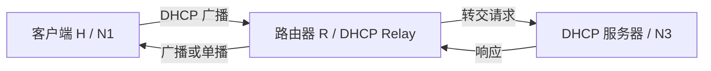

> 描述：DHCP 为主机自动配置 IPv4 地址、掩码、默认网关和 DNS 等参数。常考点是 UDP 端口、DISCOVER 的源/目的地址、DORA 四步、广播不能跨路由器以及 DHCP 中继和租约更新。

> **TIP** · 章节导航：[返回第六章：应用层总纲](/notes/cs408-a8acba740351/)

## 2.1 DHCP 基本标识

| 项目 | 值 |
| --- | --- |
| 运输层协议 | UDP |
| DHCP 服务器端口 | UDP 67 |
| DHCP 客户端端口 | UDP 68 |
| IPv4 首部协议字段 | 17，表示 UDP |
| 初始客户端源地址 | `0.0.0.0` |
| 初始受限广播目的地址 | `255.255.255.255` |

客户端刚接入网络时还没有可用 IPv4 地址，也不知道服务器地址，因此用 `0.0.0.0` 表示未知源地址，并通过受限广播寻找 DHCP 服务器。

## 2.2 DORA 四步

DHCP 初始租约过程可记为 DORA：

| 步骤 | 报文 | 作用 | 典型方向 |
| --- | --- | --- | --- |
| D | DHCPDISCOVER | 客户端广播寻找服务器 | 客户端 -> 广播 |
| O | DHCPOFFER | 服务器提供地址和配置参数 | 服务器 -> 客户端/广播 |
| R | DHCPREQUEST | 客户端选择一个 OFFER 并申请该租约 | 客户端 -> 广播 |
| A | DHCPACK | 服务器确认租约，客户端可启用配置 | 服务器 -> 客户端/广播 |

### 2.2.1 DHCPDISCOVER

典型初始封装：

```text
源 IP：0.0.0.0
目的 IP：255.255.255.255
源 UDP 端口：68
目的 UDP 端口：67
IPv4 Protocol：17
```

### 2.2.2 DHCPOFFER 与地址冲突检测

+ DHCP 服务器收到 DISCOVER 后，可在提供地址前使用 ARP 探测候选地址是否已被占用。
+ 一个网络中可能有多台 DHCP 服务器，因此客户端可能收到多个 OFFER。

### 2.2.3 DHCPREQUEST

客户端选择一个 OFFER 后，通常广播 DHCPREQUEST：

+ 被选中的服务器知道客户端接受了自己的方案。
+ 其他服务器也能看到选择结果，收回各自预留的候选地址。

### 2.2.4 DHCPACK 与客户端检测

+ 服务器发送 DHCPACK 后，租约正式生效。
+ 客户端还可用 ARP 检测获分地址是否被其他主机占用。
+ 若发现冲突，可发送 DHCPDECLINE，放弃该地址并重新开始 DISCOVER。

## 2.3 模拟题拓扑与三问

### 2.3.1 拓扑条件

+ 网络 N1、N2 使用 100BaseT 集线器，N3 使用 10BaseT 集线器。
+ 主机 H 位于 N1。
+ Web 服务器 $S_{Web}$ 位于 N2。
+ DHCP 服务器 $S_{DHCP}$ 位于 N3。
+ N1、N2、N3 由路由器 R 互联。

H 要跨路由器 R 从 $S_{DHCP}$ 获得 IPv4 地址、掩码和默认网关等配置。

### 2.3.2 第（1）问：运输层协议

DHCP 报文使用 UDP 封装。

**答案：UDP。**

### 2.3.3 第（2）问：DISCOVER 的 IPv4 首部

客户端发送 DISCOVER 时尚未获得 IPv4 地址，所以：

```text
源地址字段：0.0.0.0
协议字段：17
```

协议字段 17 表明 IP 数据载荷是 UDP。

### 2.3.4 第（3）问：跨路由器获取配置

目的地址 `255.255.255.255` 是受限广播，路由器默认不会把它转发到其他网络；H 在 N1、DHCP 服务器在 N3，普通广播无法直接到达服务器。

因此必须在 R 上配置 DHCP 中继代理，并指定 DHCP 服务器位置。

**答案：在 R 上配置 DHCP Relay。**

## 2.4 DHCP 中继代理

中继的基本工作过程：

1. 路由器接口在客户端所在网段接收 DHCP 广播。
2. 中继填写能标识客户端来源网段的信息，并把请求转发给远端 DHCP 服务器。
3. 服务器根据来源网段选择相应地址池，把响应送回中继。
4. 中继再在客户端网段广播或单播交付响应。

中继不是简单打开“广播转发”：它以 DHCP 协议代理的身份在不同网段间转交消息，并帮助服务器判断应从哪个子网分配地址。



## 2.5 租约更新、重新绑定与释放

### 2.5.1 T1：0.5 倍租用期

租期经过约 50% 时，客户端进入续租阶段，通常向原 DHCP 服务器发送 DHCPREQUEST：

+ 收到 DHCPACK：获得新的租期。
+ 收到 DHCPNAK：立即停止使用该地址，重新开始 DISCOVER。
+ 未收到响应：继续暂时使用现有地址，等待重新绑定阶段。

### 2.5.2 T2：0.875 倍租用期

租期经过约 87.5% 时仍未续租成功，客户端进入重新绑定：

+ 广播 DHCPREQUEST，允许任意可用 DHCP 服务器响应。
+ 收到 ACK：获得新租期。
+ 收到 NAK：停止使用该地址并重新发现。
+ 租期到期仍无响应：必须停止使用该地址，再发送 DHCPDISCOVER。

### 2.5.3 主动释放

客户端不再需要地址时，可以发送 DHCPRELEASE 主动解除租约，使服务器尽早回收地址；释放不是正常到期前必须执行的四步握手之一。

## 2.6 相关协议与端口速查

| 协议 | 下层协议/编号 | 常用端口或协议号 |
| --- | --- | --- |
| HTTP | TCP | 80 |
| FTP | TCP | 控制 21，主动模式数据 20 |
| SMTP | TCP | 25 |
| POP3 | TCP | 110 |
| BGP | TCP | 179 |
| DHCP | UDP | 服务器 67，客户端 68 |
| DNS | UDP/TCP | 53 |
| TFTP | UDP | 69 |
| RIP | UDP | 520 |
| ICMP | 直接封装在 IP | IPv4 协议号 1 |
| IGMP | 直接封装在 IP | IPv4 协议号 2 |
| OSPF | 直接封装在 IP | IPv4 协议号 89 |

ARP 不封装在 IP 中，它在本地链路上完成 IPv4 地址到 MAC 地址的解析。

## 2.7 解题步骤

1. 看到 DHCP，先写 UDP、服务器 67、客户端 68、IP 协议号 17。
2. 客户端尚无地址时，源 IP 写 `0.0.0.0`，目的通常为 `255.255.255.255`。
3. 按 DISCOVER、OFFER、REQUEST、ACK 判断当前处于哪一步。
4. DHCP 服务器与客户端跨路由器时，检查是否配置 DHCP Relay。
5. 租约题记住 T1=0.5、T2=0.875，并区分续租、重新绑定与到期失效。
6. 若出现地址冲突，联想到 ARP 检测、DHCPDECLINE 和重新发现。

## 2.8 易错点

+ DHCP 使用 UDP，不使用 TCP；IPv4 协议字段应填 17，不是端口号 67 或 68。
+ `0.0.0.0` 是尚无地址时的源地址，`255.255.255.255` 是本地受限广播目的地址。
+ 路由器默认不转发受限广播，跨网段 DHCP 需要中继代理。
+ DHCP 中继不是 DHCP 服务器；它转交消息，真正的地址池仍由服务器管理。
+ DORA 的第三步 REQUEST 通常广播，以通知所有提供过地址的服务器。
+ DHCPACK 后仍可能通过 ARP 发现冲突；冲突时不能继续使用该地址。
+ T1 续租优先联系原服务器，T2 重新绑定面向任意服务器。

## 相关知识

+ **科目导航**：[计算机网络导航](/notes/cs408-b78f75dd8c69/)
+ **阅读顺序**：[上一篇：HTTP 连接](/notes/cs408-0bb2d5ae08e6/) · [下一篇：DNS 与 HTTP 综合](/notes/cs408-b9c8f13ec3e6/)
+ **关联专题**：[应用层总纲](/notes/cs408-a8acba740351/)

## 2.9 本节复盘

+ DHCP 使用 UDP，服务器端口 67、客户端端口 68，IPv4 协议字段为 17。
+ 初始 DHCPDISCOVER 通常从 `0.0.0.0:68` 发往 `255.255.255.255:67`。
+ 初始租约采用 DISCOVER、OFFER、REQUEST、ACK 四步。
+ 模拟题中 H 与 DHCP 服务器跨越路由器 R，必须在 R 上配置 DHCP 中继代理。
+ DHCP 服务器和客户端可使用 ARP 检测地址冲突，客户端发现冲突后可发送 DHCPDECLINE。
+ 约 0.5 租期开始续租，约 0.875 租期开始重新绑定；到期仍失败就停止使用地址并重新 DISCOVER。
