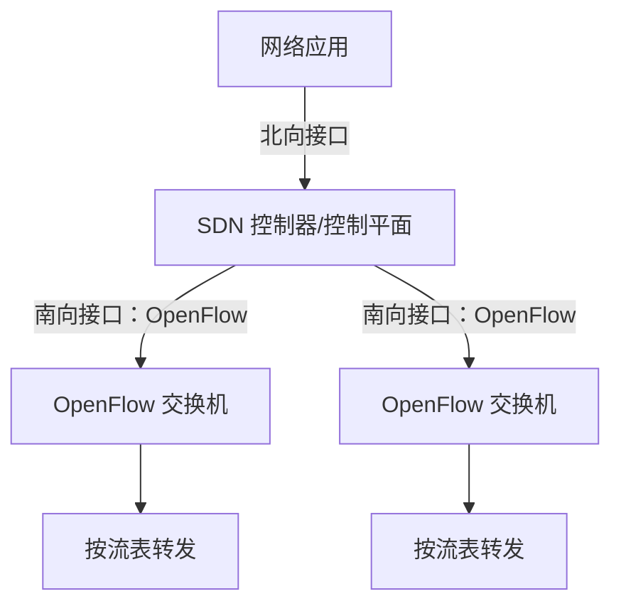

> 描述：SDN 将控制逻辑与数据转发分离，由控制器统一下发规则，交换机依据流表匹配并执行动作。OpenFlow 1.0 题重点记忆“匹配字段 - 计数器 - 动作”三部分，以及可匹配的二层、三层、四层首部字段。

## 6.1 SDN 的基本思想

传统路由器或交换机通常同时包含：

+ 控制平面：运行路由、管理和策略逻辑，决定如何转发。
+ 数据平面：依据已有转发表或流表，对到达分组执行高速转发。

SDN 的核心是把两者分离：

+ 转发设备保留数据平面，按流表执行匹配和动作。
+ SDN 控制器集中掌握网络状态并计算控制策略。
+ 网络应用通过北向接口向控制器表达需求。
+ 控制器通过南向接口向交换机下发规则；OpenFlow 是典型南向协议。



“集中控制”通常指逻辑上的集中视图，不等于控制器在实现上只能有一台物理服务器。

## 6.2 OpenFlow 流表项

OpenFlow 1.0 的每条流表项可以概括为：

| 部分 | 作用 |
| --- | --- |
| 首部字段值/匹配字段 | 判断到达分组是否属于该流 |
| 计数器 | 记录该流表项的命中和持续情况 |
| 动作 | 规定匹配后如何处理分组 |

处理过程：

```text
分组到达 -> 提取字段 -> 与流表项匹配 -> 更新 packet/byte 计数 -> 执行动作
```

常见动作包括转发到指定端口、丢弃，或按规则修改后继续处理；具体以题目给出的动作集合为准。

## 6.3 OpenFlow 1.0 可匹配字段

OpenFlow 1.0 不只处理某一层：它可以同时依据数据链路层帧、网际层 IP 数据报和运输层 TCP/UDP 报文的字段进行匹配。

### 6.3.1 完整字段表

| 范围 | 可匹配字段 |
| --- | --- |
| 交换机输入 | 入端口 |
| 以太网 | 源 MAC 地址、目的 MAC 地址、类型 |
| VLAN | VLAN ID、VLAN 优先级 |
| IPv4 | 源 IP 地址、目的 IP 地址、协议、服务类型 ToS |
| TCP/UDP | 源端口、目的端口 |

图中共有 11 个首部字段；再加上不属于分组首部的“入端口”，构成 OpenFlow 1.0 常见的 12 项匹配信息。

### 6.3.2 同名字段要分清

+ 以太网“类型”字段说明上层协议，如 IPv4。
+ IPv4“协议”字段说明 IP 数据载荷的协议，如 TCP、UDP、ICMP。
+ IPv4“服务类型”是 ToS 相关字段。
+ TCP/UDP“源端口、目的端口”属于运输层字段。

## 6.4 模拟题：不能匹配的 IPv4 首部字段

题目问：下列 IPv4 数据报首部字段中，不能在 OpenFlow 1.0 中匹配的是哪一项？

| 选项 | 字段 | OpenFlow 1.0 是否可匹配 |
| --- | --- | --- |
| A | 协议 | 可以，对应 IPv4 Protocol |
| B | 源地址 | 可以，对应源 IP 地址 |
| C | 生存时间 | 不可以，OpenFlow 1.0 这组匹配字段中没有 TTL |
| D | 服务类型 | 可以，对应 IPv4 ToS |

OpenFlow 交换机能够匹配跨二层、三层和四层的多种字段，但“能处理 IP 分组”不代表能匹配 IP 首部的每一个字段。题图列出的 IPv4 匹配字段只有源地址、目的地址、协议和服务类型，不包含 TTL。

**答案：C，生存时间。**

## 6.5 计数器字段

计数器用于描述流表项的使用情况，题目给出的含义包括：

+ 已经与该流表项匹配的分组数量。
+ 已经与该流表项匹配的字节数量。
+ 该流表项自安装/创建以来的持续时间（`duration_sec`、`duration_nsec`）。

计数器用于统计和管理，不参与判断当前分组是否匹配；真正用于匹配的是首部字段值和入端口等匹配信息。命中分组数和字节数随匹配流量更新；持续时间由交换机根据流表项存活时间计算，不是每来一个分组就像 packet/byte counter 那样递增一次。

## 6.6 解题步骤

1. 先写出流表项三部分：匹配字段、计数器、动作。
2. 将候选字段按层次分类：以太网、VLAN、IPv4、TCP/UDP。
3. 对照 OpenFlow 1.0 字段表逐项查找，不要凭“该字段属于 IP 首部”就判断可匹配。
4. 区分以太网类型、IPv4 协议和 IPv4 服务类型三个不同字段。
5. 若题目询问 OpenFlow 1.0 流表项计数器，应回答命中分组数、命中字节数和自流表项安装以来的持续时间；不要把计数器当作动作，也不要把持续时间解释成逐包计数。

## 6.7 易错点

+ SDN 是控制平面与数据平面分离，不是取消数据平面或让控制器逐个转发所有数据分组。
+ OpenFlow 交换机可以匹配多个协议层次，不能把它只看成普通二层交换机。
+ OpenFlow 1.0 能匹配 IPv4 协议、源/目的地址和 ToS，但不能匹配题目中的 TTL。
+ “入端口”是交换机元数据，不是数据帧或 IP 分组的首部字段。
+ 计数器记录命中分组数、命中字节数与流表项自安装以来的持续时间；前两者随流量累加，持续时间按存活时间取得，动作才决定转发、丢弃或其他处理。
+ 以太网类型与 IPv4 协议字段名称相近，但位置和含义不同。

## 相关知识

+ **科目导航**：[计算机网络导航](/notes/cs408-b78f75dd8c69/)
+ **阅读顺序**：[上一篇：IP 多播](/notes/cs408-ac7b677ecc0f/) · [下一篇：IPv6](/notes/cs408-324f552507c6/)
+ **关联专题**：[网络层总纲](/notes/cs408-fe8e22cc2489/)

## 6.8 本节复盘

+ SDN 把控制逻辑与数据转发分离，由控制器通过南向接口向交换机下发流表。
+ OpenFlow 流表项由匹配字段、计数器和动作组成。
+ OpenFlow 1.0 可匹配入端口，以及以太网、VLAN、IPv4、TCP/UDP 的指定字段。
+ IPv4 可匹配字段包括源地址、目的地址、协议和服务类型，不包括生存时间 TTL。
+ 模拟题答案为 C；“能处理某层分组”不等于“能匹配该层首部的所有字段”。
+ OpenFlow 1.0 的流表项统计包括匹配分组数量、匹配字节数量，以及流表项自安装以来的持续时间。
