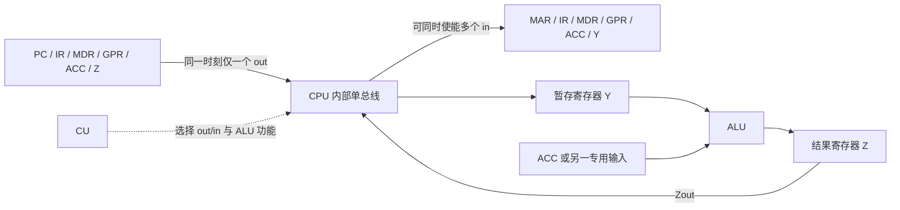

> 描述：数据通路是指令执行时数据实际经过的部件和路径。它包括 ALU、寄存器、异常检测/响应电路等，但**不包括控制器 CU**；CU 用控制信号决定通路何时、向哪流动。

## 5.1 数据通路与执行方案

| 概念 | 要点 |
| --- | --- |
| 数据通路 | 指令执行中数据流经的路径及路径上的部件，含组合逻辑和时序逻辑 |
| 组合逻辑部件 | ALU、加法器、MUX、异常检测等 |
| 时序逻辑部件 | 通用寄存器、PC、IR、MDR、暂存寄存器、标志寄存器等 |
| 控制信号 | 选择数据源、目的地、ALU 操作、读写动作，驱动数据流 |

### 5.1.1 单周期、多周期、流水线

| 方案 | 指令执行关系 | 时钟与控制特点 | 优缺点 |
| --- | --- | --- | --- |
| 单周期 | 指令串行，一条指令一个时钟周期完成 | 所有指令周期取最慢指令，控制信号在周期内不变，$CPI=1$ | 设计简单；周期长、主频低 |
| 多周期 | 指令串行，但不同类型用不同数量的时钟周期 | 每周期完成一个步骤，控制信号随周期变化 | 比单周期更高效；控制复杂 |
| 流水线 | 多条指令同时处于不同步骤 | 尽量每周期启动一条 | 提升吞吐；需处理冒险 |

+ 单周期的 $CPI=1$ 并不意味着性能一定好：为了容纳最慢指令，其时钟周期很长。
+ 单总线一次只能完成一条内部数据传输，故通常不能满足“所有微操作同一时钟完成”的单周期数据通路需求。

## 5.2 CPU 内部单总线结构

将 ALU 与所有寄存器连接到一条 CPU 内部公共总线，称单总线数据通路。它简单、省硬件，但总线争用使许多传送必须分多个微操作完成。

| 术语 | 作用 |
| --- | --- |
| GPRs | 通用寄存器组，`rs/rd` 为读/写寄存器编号 |
| Y、Z | ALU 两侧的暂存寄存器；Y 保留输入，Z 暂存结果 |
| FR | 标志寄存器，保存 ALU 的状态标志 |
| `Xin` / `Xout` | `in` 允许总线写入 X，`out` 允许 X 驱动总线 |
| 三态门 | 连接寄存器输出与总线，未使能时高阻，防止多源同时驱动 |

+ **内部总线**连接同一部件内部的寄存器和运算部件；**系统总线**连接 CPU、主存、外设，二者不可混淆。
+ 任意时刻一般只能一个 `out` 生效，但可有多个兼容的 `in` 同时接收总线数据；否则会造成总线冲突。

## 5.3 单总线微操作例子

### 5.3.1 寄存器到寄存器

把 PC 内容送 MAR：

$$PC\xrightarrow{Bus}MAR$$

+ `PCout` 有效：$(PC)\to Bus$；`MARin` 有效：$Bus\to MAR$。
+ 简写为 $(PC)\to Bus\to MAR$；箭头不表示 CU 自身在搬运数据，而表示 CU 已发出相应使能控制。

### 5.3.2 取指

$$
\begin{aligned}
(PC)&\to Bus\to MAR\\
1&\to R\\
M(MAR)&\to MDR\\
(MDR)&\to Bus\to IR
\end{aligned}
$$

+ 第一步需 `PCout`、`MARin`；第二步 CU 经控制总线发主存读；主存数据到 MDR 时 `MDRin` 有效；最后 `MDRout`、`IRin` 有效。
+ 若还需更新 PC，单总线通路须安排额外时序或借助专门增量通路，不能假设所有传送自动并行。

### 5.3.3 加法指令执行

以累加器 ACC 与主存操作数相加为例：

$$
\begin{aligned}
Ad(IR)&\to Bus\to MAR\\
1&\to R\\
M(MAR)&\to MDR\\
(MDR)&\to Bus\to Y\\
(ACC)+(Y)&\to Z\\
(Z)&\to Bus\to ACC
\end{aligned}
$$

+ Y 暂存从主存读来的操作数，避免单总线下一时刻覆盖；ALU 对 ACC、Y 运算，Z 保存中间结果，最后才回写 ACC。
+ `Ad(IR)` 是 IR 的地址字段，不能错误写成 MDR 内容；从 IR 地址码到 MAR 通常由 IR 输出相关控制支持。

## 5.4 专用数据通路与多总线

专用数据通路按指令执行中数据/地址流向设置专门连线，或采用多条内部总线同时传送多个源/目的。

| 结构 | 性能 | 硬件复杂度 | 原因 |
| --- | --- | --- | --- |
| 单总线 | 较低 | 低 | 数据争用，需要分时传送 |
| 多总线/专用通路 | 较高 | 高 | 避免共享总线冲突，可并行发生多次传送 |

+ 专用通路可让 PC 到 MAR、寄存器到 ALU、ALU 到结果寄存器等不同流动同时或更紧凑地进行；代价是更多连线、MUX/三态门和控制逻辑。
+ 图中实线通常画数据路径，带箭头虚线通常画控制路径。分析题先找“数据从哪里来、到哪里去”，再写使能和 ALU 功能控制。

#### 原 PDF 专用通路取指图的控制信号

原页第 4 页的连线图用 $C_0$～$C_4$ 标记这张图中特定的通路使能，而不是所有 CPU 通用的控制信号名称：

| 图中信号/动作 | 数据流或含义 |
| --- | --- |
| $C_0$ 有效 | $(PC)\to MAR$ |
| $C_1$ 有效，再发读命令 | 将 MAR 中的地址送往主存，并请求主存读取 |
| $C_2$ 有效 | $M(MAR)\to MDR$ |
| $C_3$ 有效 | $(MDR)\to IR$ |
| $C_4$ 有效 | $Op(IR)\to CU$，把操作码提供给控制器译码 |

该图还画出 $(PC)+1\to PC$ 的顺序地址更新；其中的 $1$ 是题图采用的指令地址单位，字节编址或变长指令要按实际长度改写。不能把主存读命令本身误认为数据已经送入 MDR：地址、读控制和返回数据是不同环节。

### 题型：#数据通路控制信号

#### 第一部分：作答步骤

1. 把语义拆成不能再并行的微操作，例如“地址送 MAR、主存读、数据进 MDR、数据进 IR”。
2. 每次总线传送只指定一个源 `out`，列出所有需要接收的 `in`；涉及 ALU 时写清操作和结果寄存器。
3. 区分 CPU 内部总线、数据线、地址线、控制线；主存读写命令由 CU 发出，而主存数据仍经 MDR/数据通路流动。

#### 第二部分：易错点

+ 数据通路不是 CU；CU 控制通路但不属于数据通路组成。
+ 单总线可同时让多个寄存器写入，却不能让两个寄存器同时输出到总线。
+ Y/Z 是为解决单总线暂存和 ALU 输入/输出时序而设，不能省略后把两次冲突传送硬并到同一节拍。

## 相关知识

+ **科目导航**：[计算机组成原理导航](/notes/cs408-2406c8c61473/)
+ **阅读顺序**：[上一篇：指令执行过程](/notes/cs408-d889ec3bdd23/) · [下一篇：控制器的功能和工作原理](/notes/cs408-c60c78e602f8/)

## 5.5 本节复盘

+ 数据通路含 ALU、寄存器、异常检测/响应等路径部件，不含 CU；控制信号决定通路数据流。
+ 单周期 $CPI=1$ 但受最慢指令制约，多周期按步骤改变控制信号，流水线提高吞吐并引入冒险问题。
+ 单总线简单但有争用，`out` 驱动总线、`in` 接收总线，三态门保证不同时多源冲突。
+ 取指、访存加法等要分解成 MAR/MDR/IR/Y/Z 的微操作；专用通路性能高但硬件和控制更复杂。
