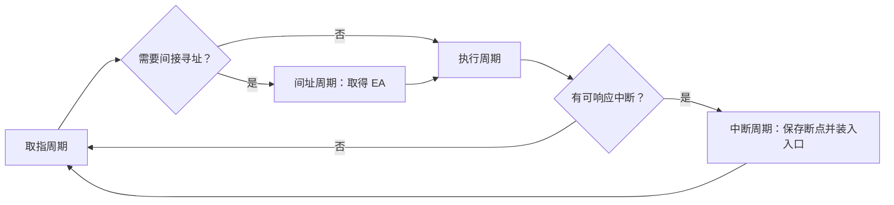

> 描述：一条指令的完整执行时间是指令周期；它由若干机器周期和时钟周期构成。遇到间接寻址或中断时，会在普通取指/执行流程之外插入间址或中断周期。

## 5.1 三层时间单位

| 单位 | 定义 | 关系 |
| --- | --- | --- |
| 时钟周期（节拍/T 周期） | 相邻同相位有效时钟边沿之间的时间间隔 | 主频 $f=1/T$，由组合逻辑最大延迟、寄存器时序与时钟裕量等约束；高、低电平脉冲宽度只是周期的组成部分 |
| 机器周期（CPU 周期） | 完成一个基本 CPU 操作所需时间 | 一个机器周期含若干时钟周期 |
| 指令周期 | CPU 取出并执行一条指令的全部时间 | 由一个或多个机器周期组成 |

+ 时钟脉冲由机器脉冲源经整形、分频等形成。指令周期必不小于一个时钟周期，但并不等于固定数量的机器周期；不同指令、不同寻址方式可不同。

## 5.2 指令周期的工作阶段

| 周期 | 主要访存目的 | 是否所有指令必有 |
| --- | --- | --- |
| 取指周期 | 从指令存储层次取得指令；教材无 Cache 模型中为读主存 | 是 |
| 间址周期 | 根据间接地址取有效地址 | 仅间接寻址等需要时 |
| 执行周期 | 取操作数、完成运算或写回等 | 指令相关 |
| 中断周期 | 保存断点并转向中断服务入口 | 有中断且被响应时 |

+ 这四类周期均可能访问主存，但目的不同：取指取指令，间址取 EA，执行取操作数，中断保存断点。
+ 无 Cache、无预取时，每条指令至少需一次主存访问用于取指，即使是空操作指令也如此；空指令取完后仍需形成下一条 PC。
+ 指令译码在取指后为控制器提供控制信息。进入取数（间址）和后续执行阶段时，通常不再需要“指令译码器”参与数据传输本身；取数/执行可涉及通用寄存器、ALU、主存。
+ 原 PDF 的 2019 年例 `R[r2] <- R[r1] + M[R[0]]`：在取数和执行时要用通用寄存器、ALU 与存储器；指令译码器已在此前解释操作码，它不是这段数据传输路径的组成部件。

## 5.3 典型微操作序列

### 5.3.1 取指周期

$$
\begin{aligned}
(PC)&\to MAR\\
\text{CU 发主存读 }R\\
M(MAR)&\to MDR\\
(MDR)&\to IR\\
(PC)+1&\to PC
\end{aligned}
$$

+ 第一行把当前指令地址送入 MAR；主存读出的指令经数据总线进入 MDR，再送 IR。
+ 最后 PC 按指令长度前移。上式写 `+1` 是按题设单位的简化表示；按字节编址/变长指令应按实际指令长度更新。

### 5.3.2 间址周期

对一次间接寻址，IR 地址字段先给出“有效地址所在单元”的地址：

$$
\begin{aligned}
Ad(IR)&\to MAR\\
\text{CU 发主存读 }R\\
M(MAR)&\to MDR\\
(MDR)&\to Ad(IR)
\end{aligned}
$$

此后 IR 地址码已改写/获得 EA，执行周期才能用 EA 取真正操作数。多次间接需重复相应操作，直到间址标志表明结束。
若某实现中指令地址字段此时仍暂存于 MDR，首步也可写为 $Ad(MDR)\to MAR$；应按题设的数据通路判断，不把两种寄存器来源同时执行。

### 5.3.3 中断周期

中断响应前需保存当前断点（通常是下一条待执行指令地址），然后装入中断服务程序入口。以栈向低地址增长为例：

$$
\begin{aligned}
(SP)-1&\to SP\\
(SP)&\to MAR\\
(PC)&\to MDR\\
\text{CU 发主存写 }W\\
\text{中断向量/入口地址}&\to PC
\end{aligned}
$$

+ 上式本质是把 PC 断点压入栈或指定保存单元；`SP-1` 中的 1 是题设的一个可寻址栈单元，字节编址机器应按实际保存宽度调整 SP。完整机器还可能保存 PSW 和通用寄存器，具体以题设为准。
+ 中断服务完成后通过中断返回恢复现场和 PC，程序才从断点处继续。

## 5.4 空指令、加法与间接寻址的差别

| 指令特征 | 周期组成 | 关注点 |
| --- | --- | --- |
| 空指令 | 取指 + 最小执行/结束 | 也必须取指、更新 PC |
| 直接加法/取数 | 取指 + 执行 | 执行周期可能读操作数、ALU 运算、写回 |
| 间接寻址指令 | 取指 + 间址 + 执行 | 多了由地址码取 EA 的主存读 |

+ “指令周期中有几次访存”必须说明统计范围：取指 1 次是基本项，间址增加读 EA 的访问，执行阶段是否访存取决于操作数位置和结果是否写回主存。
+ PC、MAR、MDR、IR、CU 的职责分工贯穿周期：PC 给取指地址，MAR 给主存地址，MDR 传主存数据，IR 保当前指令，CU 发时序控制。

### 题型：#指令周期判断

#### 第一部分：解题步骤

+ 先问操作数在寄存器、主存还是指令内，是否存在间接寻址；再列出取指、间址、执行、中断四类周期。
+ 根据箭头判断读写方向：`M(MAR)->MDR` 是读主存；`MDR->M(MAR)` 是写主存；`PC->MDR` 是准备把断点数据写出。
+ 看到中断周期优先确认保存的是断点 PC，再确认入口由中断向量/硬件产生并送入 PC。

#### 第二部分：易错点

+ 不要把“机器周期”当作“时钟周期”，也不要把“指令周期”当作每条固定一个机器周期。
+ 间址周期取得的是有效地址而非最终操作数；真正操作数仍由执行周期按 EA 访问。
+ 无 Cache 情况下空指令也至少访存一次，因为指令本身必须从主存取出。

## 相关知识

+ **科目导航**：[计算机组成原理导航](/notes/cs408-2406c8c61473/)
+ **阅读顺序**：[上一篇：CPU 的功能与结构](/notes/cs408-8aa8809e8e26/) · [下一篇：数据通路的功能和基本结构](/notes/cs408-d6101803f8c4/)

## 5.5 本节复盘

+ 时间层级是时钟周期 `->` 机器周期 `->` 指令周期；主频为时钟周期倒数。
+ 取指、间址、执行、中断的访存目的分别是取指令、取 EA、取/写操作数、保存断点。
+ 取指核心为 `PC->MAR->MDR->IR` 再更新 PC；间址用 `Ad(IR)` 读出 EA；中断先保存 PC 再装入服务入口。
+ 指令的寻址方式与操作数位置决定额外周期和访存次数，答题必须明确是否计入取指和写回。
