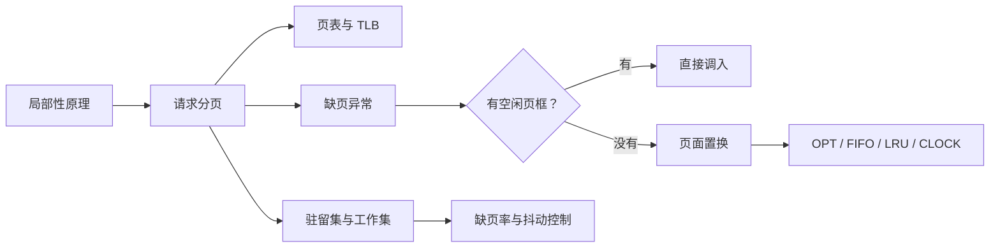
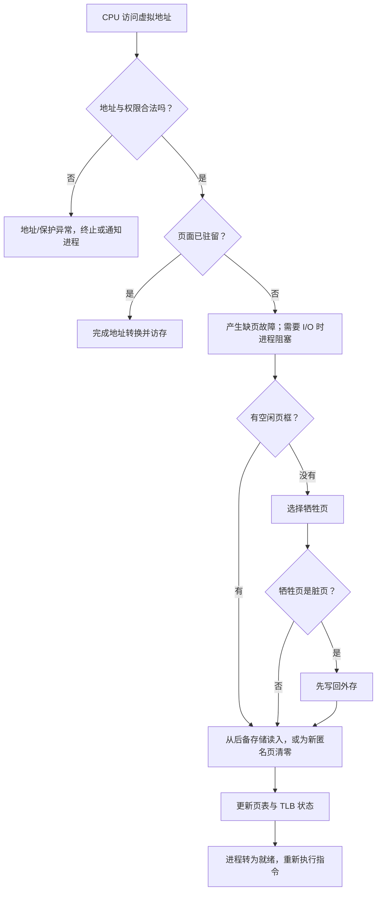
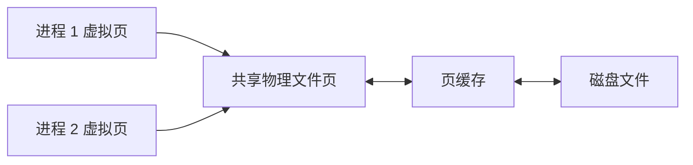

> **SUMMARY** · 本讲主线
> 局部性使“只把当前需要的页放入内存”成为可能。请求分页负责`何时调页`与`如何完成地址变换`，页框分配决定进程能占多少物理内存，页面置换算法决定内存满时牺牲谁，工作集与缺页率则用于控制抖动。

## 7.1 教材知识地图与考纲最低核验

本讲覆盖：

+ 虚拟内存的基本概念与实现条件；
+ 请求分页的页表、缺页异常和地址变换；
+ 页框分配、驻留集、工作集与抖动；
+ 调页时机、调页来源和调入过程；
+ OPT、FIFO、LRU、CLOCK 与改进 CLOCK；
+ 内存映射文件；
+ 缺页率和有效访问时间的影响因素。

## 7.2 虚拟内存的基本概念

### 7.2.1 为什么需要虚拟内存

传统装入方式有两个限制：

| 限制 | 含义 | 后果 |
| --- | --- | --- |
| 一次性 | 作业必须一次全部装入内存后才能运行 | 大作业可能无法运行，多道程序并发度受限 |
| 驻留性 | 作业装入后一直驻留到结束 | 暂时不用的代码和数据长期占据内存 |

局部性原理表明，程序在一段时间内通常只集中访问少量代码和数据。

> **NOTE** · 教材补充：局部性的两种常见表现
> + `时间局部性`：刚访问过的信息不久后可能再次访问；
> + `空间局部性`：某位置被访问后，其相邻位置也可能很快被访问。

因此，程序开始运行时只装入近期需要的部分；访问未装入部分时再请求调页；内存不足时把暂时不用的页换出。

### 7.2.2 定义、实现方式与特征

`虚拟内存`是在操作系统管理下，为进程提供的逻辑地址空间。它让进程看到的地址空间可以大于当前分配给它的物理内存。

常见实现方式：

+ 请求分页；
+ 请求分段；
+ 请求段页式。

三项基本特征：

| 特征 | 含义 |
| --- | --- |
| 多次性 | 程序不必一次全部装入，可分多次调入 |
| 对换性 | 运行期间允许页面或段换入、换出 |
| 虚拟性 | 从进程视角扩充可用的逻辑地址空间 |

实现虚拟内存通常需要：

+ 非连续分配；
+ 页表或段表等映射结构；
+ 地址变换硬件；
+ 缺页/缺段异常与操作系统处理程序；
+ 外存中的文件区或交换区作为后备存储。

> **IMPORTANT** · 教材补充与纠错：容量口径
> 单进程虚拟地址空间的上限首先受 CPU 实现的虚拟地址位数和操作系统布局限制。教材常写“实际容量为寻址范围与内存、外存容量之和的较小者”，这是便于考试理解的理想化口径；现代系统还存在文件映射、共享页、稀疏地址空间和内存过量承诺，不能把该式当成所有系统的精确实现公式。

### 7.2.3 `malloc` 与虚拟地址

+ C 语言 `malloc` 成功时返回进程虚拟地址空间中的指针；
+ 虚拟地址最终需经页表转换为物理地址；

> **NOTE** · 教材补充：分配与地址位边界
> + `malloc` 返回成功不等于对应物理页已经全部分配，系统可能在首次访问时才通过缺页分配页框；
> + 32 位系统常见理论地址空间为 $2^{32}$ B，但用户空间还会受内核布局与进程模型限制；64 位体系也通常只实现部分虚拟地址位。

## 7.3 请求分页管理

### 7.3.1 请求分页页表项

典型页表项包含：

| 字段 | 作用 |
| --- | --- |
| 页框号 | 页面在内存时对应的物理页框 |
| 存在位/有效位 $P$ | 表示该页当前是否驻留内存 |
| 访问位 $A$ 或 $R$ | 记录近期是否被访问，供置换算法参考 |
| 修改位 $M$ 或 $D$ | 表示调入后是否被写过，决定换出时是否必须写回 |
| 保护位（教材补充） | 控制读、写、执行及用户/内核权限 |
| 外存位置/后备信息 | 教材模型中可指出不驻留页的文件或交换区位置；首次访问的匿名页也可能尚无磁盘副本，相关后备信息不一定直接存于硬件页表项 |

**教材补充：**页号通常由虚拟地址直接给出，不必重复存入按页号索引的单级页表项。

> **NOTE** · 教材补充：TLB 与访问位
> 某些实现会先在 TLB 中更新访问位、修改位，再在 TLB 项被替换时同步到内存页表；另一些硬件会直接维护页表或交由软件处理。不能把“只修改快表，删除时才写回慢表”当成所有体系结构的固定规则。

### 7.3.2 缺页异常

当访问的`合法虚拟页`尚未驻留内存时，CPU 在地址转换阶段产生缺页异常。

+ 缺页属于同步内中断中的`故障`（fault），通常处理后重新执行引发故障的指令；
+ 一条指令可能跨越多个尚未驻留的页面，因此可能发生多次缺页；
+ “页不在内存”与“地址非法/权限不足”不同：前者可以调页恢复，后者应报告地址或保护异常。

缺页处理可能包括。下列流程在源课件步骤上补入了保存现场、合法性/权限检查和 TLB 一致性处理，补入部分属于**教材补充**：

+ 保存现场并进入内核；
+ 检查地址和访问权限是否合法；
+ 分配空闲页框，或选择牺牲页；
+ 对脏牺牲页执行磁盘写回；
+ 若目标页有文件或交换区后备，从相应位置读入；若是首次访问的新匿名页，则可分配并清零页框，无须先读磁盘；
+ 修改页表并使相关 TLB 项失效或更新；
+ 唤醒进程，重新执行故障指令。

考试判断：

+ 缺页处理中`可能`修改页表、分配页框并进行磁盘 I/O；
+ 若访问越界或违反权限，不能按普通缺页调页后继续；
+ **教材补充与纠错：**“越界检查一定发生在查页表之前”依赖具体地址变换结构，答题应抓住`合法性/权限必须得到确认`，不要把某张流程图的硬件次序绝对化。

### 7.3.3 含 TLB 的地址变换

1. 从虚拟地址分出页号和页内偏移；
2. 检查 TLB：
   + 命中：取得页框号；实际硬件还会同时完成权限检查（教材补充）；
   + 未命中：查询内存页表；
3. 页表项存在且合法：把映射装入 TLB；
4. 页面不在内存：执行缺页处理，调入后更新页表/TLB；
5. 将页框号与页内偏移组合为物理地址；
6. 访问目标内存单元。

### 7.3.4 Linux 页缓存

源 PDF 的“页缓冲队列”部分实际描述的是 Linux `页缓存`：

+ `read`、`write`、`mmap` 对普通文件的访问通常会经过页缓存；
+ 缓存单位是页；
+ 文件页由“文件对象（或索引节点）+ 文件内偏移”标识，而不能只用物理磁盘块号标识；
+ 内核需要支持查找缓存页、加入新页和回收缓存页；
+ 文件页不一定对应物理上连续的磁盘块。

页缓存与“空闲页框队列”“置换算法中的循环队列”不是同一个概念。

## 7.4 页框分配、驻留集与工作集

### 7.4.1 驻留集

`驻留集`是当前分配给某进程、且装有该进程页面的页框集合。

+ 驻留集较小：可容纳更多进程，但单进程缺页率可能升高；
+ 驻留集较大：单进程缺页率通常会改善，但超过工作需要后收益很小，还会降低多道程序并发度。

### 7.4.2 工作集

源课件把工作集定义为某段时间间隔里进程实际访问页面的集合，并说明重复页面只计一次。

> **NOTE** · 教材补充：形式化口径
> 在离散访问模型中，令 $t$ 表示页面访问序号，窗口长度 $\Delta$ 表示截至 $t$ 时刻最近的 $\Delta$ 次页面访问；其中实际访问过的不同页面集合称为工作集：
>
> $$
> W(t,\Delta)=\{\text{在 }(t-\Delta,t]\text{ 内被访问的页面}\}
> $$
>
> 在这个口径下，工作集大小不大于窗口长度。若按真实时间区间定义窗口，则集合大小的上界应是区间内的页面访问次数，不能直接把时间单位数当成页面数上界。

若驻留集长期容纳不下当前工作集，进程将频繁缺页。

`2016 题型`：若截至 $t$ 时刻最近的 6 次访问是

$$
6,0,3,2,3,2
$$

去重后：

$$
W(t,6)=\{6,0,3,2\}
$$

工作集大小为 4，不是 6。

### 7.4.3 抖动

`抖动（颠簸）`是系统大部分时间都在换页，进程有效执行很少的现象。

主要原因：

+ 同时运行的进程过多；
+ 每个进程得到的页框过少，无法容纳活跃工作集；
+ 全局置换使进程之间相互抢夺页框，缺页形成正反馈（教材补充）。

源课件直接给出的有效措施是降低多道程序度，挂起或撤销部分进程。进一步的**教材补充**方法包括：

+ 按工作集分配页框；
+ 使用缺页率控制动态增减页框；
+ 在物理内存允许时增加相关进程驻留集。

增加交换区容量主要增加后备存储空间，并不会直接扩大驻留集；提高进程优先级也不能从根本上解决抖动。

### 7.4.4 分配策略与置换范围

| 组合 | 页框数是否可变 | 牺牲页范围 | 是否合理 |
| --- | --- | --- | --- |
| 固定分配 + 局部置换 | 运行期间固定 | 仅本进程驻留集 | 合理 |
| 可变分配 + 全局置换 | 可动态增加或减少 | 系统全局可置换集合 | 合理 |
| 可变分配 + 局部置换 | 可按缺页率调整 | 单次置换只选本进程页 | 合理 |
| 固定分配 + 全局置换 | 声称固定却会跨进程改变页框数 | 全局 | 概念矛盾，不组合 |

区分：

+ `局部置换`：缺页进程只能从自己的驻留页中选择牺牲页；
+ `全局置换`：可从系统全局候选页框中选择，可能减少其他进程的驻留集。

固定分配时常见页框分配算法：

+ 平均分配；
+ 按进程大小比例分配；
+ 优先权分配；
+ 比例分配与优先权保留池结合。

### 7.4.5 2012 空闲页框链表题

题目机制：

+ 每隔 5 个时间单位扫描驻留集；
+ 上一周期未被访问的页被回收并挂入空闲页框链表，但内容暂不清除；
+ 被回收页面若很快再次访问，可从链表恢复，无需磁盘 I/O；
+ 初始空闲页框顺序为 $32,15,21,41$；
+ 访问事件依次为 $\langle1,1\rangle,\langle3,2\rangle,\langle0,4\rangle,\langle0,6\rangle,\langle1,11\rangle,\langle0,13\rangle,\langle2,14\rangle$。

关键过程：

| 时刻 | 事件 | 驻留/空闲变化 |
| ---: | --- | --- |
| 1、2、4 | 页 1、3、0 首次调入 | $1\to32,\ 3\to15,\ 0\to21$；空闲首项为 41 |
| 5 | 扫描 | 三页均在本周期访问，不回收 |
| 6 | 访问页 0 | 置页 0 的访问位 |
| 10 | 扫描 | 页 1、3 未访问，被挂回空闲链表；页 0 保留 |
| 11 | 再访问页 1 | 页 1 内容仍在页框 32，直接恢复，无磁盘 I/O |
| 13 | 访问页 0 | 命中页框 21 |
| 14 | 访问页 2 | 从空闲链表首部取得页框 41 |

答案：

+ $\langle0,6\rangle$ 对应页框 21；
+ $\langle1,11\rangle$ 对应页框 32；
+ $\langle2,14\rangle$ 对应页框 41；
+ 该方法适合时间局部性好的程序。

同时回收多个页框时，题目未规定 32、15 的入队先后；这不影响上述答案。

## 7.5 调页策略

### 7.5.1 何时调页

| 策略 | 做法 | 优缺点 |
| --- | --- | --- |
| 预调页 | 根据空间局部性预先调入相邻或预测将访问的页 | 可合并 I/O，但预测错误会浪费内存和带宽 |
| 请求调页 | 真正访问到不驻留页时才调入 | 不会调入永远不用的页，但首次访问要承担缺页开销 |

> **NOTE** · 教材补充：统计边界
> 源资料中的“预调页预测成功率约 50%”只能视为教材示例，不能当成跨系统固定常数。

### 7.5.2 从哪里调页

外存可分为：

+ `文件区`：保存可执行文件和普通文件，常采用离散分配；
+ `交换区`：保存换出的匿名页或修改页，常针对换页 I/O 优化。

教材常分三种情况：

1. 交换区充足：运行前可把相关页面复制到交换区，之后主要从交换区调入；
2. 交换区不足：未修改的文件页直接从文件区重读；需要保留修改的页换到交换区；
3. UNIX 类教材模型：未运行过的文件页从文件区调入；曾经驻留、换出后由交换区保存的页从交换区调入；已被其他进程共享驻留的页可直接共享。

> **NOTE** · 教材补充：实际系统边界
> 实际系统还会按匿名页/文件页、是否为脏页以及是否仍有文件后备，分别决定丢弃、写回或换出位置。

### 7.5.3 如何调入

1. CPU 发现存在位为 0，产生缺页故障；
2. 操作系统确定目标页的文件/交换区后备，或识别首次访问的匿名页；
3. 内存未满则分配空闲页框；
4. 内存已满则选牺牲页：
   + 干净页可直接丢弃，之后从原文件重读；
   + 脏页必须先写回；
5. 从后备存储读入目标页；首次访问的匿名页可直接分配并清零页框；
6. 更新页表、TLB 和相关状态；
7. 恢复进程并重新执行指令。

## 7.6 页面置换算法

> **IMPORTANT** · 先分清“缺页”和“置换”
> 有空闲页框时，缺页只需调入，不发生页面置换。题目问“置换次数”时，通常不计最初装满空页框的缺页；问“缺页次数”时则要计入。

### 7.6.1 最佳置换 OPT

选择未来最长时间不再访问，或以后永不访问的页面。

+ 能得到给定访问串下的最低缺页数；
+ 需要知道未来访问，不能作为在线算法实现；
+ 用于评价其他算法。

手算方法：发生置换时向访问串未来扫描，比较各驻留页下一次出现的位置，淘汰最晚出现或不再出现者。

经典访问串

$$
7,0,1,2,0,3,0,4,2,3,0,3,2,1,2,0,1,7,0,1
$$

分配 3 个页框时，OPT 缺页 9 次。

### 7.6.2 先进先出 FIFO

选择`最早进入内存`的页面，通常用队列维护调入顺序。

优点是实现简单；缺点是没有利用访问局部性，可能出现 Belady 异常。

`Belady 经典例`：

$$
3,2,1,0,3,2,4,3,2,1,0,4
$$

| 页框数 | FIFO 缺页次数 |
| ---: | ---: |
| 3 | 9 |
| 4 | 10 |

页框增加反而使缺页增加，这就是 Belady 异常。

> **WARNING** · 教材补充与纠错
> 408 题目通常把 FIFO 作为 Belady 异常的典型算法，而 OPT、LRU 这类栈算法不会出现该异常；但从一般算法理论看，不能绝对断言“世界上只有 FIFO 可能出现”。

### 7.6.3 最近最久未使用 LRU

选择过去最长时间没有被访问的页面，用近期历史近似未来。

+ 性能通常接近 OPT；
+ 精确实现需要时间戳、栈等访问顺序信息，通常还需要硬件协助记录访存；单个访问位只能近似 LRU，开销仍较大；
+ LRU 是栈算法，增加页框不会产生 Belady 异常。

手算方法：从当前时刻向前逆序扫描，驻留页中最后才遇到的页面就是牺牲页。

`2015 题型`：

+ 已访问 $2,0,2,9,3,4,2,8,2,4,8,4,5$；
+ 4 个页框，下一页为 7；
+ 当前驻留页中页 2 最久未使用，因此淘汰 2。

`2019 题型`：

+ 访问串 $0,1,2,7,0,5,3,5,0,2,7,6$；
+ 4 个页框、LRU、局部置换；
+ 初次装满的 4 次缺页不算“置换”，之后共发生 5 次页面置换。

### 7.6.4 简单 CLOCK（Second Chance）

每个驻留页有访问位 $A$，所有页框构成循环队列：

+ 命中某页：把该页 $A$ 置 1；
+ 缺页且需置换：从时钟指针处开始扫描；
+ 遇到 $A=0$：在此置换，新页 $A=1$；
+ 遇到 $A=1$：清为 0，给第二次机会，继续向后；
+ 置换后指针移到下一候选位置。

若首轮所有访问位都是 1，首轮会把它们清零，下一轮一定能找到候选页。

> **WARNING** · 教材补充与纠错
> 页面命中时只设置命中页的访问位，`时钟指针通常不会跳到命中页`。指针由置换扫描推进。源 PDF 示例中“命中后指针直接跳到目标位置”的说法不应采用。

源例访问串

$$
7,0,1,2,0,3,0,4,2,3,0,3,2,1,3,2
$$

分配 4 个页框，按上述标准规则共有 8 次缺页，其中装满后发生 4 次置换。

> **NOTE** · 教材补充：CLOCK 与 NRU
> 简单 CLOCK 也常被教材称为“最近未使用”近似算法，但严格说 NRU 通常按访问位/修改位把页分组后随机或任意选择，和循环指针的 Second-Chance CLOCK 不是完全同一个算法。

### 7.6.5 改进 CLOCK

增加修改位 $M$，优先淘汰写回代价低的页：

| 类别 | $(A,M)$ | 含义 | 优先级 |
| ---: | --- | --- | ---: |
| 1 | $(0,0)$ | 近期未访问、未修改 | 最高 |
| 2 | $(0,1)$ | 近期未访问、已修改 | 次高 |
| 3 | $(1,0)$ | 近期访问、未修改 | 较低 |
| 4 | $(1,1)$ | 近期访问、已修改 | 最低 |

408 常用四轮扫描口径：

1. 找 $(0,0)$，不改访问位；
2. 若失败，找 $(0,1)$，并把扫描过页的 $A$ 清 0；
3. 回到起点再找 $(0,0)$；
4. 必要时再找 $(0,1)$。

若第二轮仍未选中页面，它已经完整扫描一圈并清除了相应访问位，所以最多四轮必能选出一页。第三、四轮对应第一轮开始时的 $(1,0)$、$(1,1)$。

### 7.6.6 算法对比

| 算法 | 选择依据 | 可实现性 | Belady 异常 | 主要特点 |
| --- | --- | --- | --- | --- |
| OPT | 未来最晚再访问 | 不能在线实现 | 不会 | 理论最优基准 |
| FIFO | 最早调入 | 容易 | 可能 | 简单但不看局部性 |
| LRU | 过去最久未访问 | 精确实现较贵 | 不会 | 利用时间局部性 |
| CLOCK | 访问位 + 循环指针 | 容易 | 不具备 LRU 的栈性质 | LRU 的低成本近似 |
| 改进 CLOCK | 访问位 + 修改位 | 可实现 | 同样不是栈算法 | 同时考虑局部性和写回代价 |

## 7.7 内存映射文件

### 7.7.1 基本思想

`内存映射文件`把磁盘文件的一段映射到进程虚拟地址空间。建立映射后，进程像访问内存一样读写文件，由操作系统通过缺页和页缓存完成实际 I/O。

传统访问：

`open → seek → read/write`

映射访问：

`open → mmap → 普通内存读写 → munmap`

特点：

+ 建立映射时通常不会把整个文件立即读入；
+ 首次访问某映射页时按需调入；
+ 多个进程可把同一文件页映射到各自独立的虚拟地址；
+ 操作系统可让这些虚拟页指向同一物理页，从而实现共享。

### 7.7.2 共享映射与私有映射

| 类型 | 写入行为 | 是否修改原文件 | 进程间可见性 |
| --- | --- | --- | --- |
| `MAP_SHARED` | 写共享页 | 脏页可写回原文件 | 映射同一区域的进程可看到更新 |
| `MAP_PRIVATE` | 写时复制 COW | 不写回原文件 | 修改仅对本进程可见 |

**教材补充与纠错：**

+ 私有映射`可以是可写的`，写入通过 COW 生成私有页，不是“私有映射只用于读文件”；
+ 共享映射的脏页由内核写回，若程序需要明确持久化时机，应使用 `msync` 等机制；
+ `close` 文件描述符不等于撤销已经建立的映射，映射通常持续到 `munmap` 或进程退出；
+ 不能笼统说“关闭文件时所有修改必定立刻写盘”。

### 7.7.3 Linux 实现概念（含教材补充）

需要掌握的稳定概念：

+ VMA（虚拟内存区域）描述进程的一段映射；
+ 文件对象/索引节点把映射关联到具体文件；
+ 页缓存保存文件页；
+ 文件偏移决定虚拟区域对应文件的哪一部分；
+ 多个 VMA 可以引用同一组文件缓存页。

源 PDF 使用了旧版 Linux 字段示意。复习时注意：

+ `struct page` 表示物理内存页的内核描述对象，`不是页表`；
+ 不同内核版本可能使用 `vm_pgoff`、`address_space`、区间树、folio 等不同结构；
+ `i_mmap`、`vm_next_share`、`vm_prev_share`、`vm_offset` 等具体字段属于版本相关实现，不应当作跨版本固定 API 背诵。

## 7.8 虚拟内存性能

### 7.8.1 有效访问时间（教材补充）

简化模型：

$$
EAT=(1-p)t_m+p\,t_{pf}
$$

其中：

+ $p$：缺页率；
+ $t_m$：正常地址转换与访存时间；
+ $t_{pf}$：缺页检测、处理、磁盘 I/O、页表更新和重新执行的总时间。

若考虑牺牲页为脏页的概率 $q$：

$$
t_{pf}=t_{trap}+t_{select}+q\,t_{write}+t_{read}+t_{restart}
$$

磁盘 I/O 比内存访问慢多个数量级，因此很小的缺页率也可能显著拉高 EAT。

### 7.8.2 五类主要影响因素

#### 页面大小

小页面：

+ 页内碎片较少；
+ 单次无效调入较少；
+ 页表项更多，页表更大；
+ 同一工作集可能涉及更多页。

大页面：

+ 页表较短，TLB 覆盖范围更大；
+ 顺序访问时可一次带入更多邻近数据；
+ 页内碎片和单次 I/O 量更大，可能造成缓存污染。

> **WARNING** · 教材补充与纠错
> 页面变大并不保证缺页率单调下降，结果取决于访问局部性和工作集；因此源课件“页面较大则缺页率较低”的表述只能作为特定局部性条件下的趋势理解。

#### 分配页框数

+ 在多数有局部性的程序中，增加页框通常能降低缺页率；
+ 超过容纳工作集所需数量后，继续增加页框的收益很小。

> **NOTE** · 教材补充：算法边界
> 对 OPT、LRU 等栈算法，页框增加不会让缺页数上升；FIFO 等非栈算法则可能出现 Belady 异常。

#### 页面置换算法

保留更可能再次访问的页通常能降低缺页率。

> **NOTE** · 教材补充：实现选择
> 实际系统常用 CLOCK 类近似算法平衡效果和开销。

#### 写回策略

+ 干净文件页可直接丢弃；
+ 脏页必须写回；
+ 后台批量写回可合并磁盘 I/O；
+ 被回收但尚未覆盖的页若很快再次访问，可直接恢复，减少读盘。

#### 程序局部性

程序访问顺序应尽量匹配存储布局。例如二维数组按行存储时，按行遍历通常比按列遍历具有更好的空间局部性。

### 7.8.3 统考判断

影响请求分页平均访问时间的因素包括：

+ 缺页率；
+ 内存访问和页表查询时间；
+ 缺页处理程序的 CPU 时间；
+ 磁盘读写时间；
+ 脏页写回概率。

加快虚实地址转换：

+ 增大 TLB 容量或提高命中率；
+ 使页表所需部分常驻内存；
+ 多级页表、反向页表主要用于控制页表空间，并不保证单次转换更快；大页可扩大 TLB 覆盖范围，但要权衡页内碎片和 I/O 粒度。

增加交换区容量可以缓解后备存储不足，却`不能直接加快虚拟地址到物理地址的转换`。

## 7.9 高频易错结论

1. 缺页不等于置换：有空闲页框时无需牺牲页。
2. 缺页是同步内中断中的故障，处理成功后通常重启指令。
3. 访问非法地址不是可恢复的普通缺页。
4. 工作集是窗口内访问过的`不同页面集合`，不是访问次数。
5. 固定分配与全局置换概念冲突。
6. LRU 看`过去`，OPT 看`未来`。
7. FIFO 是 Belady 异常的经典算法；OPT、LRU 不会出现。
8. CLOCK 命中时设置访问位，不把时钟指针跳到命中页。
9. 简单 CLOCK 与严格意义的 NRU 不完全相同。
10. MAP_PRIVATE 可写，但采用写时复制且不写回原文件。
11. `close` 不等于 `munmap`，共享脏页也不保证在 close 瞬间全部落盘。
12. `struct page` 描述物理页，不是页表。
13. 页面越大、页框越多都不能脱离具体算法和访问串作绝对化判断。

## 相关知识

+ **科目导航**：[操作系统导航](/notes/cs408-b2e9e261e13a/)
+ **阅读顺序**：[上一篇：内存管理基础](/notes/cs408-6e190f5755e2/) · [下一篇：文件](/notes/cs408-01376a76f77e/)
+ **关联专题**：[Cache 与局部性](/notes/cs408-d5113c15e970/)

## 7.10 本节复盘

+ 虚拟内存建立在局部性与非连续分配上，具有多次性、对换性和虚拟性。
+ 请求分页通过存在位识别缺页；合法未驻留页可调入，非法地址或权限错误不能靠调页修复。
+ 驻留集决定进程当前拥有的页框，工作集描述近期活跃页；驻留集容纳不下工作集容易抖动。
+ 固定/可变分配决定页框数是否变化，局部/全局置换决定牺牲页搜索范围。
+ OPT 看未来、FIFO 看进入时间、LRU 看过去、CLOCK 用访问位给第二次机会。
+ 改进 CLOCK 同时考虑访问位和修改位，优先选择未访问且未修改的页。
+ 内存映射以虚拟地址访问文件；共享映射写回原文件，私有映射通过 COW 隔离修改。
+ 缺页率、磁盘 I/O、页框数、页面大小、置换算法和程序局部性共同决定虚拟内存性能。
