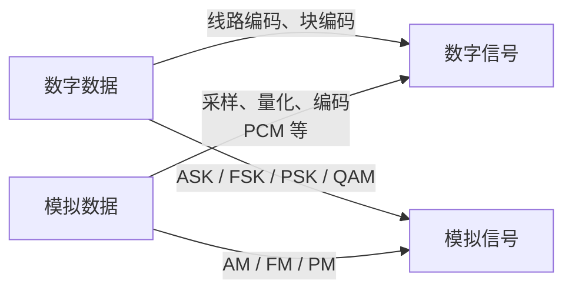

> 描述：基带编码把数字数据变成可在线路上传的数字信号，带通调制把数据加载到模拟载波。码元是信号波形的一个基本状态/时间单位，携带的比特数由可区分状态数决定；自同步与编码效率、抗极性翻转能力是常见取舍。

## 2.1 编码、调制与码元

| 概念 | 含义 |
| --- | --- |
| 编码 | 将数字数据（比特流）变换为适合在**基带**信道传输的数字信号波形 |
| 调制 | 用数字数据改变模拟载波的振幅、频率或相位，使其能在**带通**信道传输 |
| 码元 | 一个固定时长的信号单元；可取一个或多个离散状态 |

若一个码元可区分 $M$ 种状态，理想每码元可携带：

$$r=\log_2M\quad(\text{bit/码元})$$

若码元速率（波特率）为 $B$ Baud，则数据率为：

$$R=B\log_2M\quad(bit/s)$$

该式直接用于固定长度、每个码元等量承载信息且 $M=2^k$ 的常见映射。若 $M$ 不是 2 的整数次幂、各状态概率不等或跨多个码元联合编码，$\log_2M$ 只给出单码元可区分状态的理想信息上限，实际平均比特数要按具体码本/概率计算。“码元速率”和“比特率”只有在每码元恰携带 1 bit 时数值相等。

> **NOTE** · 教材补充：数据与信号的四种转换
> “编码/调制”不能只理解为“数字比特变波形”。按输入数据和输出信号的类型，可形成下面四类转换；它们共同回答“信息怎样变成适合信道传输的信号”。

| 输入数据 | 输出信号 | 典型处理 | 主要目的 |
| --- | --- | --- | --- |
| 数字数据 | 数字信号 | NRZ、曼彻斯特、4B/5B | 形成适合基带信道的线路波形，并兼顾同步、直流分量和带宽 |
| 数字数据 | 模拟信号 | ASK、FSK、PSK、QAM | 把离散码元加载到带通信道允许通过的载波上 |
| 模拟数据 | 数字信号 | PCM、差分编码等 | 便于数字传输、再生、复用和处理 |
| 模拟数据 | 模拟信号 | AM、FM、PM | 搬移频谱，适配无线电或其他带通信道 |

## 2.2 常用基带编码

> **NOTE** · 术语边界
> 不同教材对“单极性、极性、双极性”的译名并不完全统一。较严格的通信术语中，单极性只用零和一个极性，极性码用正、负两种电平，双极性码常特指 AMI 一类三电平码。原资料所说的“双极性 NRZ”在这里按“极性 NRZ”理解；做题仍以题图和题设定义为准。

### 2.2.1 单极性 NRZ 与极性 NRZ

+ **单极性 NRZ**：通常用正电平表示 1、零电平表示 0；实现简单，但含有明显直流分量，不利于变压器/电容耦合和长距离传输。
+ **极性 NRZ（NRZ-L）**：用正、负两个电平表示 0/1（具体对应以题图约定为准），一个码元周期内电平不回到零。

+ **优点**：一个码元有效承载一个 bit，效率高、所需带宽相对小。
+ **问题**：连续相同 bit 时没有跳变，接收端难从数据本身恢复码元边界，需要额外时钟信号/同步机制来确定采样时刻。

### 2.2.2 反向不归零编码 NRZI

NRZI 不用绝对电平直接表示 bit，而用码元边界处“跳变/不跳变”表示 bit。哪一个值对应跳变必须服从所用标准或题设；常见约定是“1 跳变、0 不跳变”。

+ 只依赖相对变化，线路正负极性整体翻转通常不影响解码。
+ 它并非天然完全自同步：若连续出现大量对应“不跳变”的 bit，仍可能长期没有边沿。因此工程上常与 4B/5B 等限制连续无跳变长度的块编码配合。

### 2.2.3 归零编码 RZ

每个码元的有效电平在周期内会回到零电平，天然提供码元分界/同步信息。

+ **优点**：自同步能力较好。
+ **缺点**：一个码元周期有相当部分用于回零，频谱更宽，带宽利用率较低。

### 2.2.4 曼彻斯特编码

每一个码元**中间必有一次跳变**，因此可由中间跳变恢复时钟，是自同步编码。中间跳变方向表示 bit：有的约定“低到高为 1、高到低为 0”，也有教材/题目取相反定义。

> 必须以题干/图例为准；未说明时不要擅自固定“正跳变=1”或“正跳变=0”。无论采用哪一约定，中点必跳变与自同步特性不变。

### 2.2.5 差分曼彻斯特编码

差分曼彻斯特同样保证每码元中间跳变用于同步，但 bit 值由**码元开始处**是否跳变表示。材料采用：

| 码元开始处 | 表示 |
| --- | --- |
| 无跳变 | 1 |
| 有跳变 | 0 |

+ 只依赖相邻码元间“是否变化”，不依赖绝对高/低电平或中间跳变方向。
+ 连续 1/0 时，相比普通曼彻斯特的波形变化可更少；在噪声下检测“有无跳变”常比判别跳变方向更稳健。
+ 若线路接反导致高、低电平整体翻转，差分曼彻斯特仍可正确解码；普通曼彻斯特的方向含义则可能反转。

材料中的 2021 年例题采用“码元开始处无跳变为 1、有跳变为 0”的约定：先忽略每个码元中点必有的同步跳变，再逐一检查码元边界，题图可译为 `10111001`。若题目改用相反约定，则必须随题设改变映射。

> **FIGURE** · 原 PDF 波形（第 4 页）
> 
>
> 图中虚线分隔码元，中点跳变用于同步，码元开始处的有无跳变才承载本题数据。该图采用“无跳变为 1、有跳变为 0”的约定，不应推广成所有标准唯一的位值约定。

### 2.2.6 AMI、伪三进制与扰码

> **NOTE** · 教材补充
> 这组编码主要用于说明“怎样同时削弱直流分量并维持同步”，不是把三个电平简单当成三进制数字。

+ **AMI（传号交替反转）**：0 用零电平表示；每个 1 交替使用正、负脉冲。正负脉冲平均后直流分量小，而且同极性的非零脉冲连续出现可作为传输违例的线索；但长串 0 仍没有跳变。
+ **伪三进制码**：与 AMI 相反，1 用零电平表示，0 交替使用正、负脉冲；仍存在另一种长串同码的同步问题。
+ **B8ZS、HDB3 等扰码**：在 AMI 基础上把长串 0 替换成含有正常脉冲 `B` 与双极性违例脉冲 `V` 的规定模式。接收端凭违例规则还原原始 0 串，不增加独立时钟线，也不会把用户数据真的改成另一串数据。

### 2.2.7 4B/5B 块编码

> **NOTE** · 教材补充
> 4B/5B 是**码组映射**，不是一种独立的高低电平波形。它通常先把数据重新编码，再交给 NRZI 等线路编码形成电信号或光信号。

1. 将连续数据每 4 bit 分成一组。
2. 从 32 个可能的 5 bit 码组中挑选具有足够跳变特性的码组，映射 16 种数据组合；其余码组可用于控制或保留为无效码。
3. 经过映射的码流再由 NRZI 等方式发送，从而限制过长的无跳变区间，便于接收端恢复时钟。

净荷编码效率为：

$$\eta=\frac{4}{5}=80\%$$

因此在不计其他开销时，承载速率为 $R$ 的原始数据至少需要 $1.25R$ 的线路码率。4B/5B 解决的是同步与码组控制问题，不能替代差错检测编码。

### 2.2.8 编码方式对比

| 编码 | 时钟恢复 | 带宽/效率 | 对极性反转 |
| --- | --- | --- | --- |
| 单极性/极性 NRZ | 连续同码时需额外同步 | 频谱效率较高 | NRZ-L 依赖绝对电平，易受影响 |
| NRZI | 长串“不跳变码”仍需辅助措施 | 频谱效率较高 | 依赖相对变化，抗整体极性翻转 |
| RZ | 有回零特征，较易同步 | 频谱较宽 | 取决于定义 |
| 曼彻斯特 | 每码元中点跳变，自同步 | 每 bit 至少一次中点变化，带宽需求较高 | 跳变方向含义可能翻转 |
| 差分曼彻斯特 | 每码元中点跳变，自同步 | 同样有较高跳变开销 | 依赖有无跳变，抗极性反转 |
| AMI | 连续 1 有跳变，长串 0 仍困难 | 直流分量小 | 正负脉冲必须交替 |
| 4B/5B + NRZI | 限制连续无跳变长度 | 净荷效率 80% | 由后续线路编码决定 |

## 2.3 基本带通调制

在电话线、无线电等带通信道上，常以正弦**载波**承载数字数据。三种基本调制方式：

| 名称 | 英文 | 改变的载波参数 |
| --- | --- | --- |
| 振幅键控 | ASK | 振幅 |
| 频移键控 | FSK | 频率 |
| 相移键控 | PSK | 相位 |

基本二元 ASK/FSK/PSK 通常只用两种可区分状态，故一个码元只能表示 1 bit。信道噪声、衰落与接收机判决能力会限制可可靠区分的状态数。

> **FIGURE** · 原 PDF 波形（第 4 页）
> 
>
> 原图用“调幅 AM、调频 FM、调相 PM”作简写；由于输入是离散的 `0/1` 码元、载波只在有限状态间切换，更精确的名称是二进制 ASK、FSK、PSK。图中重点是辨认究竟改变了振幅、频率还是相位。

## 2.4 混合调制与 QAM

为提高每码元携带的比特数，可同时调制载波的多个参数，形成多个离散星座点。在 408 教材的简化正弦载波参数模型中，频率是相位对时间的变化率，因而不把“频率 + 相位”当作两个彼此独立的混合调制维度；相位与振幅组合更常用。

> 这是该教材模型下的分类规则，不是说工程上绝对不存在同时涉及频率与相位轨迹的连续相位调制等方案。考试按题设模型判断即可。

**正交振幅调制**（QAM）将同相、正交两个分量组合，可产生不同振幅和相位的星座点。例如 16-QAM 有 $M=16$ 个码元状态：

$$\log_2 16=4\quad\text{bit/码元}$$

源资料的 16-QAM 示例画出 16 个星座点，共有 12 个相位方向，部分相位方向上有两个可选振幅。无论星座几何如何安排，计算每码元信息量时看的是可区分点总数 $M=16$，故仍为 4 bit/码元。

### 2.4.1 格雷码映射

传输受噪声扰动时，接收星座点可能误判到相邻点。为使这种最常见的“邻点错误”影响最小，常将每个 4 bit 组合按**格雷码**映射到星座点：任意相邻码元的比特标记仅有 1 bit 不同。

+ 若误判到相邻点，通常只造成 1 bit 错误而不是多 bit 同时错。
+ 格雷码降低相邻判错的比特误码代价，不能消除噪声、也不替代检错纠错编码。

> **FIGURE** · 原 PDF 16-QAM 星座图（第 7 页）
> 
>
> 这是 16 个星座点与 4 bit 标签的一种具体映射；红框是原资料的讲解标注，不是判决边界或星座定义的一部分。不同系统的旋转、缩放和标签排列可以不同，不能死记某一点必须对应哪组比特。计算信息量看点数 $M=16$，判断格雷映射则检查最近邻标签是否只差 1 bit。

## 2.5 模拟数据数字化：PCM

> **NOTE** · 教材补充
> 脉码调制（PCM）把连续时间、连续幅度的模拟数据变成数字码流，基本过程是**采样 → 量化 → 编码**。这三个步骤分别离散化时间、离散化幅度、再把量化等级写成二进制码。

### 2.5.1 采样

对最高频率为 $f_{max}$、已作带限处理的基带信号，理想无混叠重建要求采样频率满足：

$$f_s\ge 2f_{max}$$

$2f_{max}$ 称为奈奎斯特采样率。等号成立依赖理想带限与理想滤波器，实际系统通常留出过渡带并取更高的采样率。若采样不足，不同频率成分会混叠；事后通常无法从样值中唯一恢复原信号。

> 该式是常见的低通信号采样结论。带通信号还可在满足更严格频带条件时采用带通采样，不能机械地把“任何信号都必须按最高频率两倍以上采样”当成无条件定律。

### 2.5.2 量化与编码

+ **量化**：把每个样值归入有限个幅度等级，会引入量化误差。若用 $n$ bit 表示一个样值，最多有 $L=2^n$ 个量化等级。
+ **均匀量化**：所有量化间隔相等，结构简单；对幅度较小的信号，相对量化误差可能较大。
+ **非均匀量化/压扩**：小幅度区域分得更细、大幅度区域分得较粗，可改善语音等信号在弱幅度区的量化信噪比；电话系统常见 A 律或 $\mu$ 律压扩。
+ **编码**：为量化等级分配二进制码。忽略同步和成帧等额外开销时，PCM 码率为：

$$R_{PCM}=f_s\times n$$

例如传统电话语音常以 $8\,\text{kHz}$ 采样、每个样值 8 bit 编码，得到 $64\,\text{kbit/s}$ 的基本 PCM 话路。提高采样率或量化位数通常能提高保真度，但会线性增加码率、存储量与传输带宽需求。

## 2.6 模拟数据到模拟信号：AM、FM、PM

> **NOTE** · 教材补充
> 当原始数据本身是模拟量时，也可让它连续改变正弦载波的参数，以搬移频谱、适应天线辐射或频分复用等带通信道要求。

| 方式 | 被连续改变的载波参数 | 典型性质 |
| --- | --- | --- |
| 调幅 AM | 振幅 | 实现较简单，但幅度噪声会直接影响信息 |
| 调频 FM | 瞬时频率 | 对幅度噪声较不敏感，通常需要更宽频带 |
| 调相 PM | 瞬时相位 | 信息体现在相位变化中，与 FM 都属于角度调制 |

AM/FM/PM 与 ASK/FSK/PSK 的区别不在于“改的是哪一个载波参数”，而在于输入数据及可取状态：前者通常由连续模拟量连续控制载波，后者把离散数字码元映射为有限个可判决状态。

### 题型：#波形识别与码元计算

#### 第一部分：识别步骤

1. 先看一个 bit 周期内是否一直保持电平（NRZ）、是否回零（RZ）、是否中点必跳变（曼彻斯特/差分曼彻斯特）。
2. 若只看边界处有无变化，要先区分 NRZI 与差分曼彻斯特：后者每个码元中点仍必有同步跳变。
3. 中点跳变方向直接代表 bit 的是曼彻斯特；码元开始处有无跳变代表 bit 的是差分曼彻斯特。
4. 载波只改幅度/频率/相位分别为 ASK/FSK/PSK；同时改幅度与相位常为 QAM。
5. 遇到“模拟信号数字化”，依次写采样、量化、编码；遇到 AM/FM/PM，要先确认输入是连续模拟数据还是离散数字码元。

#### 第二部分：计算方法

1. 数星座点/码元状态数 $M$，计算每码元位数 $\log_2M$。
2. 用 $R=B\log_2M$ 在比特率、码元速率间换算；单位 Baud 是码元每秒，不是 bit/s 的同义词。
3. 判断编码效率时同时考虑每码元携带的数据信息与为同步付出的跳变/回零开销。
4. 4B/5B 的线路码率按原数据率乘 $5/4$；PCM 的净码率按采样率乘每样值位数计算。

## 相关知识

+ **科目导航**：[计算机网络导航](/notes/cs408-b78f75dd8c69/)
+ **阅读顺序**：[上一篇：传输方式](/notes/cs408-3560d9d2909b/) · [下一篇：信道的极限容量](/notes/cs408-04eb683de74c/)

## 2.7 本节复盘

+ 数字/模拟数据都可转换为数字/模拟信号；要先判断输入数据和信道需要的输出信号，再选择线路编码、数字调制、PCM 或模拟调制。
+ NRZ 频谱效率较高但连续同码缺乏自同步；RZ 用回零换同步；曼彻斯特中点必跳变自同步，方向映射须服从题设。
+ NRZI 与差分曼彻斯特都按相对变化判值、抗整体极性翻转，但只有差分曼彻斯特规定每个码元中点必跳变。
+ AMI 用交替正负脉冲削弱直流分量，扰码解决长串零问题；4B/5B 通过码组映射限制无跳变区间，净荷效率为 80%。
+ ASK、FSK、PSK 分别改幅度、频率、相位；QAM 组合幅度和相位，16-QAM 每码元 4 bit。
+ QAM 星座点常用格雷码，让相邻误判尽量只改变 1 bit。
+ PCM 依次经过采样、量化、编码；低通信号通常需满足 $f_s\ge2f_{max}$，忽略额外开销时码率为 $f_sn$。
+ AM、FM、PM 用连续模拟数据改变载波参数；不要与离散码元状态的 ASK、FSK、PSK 混为一谈。
