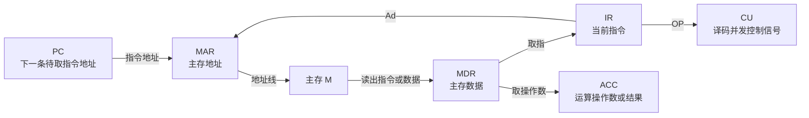

> 描述：本讲从硬件、软件与冯·诺依曼机出发，建立“程序如何被保存、取出、解释并执行”的全局视角。重点是各部件的职责、关键寄存器、层次结构和从源程序到可执行程序的全过程。

## 1.1 计算机系统与软硬件

##### **定义**：#计算机系统

+ **硬件**是可见、可触的物理设备总称，如 CPU、主存、硬盘、键盘与显示器。
+ **软件**是运行于硬件上的程序、数据和相关文档。计算机性能最终通常通过软件的执行效率和作用体现。
+ 同一逻辑功能既可由硬件完成，也可由软件完成时，称二者在该功能上具有**逻辑等价性**。例如乘法可由专用乘法器完成，也可由多次加法的软件例程实现；取舍常在速度、成本、灵活性之间。

## 1.2 冯·诺依曼机的基本结构

### 1.2.1 五大部件与存储程序

| 部件 | 主要职责 | 典型要点 |
| --- | --- | --- |
| 运算器 | 算术、逻辑与移位等运算 | 核心为 ALU，配合寄存器保存操作数和结果 |
| 控制器 | 取指、译码并发出控制信号 | PC、IR、CU 是核心 |
| 存储器 | 保存程序与数据 | 分主存和辅存 |
| 输入设备 | 将外界信息变为机器可接受形式 | 键盘、鼠标、传感器、网络接口等 |
| 输出设备 | 将处理结果变为用户或其他系统可接受形式 | 显示器、打印机、网络接口等 |

冯·诺依曼机的核心思想如下：

+ 计算机由上述五大部件构成；程序采用**存储程序**方式运行。
+ 指令和数据都以二进制表示，且以同等地位存放于存储器中。
+ 一条指令通常由**操作码**和**地址码**构成：操作码说明做什么，地址码说明操作数或转移目标在哪里。
+ CPU 并不是凭“存储位置”区分指令和数据，而是依据**指令周期所处阶段**解释同一串二进制位。因此“CPU 无法区分指令和数据”是错误说法。

##### **定义**：#存储程序

程序及其数据先以二进制形式装入主存；CPU 从程序首地址取第一条指令，随后按指令规定的顺序或转移关系连续执行，直到结束。启动之后通常不需要操作人员逐条干预。

### 1.2.2 存储器、MAR 与 MDR

| 层次 | CPU 是否可直接访问 | 作用 |
| --- | --- | --- |
| 主存储器（内存） | 可以 | 当前运行程序与数据的直接工作区，按地址读写 |
| 辅助存储器（外存） | 不可以 | 长期保存更多信息，使用前须调入主存 |

+ 物理结构关系：**存储体** `->` **存储单元** `->` **存储元件**；一个元件保存 1 位 `0` 或 `1`。
+ 一个存储单元保存的一串二进制位称为**存储字**；每个字的位数称**存储字长**。
+ **MAR（存储器地址寄存器）**保存欲访问的单元地址，其位数决定可寻址单元数。若 MAR 为 10 位，最多寻址 $2^{10}=1024=1K$ 个单元。
+ **MDR（存储器数据寄存器）**暂存从主存读出的数据或准备写入主存的数据，其位数通常等于存储字长，常为字节的整数倍。
+ 在基本单地址顺序执行模型中，PC 与 MAR 的位数常相等；这是因为二者都需要容纳主存地址，但具体机器仍以题设为准。

### 1.2.3 运算器与控制器

| 组成 | 功能 |
| --- | --- |
| ALU | 执行加、减、乘、除、与、或、非、异或、比较、移位等 |
| 通用/专用寄存器 | 暂存操作数、中间结果或地址，如 ACC、MQ、X、IX、基址寄存器 |
| PSW（程序状态字寄存器） | 保存溢出、进位/借位、负数、零等标志及处理机状态 |
| PC（程序计数器） | 保存**当前欲执行指令的地址**，顺序执行时自动增量形成下一条指令地址 |
| IR（指令寄存器） | 保存**当前正在执行的指令**，内容由 MDR 送入 |
| CU（控制单元） | 对 $OP(IR)$ 译码，产生完成各微操作的控制命令序列 |

+ PC 中保存的是**地址而不是指令本身**；指令被取到后在 IR 中接受译码。
+ PC 的“自动加 1”本质是前进**一条指令长度**，并不必然是地址数值加 1。
+ 指令地址码 $Ad(IR)$ 可送入 MAR 取操作数，操作码 $OP(IR)$ 则送入 CU 分析。
+ CPU 与主存通过地址、数据、控制三类信号线连接：MAR 的地址送地址线；读/写控制决定数据方向；MDR 经数据线与主存交换数据。

## 1.3 软件与计算机系统层次

### 1.3.1 翻译程序

| 程序 | 输入与输出 | 特点 |
| --- | --- | --- |
| 汇编程序（汇编器） | 汇编语言 `->` 机器语言 | 汇编语句与低级机器指令一一对应或接近对应 |
| 编译程序（编译器） | 高级语言 `->` 汇编/机器语言 | 先整体翻译再执行 |
| 解释程序（解释器） | 源代码语句 `->` 机器指令并立即执行 | 翻译一条、执行一条，通常不独立生成完整机器目标程序 |

### 1.3.2 五层机器结构与 ISA

| 层次 | 名称 | 实现/支持者 |
| --- | --- | --- |
| 第 1 级 | 微程序机器层 | 实在硬件直接执行微指令 |
| 第 2 级 | 传统机器语言层 | 微程序解释机器指令，亦是实际机器层 |
| 第 3 级 | 操作系统层 | OS 用机器指令和广义指令扩展功能，属软硬混合层 |
| 第 4 级 | 汇编语言层 | 汇编程序支持 |
| 第 5 级 | 高级语言层 | 各种高级语言编译程序支持，最面向用户 |

这五层是教材用于说明“逐层抽象、下层支撑上层”的概念模型，并不表示每台真实计算机都以同样方式实现。例如，硬布线控制器并不存在由微指令构成的实际微程序；此时第 1 级应理解为控制信号与数据通路层面的硬件实现，而不是强行套用微程序。

##### **定义**：#ISA

**指令集体系结构（ISA）**规定软件可见的机器接口，核心包括指令及其编码、操作数类型、寄存器组织、寻址方式、存储器地址空间，以及异常/中断等程序可见行为。它是软硬件的重要接口；同一 ISA 可由流水线结构、Cache 组织和控制器实现均不同的多种微体系结构实现。

## 1.4 程序的执行与生成

### 1.4.1 指令周期与取数示例

一条指令的典型过程为：取指 `->` 译码 `->` 计算下一条地址 `->` 取操作数并执行 `->` 写回结果。以取数指令为例：

$$
\begin{aligned}
&\text{取指：}\quad PC \to MAR \to M \to MDR \to IR\\
&\text{分析：}\quad OP(IR) \to CU\\
&\text{执行取数：}\quad Ad(IR) \to MAR \to M \to MDR \to ACC
\end{aligned}
$$

其中 $M$ 代表主存，ACC 是累加器。每一个箭头表示一次信息传送；是否需要取操作数、是否写回主存由指令类型决定。

图中 `IR -> MAR` 与 `MDR -> ACC` 是取操作数阶段；并非每条指令都必须经过这两步，例如寄存器寻址指令可直接从寄存器取得操作数。

### 1.4.2 从 C 源程序到可执行文件

| 阶段 | 主要工作 | 常见产物 |
| --- | --- | --- |
| 预处理 | 处理 `#include`、宏等以 `#` 开头的命令 | 展开后的源程序 |
| 编译 | 将高级语言翻译为汇编语言 | `hello.s` |
| 汇编 | 将汇编语言翻译、打包为机器指令 | 可重定位目标文件 `hello.o` |
| 链接 | 合并多个目标文件与标准库，解析外部符号 | 可执行目标文件 |

+ `hello.o` 是二进制可重定位目标文件，用文本编辑器查看会出现乱码，并不是源程序损坏。
+ **机器语言程序**才可被硬件直接执行；高级语言程序和汇编代码都需经过相应翻译。

## 相关知识

+ **科目导航**：[计算机组成原理导航](/notes/cs408-2406c8c61473/)
+ **阅读顺序**：[下一篇：计算机性能指标](/notes/cs408-c4914b00ec31/)
+ **关联专题**：[操作系统概述](/notes/cs408-20d7b070155d/)

## 1.5 本节复盘

+ 冯·诺依曼机的关键是五大部件、二进制、存储程序、指令由操作码和地址码构成。
+ 主存可被 CPU 直接访问，外存中的信息必须先调入主存；MAR 决定地址范围，MDR 对应数据宽度。
+ PC 存当前待执行指令的地址，IR 存当前指令，CU 解析操作码并发控制信号。
+ 指令与数据同存并不矛盾：CPU 依靠取指、译码、执行等阶段区分其角色。
+ 源程序经过预处理、编译、汇编、链接得到可执行文件；ISA 是软件与硬件之间的约定。
